

  <a href="README.md">🇷🇺 Русский</a> · <b>🇬🇧 English</b>

  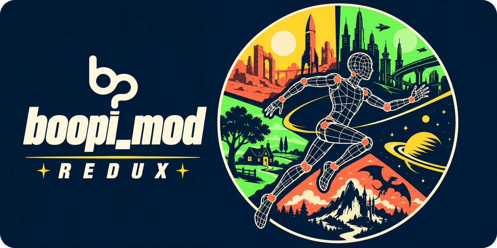

<h1 align="center">boopi_mod REDUX</h1>

<h3 align="center">Modding has never been this easy</h3>

  <b>A mod manager for Fallout 4 in which you create — your own animations, scenarios, scenes and dialogues. 
  By hand or with AI help.</b>

  
  
  
  
  
  
  
  

  
  &nbsp;
  

  <a href="#install-and-first-run">Install</a> ·
  <a href="#for-modders">For modders</a> ·
  <a href="#lullaby-the-new-story">The story</a> ·
  <a href="#faq">FAQ</a> ·
  <a href="#whats-coming">What's coming</a> ·
  <a href="instructions/en/README.md">Guides</a> ·
  <a href="https://github.com/boopi-coder/boopi_mod/issues/new">Report a problem</a> ·
  <a href="https://boosty.to/boopi_coder">Boosty</a>

> [!WARNING]
> **This is a beta (0.2.0).** Expect rough edges and bugs — please report them so I can fix them quickly:
> [open an issue](https://github.com/boopi-coder/boopi_mod/issues/new/choose) (the template tells you what to attach) — I read everything.
> **Feedback on problems and ideas is very welcome — we'll sort it out.**

---

**boopi_mod** is a desktop app plus a set of game plugins for **Fallout 4 (1.10.163, Old-Gen)**. It makes a Fallout where
people remember you: flirt, go on dates, become a couple, take someone to the night club — and just say what you want in
your own words: AI dialogue answers in character. And when you want something of your own, everything for making it is at
hand: a 3D animation editor, a studio for dialogues and scenes, voice, and your own mod as a single file. It is all held
together by a **mod manager** that installs and runs your mods, prepares the game and puts the load order straight.

## What you get

- **💋 Relationships that actually go somewhere.** Flirt, ask someone out, become a couple, spend the night, deal with
  jealousy, get married — and people remember what you said and did. [More](#life-and-living-people)
- **🗣 Win people over in your own words.** Switch on AI dialogue and just type or say whatever you want. The person answers
  in character and makes up their own mind. [More](#ai-help-and-ai-dialogue)
- **🌃 Nightlife.** The Black Acorn night club with a singer you can win over, a VIP room and rooms upstairs, Boopi Corp. and
  its Gen 4 synths, and the Red Rocket turned into a bar. The waitresses already walk their rounds, guests drink coffee and
  smoke, card players sit at tables; pair scenes and dancing come alive with our animations (soon, as separate mods).
  [More](#boopi-corp-and-the-black-acorn)
- **🎬 Romantic and intimate scenes on our own engine.** G.A.M. plays scenes for two or more — and you can make your own:
  describe the scene in a sentence and the AI animator builds it. [More](#gam-create-and-import-animations)
- **🧱 F.O.R.G.E.** A workshop for 3D objects and textures: look at the game's objects in 3D, recolour them (for everyone,
  for one item or for one person), build weapons from parts and put **your own 3D models** into the game as workshop
  objects. [More](#forge-3d-objects-and-textures)
- **🛠 Make your own and share it.** Dialogues, quests and scenes in the Studio, packed into one file that anyone installs
  in one click. [More](#script-studio-dialogues-scenes-and-your-own-mod)

## What is inside

<table>
  <tr>
    <td width="33%" align="center" valign="top">
       
      <b><a href="#mod-manager">Mod manager</a></b> 
      Base pack in one click, install with rollback, Nexus inside the app
    </td>
    <td width="33%" align="center" valign="top">
      <a href="#mod-manager">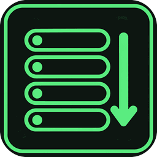</a> 
      <b><a href="#mod-manager">Smart load order</a></b> 
      "Sort" shows the plan, "Sort with AI" explains it too
    </td>
    <td width="33%" align="center" valign="top">
       
      <b><a href="#gam-create-and-import-animations">G.A.M.: your own animations</a></b> 
      3D editor with IK handles, an AI animator and AI polish, sounds on the timeline, role height, scenes play in the game
    </td>
  </tr>
  <tr>
    <td width="33%" align="center" valign="top">
       
      <b><a href="#gam-create-and-import-animations">Animation import</a></b> 
      Fallout 4 HKX animations and mod idles, Skyrim SE and OAR — into your editor
    </td>
    <td width="33%" align="center" valign="top">
       
      <b><a href="#script-studio-dialogues-scenes-and-your-own-mod">Script Studio</a></b> 
      Dialogues, scenes, branches off the game's wheels, one-click voicing, your own <code>.ogmod</code>
    </td>
    <td width="33%" align="center" valign="top">
       
      <b><a href="#ai-help-and-ai-dialogue">AI help and AI dialogue</a></b> 
      An assistant in every tool and free conversation in the game
    </td>
  </tr>
  <tr>
    <td width="33%" align="center" valign="top">
       
      <b><a href="#life-and-living-people">"Life" and living people</a></b> 
      Relationships, reputation, law, dates, 27 characters with memory
    </td>
    <td width="33%" align="center" valign="top">
       
      <b><a href="#lullaby-the-new-story">"Lullaby"</a></b> 
      A detective story: 18 missions, 13 side quests, 9 endings
    </td>
    <td width="33%" align="center" valign="top">
       
      <b><a href="#voice-speech-synthesis-and-recognition">Voice</a></b> 
      Text-to-speech, lip sync with facial expression, voice cloning, speech recognition, push-to-talk
    </td>
  </tr>
  <tr>
    <td width="33%" align="center" valign="top">
       
      <b><a href="#graphics-for-your-pc">Graphics presets</a></b> 
      12 presets and a recommendation for your PC
    </td>
    <td width="33%" align="center" valign="top">
      <a href="#oldgen-os-on-the-pip-boy">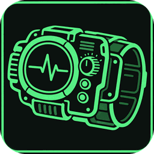</a> 
      <b><a href="#oldgen-os-on-the-pip-boy">OldGen OS</a></b> 
      An app on the Pip-Boy: people, reputation, dossier, 71 achievements (15 hidden)
    </td>
    <td width="33%" align="center" valign="top">
       
      <b><a href="#safety-is-built-in">Safety</a></b> 
      Content rules live in the core, not in a setting
    </td>
  </tr>
  <tr>
    <td width="33%" align="center" valign="top">
       
      <b><a href="#forge-3d-objects-and-textures">F.O.R.G.E.</a></b> 
      The game's 3D objects and their textures: catalog, weapons from parts, recolouring for an item or a person, your own models into the game
    </td>
    <td width="33%"></td>
    <td width="33%"></td>
  </tr>
</table>

## What no other mod had

| | Vanilla | Other tools | **boopi_mod** |
|---|---|---|---|
| Installing mods and load order | by hand | managers (MO2, Vortex): you arrange the order | base pack in one click, journal and rollback, smart sorting and **AI sort** |
| Your own animation | no | external 3D packages, converters, hand-built files | a **3D editor inside** with IK handles and an AI animator |
| Importing ready-made animations (Fallout 4 HKX animations and mod idles, Skyrim) | no | by hand, through converters | "drop it, it plays", retargeted onto the Fallout 4 skeleton |
| The game's textures and 3D models | Creation Kit, external editors | format converters, manual paths | **F.O.R.G.E.** inside: a catalog, a 3D view, recolouring converted to the game's format, with rollback, your own model into the game in one click |
| Your own dialogues and scenes | Creation Kit | CK, Papyrus scripts | **Script Studio**, no programming, branches right on the game's wheel |
| AI help while creating | no | no | an AI assistant drafts a dialogue branch and builds a scene; the "Check in AI mode" chat |
| Sharing your mod | an archive and instructions | an archive and instructions | **a single `.ogmod` file**: installs in one click and is removed as one |
| Free conversation with NPCs | a wheel of lines | separate AI mods: talk only | in the game, with **real outcomes** (an item, a quest, a scene) validated by the core; works in the game's own quest dialogues too (**T**) |
| Install rollback | no | partial | a journal: removing restores the files byte for byte |
| Story | the original | — | a new detective story, "Lullaby", with the vanilla game woven in |

> [!NOTE]
> The comparison is general: other tools have strengths of their own, and boopi_mod has its [0.1.0 limitations](#honest-limitations).

## What is new

**0.2.0** — F.O.R.G.E.: a clean catalog, weapons from parts, recolouring for one item or one person, palette colours, clothes on the skeleton, a generator of normal and gloss maps, "Re-read the changed PNG", a UV template and OBJ/GLB export, **your own 3D models into the game as workshop objects**; G.A.M.: a full audit (no white screen, robust AI runs, the AI animator first, ready poses, numbers and snapping, a timeline with groups and zoom, import "pick first", previews as GIF/WebM/PNG, a fast library) and **role height in the game** (G.A.M. 0.6.1); lip sync with smooth sounds and facial expression (BoopiUI 1.3.0), Higgs TTS 3 and an automatic voice sample; Script Studio: every fix of the audit; living places: pair scenes, tables in the Red Rocket, places livelier even without packs; **Skyrim SE (beta)**: our own archive reader, the skeleton from the game, GAM for Skyrim; updates checked on every start. [0.2.0 notes](docs/release/v0.2.0.md).

**0.1.9** — F.O.R.G.E.: the game's 3D objects and textures with recolouring and rollback; sounds on the G.A.M. timeline (G.A.M. 0.5.0); a curve editor, ghosts, trails and before/after comparison; AI polish for animations and a motion check; living places: the system that makes the people of the club, the Red Rocket and the HQ move with G.A.M. scenes is in place and comes alive with our animations (out separately, soon); lip sync and "Voice all" in the Studio; a game picker and colour themes (only Fallout 4 is playable for now); a language choice on the first start. [0.1.9 notes](docs/release/v0.1.9.md).

**0.1.8** — AI inside the game's own conversations (T: type your line, the AI picks the answer on the wheel) and free talk with anyone; AI dialogue outcomes reach the game; Studio trees on the game's and DLC characters; lines from the game itself by reference; LM Studio and any OpenAI-compatible server; "Lullaby" playable to all 9 endings; a sharper AI animator and a stricter anatomy check. [0.1.8 notes](docs/release/v0.1.8.md).

**0.1.7** — G.A.M.: undo and redo, key editing, mirror, full screen, face and camera, "▶ In game", scene events in the game, a library with search and previews, a sharper AI animator; Studio: triggers for your own stories, "+ Story", the dialogue player; Studio mods install from the boopi.site catalog with requirements. [0.1.7 notes](docs/release/v0.1.7.md).

**0.1.6** — animation import from Fallout 4 mods, Skyrim SE and OAR gaits, Life scenes through G.A.M., updated guides. [0.1.6 notes](docs/release/v0.1.6.md).

**0.1.5** — community mods from [boopi.site](https://boopi.site) right in the app, the boopi.site account and publishing your own mods from the Studio to moderation. [0.1.5 notes](docs/release/v0.1.5.md).

**0.1.4** — our mods download in the app from [boopi.site](https://boopi.site) and update separately from it; fixed the face editor after waking up. [0.1.4 notes](docs/release/v0.1.4.md).

**0.1.3** — fixes and an updated license: the app is freeware, all rights reserved. [0.1.3 notes](docs/release/v0.1.3.md).

**0.1.2** — a maintenance release: descriptions and screenshots refreshed. [0.1.2 notes](docs/release/v0.1.2.md).

**0.1.1** — in-app updates: at startup the app finds a new version by itself, and the "Download and install" button
installs it in one click (with a checksum check and a rollback if anything goes wrong). [0.1.1 notes](docs/release/v0.1.1.md).

**0.1.0** — the first public beta: a mod manager with a base pack, G.A.M. with a 3D editor and animation import, Script Studio with
`.ogmod` export, AI dialogue in the game, "Life", voice, 12 graphics presets and the story "Lullaby". The limitations are
[below](#honest-limitations) and in the [release notes](docs/release/v0.1.0.md#known-limitations).

---

## Mod manager

<table>
  <tr>
    <td width="50%">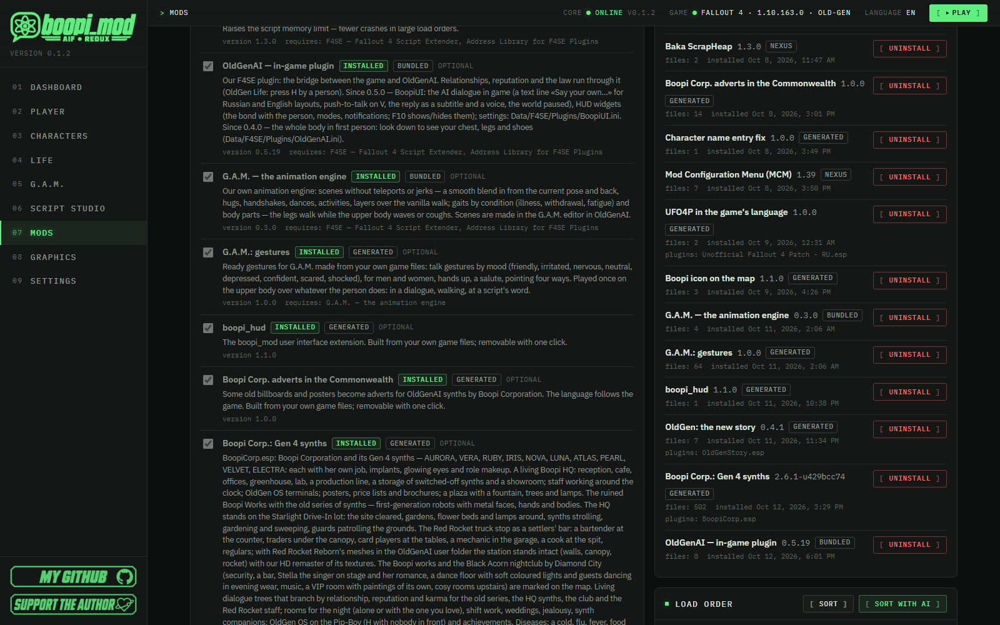</td>
    <td width="50%">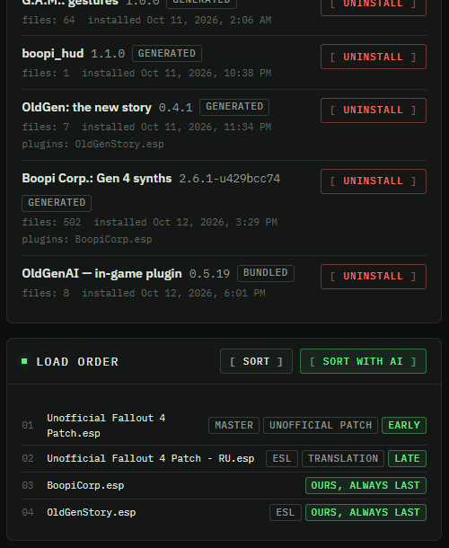</td>
  </tr>
</table>

- **The base pack in one click:** F4SE, Address Library, Buffout 4 NG, the Unofficial Patch (UFO4P) in your game's
  language, High FPS Physics Fix, MCM, Baka ScrapHeap. Ordered by dependencies, SHA-256 verified.
- **Our own parts** install with the same pack and are built **on your machine from your own game files**: the in-game
  plugin, **"G.A.M. — the animation engine"**, **boopi_hud** (an interface extension), "G.A.M.: gestures", "OldGen: the new story",
  "Boopi Corp.: Gen 4 synths".
- **Install with a journal and full rollback.** Mods are installed with hard links; removing restores the original files
  byte for byte. zip / 7z / rar archives by drag and drop; a Nexus Mods window inside the app (no API key needed).
- **Smart load order.** "Sort" first **shows the plan** without changing anything, and only then applies it;
  "Sort with AI" does the same with an explanation for every plugin.

Details: [Install and first run](#install-and-first-run).

## G.A.M.: create and import animations

**G.A.M.** is our own animation engine and editor: it plays scenes in the game with its own plugin, `GAM.dll`.

- **3D editor:** timeline, bones, the Rotate / Move / Character / Heading tools, **IK handles** on hands, feet and head,
  lighting, several actors, creatures, furniture and props. What you see in the editor is what plays in the game.
- **AI animator** (in 0.2.0 it comes first in the inspector, and on an empty scene it tells you where to start): describe a
  scene in a sentence ("make him wave in greeting", "they embrace and sway") and it builds it step by step; you see every
  step and polish the result by hand. It keeps elbows out of bodies, wrists natural and palms on the body they touch. One
  bad item in the model's answer no longer breaks the whole run.
- **Ready poses without an AI key:** standing, sitting on a chair, kneeling, crouching, sitting on the floor, lying — feet on
  the floor.
- **Anatomy check:** arms going through bodies (crossed arms are not an error), twisted wrists, hands that miss, props out
  of the hand, bodies inside furniture, sliding feet — before you ever load the game. A pair can be any combination of
  sexes. The messages are in the interface language.
- **AI polish in one click:** smooth easing, anticipation and overshoot, arcs instead of straight lines, weight shifts,
  breathing and sway, a loop without a seam and fewer keys. Touches stay where they are (feet on the floor, a palm on the
  body); the result is one undo step.
- **Motion check:** jerks, balance, shaking contacts, "woodenness" — a 0–100 score before and after. A visual judge looks
  at a storyboard of the finished scene if a model that can see images is connected. The AI animator runs the loop
  "build → check → polish → fix" itself.
- **Editing tools:** undo/redo, multi-select keys, copy a pose onto another actor, mirror, stretch or squeeze time (the
  sounds move along), fix the loop seam, a key optimiser, fullscreen.
- **Numbers and snapping:** a key card with time, transition, weight and value in numbers; a role's place and heading in
  numbers, "Face towards", "Stand at a distance"; "Angle step" and "Grid" for the rings and for dragging.
- **Timeline:** tracks grouped by role and body part and foldable, a bone search, zoom with `Ctrl`+wheel, "Fit"; the editor
  fills the window height at both 1080p and 720p.
- **Hand-polishing tools:** a curve editor (Bezier handles, ease), "Ghosts" of neighbouring frames, "Trails" of hands, feet
  and head, "Compare" before/after (hold **B**), speed 0.25×–2× and frame steps.
- **Role height — in the editor and in the game:** "Role height" 0.5–1.5; in the game (G.A.M. 0.6.1) a pair is fitted to
  the actors' real heights — places move apart, and the hands are led by IK to the spot on the partner's body they touched;
  a scene can also give an actor the role's height for its duration. Each finger curls and the grip follows the thickness
  of the object.
- **Face and camera tracks** that play in the game.
- **Sounds on the timeline:** drop your own sounds (wav, ogg, mp3, flac, m4a) onto a role's or the scene's lane — they play
  with the scene, both in the preview and in the game, from the actor's position. Trim, volume, waveform; 22 sounds of our
  own (claps, steps, a door, glass…) are included. Sounds travel inside the `.ogmod`. Needs G.A.M. 0.5.0.
- **▶ In game:** plays the scene in your running game on the hero or the NPC in front of you — no install, no restart.
- **Previews as GIF, WebM and PNG** right from the editor.
- **Scene events:** a sound, a line, an expression, an outfit change, a quest stage, your own script events.
- **Library:** search, folders and packs, favourites, previews, version history; fast — a list of 3000 scenes opens in
  0.15 s.
- **Import** animations you own: Fallout 4 mod animations (HKX, idles), **OAR** gait sets and **Skyrim SE** animations are
  retargeted onto the Fallout 4 skeleton and become tagged scenes you can edit; clips of creatures and robots land on
  their own skeletons. The source is only scanned first — you tick what to convert, and the job runs in the background and
  can be stopped. Rights to imported animations stay with their authors.
- **Other games:** "Other games" in the G.A.M. panel saves a scene for Skyrim SE (or for the shared skeleton), takes a
  scene of another game back and installs a scene into [Skyrim SE](#skyrim-se-beta).
- **Robustness:** a damaged scene is mended on opening, and a failing panel shows a "Try again" card instead of a white
  screen.
- **Scenes work everywhere:** in dialogues and scripts (gestures, scenes, camera) and in "Life".

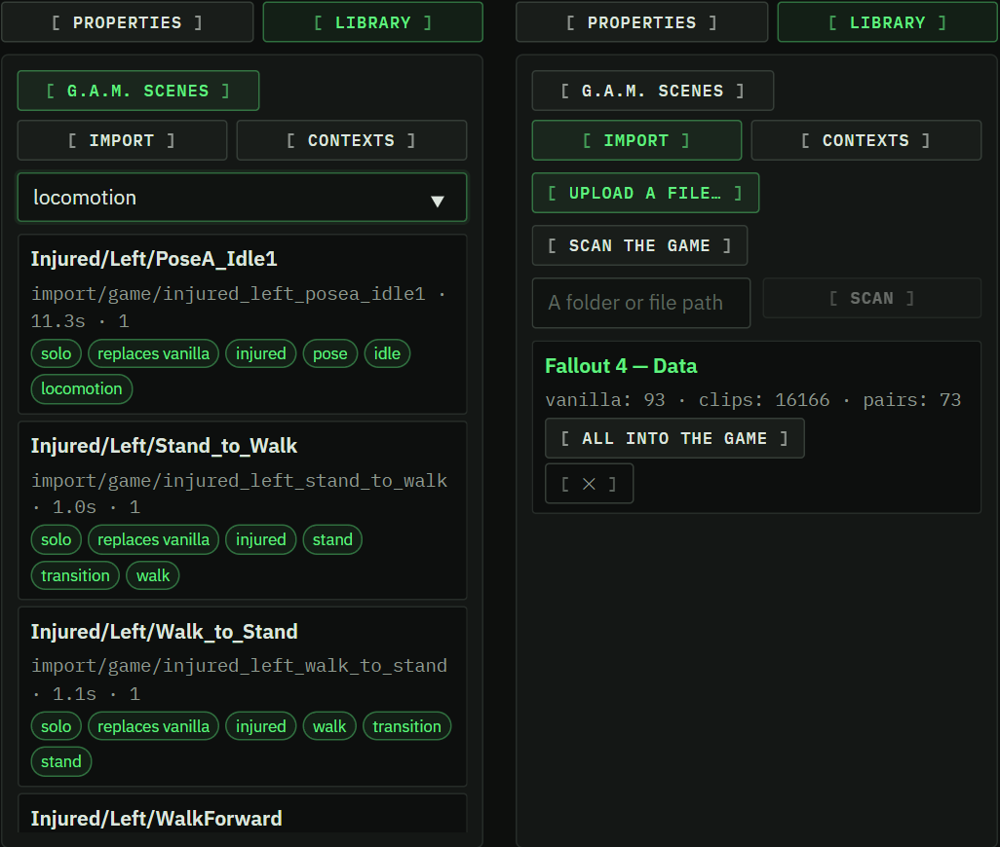

The scene library (here: the game's own animations imported from «Fallout 4 — Data», filtered by tag) and one-click import

Guides: [import and the editor](instructions/en/ANIMATION_IMPORT.md) · [animations in dialogues and scripts](instructions/en/ANIMATION_GUIDE.md).

## F.O.R.G.E.: 3D objects and textures

**F.O.R.G.E.** is the module for the game's 3D objects and textures (a menu entry right after G.A.M.): look at any object in
3D, recolour it for everyone, for one item or for one person, build weapons from parts and put your own model into the
game — without leaving the app.

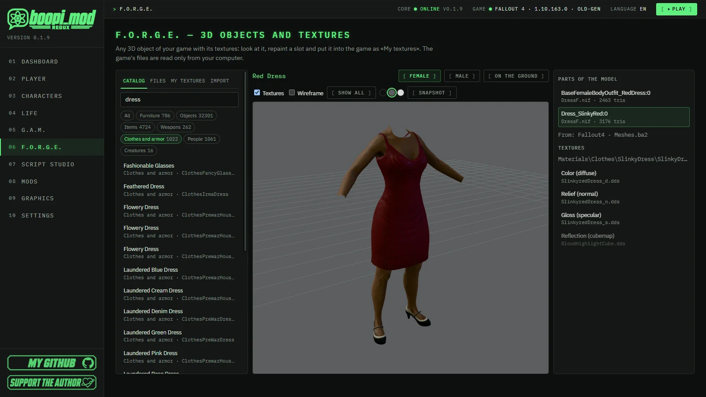

- **The game's catalog:** furniture, items, weapons, clothing and armour, people and creatures — named in your language.
  Technical records are hidden, there is a filter by plugin and sorting, search ignores case, "ё" and hyphens; the "Files"
  tab lists every model. Keyboard control, "Rescan" after the load order changes. In 3D — the real textures (colour,
  normal, gloss, glow), click to pick a part, an eye on every part, a wireframe.
- **Weapons from parts:** the "Build" panel — any variant of a weapon from the game and any part in each slot from your
  load order; parts sit by their attach points, and each one can be recoloured. "First person" — for weapons and clothes
  whose first-person model the game keeps.
- **Palette colours and clothes on the skeleton:** hair and armour show in their real colour; clothes are put on the G.A.M.
  skeleton — in the "As made" pose, "Standing" or in a frame of any of your scenes.
- **Recolouring:** "Save as PNG" → edit in any editor → "New picture…" (or the app re-reads the changed PNG by itself). It
  converts the picture to the game's format (the original's format and mips are kept, a normal map stays a normal map, the
  size never changes silently); you see the result at once, and "Show original" compares. There are no limits on your own
  textures.
- **Five scopes:** the texture file (everywhere) · this material only (the default) · this outfit only · this person only ·
  this person's skin only. The records for an outfit or a person go into a small plugin, `BoopiForge.esp`, which is
  installed and removed together with the mod.
- **Maps from the main texture:** a generator makes relief (a normal map), reflections (specular/gloss, with presets for
  cloth, leather, metal, wood…), cavities and glow — with a preview on the model; the result is an ordinary draft.
- **"My textures"** go in as a mod through the journal: remove an entry or the whole mod and the files come back byte for
  byte. They stay fast on thousands of entries: thumbnails, search, groups. "Apply all drafts" installs everything in one
  go. Install them with the game closed.
- **Texture packs `.ogmod`:** share your recolours; a pack carries only your pictures. They install by drag and drop or from
  boopi.site.
- **Import a whole texture mod:** drop a folder or a .zip laid out like `Textures\…` onto the page — before anything goes
  in you see which textures replace the game's and which the game doesn't have; "Into the game" installs it all in one
  click through the journal, and it comes out the same way.
- **Your own model into the game ("My objects"):** OBJ, glTF or GLB becomes a new static object — the app writes the NIF,
  the materials, the textures and the collision itself. Units, scale, axis and rotation, a "what the game will see" preview;
  the object appears in the workshop menu ("Decorations"/"Furniture") through a free recipe and spawns from the console with
  `player.placeatme`. It comes out through the journal without a trace.
- **Out to other tools:** a UV template for painting a texture, an export of what you see to OBJ or GLB, a snapshot of the
  3D view to PNG.
- **Handy bits:** a dark / grey / light background, drag and drop of models and pictures onto the window, search by name,
  editor id, form id or model path.

<table>
  <tr>
    <td width="50%">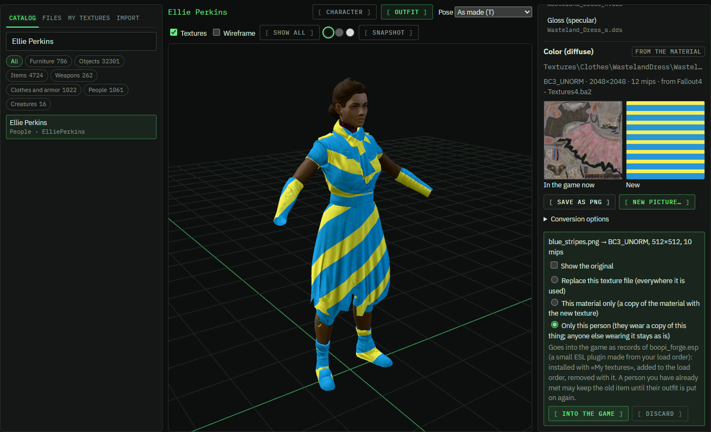</td>
    <td width="50%">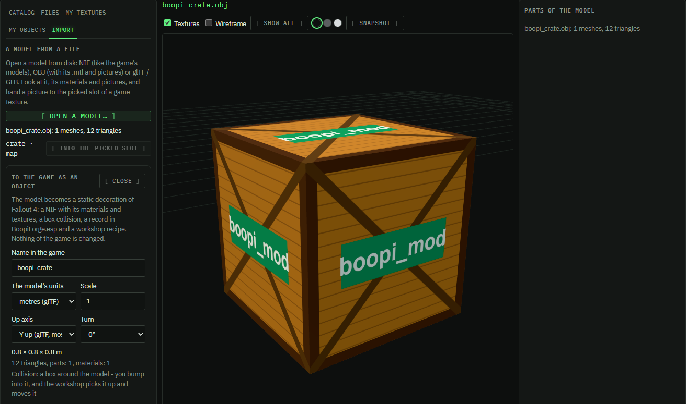</td>
  </tr>
  <tr>
    <td width="50%">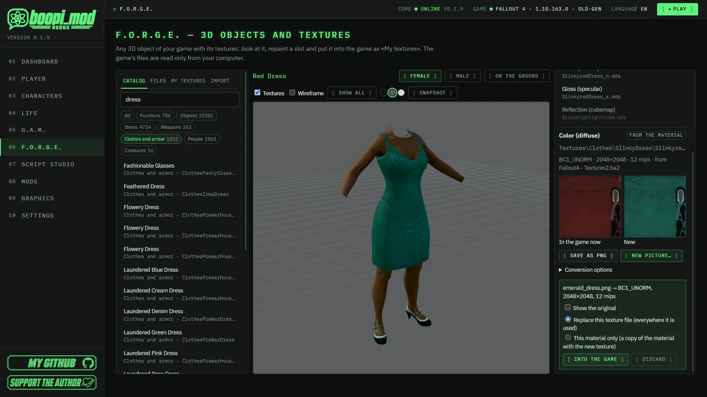</td>
    <td width="50%">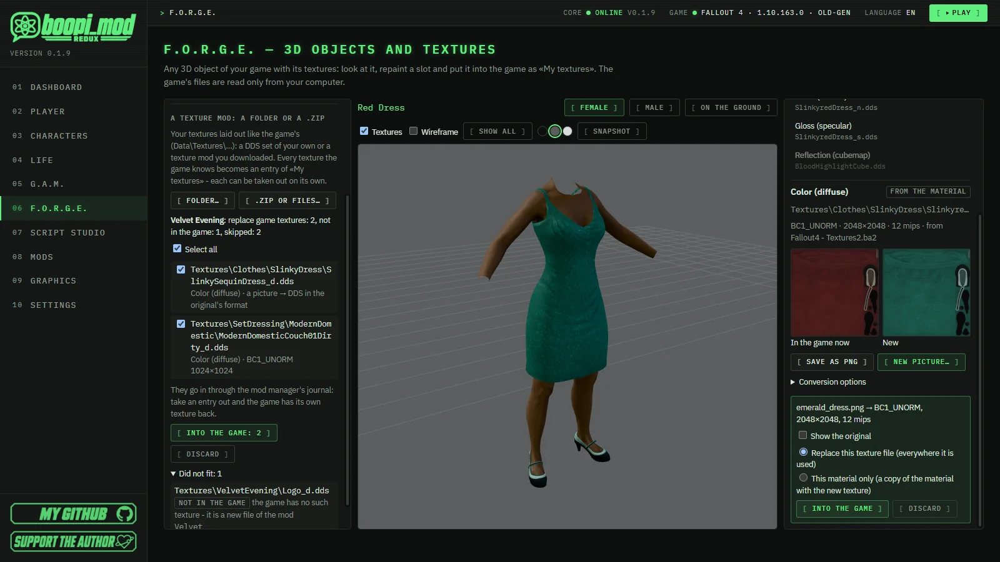</td>
  </tr>
</table>

Guide: [instructions/en/FORGE.md](instructions/en/FORGE.md).

## Skyrim SE: beta

In 0.2.0 Skyrim Special Edition takes its first step from the "foundation" towards playing (a beta). You can choose it in
"Settings → Games & theme"; the app finds the installed game by itself.

- **Our own reader of Skyrim archives (BSA)** — SE and LE: F.O.R.G.E. and G.A.M. find files in the game's archives.
- **The skeleton from the game itself:** your Skyrim's `skeleton.nif` is read by our own reader, and G.A.M. scenes are
  transferred onto exactly that.
- **GAM for Skyrim** — an SKSE64 plugin (SE 1.5.97 and AE 1.6.x through Address Library) that plays G.A.M. scenes in Skyrim:
  the console command `gam` (`gam list`, `gam play <scene>`, `gam stop`) and Papyrus. It installs from a button in
  "Settings → Games & theme" or "Install into Skyrim" in G.A.M. → "Other games".
- **F.O.R.G.E. for Skyrim:** viewing of models and textures only for now.
- **Honestly:** this is a beta. The plugin is built and checked without running the game — your reports are needed; scene
  events, timeline sounds, props and the camera exist only in the Fallout 4 version for now. You download SKSE64 and
  Address Library yourself.

## Script Studio: dialogues, scenes and your own mod

<table>
  <tr>
    <td width="50%"></td>
    <td width="50%"></td>
  </tr>
</table>

- **Dialogue trees** in forms or YAML: greetings, answers, conditions (SPECIAL, relationship, flags, items, time),
  outcomes, gestures and G.A.M. scenes right inside a line. Conditions and consequences are proper editors (flags from the
  file, stages, items and quests by picker), and YAML comments are kept when you edit.
- **Branch map and checker** that jumps straight to the mistake: triggers are matched against places, items, quests and
  people the way the build does it; a "greeting that will never be heard" is found too.
- **Dialogue player:** click through your wheel in the app with a test state — no build, no game.
- **Triggers:** when the hero enters a place, an hour comes, a timer ends, a quest stage is set, someone is killed, an item
  is picked up or something is used — show a message, start a talk (it can open exactly the tree you chose), play a scene,
  give a reward, set a flag, show or hide, lock, move, change a faction.
- **Copy, paste, duplicate** nodes and groups (across files too), **Ctrl+F** over texts and flags, renaming that carries
  every reference, versions that show what differs.
- **Your own dialogues for the game's and DLC characters** (Daisy, Vadim, settlers…) — they open first in that person's
  everyday talk.
- **Branches off the game's wheels:** take a real Fallout 4 conversation and add your own line to its wheel.
- **Lines from the game itself:** point a reply at a vanilla line and the character says it in their own voice with lip sync.
- **Voice** from your recordings or a synthetic voice, with lip sync and facial expression (a "Face" picker per line);
  Papyrus stubs for those who need a script.
- **"🎙 Voice all":** every line of a file is voiced in one click — a voice and a voice sample for each speaker, a cost
  estimate for paid providers, progress; finished recordings of the same text are reused without new voicing, and changed
  lines are voiced again.
- **"+ Story":** a ready dialogue with two triggers to start from; an example story in one click.
- **"Check in AI mode":** chat with your dialogue the way the AI will play it, before the game — it shows which goals and
  flags fired.
- **Your mod as one `.ogmod`** with requirements (app version, plugins, other mods): another player drags it into the
  boopi_mod window, and everything installs and is removed together; publish it on boopi.site right from the Studio.

Guide: [instructions/en/SCRIPT_STUDIO.md](instructions/en/SCRIPT_STUDIO.md).

## AI help and AI dialogue

AI in boopi_mod is a **modder's assistant** and, separately, a **way to play**. Either way it is your choice: you can skip
AI altogether, and the mod manager, the studio, G.A.M. and graphics work without it.

**Help while creating.** A dialogue branch from a description, a scene from a sentence, load order sorted "with AI",
your trees checked in the test chat.

**Talk like a person, not a menu.** In the **"Progressive AI dialogue"** mode the wheel stays, but it gains a **"Say your
own…"** entry: you type (Russian or English layout) or speak by holding **V**. The person answers in character, out loud and
with a subtitle. They know who you are, what you've been through together, your **S.P.E.C.I.A.L.**, level, karma and the
story so far — and the right words can lead to a date or to closeness, if they want it too.

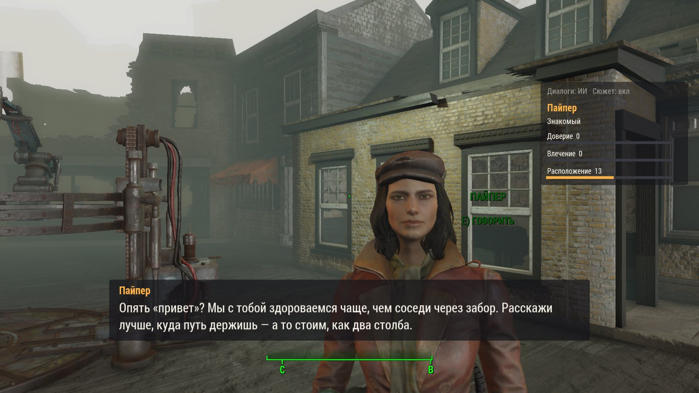

<table>
  <tr>
    <td width="50%">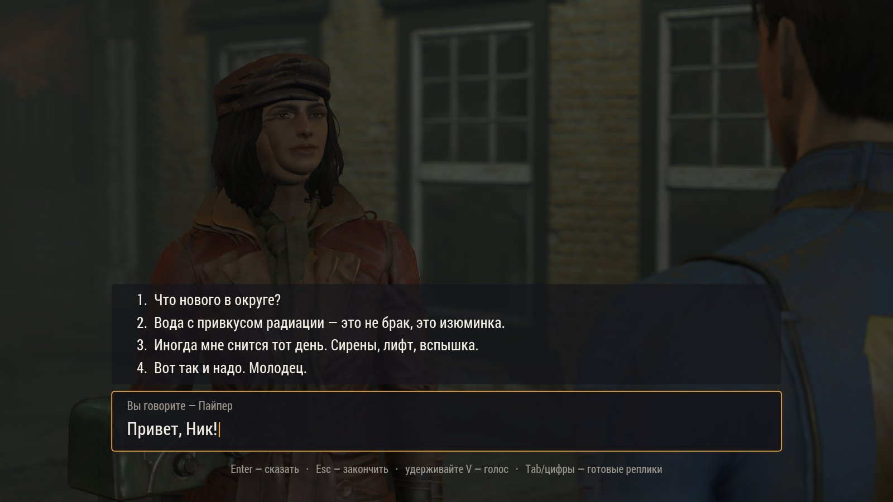</td>
    <td width="50%">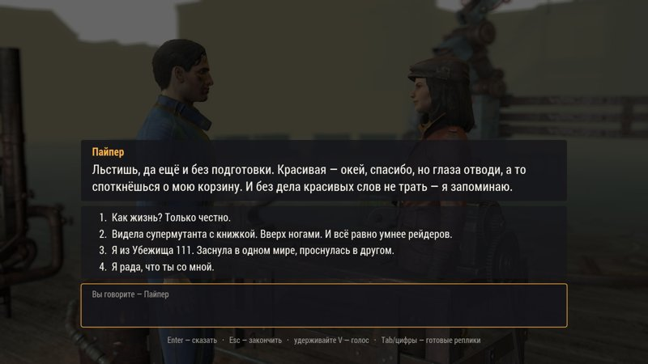</td>
  </tr>
</table>

- **It changes the game, not just the chat.** The AI only *asks*; the core *validates and executes*: it may hand you an
  item, move a quest along, start a scene or take your relationship a step further — but only what that person's authored
  dialogue offers, and only when the talk has really got there. So it can't break your game.
- **Memory.** People remember past conversations and how you treated them.
- **Any model you like.** OpenRouter, DeepSeek or OpenAI with your own key — or a local model on your PC: Ollama, LM Studio
  or any OpenAI-compatible server. Local means no key and no internet, and nothing leaves your computer. Mid-size local
  models (around 27B) already hold a conversation well. Keys live in the Windows Credential Manager.
- **Voices.** Edge TTS works out of the box with no key; ElevenLabs and OpenAI TTS online; XTTS-v2 (it can clone a voice
  from the game's own lines) and Silero locally. Talk with your voice — speech recognition runs locally with faster-whisper.
- **New in 0.1.8 — AI in the game's own conversations.** When the vanilla wheel is open, press **T** and type what you want
  to say — the AI picks the matching answer on the wheel and the quest goes on exactly as designed. If nothing fits, the
  person just answers you in character and the wheel stays open. The "AI in vanilla dialogues" setting: off / pick the
  answer / pick the answer and free lines.
- **New in 0.1.8 — talk to anyone.** Press **T** in front of any person — a named character, a settler, a robot, someone
  from a DLC — and start a free conversation. They know their faction, place and the quests they're part of.
- **New in 0.1.8 — outcomes reach the game:** flags, items, quest stages and gestures from an AI conversation now fire in
  the game; "Say your own…" is in every authored dialogue. HUD widgets on **F10**.
- **Lip sync and facial expression (0.1.9, much better in 0.2.0).** The speaker's lips move with the voice of an AI reply
  and with voiced lines of Studio trees: sounds flow smoothly into each other, and the face plays the line's emotion —
  brows, eyelids, blinks in the pauses. The switch is `BoopiUI.ini [Audio] bLipSync`.
- **A modder's own trees** get the AI mode too: the "AI dialogue" section of the studio says who the person is and where
  the conversation should lead.

Guide: [instructions/en/AI_DIALOGUE.md](instructions/en/AI_DIALOGUE.md).

## Life and living people

<table>
  <tr>
    <td width="50%">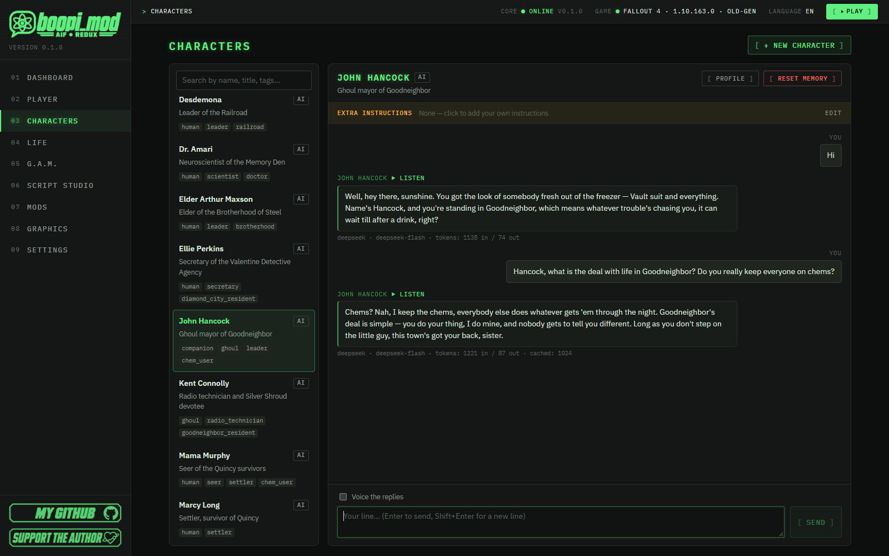</td>
    <td width="50%">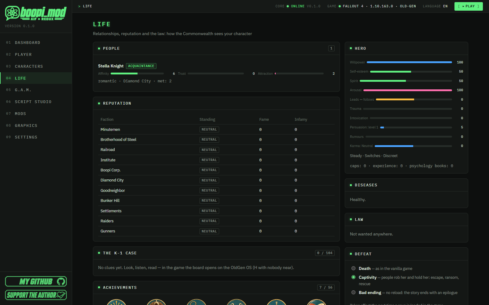</td>
  </tr>
</table>

Everyone has their own attitude to you: how much they like you, trust you, and are drawn to you. Flirt, ask them out, pick a
place for the evening, become a couple, propose — or get caught and see how jealous they get. The world reacts too:
reputation, the law, jobs, even diseases.

- **Every NPC has a relationship with you** — affinity, trust and attraction that grow or drop with what you do, say and give.
- **Flirt and compliments, dates in real places** — a table at the club, a walk, a room for the night, alone or with the one
  you love.
- **A night together** plays as a scene on our own engine; mood, your relationship, how much they had to drink and the
  moment all matter — and they can say no.
- **Partners, a proposal and a wedding**; partners and spouses live their own lives — and get jealous if they catch you.
- **Faction reputation, law and bounties:** guards remember crimes, factions remember whose side you took. Settlers can
  be abducted.
- **Jobs and shift work** for caps; **diseases** (cold, flu, fever, poisoning, radiation sickness) —
  caught from the weather, bites, food and people (their own walks come with our animations); settlement doctors treat them and cure addiction.
- **Defeat is your choice:** death as in the vanilla game, captivity, or a "bad ending".
- **27 key characters** with a backstory, character and memory — chat with them right in the app (with voice), even before
  you start the game; edit their cards or create your own.
- **OldGen OS on the Pip-Boy** (**H**): people, reputation and karma, dossiers, health and **71 achievements (15 hidden)**.

## Boopi Corp. and the Black Acorn

A new corner of the Commonwealth — living places with their own people and dialogues:

- **The Black Acorn night club** near Diamond City: bouncers, a bar, Stella singing on stage (and you can try your luck
  with her), a dance floor in soft coloured light, a VIP room and cosy rooms upstairs.
- **The Boopi Corp. HQ** with its Gen 4 synths — each one with her own job, look and story.
- **The Red Rocket** is now a bar for settlers.
- **Living places:** about a hundred people in the club, the bar and the HQ move with G.A.M. scenes — dancers dance with
  their whole body, guests sit with a cigarette or a drink, card players play cards, bartenders wash glasses, the cleaner
  scrubs the floor, at the HQ they type at terminals and water the garden. Talk to someone and the scene stops and the
  conversation opens.
- **Pairs (since 0.2.0):** two people of one place can play a scene together — cards across a table, a couple dance, a talk
  at a table. The mechanism is ready and checked in the game; the pair scenes themselves come with our animations. In the
  Red Rocket the card players now sit at two tables facing each other.
- **Alive even without packs:** the club's waitresses walk rounds between the bar and the lounges, "standing" furniture
  appeared around the guests (coffee, a paper, a cigarette, noodles), and in the evening, 19:00 to 01:00, idlers spread
  wider — to the bar, the dance floor, other tables. The places come fully alive with our animations, which come out as
  separate mods soon; until a fitting scene exists, a person is busy with vanilla things.
- The dates of "Life" take place in real places — a table at the club, for one. These places are also part of the story
  [«Lullaby»](#lullaby-the-new-story).

## "Lullaby": the new story

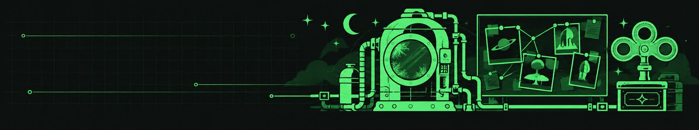

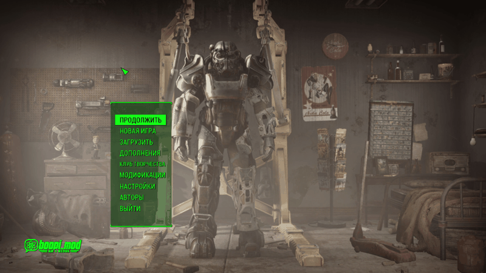

*For two hundred and ten years a machine kept you in a secret capsule. You were woken a year early, because someone came
for you. To understand who you are you must find those who came, and remember the morning you asked to forget.*

- **You are the second sleeper of Vault 111.** Pod **K-1** — not the one Nora climbed out of, and you are not her
  spouse. The OldGenAI core wakes you at **09:44**, while Nora left **sixteen days ago** to find her son. You know neither
  who you are nor who woke you.
- **Boopi Corp.** The headquarters, its Gen 4 synths, the Black Acorn night club and the Red Rocket bar — living places with
  their own people and dialogues ([more](#boopi-corp-and-the-black-acorn)). The core looks after you the way it was taught
  to, and that care can be suffocating.
- **"Case K-1" is a detective story.** Who am I? Who woke me? Why am I being hunted? An evidence board, a cipher,
  mini-games; every truth you find asks a more frightening question. And the answer to the last one may not be what you
  expect: **you may not be who you think you are.**
- **Four acts, 18 main missions, 13 side quests, 9 endings.** The ending is decided not by the last button but by your whole
  road: your decisions and your reputation with people, factions and the core. There is one truly good ending, one truly bad
  one, and seven in between.
- **How long:** about **20–25 hours** for the main line and **30+** with the side quests; romance along the way. Since
  0.1.8 the whole story can be played to every one of the 9 endings, and the Pip-Boy journal shows all the objectives.
- **The vanilla game is woven in, not thrown out.** The best vanilla quests — Vault 114, Fort Hagen, Kellogg's memory, the
  Glowing Sea — you play **yourself**, inside the new line, while Nora's path is told to you by the people you meet. All other
  side quests, companions, factions, settlements and DLC stay available.

> [!NOTE]
> A **new game** is recommended for the story; "Life", chat and AI dialogue also work with existing saves.

## Voice: speech synthesis and recognition

<table>
  <tr>
    <td width="50%"></td>
    <td width="50%"></td>
  </tr>
</table>

- **Text-to-speech (TTS):** Microsoft Edge TTS works out of the box with no key; ElevenLabs, OpenAI TTS and **Higgs TTS 3**
  online (Boson AI: the cloud with your own key or your own server, about a hundred languages); XTTS-v2 and Silero locally.
- **Voice cloning** (XTTS-v2, Higgs TTS 3): a clone is made from the game's own lines by an NPC's voice type, or from your
  recordings. In the Studio a speaker who is a game NPC or the hero gets **a sample of their own game voice
  automatically**.
- **Lip sync** (since 0.1.9, smooth and with facial expression in 0.2.0): lips move with any voicing of AI replies and
  Studio lines — computed from the recording itself, with no outside tools; the line's emotion, accents, a question and
  blinks play on the face.
- **The game's subtitles** show in the right code page (Russian and Polish tables, old code pages included).
- **Speech recognition (STT):** the built-in faster-whisper (runs locally, on the CPU) or OpenAI Whisper; in the game —
  push-to-talk on **V**.
- The heavy engines are not part of the app: they install on a button, and the XTTS and Silero licences (non-commercial)
  are accepted explicitly.

Guide: [instructions/en/VOICE.md](instructions/en/VOICE.md).

## Graphics for your PC

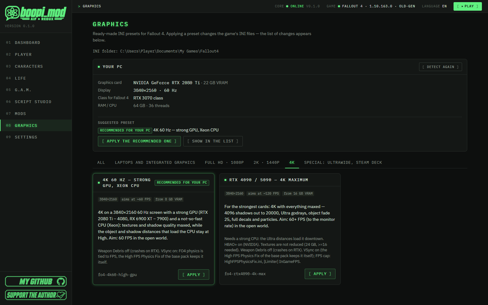

- **12 ready presets** (from integrated 720p graphics and the Steam Deck to an RTX 4090 at 4K and an ultrawide monitor).
- The app detects your GPU, screen, RAM and CPU and marks the **"Recommended for your PC"** preset; applying it edits the
  game's INI files and makes backups.

## OldGen OS on the Pip-Boy

**OldGen OS** is an app on the Pip-Boy (press **H** with nobody in front of you): people, reputation and karma, a dossier,
health and **71 achievements (15 hidden)**.

## Safety is built in

The project contains adult content (**18+**). The content rules are collected in a single core module and cannot be bypassed
by settings or by a model's answer: romance and intimacy only between adults and by consent; coercion is closed for everyone;
**a child never takes part in such scenes under any setting**. Every request for flirting, romance or intimacy is checked by
the core itself, whatever the AI says.

## Honest limitations

- **The in-game AI dialogue is still a beta.** The AI works in the vanilla quest dialogues too (**T** on an open wheel).
  While an AI reply is spoken, the input line is hidden.
- **Lip sync:** one emotion per line; XWM voice without a `.lip` file does not move the lips; sound without text guesses
  vowels from formants, at lower quality.
- **Living places:** pair scenes wait for our animation packs; guests do not come and go and do not lean on walls and rails;
  stopping by a talk is not instant (the scene finishes its pass, up to ~8 s).
- **Skyrim SE is a beta:** the plugin is checked without running it in Skyrim itself; no scene events, sounds, props or
  camera; F.O.R.G.E. is viewing-only there. The other games are not playable yet.
- **Role height in the game:** places and hands are fitted; the seat height is not fitted to the height.
- **F.O.R.G.E.:** your own model is a static object only (not furniture you can sit on, not an item), its collision is a box
  by the model's size; weapon paint swaps and blending the generated relief with the original are not done yet; items from
  level lists are not taken for "this person only".
- **Your own dialogues on the game's and DLC characters:** while a story quest of the game holds the character (for
  example Cassie or Kent), that quest goes first and your tree comes after it.
- **Next-Gen / Anniversary (1.10.98x, 1.11.x) are not supported.** The target is 1.10.163 (Old-Gen); Steam and GOG have
  not been tested.
- **This is a beta:** expect rough edges and bugs — [report them](https://github.com/boopi-coder/boopi_mod/issues/new/choose) and I'll fix them quickly.
- The story is the first public edition: its world and mini-games will be refined; a **new game** is better for the story.
- The release files are **not code-signed**: SmartScreen may warn about an unknown publisher — verify the SHA-256.
- The local speech engines are large (XTTS-v2 is about 4.7 GB, an NVIDIA GPU is recommended) and install on a button.
- Windows only.

The full list is in the [release notes](docs/release/v0.1.0.md#known-limitations).

---

## Install and first run

### What you need

| What | Needed |
|---|---|
| System | Windows 10 (22H2) or 11, x64; WebView2 (present in Windows 11 and in an up-to-date Windows 10) |
| Game | A legitimate **Fallout 4 version 1.10.163 (Old-Gen)** |
| F4SE | Required, **not included**: the app downloads it from the author's official page on your button |
| AI (optional) | An API key of one provider (OpenRouter, DeepSeek, OpenAI) **or** a local model (Ollama, LM Studio, any OpenAI-compatible server). Without AI the mod manager, the studio, G.A.M. and graphics work |
| Internet | For installing mods, the AI provider and online voice |
| Disk space | A few GB for the mod cache; the local XTTS-v2 is about 5 GB more (optional) |

### Step 0. Download and unpack

1. Download **`boopi_mod-0.2.0-win-x64.zip`** from the [Releases](https://github.com/boopi-coder/boopi_mod/releases/latest)
   page and compare its SHA-256 with `SHA256SUMS.txt` from the same release (for 0.2.0 it is `3990f910b897f091d6852ed5fbb3a7e419c45139a0be3479a77b67fe0e10a267`).
2. Unpack to a **short path** such as `C:\Games\boopi_mod` (not into "Downloads" or deep folders: Windows will not run
   programs whose path is longer than 260 characters).
3. Run **`boopi_mod.exe`** — the app starts the core by itself. On the first start choose your language and game (Fallout 4
   is playable; Skyrim SE is a beta, the others are marked "coming soon").
4. On the Dashboard press **"Download and install"**: the app downloads our mods from [boopi.site](https://boopi.site)
   (≈ 215 MB; the catalog is signed and files are checked by SHA-256), then **"Restart the core"**. From then on the
   mods update on their own, separately from the app.

> [!WARNING]
> The release files are not code-signed, so Windows SmartScreen may show a warning. Download only from the releases page and
> verify the hash.

### Step 1. Dashboard: is everything found

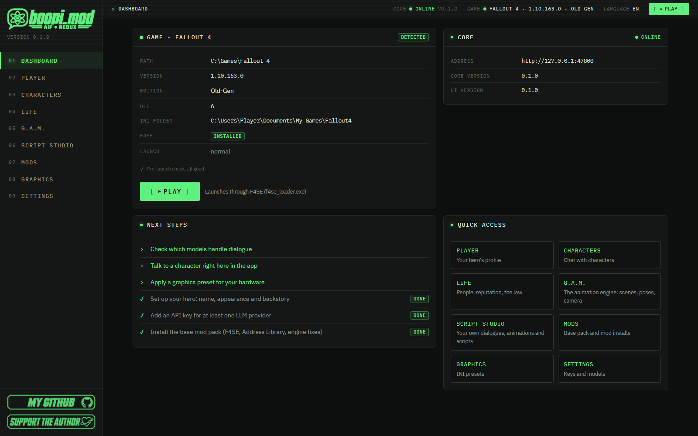

The **Dashboard** opens. The game should be found on its own: the path, version **1.10.163**, the Old-Gen edition, the F4SE
status. At the top right the core shows "online". Below, "Next steps": the app itself tells you what is left to do.

### Step 2. The game path (if it was not found)

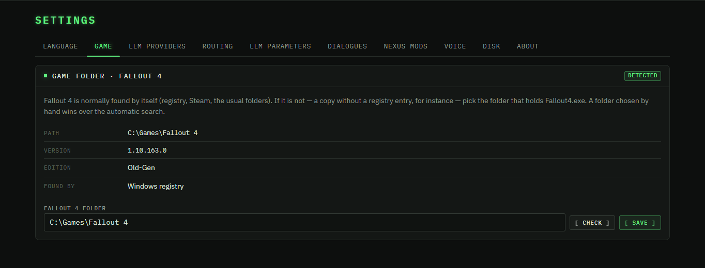

If the game is not found (for example a copy without a registry entry), open **Settings → Game**, enter the folder that holds
`Fallout4.exe`, press **"Check"**, then **"Save"**. A folder you set by hand beats auto-detection.

### Step 3. Mods → "Base pack"

Open **Mods** and press the install button of the base pack: F4SE, Address Library, Buffout 4 NG, UFO4P, High FPS Physics
Fix, MCM, Baka ScrapHeap and our own parts. What comes from Nexus Mods needs your account: with Premium the links are direct,
without it use the "Slow download" button in the Nexus window inside the app. Everything installed is listed on the right;
any mod can be removed.

### Step 4. An AI provider key (optional)

For AI dialogue and the AI assistant: **Settings → LLM providers** → paste the API key → **"Save key"** → **"Check"**. The key
is kept in the Windows Credential Manager and is never shown again. Which model answers for what is set on the **"Routing"**
tab. Without a key, skip this step: the mod manager, the studio, G.A.M. and graphics work anyway. A local model (Ollama,
LM Studio or your own OpenAI-compatible address) needs no key — the provider list has ready entries for them.

### Step 5. Dialogue mode

**Settings → Dialogues** → the **"Progressive AI dialogue"** mode (or "Vanilla" if you do not want AI in conversations).
The answer length, voice and line suggestions are here too.

### Step 6. Hero, graphics and "Play"

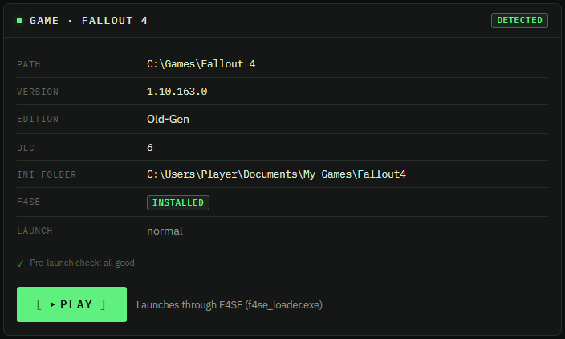

1. **Hero** — the name and sex come from your latest save; fill in the appearance and backstory: the characters will see them.
2. **Graphics → "Apply recommended"** (edits the game's INI files and makes backups).
3. Press **"Play"** — the game starts through F4SE. AI dialogue and "Life" work at once, the story from a new game.

### "The core file is missing" or your antivirus complains

What each message of the "Core is not responding" screen means (including "The core runs, but the app cannot connect to
it") — [Guides → If the core does not respond](instructions/en/README.md#if-the-core-does-not-respond).

1. Your antivirus most likely moved `core\oldgenai-core.exe` to quarantine. It's a false alarm: the core is an unsigned
   program built with Python, and some antiviruses flag those by pattern.
2. Download the archive only from the [Releases](https://github.com/boopi-coder/boopi_mod/releases/latest) page and check
   its SHA-256 (PowerShell: `Get-FileHash .\boopi_mod-0.2.0-win-x64.zip`). For 0.2.0 it must be `3990f910b897f091d6852ed5fbb3a7e419c45139a0be3479a77b67fe0e10a267`.
3. Restore the file from quarantine or add the boopi_mod folder to your antivirus exclusions, then unzip the archive again.
4. Unzip to a normal folder (not Program Files) and don't run it from inside the zip.
5. Tell me which antivirus it was and the detection name — I'll report the false positive.

<b>If something went wrong (click to expand)</b>

- **The game is not found.** "Settings → Game" → enter the folder with `Fallout4.exe`.
- **The game version is not 1.10.163.** The app warns you; launch is not blocked, but it is not guaranteed to work.
  Next-Gen and Anniversary are not supported.
- **`boopi_mod.exe` does not start.** Check the path (short, no deep folders) and that WebView2 is present. SmartScreen:
  "More info" → "Run anyway" — after verifying the SHA-256.
- **A Nexus mod will not download.** An account is required; without Premium use "Slow download" in the Nexus window inside the app.
- **The AI is silent.** "Settings → LLM providers" → "Check" on your provider; check the key's balance, the "Dialogue" route on
  the "Routing" tab and the mode on the "Dialogues" tab.
- **No voice.** "Settings → Voice": pick a voice provider; Edge TTS needs no key but needs the internet.
- **The game crashes on start.** Open the Buffout 4 NG crash log (folder `Documents\My Games\Fallout4\F4SE`, files
  `crash-*.log`) and attach it to your report.
- **App logs:** `%APPDATA%\BoopiMod\logs\` (`app.log`, `core.log`, `all.log`, `errors.log`). Data and settings:
  `%APPDATA%\BoopiMod\`.

**Did not help?** [Open an issue](https://github.com/boopi-coder/boopi_mod/issues/new): the app version, the steps, the
`all.log` file and the F4SE crash log. Write about any problems and ideas — we will sort them out.

**What the app installs itself** (on your button, with hash checks): F4SE and Buffout 4 NG — from their authors' GitHub;
Address Library, UFO4P, High FPS Physics Fix, MCM, Baka ScrapHeap — from the authors' Nexus Mods pages. Our own plugins
(`BoopiCorp.esp`, `OldGenStory.esp`, posters, `boopi_hud`) and F4SE plugins (`OldGenAI.dll`, `BoopiUI.dll`, `GAM.dll`) are
built by the app and placed into the game for you.

### Updates

At every start (no once-a-day pause) the app checks whether a new version is out and shows a **"New version available"**
banner on the Dashboard right away, with a "Download" button. You can turn the check off in the settings. To hear about releases even without
the app, click **Watch → Custom → Releases** on GitHub and you'll get an email for every new version.

---

## For modders

Everything the app does can be extended — without programming and without other people's tools. What you can build:

- **Your own animation** — in the G.A.M. 3D editor with IK handles, or in words through the AI animator; import animations from
  mods you have installed.
- **Your own conversation** — a dialogue tree with branching, gestures and scenes; a branch off the game's wheel; a dialogue on a game or DLC character; voice and lip sync.
- **Your own scene** — actors, movement, camera, tags so that "Life", dialogues and other mods can find it.
- **Your own sounds on a scene's timeline**, **your own textures and models** (F.O.R.G.E.): recolouring the game's objects
  for everyone, for one item or for one person, texture packs as `.ogmod`, your own 3D model as a workshop object.
- **Your own mod as a single `.ogmod`** that others install in one click, and **your own AI dialogues** — checked in the test chat.

| Guide | What it covers |
|---|---|
| [SCRIPT_STUDIO.md](instructions/en/SCRIPT_STUDIO.md) | Script Studio: dialogue trees, branches off the game, the AI block, voice, your own `.ogmod` mod |
| [ANIMATION_IMPORT.md](instructions/en/ANIMATION_IMPORT.md) | Animation import and the G.A.M. scene editor |
| [ANIMATION_GUIDE.md](instructions/en/ANIMATION_GUIDE.md) | Animations in dialogues and scripts: gestures, scenes, camera, contexts |
| [AI_DIALOGUE.md](instructions/en/AI_DIALOGUE.md) | The AI dialogue mode: what the player sees, what the AI can and cannot do |
| [VOICE.md](instructions/en/VOICE.md) | Text-to-speech and speech recognition: providers, voice cloning, lip sync |
| [FORGE.md](instructions/en/FORGE.md) | F.O.R.G.E.: the game's 3D object catalog, recolouring (item, person, palette), the map generator, "My textures", texture packs, "My objects" |

All the guides also exist [in Russian](instructions/README.md).

## FAQ

<b>Are Next-Gen / Anniversary (1.10.98x, 1.11.x) supported?</b>

Not yet. The target is **1.10.163 (Old-Gen)**, on which the F4SE plugins are stable. The app warns you if the game version is
different; launch is not blocked, but it is not guaranteed to work. The Steam and GOG editions have not been tested.

<b>Do I need AI to use the program?</b>

No. The mod manager, Script Studio, the G.A.M. editor and import, and the graphics presets work without AI. AI is needed for
the assistant, AI dialogue in the game and (optionally) cloud voice. And if you want AI without the cloud, a local model works
(Ollama, LM Studio, any OpenAI-compatible server): mid-size models (around 27B) already hold a conversation well.

<b>What happens to my old saves?</b>

"Life", chat and AI dialogue do not need a new game, but the story "Lullaby" and the new places are built for a **new game**.
Adding and removing plugins mid-playthrough is the usual risk of any mods: back up your `Saves` folder.

<b>What goes to the internet and where are my keys?</b>

There is no telemetry. Dialogue lines and the hero's and character's data go to **the AI provider you chose** (OpenRouter,
DeepSeek, OpenAI; the text to be spoken goes to Microsoft Edge TTS or ElevenLabs/OpenAI if you chose them). If you want
nothing to leave your PC, use a local model (Ollama, LM Studio) and local XTTS / Silero / Whisper. The update check is one request to github.com at startup,
with no data about you; it can be turned off in the settings. API keys are kept in the **Windows Credential
Manager** (service `BoopiMod`) and are never written to files.

<b>Is it safe for my game?</b>

Mods install through a journal with full rollback; before launch the app checks the game version, F4SE and the required mods.
The content rules are collected in a single core module: romance and intimacy only between adults and by consent; coercion is
closed for everyone; a child never takes part in such scenes under any setting; the AI cannot bypass any of this.

<b>May I share the mods I make?</b>

Yes. Mods you create with boopi_mod (dialogue trees, scenes, voice lines and `.ogmod` packages made from your own work)
belong to you (see `NOTICE.txt`). Respect the rights of the authors of anything you include.

<b>Does the AI work in the game's regular quest dialogues?</b>

Yes, since 0.1.8. When the vanilla wheel is open, press **T** and type what you want to say: the AI picks the matching answer
on the wheel and the quest goes on exactly as designed. If nothing fits, the person answers in character and the wheel stays
open. The "AI in vanilla dialogues" setting: off / pick the answer / pick the answer and free lines. And **T** in front of
any person starts a free conversation.

<b>Do the lips move on AI replies?</b>

Yes: the lip motion is computed from the voice recording itself (and from the letters, when the text is known) and plays on
the speaker's face — the same on the WAV-voiced lines of your Studio trees. Since 0.2.0 the sounds flow smoothly into each
other and the face plays the line's emotion (brows, eyelids, blinks). The switch is `BoopiUI.ini [Audio] bLipSync`.

<b>Can I play other games, not only Fallout 4?</b>

Fully — only Fallout 4. Skyrim SE gets a beta in 0.2.0: reading the game's archives, the skeleton from the game itself and
the SKSE64 plugin GAM for Skyrim, which plays G.A.M. scenes (it is built without being run in Skyrim itself — I would be
glad of your reports). The other games are marked "coming soon"; I do not promise dates.

<b>Can I put my own 3D model into the game?</b>

Yes, since 0.2.0: open an OBJ, glTF or GLB in F.O.R.G.E. and press "To the game as an object" — the app makes the NIF, the
materials, the textures and a simple collision itself. The object appears in the workshop menu ("Decorations"/"Furniture")
and spawns from the console (`player.placeatme`). For now it is a static decoration: not furniture you can sit on and not
an inventory item; it comes out through the journal without a trace.

<b>I found a bug or have an idea — where do I write?</b>

In this repository's [issues](https://github.com/boopi-coder/boopi_mod/issues/new): the app version, the steps, the file
`%APPDATA%\BoopiMod\logs\all.log` and the F4SE crash log help sort it out fast. **Feedback wanted — report problems and
ideas, we'll fix them.**

🧡 **Questions and requests posted on [Boosty](https://boosty.to/boopi_coder) are handled first.**

## What's coming

**The next release:**

- **Every Fallout 4 version:** Old-Gen, Next-Gen and Anniversary — the app detects the version and picks the right
  plugins.
- **Quick import from Mod Organizer 2:** your profile, mod list and load order move into boopi_mod in a couple of clicks.
- **Animation import and export** in Havok (HKX), FBX, glTF and BVH — both ways.
- **Animation from video and a pose from a picture:** drop a clip — get a G.A.M. scene; drop an image — get a pose.
- **Our animation packs — the headline:** couples and romance, everyday life, work, emotions, gaits and smoking, **including
  the adult scenes made in G.A.M.**, after my hand polish. With them the pair scenes of the places (cards for two, a dance,
  a talk at a table) and the gaits for illnesses come alive.
- **F.O.R.G.E. further:** weapon paint swaps, blending a generated map with the original normal, an exact collision and a
  choice of material for your own objects.
- **G.A.M. further:** BVH, glTF and FBX import, building an animation pack from the editor, fitting the seat height to the
  height.
- **Skyrim further:** testing in the game itself, scene events, sounds and props.
- **NPCs talking to each other.**

**Fallout 4 — lots more on the way:**

- People who talk to each other, and group conversations.
- Side quests the AI makes up in the world: find, escort, investigate.
- Longer memory: people keep the gist of everything you've been through.
- More "Lullaby", more Boopi Corp. and the club.
- A FOMOD installer, mod profiles and a smarter load order.
- Next-Gen and Anniversary editions of the game.

**Soon — other games:** Cyberpunk 2077, Skyrim, Starfield and The Sims 4 — the same mod manager and the same creation of
animations, scenes and dialogues by hand or with AI. The foundation is already here: a game picker, themes, scene
transfer and the Skyrim SE beta. What comes first and when depends on **interest in the project, support
and stars on GitHub**:

- ⭐ [Star the repo](https://github.com/boopi-coder/boopi_mod/stargazers) — the best way to show the project is wanted;
- 💬 [tell me](https://github.com/boopi-coder/boopi_mod/issues/new/choose) which game you want most;
- 🧡 [support the server with a one-time donation](https://www.donationalerts.com/r/boopi_coder) or on [Boosty](https://boosty.to/boopi_coder) — it directly speeds up the work.

## Feedback

> **This is the first beta — feedback wanted: report problems and ideas, I'll fix them quickly.**
> [Report a problem or suggest an idea](https://github.com/boopi-coder/boopi_mod/issues/new/choose) · for a bug attach the
> app version, `%APPDATA%\BoopiMod\logs\all.log`, the F4SE crash log and the steps to reproduce.

## Support the author

boopi_mod is made by one person and it's free. There are two ways to support it — pick the one that suits you:

<table>
  <tr>
    <td align="center" width="50%" valign="top">
      <h3>🧡 Boosty subscription</h3>
        
      Regular support for the author: it pays for development time — new animation packs and scenes, F.O.R.G.E.,
      every Fallout 4 version and other games. Questions and requests from Boosty are handled <b>first</b>.  
      <a href="https://boosty.to/boopi_coder"><b>boosty.to/boopi_coder</b></a>
    </td>
    <td align="center" width="50%" valign="top">
      <h3>💸 One-time donation for the server</h3>
        
      A fund for a <b>server</b>: stable updates, the mod catalog and packs on boopi.site, and keeping the work going.
      Card and other payment methods — no sign-up.  
      <a href="https://www.donationalerts.com/r/boopi_coder"><b>donationalerts.com/r/boopi_coder</b></a>
    </td>
  </tr>
</table>

Thank you for your support! 🧡

## License and credits

- boopi_mod is **freeware, all rights reserved.** You may use it free of charge and share the original archive, credited to
  the author. You may **not** sell it, modify it, distribute modified versions or reverse-engineer it. Full text:
  [`LICENSE.txt`](LICENSE.txt); third-party components: [`NOTICE.txt`](NOTICE.txt). Mods you create with boopi_mod are yours.
- boopi_mod is an unofficial project and is not affiliated with Bethesda Softworks / ZeniMax Media. **Fallout** is a trademark
  of its owners. You need your own copy of the game.
- **Third-party components in the archive:** 7-Zip (LGPL, unmodified, 7-zip.org); texconv from DirectXTex (Microsoft, MIT);
  CommonLibF4, fmt, spdlog, rsm-mmio (MIT) and boost-stl-interfaces (BSL-1.0) inside our F4SE plugins; React, three.js, Tauri
  (MIT / Apache-2.0); IBM Plex fonts (SIL OFL 1.1); the core's Python libraries under their own licences.
- **Not in the archive and downloaded by you:** F4SE, Buffout 4 NG, Address Library, UFO4P, High FPS Physics Fix, MCM, Baka
  ScrapHeap (their authors forbid or restrict redistribution — the app only helps you download from the official sources).
  The speech engines XTTS-v2 (Coqui Public Model License) and Silero (CC BY-NC-SA 4.0) install on request, with the terms accepted.
- Author: **boopi-coder** — [github.com/boopi-coder](https://github.com/boopi-coder).
