<p align="center">
  <b>🇷🇺 Русский</b> · <a href="README.en.md">🇬🇧 English</a>
</p>

<p align="center">
  
</p>

<h1 align="center">boopi_mod <sup>REDUX</sup></h1>

<h3 align="center">Моддинг никогда не был так прост</h3>

<p align="center">
  <b>Менеджер модов для Fallout 4, в котором вы сами создаёте — свои анимации, сценарии, сцены и диалоги.<br>
  Вручную или с помощью ИИ.</b>
</p>

<p align="center">
  
  <a href="https://github.com/boopi-coder/boopi_mod/stargazers"></a>
  
  
  <a href="LICENSE.txt"></a>
  <a href="https://boosty.to/boopi_coder"></a>
  
</p>

<p align="center">
  <a href="https://github.com/boopi-coder/boopi_mod/releases/latest"></a>
  &nbsp;
  <a href="https://boosty.to/boopi_coder"></a>
</p>

<p align="center">
  <a href="#установка-и-первый-запуск">Установка</a> ·
  <a href="#для-мододелов">Для мододелов</a> ·
  <a href="#колыбельная-новая-история">История</a> ·
  <a href="#вопросы-и-ответы">FAQ</a> ·
  <a href="#что-дальше">Что дальше</a> ·
  <a href="instructions/README.md">Руководства</a> ·
  <a href="https://github.com/boopi-coder/boopi_mod/issues/new">Сообщить о проблеме</a> ·
  <a href="https://boosty.to/boopi_coder">Boosty</a>
</p>

> [!WARNING]
> **Это бета (0.2.0).** Возможны неточности и баги — пожалуйста, пишите о них, чтобы я мог оперативно исправить:
> [откройте issue](https://github.com/boopi-coder/boopi_mod/issues/new/choose) (шаблон подскажет, что приложить) — я читаю всё.
> **Жду обратной связи: о проблемах и идеях — будем решать.**

---

**boopi_mod** — десктоп-приложение и набор плагинов для **Fallout 4 (1.10.163, Old-Gen)**. Это Fallout, в котором люди вас
помнят: флиртуйте, ходите на свидания, становитесь парой, зовите в ночной клуб — и говорите своими словами: ИИ-диалог
отвечает в образе. А когда захочется своего, под рукой всё для творчества: 3D-редактор анимаций, студия диалогов и сцен,
озвучка и свой мод одним файлом. Всё это держит **менеджер модов**: он ставит и ведёт моды, готовит игру и расставляет
порядок загрузки.

## Что вы получаете

- **💋 Отношения, которые к чему-то ведут.** Флирт, свидание, пара, ночь вместе, ревность, свадьба — и человек помнит, что
  вы говорили и делали. [Подробнее](#жизнь-и-живые-люди)
- **🗣 Располагайте к себе своими словами.** Включите ИИ-диалог и просто пишите или говорите что хотите. Человек отвечает в
  образе и решает сам. [Подробнее](#ии-помощь-и-ии-диалог)
- **🌃 Ночная жизнь.** Клуб «Чёрный жёлудь» с певицей, которую можно добиться, VIP-залом и комнатами наверху,
  Boopi Corp. с её синтами 4-го поколения и «Ред Рокет», ставший баром. Официантки уже ходят по залу, гости пьют кофе и
  курят, картёжники сидят за столами; парные сцены и танцы оживут с нашими анимациями
  (скоро, отдельными модами). [Подробнее](#boopi-corp-и-чёрный-жёлудь)
- **🎬 Романтические и интимные сцены на своём движке.** G.A.M. играет сцены на двоих и больше — и вы можете делать свои:
  опишите сцену фразой, и ИИ-аниматор её соберёт. [Подробнее](#gam-создавайте-и-импортируйте-анимации)
- **🧱 F.O.R.G.E.** Мастерская 3D-объектов и текстур: смотрите предметы игры в 3D, перекрашивайте их (для всех, для одной
  вещи или для одного человека), собирайте оружие из деталей и ставьте в игру **свои 3D-модели** как объекты мастерской.
  [Подробнее](#forge-3d-объекты-и-текстуры)
- **🛠 Делайте своё и делитесь.** Диалоги, квесты и сцены в Студии — одним файлом, который ставится в один клик.
  [Подробнее](#студия-скриптов-диалоги-сцены-и-свой-мод)

## Что внутри

<table>
  <tr>
    <td width="33%" align="center" valign="top">
      <a href="#менеджер-модов"></a><br>
      <b><a href="#менеджер-модов">Менеджер модов</a></b><br>
      <sub>Базовый пакет одной кнопкой, установка с откатом, Nexus внутри приложения</sub>
    </td>
    <td width="33%" align="center" valign="top">
      <a href="#менеджер-модов"></a><br>
      <b><a href="#менеджер-модов">Умный порядок загрузки</a></b><br>
      <sub>«Упорядочить» показывает план, «через ИИ» — ещё и объясняет</sub>
    </td>
    <td width="33%" align="center" valign="top">
      <a href="#gam-создавайте-и-импортируйте-анимации"></a><br>
      <b><a href="#gam-создавайте-и-импортируйте-анимации">G.A.M.: свои анимации</a></b><br>
      <sub>3D-редактор с IK-ручками, ИИ-аниматор и ИИ-доводка, звуки на таймлайне, рост ролей, сцены играют в игре</sub>
    </td>
  </tr>
  <tr>
    <td width="33%" align="center" valign="top">
      <a href="#gam-создавайте-и-импортируйте-анимации"></a><br>
      <b><a href="#gam-создавайте-и-импортируйте-анимации">Импорт анимаций</a></b><br>
      <sub>HKX-анимации и айдлы модов Fallout 4, Skyrim SE и OAR — в свой редактор</sub>
    </td>
    <td width="33%" align="center" valign="top">
      <a href="#студия-скриптов-диалоги-сцены-и-свой-мод"></a><br>
      <b><a href="#студия-скриптов-диалоги-сцены-и-свой-мод">Студия скриптов</a></b><br>
      <sub>Диалоги, сцены, ветки от колёс игры, озвучка в один клик, свой мод <code>.ogmod</code></sub>
    </td>
    <td width="33%" align="center" valign="top">
      <a href="#ии-помощь-и-ии-диалог"></a><br>
      <b><a href="#ии-помощь-и-ии-диалог">ИИ-помощь и ИИ-диалог</a></b><br>
      <sub>Помощник во всех инструментах и свободный разговор в игре</sub>
    </td>
  </tr>
  <tr>
    <td width="33%" align="center" valign="top">
      <a href="#жизнь-и-живые-люди"></a><br>
      <b><a href="#жизнь-и-живые-люди">«Жизнь» и живые люди</a></b><br>
      <sub>Отношения, репутация, закон, свидания, 27 персонажей с памятью</sub>
    </td>
    <td width="33%" align="center" valign="top">
      <a href="#колыбельная-новая-история"></a><br>
      <b><a href="#колыбельная-новая-история">«Колыбельная»</a></b><br>
      <sub>Детективная история: 18 миссий, 13 побочек, 9 финалов</sub>
    </td>
    <td width="33%" align="center" valign="top">
      <a href="#голос-озвучка-и-распознавание-речи"></a><br>
      <b><a href="#голос-озвучка-и-распознавание-речи">Голос</a></b><br>
      <sub>Озвучка, липсинк с мимикой, клонирование голоса, распознавание речи, push-to-talk</sub>
    </td>
  </tr>
  <tr>
    <td width="33%" align="center" valign="top">
      <a href="#графика-под-ваш-пк"></a><br>
      <b><a href="#графика-под-ваш-пк">Пресеты графики</a></b><br>
      <sub>12 пресетов и рекомендация под ваш ПК</sub>
    </td>
    <td width="33%" align="center" valign="top">
      <a href="#ос-oldgen-на-пип-бое"></a><br>
      <b><a href="#ос-oldgen-на-пип-бое">ОС OldGen</a></b><br>
      <sub>Приложение на Пип-Бое: люди, репутация, досье, 71 достижение (15 скрытых)</sub>
    </td>
    <td width="33%" align="center" valign="top">
      <a href="#безопасность-встроена"></a><br>
      <b><a href="#безопасность-встроена">Безопасность</a></b><br>
      <sub>Правила содержимого зашиты в ядро, а не в настройки</sub>
    </td>
  </tr>
  <tr>
    <td width="33%" align="center" valign="top">
      <a href="#forge-3d-объекты-и-текстуры"></a><br>
      <b><a href="#forge-3d-объекты-и-текстуры">F.O.R.G.E.</a></b><br>
      <sub>3D-объекты игры и их текстуры: каталог, оружие из деталей, перекраска для вещи или человека, свои модели в игру</sub>
    </td>
    <td width="33%"></td>
    <td width="33%"></td>
  </tr>
</table>

## Чего не было ни в одном моде

| | Ваниль | Другие инструменты | **boopi_mod** |
|---|---|---|---|
| Установка модов и порядок загрузки | вручную | менеджеры (MO2, Vortex): порядок расставляете вы | базовый пакет одной кнопкой, журнал и откат, умная расстановка и **ИИ-сортировка** |
| Своя анимация | нет | внешние 3D-пакеты, конвертеры, ручная сборка файлов | **3D-редактор внутри** с IK-ручками и ИИ-аниматором |
| Импорт готовых анимаций (HKX-анимации и айдлы модов Fallout 4, Skyrim) | нет | вручную, через конвертеры | «перетащил — играет», перенос на скелет Fallout 4 |
| Текстуры и 3D-модели игры | Creation Kit, внешние редакторы | конвертеры форматов, ручные пути | **F.O.R.G.E.** внутри: каталог, 3D-вид, перекраска с переводом в формат игры и откатом, своя модель в игру одной кнопкой |
| Свои диалоги и сцены | Creation Kit | CK, скрипты Papyrus | **Студия скриптов** без программирования, ветки прямо на колесе игры |
| Помощь ИИ при создании | нет | нет | ИИ-помощник пишет ветку диалога, собирает сцену; тестовый чат «Проверить в ИИ-режиме» |
| Поделиться своим модом | архив и инструкция | архив и инструкция | **один файл `.ogmod`**: ставится в один клик и убирается вместе |
| Свободный разговор с NPC | колесо реплик | отдельные ИИ-моды: только беседа | в игре, с **настоящими исходами** (предмет, квест, сцена), проверяемыми ядром; работает и в родных квестовых диалогах (**T**) |
| Откат установки | нет | частичный | журнал: удаление возвращает файлы байт в байт |
| Сюжет | оригинальный | — | новая детективная история «Колыбельная», ваниль вплетена |

> [!NOTE]
> Сравнение обобщённое: у других инструментов есть свои сильные стороны, а у boopi_mod есть [ограничения 0.1.0](#честно-об-ограничениях).

## Что нового

<p align="center"></p>

**0.2.0** — F.O.R.G.E.: чистый каталог, оружие из деталей, перекраска для одной вещи или одного человека, цвета палитры, одежда на скелете, генератор карт нормалей и блеска, «Перечитать изменённый PNG», шаблон UV и экспорт OBJ/GLB, **свои 3D-модели в игру как объекты мастерской**; G.A.M.: аудит целиком (без белого экрана, устойчивые прогоны ИИ, ИИ-аниматор первым, готовые позы, числа и привязка, таймлайн с группами и масштабом, импорт «сначала выбор», превью в GIF/WebM/PNG, быстрая библиотека) и **рост ролей в игре** (G.A.M. 0.6.1); липсинк с плавными звуками и мимикой (BoopiUI 1.3.0), Higgs TTS 3 и автоматический образец голоса; Студия скриптов: все исправления аудита; живые места: парные сцены, столы в «Ред Рокете», места живее и без паков; **Skyrim SE (бета)**: свой читатель архивов, скелет из игры, GAM for Skyrim; обновления проверяются при каждом запуске. [Заметки к 0.2.0](docs/release/v0.2.0.md).

**0.1.9** — F.O.R.G.E.: 3D-объекты и текстуры игры с перекраской и откатом; звуки на таймлайне G.A.M. (G.A.M. 0.5.0); редактор кривых, призраки, траектории и сравнение до/после; ИИ-доводка анимаций и проверка движения; живые места: система, по которой люди клуба, «Ред Рокет» и штаба двигаются сценами G.A.M., готова и оживёт с нашими анимациями (они выйдут отдельно, скоро); липсинк и «Озвучить всё» в Студии; выбор игры и цветовые оформления (играбельна пока Fallout 4); выбор языка при первом запуске. [Заметки к 0.1.9](docs/release/v0.1.9.md).

**0.1.8** — ИИ в разговорах самой игры (T: пишете своё, ИИ выбирает ответ на колесе) и свободный разговор с кем угодно; последствия ИИ-диалога доходят до игры; деревья Студии на персонажах игры и DLC; реплики самой игры по ссылке; LM Studio и любой OpenAI-совместимый сервер; «Колыбельная» проходится до всех 9 финалов; точнее ИИ-аниматор и строже проверка анатомии. [Заметки к 0.1.8](docs/release/v0.1.8.md).

**0.1.7** — G.A.M.: отмена и повтор, правка ключей, зеркало, во весь экран, лицо и камера, «▶ В игре», события сцен в игре, библиотека с поиском и превью, точный ИИ-аниматор; Студия: триггеры для своих историй, «+ История», проигрыватель диалога; моды из Студии ставятся из каталога boopi.site с требованиями. [Заметки к 0.1.7](docs/release/v0.1.7.md).

**0.1.6** — импорт анимаций из модов Fallout 4, Skyrim SE и походок OAR, сцены «Жизни» через G.A.M., обновлённые инструкции. [Заметки к 0.1.6](docs/release/v0.1.6.md).

**0.1.5** — моды сообщества с [boopi.site](https://boopi.site) прямо в программе, вход в аккаунт boopi.site и публикация своих модов из Студии на модерацию. [Заметки к 0.1.5](docs/release/v0.1.5.md).

**0.1.4** — наши моды скачиваются в программе с [boopi.site](https://boopi.site) и обновляются отдельно от неё; исправлен редактор внешности после пробуждения. [Заметки к 0.1.4](docs/release/v0.1.4.md).

**0.1.3** — исправления и обновлённая лицензия: программа бесплатна, все права защищены. [Заметки к 0.1.3](docs/release/v0.1.3.md).

**0.1.2** — обслуживающий выпуск: обновлены описания и скриншоты. [Заметки к 0.1.2](docs/release/v0.1.2.md).

**0.1.1** — обновления внутри программы: при запуске она сама находит новую версию, а кнопка «Скачать и установить»
ставит её в один клик (с проверкой контрольной суммы и откатом, если что-то пойдёт не так). [Заметки к 0.1.1](docs/release/v0.1.1.md).

**0.1.0** — первая публичная бета: менеджер модов с базовым пакетом, G.A.M. с 3D-редактором и импортом анимаций, студия скриптов
с экспортом `.ogmod`, ИИ-диалог в игре, «Жизнь», голос, 12 пресетов графики и история «Колыбельная». Список ограничений —
[ниже](#честно-об-ограничениях) и в [заметках к релизу](docs/release/v0.1.0.md).

---

## Менеджер модов

<p align="center"></p>

<table>
  <tr>
    <td width="50%">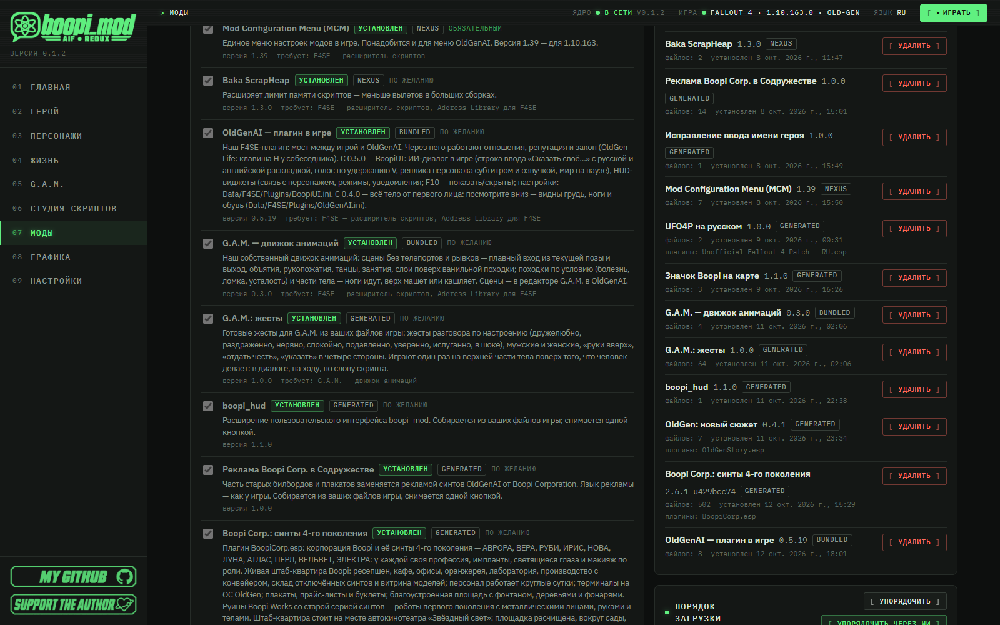</td>
    <td width="50%">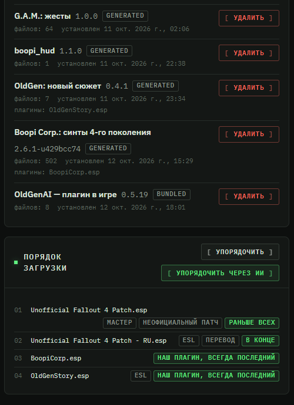</td>
  </tr>
</table>

- **Базовый пакет одной кнопкой:** F4SE, Address Library, Buffout 4 NG, неофициальный патч (UFO4P) с переводом на язык игры,
  High FPS Physics Fix, MCM, Baka ScrapHeap. Порядок — по зависимостям, проверка SHA-256.
- **Наши части** ставятся тем же пакетом и собираются **на вашей машине из ваших файлов игры**: плагин в игре, движок
  **«G.A.M. — движок анимаций»**, **boopi_hud** (расширение интерфейса), «G.A.M.: жесты», «OldGen: новый сюжет», «Boopi Corp.: синты
  4-го поколения».
- **Установка с журналом и полным откатом.** Моды ставятся хардлинками; удаление возвращает исходные файлы байт в байт.
  Архивы zip / 7z / rar — перетаскиванием; окно Nexus Mods внутри приложения (ключ API не нужен).
- **Умный порядок загрузки.** «Упорядочить» сначала **показывает план**, ничего не меняя, и только потом применяет;
  «Упорядочить через ИИ» делает то же, но с объяснениями по каждому плагину.

Подробно: [Установка и первый запуск](#установка-и-первый-запуск).

## G.A.M.: создавайте и импортируйте анимации

<p align="center"></p>

**G.A.M.** — наш собственный движок и редактор анимаций: играет сцены в игре своим плагином `GAM.dll`.

<p align="center"></p>

- **3D-редактор:** таймлайн, кости, инструменты «Поворот / Сдвиг / Персонаж / Курс», **IK-ручки** на руках, ногах и голове,
  свет, несколько актёров, существа, мебель и предметы. Что видно в редакторе — то и сыграет в игре.
- **ИИ-аниматор** (в 0.2.0 он первым в инспекторе, а на пустой сцене подскажет, с чего начать): опишите сцену фразой
  («пусть он помашет в приветствии», «обнимаются и покачиваются») — он соберёт её по шагам; каждый шаг виден, результат
  доводится руками. Следит, чтобы локти не уходили в тело, запястья гнулись естественно, а ладонь ложилась на тело при
  касании. Один плохой элемент в ответе модели больше не ломает весь прогон.
- **Готовые позы без ключа ИИ:** стоя, сидя на стуле, на колене, на корточках, сидя на полу, лёжа — со стопами на полу.
- **Проверка анатомии:** руки сквозь тело (скрещённые руки — не ошибка), вывернутые запястья, руки мимо цели, предмет не в
  руке, тела внутри мебели, скольжение ног — ещё до запуска игры. Пара — любое сочетание полов. Сообщения — на языке
  интерфейса.
- **ИИ-доводка в один клик:** плавность с разгоном и торможением, замах и дотяжка, дуги вместо прямых, перенос веса,
  дыхание и покачивание, цикл без шва и меньше ключей. Касания остаются на месте (стопы на полу, ладонь на теле);
  результат — один шаг отмены.
- **Проверка движения:** рывки, равновесие, дрожь касаний, «деревянность» — оценка 0–100 до и после. Визуальный судья
  смотрит раскадровку готовой сцены, если подключена модель, которая видит картинки. ИИ-аниматор сам проходит цикл
  «собрал → проверил → довёл → исправил».
- **Правка:** отмена и повтор, выделение нескольких ключей, перенос позы на другого актёра, зеркало, растяжение и сжатие
  времени (звуки едут вместе), шов цикла, оптимизатор ключей, полный экран.
- **Числа и привязка:** карточка ключа с временем, переходом, весом и значением числами; место и курс роли числами,
  «Повернуть лицом», «Встать на расстоянии»; «Шаг угла» и «Сетка» для колец и перетаскивания.
- **Таймлайн:** дорожки сгруппированы по роли и части тела и сворачиваются, поиск кости, масштаб `Ctrl`+колесо, «Вписать»;
  редактор занимает высоту окна и на 1080p, и на 720p.
- **Инструменты ручной доводки:** редактор кривых (ручки Безье, мягкость), «Призраки» соседних кадров, «Траектории»
  кистей, стоп и головы, «Сравнить» до/после (удерживайте **B**), скорость 0,25×–2× и шаги по кадрам.
- **Рост ролей — в редакторе и в игре:** «Рост ролей» 0,5–1,5; в игре (G.A.M. 0.6.1) пара подгоняется под настоящие росты
  актёров — места расходятся, а кисти ведутся IK к тому месту тела партнёра, которого касались; сцена может и задать
  актёру рост роли на время сцены. Сгиб каждого пальца и хват по толщине предмета.
- **Дорожки лица и камеры**, которые играют в игре.
- **Звуки на таймлайне:** кладёте свои звуки (wav, ogg, mp3, flac, m4a) на дорожку роли или сцены — они играют вместе со
  сценой и в предпросмотре, и в игре, от позиции актёра. Обрезка, громкость, форма волны; 22 своих звука (хлопки, шаги,
  дверь, стекло…) в комплекте. Звуки едут внутри `.ogmod`. Нужен G.A.M. 0.5.0.
- **▶ В игре:** сцена сразу играет в запущенной игре на герое или NPC перед ним — без установки и перезапуска.
- **Превью в GIF, WebM и PNG** прямо из редактора.
- **События сцены:** звук, реплика, эмоция, смена одежды, стадия квеста, свои события для скриптов.
- **Библиотека:** поиск, папки и паки, избранное, превью, история версий; быстрая — список из 3000 сцен открывается за
  0,15 с.
- **Импорт** ваших анимаций: HKX и idle модов Fallout 4, наборы походок **OAR** и анимации **Skyrim SE** переносятся на
  скелет Fallout 4 и становятся сценами с тегами, которые можно править; клипы существ и роботов ложатся на свои скелеты.
  Сначала источник только просматривается — вы отмечаете, что перевести, и задача идёт в фоне, её можно остановить. Права на
  импортированные анимации остаются у их авторов.
- **Другие игры:** «Другие игры» в панели G.A.M. сохраняет сцену для Skyrim SE (или на общий скелет), принимает сцену
  другой игры обратно и ставит сцену в [Skyrim SE](#skyrim-se-бета).
- **Устойчивость:** повреждённая сцена чинится при открытии, а сбой панели показывает карточку «Попробовать снова» вместо
  белого экрана.
- **Сцены работают везде:** в диалогах и скриптах (жесты, сцены, камера) и в «Жизни».

<p align="center"></p>

<p align="center"><sub>Библиотека сцен (здесь — анимации самой игры, импортированные из «Fallout 4 — Data», с фильтром по тегу) и импорт одной кнопкой</sub></p>

Руководства: [импорт и редактор](instructions/ANIMATION_IMPORT.md) · [анимации в диалогах и скриптах](instructions/ANIMATION_GUIDE.md).

## F.O.R.G.E.: 3D-объекты и текстуры

**F.O.R.G.E.** — модуль для 3D-объектов и текстур игры (пункт меню сразу после G.A.M.): посмотреть любой предмет в 3D,
перекрасить его для всех, для одной вещи или для одного человека, собрать оружие из деталей и поставить в игру
собственную модель — не выходя из приложения.

<p align="center">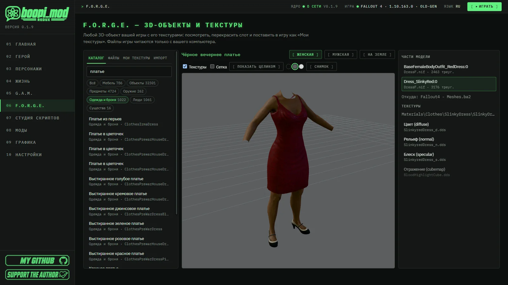</p>

- **Каталог игры:** мебель, предметы, оружие, одежда и броня, люди и существа — с названиями на вашем языке. Технические
  записи скрыты, есть фильтр по плагину и сортировка, поиск не различает регистр, «ё» и дефисы; вкладка «Файлы» показывает
  все модели. Управление с клавиатуры, «Пересканировать» после смены порядка загрузки. В 3D — настоящие текстуры (цвет,
  нормали, блеск, свечение), выбор части щелчком, глаз у каждой части, каркас.
- **Оружие из деталей:** панель «Сборка» — любой вариант оружия из игры и любая деталь в каждом слоте из вашего порядка
  загрузки; детали встают по точкам крепления, каждая перекрашивается. «От первого лица» — для оружия и одежды, у которых
  игра хранит такую модель.
- **Цвета палитры и одежда на скелете:** волосы и броня показаны в настоящем цвете; одежда надета на скелет G.A.M. — в позе
  «Как сделано», «Стоя» или в кадре любой вашей сцены.
- **Перекраска:** «Сохранить как PNG» → правите в любом редакторе → «Новая картинка…» (или программа сама перечитает
  изменённый PNG). Она переводит картинку в формат игры (формат и мипы оригинала сохраняются, карта нормалей остаётся
  картой нормалей, размер не меняется молча); результат виден сразу, «Показать оригинал» сравнивает. Ограничений на ваши
  собственные текстуры нет.
- **Пять охватов:** файл текстуры (везде) · только этот материал (по умолчанию) · только эта вещь · только этот человек ·
  только кожа этого человека. Записи для вещи и человека ложатся в маленький плагин `BoopiForge.esp`, который ставится и
  убирается вместе с модом.
- **Карты из основной текстуры:** генератор делает рельеф (карту нормалей), отражения (specular/gloss, с пресетами ткани,
  кожи, металла, дерева…), впадины и свечение — с предпросмотром на модели; результат — обычный черновик.
- **«Мои текстуры»** ставятся модом через журнал: удалите запись или весь мод — файлы вернутся байт в байт. На тысячах
  записей не тормозят: миниатюры, поиск, группы. «Применить все черновики» ставит всё одной инсталляцией. Ставьте при
  закрытой игре.
- **Пакеты текстур `.ogmod`:** поделитесь перекрасками; в пакете только ваши картинки. Ставятся перетаскиванием или с
  boopi.site.
- **Импорт текстурного мода целиком:** перетащите на страницу папку или .zip, где файлы лежат как в `Textures\…`, — ещё до
  установки видно, какие текстуры заменят игровые, а какие в игре не найдены; «В игру» ставит всё одним щелчком через
  журнал, и так же целиком убирается.
- **Своя модель в игру («Мои объекты»):** OBJ, glTF или GLB превращается в новый статичный объект — программа сама пишет
  NIF, материалы, текстуры и коллизию. Единицы, масштаб, ось и поворот, предпросмотр «как увидит игра»; объект появляется в
  меню мастерской («Украшения»/«Мебель») бесплатным рецептом и ставится из консоли `player.placeatme`. Убирается через
  журнал без следов.
- **Наружу:** шаблон UV для рисования текстуры, экспорт видимого в OBJ или GLB, снимок 3D-вида в PNG.
- **Удобства:** тёмный / серый / светлый фон, перетаскивание моделей и картинок на окно, поиск по названию, editor id,
  form id или пути модели.

<table>
  <tr>
    <td width="50%"></td>
    <td width="50%"></td>
  </tr>
  <tr>
    <td width="50%">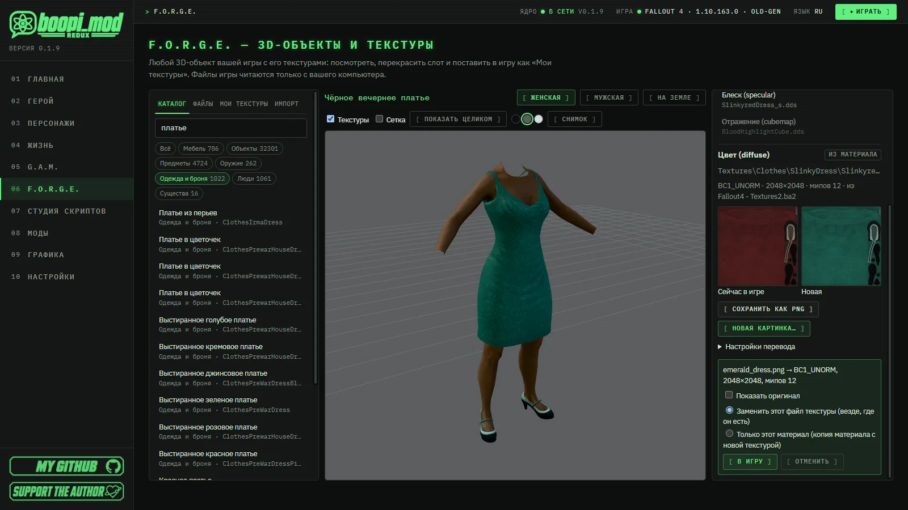</td>
    <td width="50%">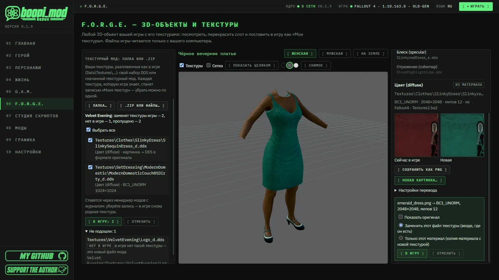</td>
  </tr>
</table>

Руководство: [instructions/FORGE.md](instructions/FORGE.md).

## Skyrim SE: бета

Skyrim Special Edition в 0.2.0 — первый шаг от «фундамента» к игре (бета). Его можно выбрать в «Настройки → Игры и
оформление»; приложение само находит установленную игру.

- **Свой читатель архивов Skyrim (BSA)** — версий SE и LE: F.O.R.G.E. и G.A.M. находят файлы в архивах игры.
- **Скелет из самой игры:** `skeleton.nif` вашей Skyrim читается нашим читателем, сцены G.A.M. переносятся именно на него.
- **GAM for Skyrim** — плагин SKSE64 (SE 1.5.97 и AE 1.6.x через Address Library), который играет сцены G.A.M. в Skyrim:
  консольная команда `gam` (`gam list`, `gam play <сцена>`, `gam stop`) и Papyrus. Ставится кнопкой в «Настройки → Игры и
  оформление» или «Поставить в Skyrim» в G.A.M. → «Другие игры».
- **F.O.R.G.E. для Skyrim:** пока только просмотр моделей и текстур.
- **Честно:** это бета. Плагин собран и проверен без запуска игры — нужны ваши отчёты; события сцены, звуки таймлайна,
  предметы и камера пока есть только у версии для Fallout 4. SKSE64 и Address Library вы скачиваете сами.

## Студия скриптов: диалоги, сцены и свой мод

<p align="center"></p>

<table>
  <tr>
    <td width="50%"></td>
    <td width="50%"></td>
  </tr>
</table>

- **Деревья диалогов** в формах или YAML: приветствия, ответы, условия (SPECIAL, отношения, флаги, предметы, время),
  последствия, жесты и сцены G.A.M. прямо в реплике. Условия и последствия — настоящие редакторы (флаги из файла,
  стадии, предметы и квесты через выбор), YAML-комментарии при правке сохраняются.
- **Карта веток и проверка**, которая сразу ведёт к ошибке: триггеры сверяются с местами, предметами, квестами и людьми так
  же, как при сборке; «приветствие, которое никогда не прозвучит» тоже находится.
- **Проигрыватель диалога:** прокликайте колесо в программе с тестовым состоянием — без сборки и без игры.
- **Триггеры:** герой входит в место, наступает час, кончается таймер, ставится стадия квеста, кого-то убили, получили
  предмет или что-то использовали — показать сообщение, начать разговор (можно открыть именно выбранное дерево), сыграть
  сцену, дать награду, поставить флаг, показать или скрыть, запереть, переместить, сменить фракцию.
- **Копировать, вставить, дублировать** узлы и группы (в том числе между файлами), **Ctrl+F** по текстам и флагам,
  переименование с переносом всех ссылок, версии с показом отличий.
- **Свои диалоги для персонажей игры и DLC** (Дейзи, Вадим, поселенцы…) — открываются первыми в их обычном разговоре.
- **Ответвления от колёс игры:** возьмите настоящий разговор из Fallout 4 и добавьте свой вариант реплики на его колесо.
- **Реплики самой игры:** укажите в ответе ванильную реплику — персонаж скажет её своим голосом с липсинком.
- **Озвучка** своими записями или синтезом, с липсинком и мимикой (выбор «Лицо» у реплики); заготовки Papyrus для тех,
  кому нужен скрипт.
- **«🎙 Озвучить всё»:** все реплики файла озвучиваются в один клик — свой голос и образец голоса на каждого говорящего,
  оценка стоимости для платных провайдеров, прогресс; готовые записи того же текста берутся без новой озвучки, изменённые
  озвучиваются заново.
- **«+ История»:** готовый диалог с двумя триггерами, чтобы было от чего оттолкнуться; пример истории в один клик.
- **«Проверить в ИИ-режиме»:** поговорите со своим диалогом так, как его сыграет ИИ, ещё до игры — видно, какие цели и
  флаги сработали.
- **Свой мод одним `.ogmod`** с требованиями (версия программы, плагины, другие моды): другой игрок перетаскивает его в
  окно boopi_mod, всё ставится вместе и убирается вместе; публикация на boopi.site прямо из Студии.

Руководство: [instructions/SCRIPT_STUDIO.md](instructions/SCRIPT_STUDIO.md).

## ИИ-помощь и ИИ-диалог

<p align="center"></p>

ИИ в boopi_mod — это **помощник мододела** и, отдельно, **режим игры**. Во всём это ваш выбор: ИИ можно не подключать, и
менеджер модов, студия, G.A.M. и графика будут работать без него.

**Помощь в создании.** Ветка диалога по описанию, сцена по фразе, расстановка порядка загрузки «через ИИ», проверка ваших
деревьев в тестовом чате.

**Говорите как с человеком, а не с меню.** В режиме **«Прогрессивный ИИ-диалог»** колесо остаётся, но на нём появляется
пункт **«Сказать своё…»**: вы пишете (в русской или английской раскладке) или говорите, удерживая **V**. Человек отвечает в
образе — голосом и субтитром. Он знает, кто вы, что между вами было, ваш **S.P.E.C.I.A.L.**, уровень, карму и ход сюжета, а
правильные слова могут обернуться свиданием или близостью — если он тоже этого хочет.

<p align="center"></p>
<table>
  <tr>
    <td width="50%"></td>
    <td width="50%"></td>
  </tr>
</table>

- **Меняется игра, а не только чат.** ИИ только *просит*, ядро *проверяет и исполняет*: он может дать предмет, продвинуть
  квест, начать сцену или сделать шаг в отношениях — но лишь то, что разрешают авторские диалоги этого человека, и только
  когда разговор до этого дошёл. Так сломать игру он не может.
- **Память.** Люди помнят прошлые разговоры и как вы с ними обошлись.
- **Любая модель.** OpenRouter, DeepSeek или OpenAI со своим ключом — или локальная модель на вашем ПК: Ollama, LM Studio
  или любой OpenAI-совместимый сервер. Локально — без ключа и без интернета, ничего не уходит с компьютера. Средние
  локальные модели (около 27B) уже нормально держат разговор. Ключи лежат в Диспетчере учётных данных Windows.
- **Голоса.** Edge TTS работает сразу и без ключа; ElevenLabs и OpenAI TTS онлайн; локально — XTTS-v2 (умеет клонировать
  голос по репликам самой игры) и Silero. Говорить можно голосом: распознавание речи работает локально через
  faster-whisper.
- **Новое в 0.1.8 — ИИ в разговорах самой игры.** Когда открыто родное колесо диалога, нажмите **T** и напишите, что хотите
  сказать, — ИИ выберет подходящий ответ на колесе, и квест пойдёт ровно как задуман. Если ничего не подходит, человек
  ответит вам в образе, а колесо останется открытым. Настройка «ИИ в ванильных диалогах»: выкл / подбирать ответ /
  подбирать и свободные реплики.
- **Новое в 0.1.8 — говорите с кем угодно.** Нажмите **T** перед любым человеком — именным персонажем, поселенцем, роботом,
  кем-то из DLC — и начните свободный разговор. Он знает свою фракцию, место и квесты, в которых участвует.
- **Новое в 0.1.8 — последствия доходят до игры:** флаги, предметы, стадии квестов и жесты из ИИ-разговора срабатывают в
  игре; «Сказать своё…» есть в каждом авторском диалоге. Виджеты в игре — на **F10**.
- **Липсинк и мимика (0.1.9, в 0.2.0 заметно лучше).** Губы собеседника двигаются под голос ИИ-ответа и озвученные реплики
  деревьев Студии: звуки плавно перетекают друг в друга, а лицо играет эмоцию реплики — брови, веки, моргание в паузах.
  Выключатель — `BoopiUI.ini [Audio] bLipSync`.
- **Свои деревья мододела** тоже получают ИИ-режим: секция «ИИ-диалог» в студии описывает, кто этот человек и к чему
  вести разговор.

Руководство: [instructions/AI_DIALOGUE.md](instructions/AI_DIALOGUE.md).

## «Жизнь» и живые люди

<table>
  <tr>
    <td width="50%">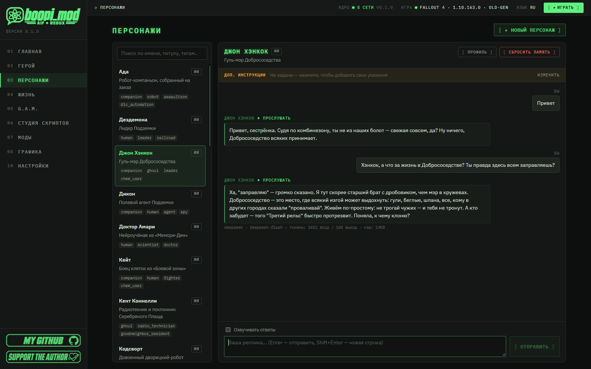</td>
    <td width="50%">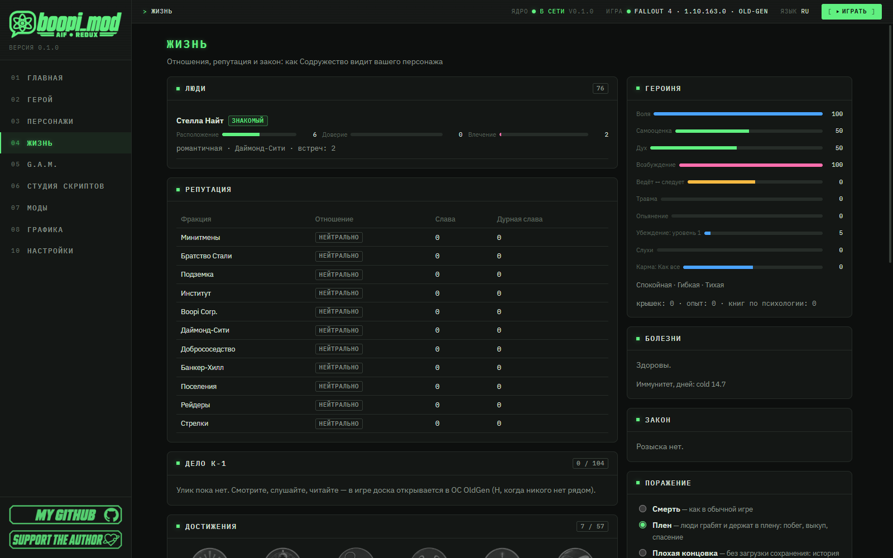</td>
  </tr>
</table>

У каждого своё отношение к вам: насколько вы ему нравитесь, насколько он вам доверяет и тянет ли его к вам. Флиртуйте, зовите
на свидание, выбирайте место для вечера, становитесь парой, делайте предложение — или попадитесь и узнайте, как вас
ревнуют. Мир тоже реагирует: репутация, закон, работа, даже болезни.

- **С каждым NPC свои отношения** — симпатия, доверие и влечение растут или падают от того, что вы делаете, говорите и
  дарите.
- **Флирт и комплименты, свидания в настоящих местах** — столик в клубе, прогулка, комната на ночь, одному или с любимым
  человеком.
- **Ночь вместе** идёт сценой на нашем движке; важно всё — настроение, отношения, сколько выпито и сам момент, — и вам
  могут отказать.
- **Пара, предложение и свадьба**; партнёры и супруги живут своей жизнью — и ревнуют, если застанут.
- **Репутация у фракций, закон и награды за голову:** стража помнит преступления, фракции — на чьей вы стороне.
  Поселенцев могут похитить.
- **Работа и смены** за крышки; **болезни** (простуда, грипп, жар, отравление, лучевая болезнь) — от
  погоды, укусов, еды и людей (свои походки при болезнях придут с нашими анимациями); доктора в поселениях лечат и снимают зависимость.
- **Поражение на ваш выбор:** смерть как в ванили, плен или «плохая концовка».
- **27 ключевых персонажей** с историей, характером и памятью — с ними можно поговорить прямо в программе (чат с озвучкой),
  ещё до запуска игры, поправить их карточки или создать своих.
- **OldGen OS на Пип-Бое** (**H**): люди, репутация и карма, досье, здоровье и **71 достижение (15 скрытых)**.

## Boopi Corp. и «Чёрный жёлудь»

Новый уголок Содружества — живые места со своими людьми и диалогами:

- **Ночной клуб «Чёрный жёлудь»** у Даймонд-сити: охрана, бар, Стелла поёт на сцене (и у вас есть шанс), танцпол в мягком
  цветном свете, VIP-зал и уютные комнаты наверху.
- **Штаб Boopi Corp.** с синтами 4-го поколения — у каждой своя работа, внешность и история.
- **«Ред Рокет»** — теперь бар для поселенцев.
- **Живые места:** около сотни человек в клубе, баре и штабе двигаются сценами G.A.M. — танцоры танцуют всем телом,
  гости сидят с сигаретой или бокалом, картёжники играют в карты, барменши моют стаканы, уборщица моет пол, в штабе
  печатают за терминалами и поливают сад. Заговорите с человеком — сцена остановится, и откроется разговор.
- **Пары (с 0.2.0):** двое людей одного места могут играть одну сцену на двоих — карты через стол, танец вдвоём,
  разговор за столиком. Механизм готов и проверен в игре; сами парные сцены придут с нашими анимациями. В «Ред Рокете»
  картёжники теперь сидят за двумя столами друг напротив друга.
- **Живо и без паков:** официантки клуба ходят кругом между баром и лаунжами, вокруг гостей появилась «стоячая» мебель
  (кофе, газета, сигарета, лапша), а вечером с 19:00 до 01:00 бездельники расходятся шире — к бару, на танцпол, к чужим
  столикам. Полностью места оживут с нашими анимациями, которые выйдут отдельными модами в ближайшее время; пока нет
  подходящей сцены, человек занят ванильными делами.
- Свидания «Жизни» проходят в настоящих местах — например, за столиком в клубе. Эти места — и часть истории
  [«Колыбельной»](#колыбельная-новая-история).

## «Колыбельная»: новая история

<p align="center"></p>

<p align="center"></p>

*Двести десять лет машина берегла тебя в тайной капсуле. Тебя разбудили на год раньше срока, потому что за тобой пришли.
Чтобы понять, кто ты, нужно найти тех, кто пришёл, и вспомнить утро, которое ты сам(а) попросил(а) забыть.*

- **Вы — второй спящий Убежища 111.** Капсула **К-1**, не та, из которой вышла Нора, и вы не её супруг(а). Ядро OldGenAI
  будит вас в **09:44**, а Нора ушла **шестнадцать дней назад** искать сына. Вы не знаете ни кто вы, ни кто вас разбудил.
- **Корпорация Boopi.** Штаб-квартира, её синты 4-го поколения, ночной клуб «Чёрный жёлудь» и бар «Ред Рокет» — живые
  места со своими людьми и диалогами ([подробнее](#boopi-corp-и-чёрный-жёлудь)). Ядро заботится о вас так, как его учили,
  и этой заботой можно задохнуться.
- **«Дело К-1» — детектив.** Кто я? Кто меня разбудил? Почему за мной охотятся? Доска улик, шифр, мини-игры; каждая
  найденная правда задаёт вопрос страшнее прежнего. А ответ на последний может оказаться не таким, каким вы его ждёте:
  **вы можете оказаться не тем, кем себя считаете.**
- **Четыре акта, 18 основных миссий, 13 побочных заданий, 9 финалов.** Финал определяет не последняя кнопка, а весь ваш
  путь: решения и репутация — у людей, фракций и у ядра. Есть один по-настоящему хороший финал, один по-настоящему плохой
  и семь — между ними.
- **Сколько играть:** примерно **20–25 часов** на основную линию и **30+** с побочными заданиями; по дороге — романтика.
  С 0.1.8 сюжет проходится до любого из 9 финалов, а журнал Пип-Боя показывает все цели.
- **Ваниль вплетена, а не выброшена.** Лучшие ванильные квесты — Убежище 114, Форт-Хаген, память Келлога, Светящееся
  море — вы проходите **сами**, внутри новой линии, а путь Норы вам рассказывают люди, которых вы встречаете. Вся прочая
  побочка, напарники, фракции, поселения и DLC остаются доступными.

> [!NOTE]
> Для сюжета рекомендуется **новая игра**; «Жизнь», чат и ИИ-диалог работают и в старых сохранениях.

## Голос: озвучка и распознавание речи

<table>
  <tr>
    <td width="50%"></td>
    <td width="50%"></td>
  </tr>
</table>

- **Озвучка (TTS):** Microsoft Edge TTS работает сразу и без ключа; онлайн ещё ElevenLabs, OpenAI TTS и **Higgs TTS 3**
  (Boson AI: облако со своим ключом или свой сервер, около сотни языков); локально — XTTS-v2 и Silero.
- **Клонирование голоса** (XTTS-v2, Higgs TTS 3): клон делается из реплик самой игры по голосовому типу NPC или из ваших
  записей. В Студии говорящий, который NPC игры или герой, получает **образец своего игрового голоса автоматически**.
- **Липсинк** (с 0.1.9, в 0.2.0 плавный и с мимикой): губы двигаются под любую озвучку ИИ-ответов и реплик Студии — своим
  расчётом по записи, без сторонних инструментов; эмоция реплики, акценты, вопрос и моргание играют на лице.
- **Субтитры игры** показываются в правильной кодировке (русские и польские таблицы, в том числе старых кодовых страниц).
- **Распознавание речи (STT):** встроенный faster-whisper (работает локально, на процессоре) или OpenAI Whisper; в игре —
  push-to-talk на **V**.
- Тяжёлые движки не входят в приложение: ставятся по кнопке, лицензии XTTS и Silero (некоммерческие) принимаются явно.

Руководство: [instructions/VOICE.md](instructions/VOICE.md).

## Графика под ваш ПК

<p align="center">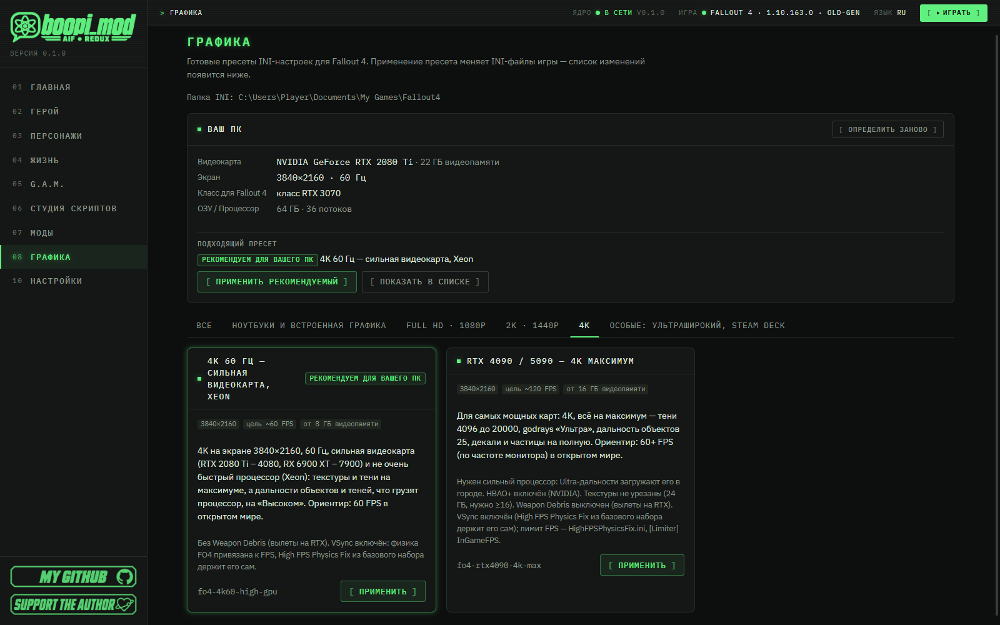</p>

- **12 готовых пресетов** (от встроенной графики 720p и Steam Deck до RTX 4090 в 4K и ультраширокого монитора).
- Приложение определяет видеокарту, экран, ОЗУ и процессор и отмечает **«Рекомендуем для вашего ПК»**; применение
  правит INI игры и делает резервные копии.

## ОС OldGen на Пип-Бое

**OldGen OS** — приложение на Пип-Бое (клавиша **H**, когда перед героем никого нет): люди, репутация и карма, досье,
здоровье и **71 достижение (15 скрытых)**.

## Безопасность встроена

Проект содержит взрослый контент (**18+**). Правила содержимого встроены в ядро программы и не обходятся ни
настройками, ни ответом модели: романтика и близость — только между взрослыми и по согласию; принуждение закрыто для всех;
**ребёнок не участвует в таких сценах ни при каких настройках**. Любой запрос флирта, романтики или близости проверяет само
ядро, что бы ни ответил ИИ.

## Честно об ограничениях

- **ИИ-диалог в игре — ещё бета.** ИИ работает и в ванильных квестовых диалогах (**T** на открытом колесе). Пока звучит
  ответ ИИ, строка ввода скрыта.
- **Липсинк:** одна эмоция на реплику; озвучка XWM без файла `.lip` губ не двигает; звук без текста подбирает гласные
  по формантам, качество ниже.
- **Живые места:** парные сцены ждут наших паков анимаций; гости не приходят и не уходят, к стенам и перилам не
  прислоняются; остановка разговором не мгновенна (сцена доигрывает проход, до ~8 с).
- **Skyrim SE — бета:** плагин проверен без запуска в самой Skyrim; нет событий сцены, звуков, предметов и камеры; в
  F.O.R.G.E. только просмотр. Остальные игры пока не играбельны.
- **Рост ролей в игре:** подгоняются места и руки; высота сиденья под рост не подгоняется.
- **F.O.R.G.E.:** своя модель — только статичный объект (не мебель для сидения и не предмет), коллизия — коробка по
  габаритам; окраска оружия и смешивание сгенерированного рельефа с оригинальным пока не сделаны; вещи из списков уровня
  для «только этого человека» не берутся.
- **Свои диалоги на персонажах игры и DLC:** пока персонажа держит сюжетный квест игры (например, Кэсси или Кент),
  первым идёт этот квест, а ваше дерево — после него.
- **Next-Gen / Anniversary (1.10.98x, 1.11.x) не поддерживаются.** Цель — 1.10.163 (Old-Gen); Steam и GOG не тестировались.
- **Это бета:** возможны неточности и баги — [пишите](https://github.com/boopi-coder/boopi_mod/issues/new/choose), исправлю оперативно.
- Сюжет — первая публичная редакция: мир и мини-игры будут дорабатываться; для сюжета лучше **новая игра**.
- Файлы релиза **не подписаны цифровой подписью**: SmartScreen может предупредить о неопознанном издателе — сверяйте SHA-256.
- Локальные движки речи большие (XTTS-v2 — около 4,7 ГБ, желательна NVIDIA) и ставятся по кнопке.
- Только Windows.

Полный список — в [заметках к релизу](docs/release/v0.1.0.md#известные-ограничения).

---

## Установка и первый запуск

<p align="center"></p>

### Что нужно

| Что | Нужно |
|---|---|
| Система | Windows 10 (22H2) или 11, x64; WebView2 (есть в Windows 11 и в обновлённой Windows 10) |
| Игра | Лицензионный **Fallout 4 версии 1.10.163 (Old-Gen)** |
| F4SE | Нужен, **в архив не входит**: приложение скачивает его с официальной страницы автора по вашей кнопке |
| ИИ (по желанию) | Ключ API одного из провайдеров (OpenRouter, DeepSeek, OpenAI) **или** локальная модель (Ollama, LM Studio, любой OpenAI-совместимый сервер). Без ИИ работают менеджер модов, студия, G.A.M. и графика |
| Интернет | Для установки модов, ИИ-провайдера и онлайн-озвучки |
| Место на диске | Несколько ГБ под кэш модов; локальный XTTS-v2 — ещё около 5 ГБ (по желанию) |

### Шаг 0. Скачать и распаковать

1. Скачайте **`boopi_mod-0.2.0-win-x64.zip`** со страницы [Releases](https://github.com/boopi-coder/boopi_mod/releases/latest)
   и сверьте SHA-256 с файлом `SHA256SUMS.txt` из того же релиза (для 0.2.0 это `3990f910b897f091d6852ed5fbb3a7e419c45139a0be3479a77b67fe0e10a267`).
2. Распакуйте в **короткий путь**, например `C:\Games\boopi_mod` (не в «Загрузки» и не в глубокие папки: Windows не
   запускает программы с путём длиннее 260 символов).
3. Запустите **`boopi_mod.exe`** — приложение само поднимет ядро. При первом запуске выберите язык и игру (играбельна
   Fallout 4; Skyrim SE — бета, остальные отмечены «скоро»).
4. На Главной нажмите **«Скачать и установить»**: программа скачает наши моды с [boopi.site](https://boopi.site)
   (≈ 215 МБ; каталог подписан, файлы проверяются по SHA-256), затем **«Перезапустить ядро»**. Дальше моды
   обновляются сами, отдельно от программы.

> [!WARNING]
> Файлы релиза не подписаны цифровой подписью, поэтому Windows SmartScreen может показать предупреждение. Скачивайте
> только со страницы релизов и сверяйте хеш.

### Шаг 1. Главная: всё ли найдено

<p align="center">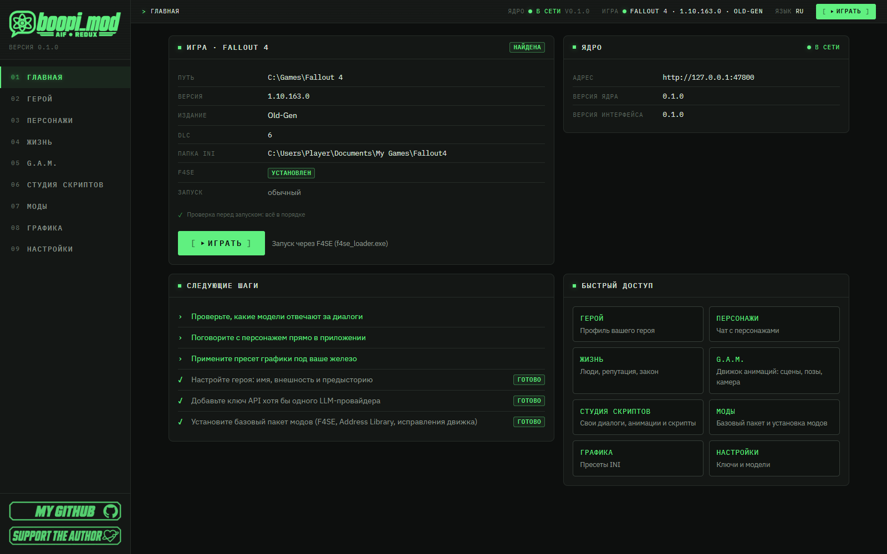</p>

Откроется **Главная**. Игра должна найтись сама: путь, версия **1.10.163**, издание Old-Gen, статус F4SE. Справа вверху
видно, что ядро «в сети». Внизу — «Следующие шаги»: приложение само подсказывает, что осталось сделать.

### Шаг 2. Путь к игре (если не нашлась)

<p align="center">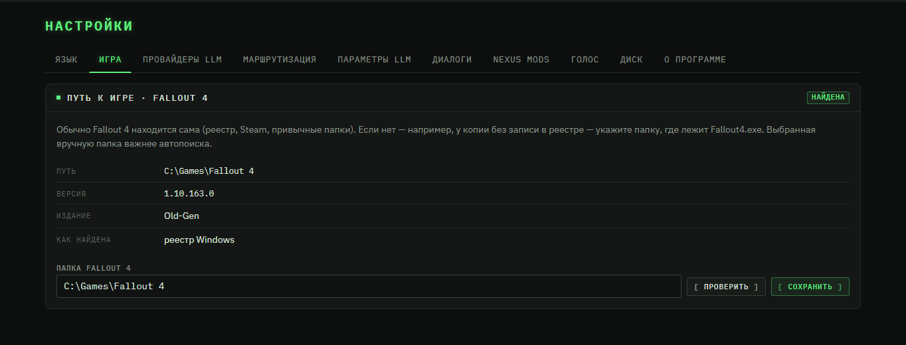</p>

Если игра не найдена (например, копия без записи в реестре), откройте **Настройки → Игра**, укажите папку с `Fallout4.exe`,
нажмите **«Проверить»**, затем **«Сохранить»**. Выбранная вручную папка важнее автопоиска.

### Шаг 3. Моды → «Базовый пакет»

<p align="center"></p>

Откройте **Моды** и нажмите кнопку установки базового пакета: F4SE, Address Library, Buffout 4 NG, UFO4P, High FPS Physics
Fix, MCM, Baka ScrapHeap и наши части. Что скачивается с Nexus Mods — потребует ваш аккаунт: с Premium ссылки прямые, без
него — кнопка «Slow download» в окне Nexus внутри приложения. Всё, что установлено, видно справа; удалить можно любой мод.

### Шаг 4. Ключ ИИ-провайдера (по желанию)

<p align="center"></p>

Для ИИ-диалога и ИИ-помощника: **Настройки → Провайдеры LLM** → вставьте ключ API → **«Сохранить ключ»** → **«Проверить»**.
Ключ хранится в Диспетчере учётных данных Windows и не показывается повторно. Какая модель за что отвечает — на вкладке
**«Маршрутизация»**. Без ключа пропустите шаг: менеджер модов, студия, G.A.M. и графика работают и так. Локальная модель
(Ollama, LM Studio или свой OpenAI-совместимый адрес) ключа не требует — в списке провайдеров есть готовые пункты.

### Шаг 5. Режим диалогов

<p align="center"></p>

**Настройки → Диалоги** → режим **«Прогрессивный ИИ-диалог»** (или «Ванильные», если ИИ в разговорах не нужен). Здесь же —
длина ответа, озвучка и подсказки реплик.

### Шаг 6. Герой, графика и «Играть»

<p align="center">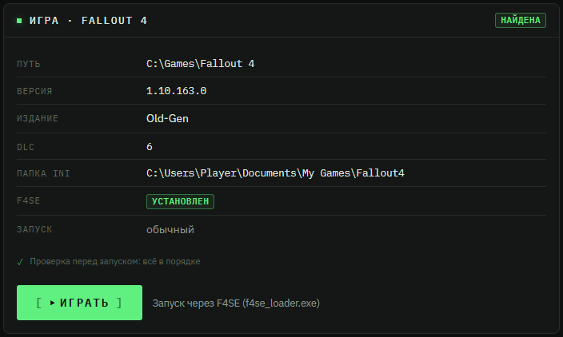</p>

1. **Герой** — имя и пол подтянутся из последнего сохранения; впишите внешность и предысторию: их увидят персонажи.
2. **Графика → «Применить рекомендуемый»** (правит INI игры и делает резервные копии).
3. Нажмите **«Играть»** — запуск идёт через F4SE. «ИИ-диалог» и «Жизнь» работают сразу, сюжет — с новой игры.

### Ядро не найдено («Файл ядра не найден») или ругается антивирус

Что значит каждое сообщение экрана «Ядро не отвечает» (в том числе «Ядро работает, но приложение не может к нему
подключиться») — [Руководства → Если ядро не отвечает](instructions/README.md#если-ядро-не-отвечает).

1. Скорее всего, антивирус убрал `core\oldgenai-core.exe` в карантин. Это ложная тревога: ядро — неподписанная программа
   на Python, а такие некоторые антивирусы помечают по шаблону.
2. Скачивайте архив только со страницы [Releases](https://github.com/boopi-coder/boopi_mod/releases/latest) и проверьте
   SHA-256 (PowerShell: `Get-FileHash .\boopi_mod-0.2.0-win-x64.zip`). Для 0.2.0 должно быть `3990f910b897f091d6852ed5fbb3a7e419c45139a0be3479a77b67fe0e10a267`.
3. Верните файл из карантина или добавьте папку boopi_mod в исключения антивируса и распакуйте архив заново.
4. Распаковывайте в обычную папку (не в Program Files) и не запускайте прямо из архива.
5. Напишите, какой у вас антивирус и как он назвал угрозу, — я отправлю им ложное срабатывание.

<details>
<summary><b>Если что-то пошло не так (нажмите, чтобы раскрыть)</b></summary>

- **Игра не найдена.** «Настройки → Игра» → укажите папку с `Fallout4.exe`.
- **Версия игры не 1.10.163.** Приложение предупредит; запуск не блокируется, но работоспособность не гарантируется. Next-Gen
  и Anniversary не поддерживаются.
- **Не запускается `boopi_mod.exe`.** Проверьте путь (короткий, без глубоких папок) и наличие WebView2. SmartScreen:
  «Подробнее» → «Выполнить в любом случае» — после сверки SHA-256.
- **Не скачивается мод с Nexus.** Нужен аккаунт; без Premium используйте «Slow download» в окне Nexus внутри приложения.
- **ИИ молчит.** «Настройки → Провайдеры LLM» → «Проверить» у вашего провайдера; проверьте баланс ключа, маршрут
  «Диалог» на вкладке «Маршрутизация» и режим на вкладке «Диалоги».
- **Нет голоса.** «Настройки → Голос»: выберите провайдера озвучки; Edge TTS не требует ключа, но нужен интернет.
- **Игра вылетает при запуске.** Откройте журнал вылета Buffout 4 NG (папка `Documents\My Games\Fallout4\F4SE`, файлы
  `crash-*.log`) и приложите к обращению.
- **Журналы приложения:** `%APPDATA%\BoopiMod\logs\` (`app.log`, `core.log`, `all.log`, `errors.log`). Данные и настройки:
  `%APPDATA%\BoopiMod\`.

**Не помогло?** [Откройте issue](https://github.com/boopi-coder/boopi_mod/issues/new): версия приложения, шаги, файл
`all.log` и журнал вылета F4SE. Пишите о любых проблемах и идеях — будем решать.

</details>

**Что приложение ставит само** (по вашей кнопке, с проверкой хешей): F4SE и Buffout 4 NG — с GitHub их авторов; Address
Library, UFO4P, High FPS Physics Fix, MCM, Baka ScrapHeap — со страниц авторов на Nexus Mods. Свои плагины
(`BoopiCorp.esp`, `OldGenStory.esp`, плакаты, `boopi_hud`) и F4SE-плагины (`OldGenAI.dll`, `BoopiUI.dll`, `GAM.dll`)
приложение собирает и кладёт в игру само.

### Обновления

При каждом запуске (без паузы в сутки) приложение проверяет, не вышла ли новая версия, и сразу показывает на Главной
плашку **«Доступна новая версия»** с кнопкой «Скачать». Проверку можно выключить в настройках. Хотите узнавать о релизах и без
программы — нажмите на GitHub **Watch → Custom → Releases**, и о каждой новой версии придёт письмо.

---

## Для мододелов

<p align="center"></p>

Всё, что делает приложение, можно расширять — без программирования и без чужих программ. Что можно создать:

- **Свою анимацию** — в 3D-редакторе G.A.M. с IK-ручками или словами через ИИ-аниматора; импортировать анимации из
  установленных у вас модов.
- **Свой разговор** — дерево диалога с ветвлением, жестами и сценами; ответвление от колеса игры; диалог на персонаже игры или DLC; озвучку и липсинк.
- **Свою сцену** — участники, движение, камера, теги, чтобы её находили «Жизнь», диалоги и чужие моды.
- **Свои звуки на таймлайне сцены**, **свои текстуры и модели** (F.O.R.G.E.): перекраска предметов игры для всех, для одной
  вещи или для одного человека, пакеты текстур `.ogmod`, своя 3D-модель как объект мастерской.
- **Свой мод одним файлом `.ogmod`**, который другие ставят в один клик, и **свои ИИ-диалоги** — с проверкой в тестовом чате.

| Инструкция | О чём |
|---|---|
| [SCRIPT_STUDIO.md](instructions/SCRIPT_STUDIO.md) | Студия скриптов: деревья диалогов, ответвления от игры, ИИ-блок, озвучка, свой мод `.ogmod` |
| [ANIMATION_IMPORT.md](instructions/ANIMATION_IMPORT.md) | Импорт анимаций и редактор сцен G.A.M. |
| [ANIMATION_GUIDE.md](instructions/ANIMATION_GUIDE.md) | Анимации в диалогах и скриптах: жесты, сцены, камера, контексты |
| [AI_DIALOGUE.md](instructions/AI_DIALOGUE.md) | Режим ИИ-диалога: что видит игрок, что умеет и чего не умеет ИИ |
| [VOICE.md](instructions/VOICE.md) | Озвучка и распознавание речи: провайдеры, клонирование голоса, липсинк |
| [FORGE.md](instructions/FORGE.md) | F.O.R.G.E.: каталог 3D-объектов игры, перекраска (вещь, человек, палитра), генератор карт, «Мои текстуры», пакеты текстур, «Мои объекты» |

Все руководства есть и [на английском](instructions/en/README.md).

## Вопросы и ответы

<details>
<summary><b>Поддерживается ли Next-Gen / Anniversary (1.10.98x, 1.11.x)?</b></summary>

Пока нет. Целевая версия — **1.10.163 (Old-Gen)**: на ней стабильны F4SE-плагины. Приложение предупредит, если версия
игры другая; запуск не блокируется, но работоспособность не гарантируется. Steam- и GOG-издания не тестировались.
</details>

<details>
<summary><b>Нужен ли ИИ, чтобы пользоваться программой?</b></summary>

Нет. Менеджер модов, студия скриптов, редактор и импорт G.A.M. и пресеты графики работают без ИИ. ИИ нужен для
помощника, ИИ-диалога в игре и (по желанию) облачной озвучки. А если нужен, но без облака, — подойдёт локальная модель
(Ollama, LM Studio, любой OpenAI-совместимый сервер): средние модели (около 27B) уже нормально держат разговор.
</details>

<details>
<summary><b>Что будет со старыми сохранениями?</b></summary>

«Жизнь», чат и ИИ-диалог не требуют новой игры, но сюжет «Колыбельная» и новые места рассчитаны на **новую игру**.
Добавление и удаление плагинов в середине прохождения — обычный риск для любых модов: делайте копию папки `Saves`.
</details>

<details>
<summary><b>Что уходит в интернет и где мои ключи?</b></summary>

Телеметрии нет. Реплики диалога и данные героя и персонажа уходят **выбранному вами провайдеру ИИ** (OpenRouter, DeepSeek,
OpenAI; текст озвучки — Microsoft Edge TTS или ElevenLabs/OpenAI, если вы их выбрали). Хотите, чтобы ничего не уходило, —
используйте локальную модель (Ollama, LM Studio) и локальные XTTS / Silero / Whisper. Проверка обновлений — один запрос к github.com при запуске,
без данных о вас; выключается в настройках. Ключи API хранятся в **Диспетчере учётных данных Windows**
(служба `BoopiMod`) и не записываются в файлы.
</details>

<details>
<summary><b>Это безопасно для игры?</b></summary>

Моды ставятся через журнал с полным откатом; перед запуском приложение проверяет версию игры, F4SE и обязательные моды.
Правила содержимого сосредоточены в одном модуле ядра: романтика и близость — только между взрослыми и по согласию;
принуждение закрыто для всех; ребёнок не участвует в таких сценах ни при каких настройках; ИИ не может ничего из этого
обойти.
</details>

<details>
<summary><b>Можно ли делиться модами, которые я сделал?</b></summary>

Да. Моды, созданные в boopi_mod (деревья диалогов, сцены, озвучка, пакеты `.ogmod` из вашей работы), принадлежат вам
(см. `NOTICE.txt`). Уважайте права авторов того, что вы в них включаете.
</details>

<details>
<summary><b>Работает ли ИИ в обычных квестовых диалогах игры?</b></summary>

Да, с 0.1.8. Когда открыто родное колесо, нажмите **T** и напишите, что хотите сказать: ИИ выберет подходящий ответ на
колесе, и квест пойдёт ровно как задуман. Если ничего не подходит, человек ответит в образе, а колесо останется открытым.
Настройка «ИИ в ванильных диалогах»: выкл / подбирать ответ / подбирать и свободные реплики. А **T** перед любым человеком
начинает свободный разговор.
</details>

<details>
<summary><b>Двигаются ли губы у ИИ-реплик?</b></summary>

Да: движение губ считается по самой записи голоса (а если известен текст — и по буквам) и играет на лице собеседника —
так же и в озвученных WAV репликах ваших деревьев Студии. С 0.2.0 звуки плавно переходят друг в друга, а лицо играет
эмоцию реплики (брови, веки, моргание). Выключатель — `BoopiUI.ini [Audio] bLipSync`.
</details>

<details>
<summary><b>Можно ли играть в другие игры, не только в Fallout 4?</b></summary>

Полностью — только Fallout 4. У Skyrim SE в 0.2.0 появилась бета: чтение архивов игры, скелет из самой игры и плагин
SKSE64 GAM for Skyrim, который играет сцены G.A.M. (он собран без проверки в самой игре — буду рад отчётам). Остальные
игры отмечены «скоро»; сроки я не обещаю.
</details>

<details>
<summary><b>Можно ли поставить в игру свою 3D-модель?</b></summary>

Да, с 0.2.0: откройте OBJ, glTF или GLB в F.O.R.G.E. и нажмите «В игру как объект» — программа сама сделает NIF,
материалы, текстуры и простую коллизию. Объект появится в меню мастерской («Украшения»/«Мебель») и ставится из консоли
(`player.placeatme`). Пока это статичная декорация: не мебель для сидения и не предмет инвентаря; убирается через журнал
без следов.
</details>

<details>
<summary><b>Нашёл ошибку или есть идея — куда писать?</b></summary>

В [issues](https://github.com/boopi-coder/boopi_mod/issues/new) этого репозитория: версия приложения, шаги, файл
`%APPDATA%\BoopiMod\logs\all.log` и журнал вылета F4SE помогут быстро разобраться. **Жду обратной связи — пишите о
проблемах и идеях, будем решать.**

🧡 **Вопросы и пожелания, написанные на [Boosty](https://boosty.to/boopi_coder), разбираются в первую очередь.**
</details>

## Что дальше

**Следующий выпуск:**

- **Наши паки анимаций — главное:** пары и романтика, быт, работа, эмоции, походки и курение, **в том числе взрослые сцены,
  сделанные в G.A.M.**, — после моей ручной доводки. Вместе с ними оживут парные сцены мест (карты вдвоём, танец,
  разговор за столиком) и походки при болезнях.
- **F.O.R.G.E. дальше:** окраска оружия, смешивание сгенерированной карты с оригинальной нормалью, точная коллизия и
  выбор материала у своих объектов.
- **G.A.M. дальше:** импорт BVH, glTF и FBX, сборка пака анимаций прямо из редактора, подгонка высоты сиденья под рост.
- **Skyrim дальше:** проверка в самой игре, события сцены, звуки и предметы.
- **Разговоры NPC между собой.**

**Fallout 4 — впереди много всего:**

- NPC, которые разговаривают друг с другом, и групповые разговоры.
- Побочные задания, которые придумывает ИИ: найти, сопроводить, расследовать.
- Длинная память: люди помнят суть всего, что было между вами.
- Больше «Колыбельной», Boopi Corp. и клуба.
- FOMOD-установщик, профили модов и умнее порядок загрузки.
- Next-Gen и Anniversary версии игры.

**Скоро — другие игры:** Cyberpunk 2077, Skyrim, Starfield и The Sims 4 — тот же менеджер модов, создание анимаций, сцен и
диалогов вручную или с ИИ. Фундамент уже есть: выбор игры, оформления, перенос сцен и бета Skyrim SE. Что появится первым и когда, зависит от **интереса к проекту, поддержки и звёзд на GitHub**:

- ⭐ [Поставьте звезду](https://github.com/boopi-coder/boopi_mod/stargazers) — это лучший способ показать, что проект нужен;
- 💬 [напишите](https://github.com/boopi-coder/boopi_mod/issues/new/choose), какую игру ждёте больше всего;
- 🧡 [поддержите на Boosty](https://boosty.to/boopi_coder) — это напрямую ускоряет работу.

## Обратная связь

> **Это первая бета — жду обратной связи: пишите о проблемах и идеях, исправлю оперативно.**
> [Сообщить о проблеме или предложить идею](https://github.com/boopi-coder/boopi_mod/issues/new/choose) · для ошибки
> приложите версию приложения, `%APPDATA%\BoopiMod\logs\all.log`, журнал вылета F4SE и шаги воспроизведения.

## Поддержать автора

<p align="center">
  <a href="https://boosty.to/boopi_coder"></a>
</p>

boopi_mod делает один человек. Если проект вам полезен — поддержите его на **[Boosty](https://boosty.to/boopi_coder)**: это
напрямую оплачивает время на развитие (новые паки анимаций и сцены, F.O.R.G.E., поддержка Next-Gen, другие игры).
Вопросы и пожелания, написанные на Boosty, разбираются **в первую очередь**.

### ₿ Криптовалюта

<table>
  <tr>
    <td align="center" width="50%">
      <br>
      <sub>сеть Bitcoin</sub><br><br>
      <br><br>
      <code>bc1qw082qflzsw7qzpe6ghtv8uj4cga83ehqfxyx6a</code>
    </td>
    <td align="center" width="50%">
      <br>
      <sub>сеть Ethereum (ERC-20)</sub><br><br>
      <br><br>
      <code>0x69a6Ccd27143F077EBC822f4Af8F8e8dB6371543</code>
    </td>
  </tr>
</table>

Адрес удобно скопировать кнопкой справа от блока ниже:

**Bitcoin (BTC)**

```
bc1qw082qflzsw7qzpe6ghtv8uj4cga83ehqfxyx6a
```

**Ethereum (ETH, ERC-20)**

```
0x69a6Ccd27143F077EBC822f4Af8F8e8dB6371543
```

> [!NOTE]
> Отправляйте только в своей сети: BTC — на адрес Bitcoin, ETH и токены ERC-20 — на адрес Ethereum. Перевод в другой сети может потеряться. Спасибо за поддержку! 🧡

## Лицензия и благодарности

- boopi_mod — **бесплатная программа, все права защищены.** Ею можно бесплатно пользоваться и делиться оригинальным
  архивом с указанием автора. **Нельзя** продавать её, изменять, распространять изменённые версии и исследовать её
  устройство. Полный текст — [`LICENSE.txt`](LICENSE.txt), сторонние компоненты — [`NOTICE.txt`](NOTICE.txt). Моды, которые
  вы создаёте в boopi_mod, — ваши.
- boopi_mod — неофициальный проект, он не связан с Bethesda Softworks / ZeniMax Media. **Fallout** — торговая марка их
  владельцев. Для работы нужна ваша собственная копия игры.
- **Сторонние компоненты в архиве:** 7-Zip (LGPL, без изменений, 7-zip.org); texconv из DirectXTex (Microsoft, MIT);
  CommonLibF4, fmt, spdlog, rsm-mmio (MIT) и boost-stl-interfaces (BSL-1.0) внутри наших F4SE-плагинов; React, three.js,
  Tauri (MIT / Apache-2.0); шрифты IBM Plex (SIL OFL 1.1); библиотеки ядра на Python под своими лицензиями.
- **Не входит в архив и скачивается вами:** F4SE, Buffout 4 NG, Address Library, UFO4P, High FPS Physics Fix, MCM, Baka
  ScrapHeap (у их авторов запрещено или оговорено распространение — приложение лишь помогает скачать с официальных
  источников). Движки речи XTTS-v2 (Coqui Public Model License) и Silero (CC BY-NC-SA 4.0) ставятся по запросу с принятием
  условий.
- Автор: **boopi-coder** — [github.com/boopi-coder](https://github.com/boopi-coder).
