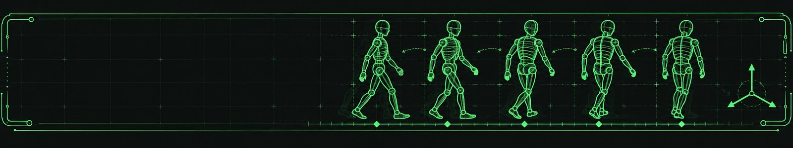
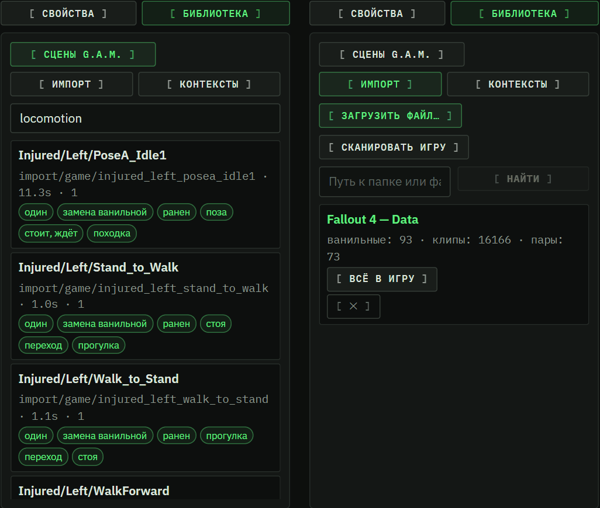

#  Анимации в boopi_mod: импорт из модов, Skyrim и свои сцены

🇷🇺 Русский · [🇬🇧 English](en/ANIMATION_IMPORT.md)

[← Все инструкции](README.md) · [Главная страница проекта](../README.md) · Дальше: [Анимации в модах и скриптах](ANIMATION_GUIDE.md)

> *Моддинг никогда не был так прост.*

boopi_mod — прежде всего **менеджер модов, в котором вы создаёте своё**: анимации, сценарии, сцены и диалоги — вручную или с помощью
ИИ. За анимации отвечает **G.A.M. — движок анимаций**: 3D-редактор с IK-ручками, импорт анимаций из модов Skyrim / OAR / Fallout 4,
ИИ-аниматор и воспроизведение сцен прямо в игре.

> [!NOTE]
> **⏱ За 1 минуту**
>
> - Любая анимация в boopi_mod — это **сцена G.A.M.** (файл `.gam` в вашей библиотеке): роли, кости, мебель и предметы, камера, теги.
> - Самый быстрый путь: откройте **G.A.M.** и **перетащите** в окно архив мода, папку, плагин, BA2 или HKX — пак сам
>   переведётся в сцены с тегами и встанет в игру («Всё в игру»).
> - Читаются моды Fallout 4 (HKX, idle, походки OAR) и моды **Skyrim SE** (FNIS, SexLab Animation Loader).
> - Своё делается в редакторе: ставите роли, тянете **IK-ручки**, ставите ключи — или просите **ИИ-аниматора** словами.
> - Дальше сцену находят «Жизнь», реплики диалогов (по тегам) и скрипты Papyrus, а ваш мод (`.ogmod`) увозит её другим игрокам.

## Содержание

1. [Самый быстрый путь: перетащил, и играет](#1-самый-быстрый-путь-перетащил-и-играет)
2. [Импорт модов Fallout 4](#2-импорт-модов-fallout-4)
3. [Анимации Skyrim](#3-анимации-skyrim)
4. [Своя сцена в редакторе](#4-своя-сцена-в-редакторе)
5. [Как анимации доходят до игрока](#5-как-анимации-доходят-до-игрока)
6. [Частые вопросы](#6-частые-вопросы)
7. [Что дальше](#7-что-дальше)

---

## Откуда берутся сцены

Все анимации в boopi_mod — это **сцены G.A.M.** (файлы `.gam` в вашей библиотеке): кто участвует (роли), что делает
каждая кость, где стоит мебель и предметы, камера, теги.

| Откуда | Как | Раздел |
|---|---|---|
| Мод анимаций для Fallout 4 (клипы HKX, idle, походки OAR) | перетащить в G.A.M. или «Импорт» | [2](#2-импорт-модов-fallout-4) |
| Мод анимаций Skyrim SE (FNIS, SexLab Animation Loader) | перетащить в G.A.M. | [3](#3-анимации-skyrim) |
| Своя сцена с нуля | редактор G.A.M. | [4](#4-своя-сцена-в-редакторе) |

Дальше сцена играет в игре: в «Жизни» (по контекстам), в репликах диалогов (по тегам), из скриптов Papyrus — и
может уйти в ваш мод для других игроков. Как вызывать анимации из диалогов и скриптов — [ANIMATION_GUIDE.md](ANIMATION_GUIDE.md),
студия диалогов — [SCRIPT_STUDIO.md](SCRIPT_STUDIO.md).

> [!NOTE]
> Сторонние программы не нужны: всё читает и переводит сам boopi_mod. Из исходного мода ничего не запускается.

---

## 1. Самый быстрый путь: перетащил, и играет

1. Откройте **G.A.M.** в меню boopi_mod.
2. Перетащите в окно архив мода (zip / 7z / rar), его папку, плагин (ESP / ESM / ESL), BA2 или отдельный HKX.
   Появится подсказка «Отпустите файл: анимации Skyrim и Fallout 4 — импорт сам разберётся».
3. Пак разбирается, и в фоне идёт **«Всё в игру»**: каждый клип, пара, сцена SexLab и набор походок OAR
   становятся сценами с тегами (из тегов пака, из слов имён, а у одиночных клипов — ещё и по самому движению) и сразу
   ставятся в игру. Прогресс виден по надписи «Перевожу пак в сцены: N / M…», в конце — сколько сцен и наборов походок в игре.

После этого «Жизнь» и диалоги находят новые сцены по тегам сразу.

> [!TIP]
> Пример для масштаба: пак Skyrim на 990 клипов, 8 наборов походок — превратился в 184 сцены, уже стоящие в игре,
> за минуту с небольшим.

---

## 2. Импорт модов Fallout 4

Если хотите выбрать, что именно брать, откройте **Библиотека → «Импорт»**. Источник можно указать тремя способами:

- **«Загрузить файл…»** — архив, плагин, BA2 или HKX;
- **«Путь к папке или файлу»** → «Найти» — мод, распакованный где угодно;
- **«Сканировать игру»** — то, что уже установлено в `Data`.

Источник распаковывается один раз в вашу папку (`%APPDATA%\BoopiMod\gam\imports`) и раскладывается по видам:

| Вид | Что это |
|---|---|
| **пары** | клипы двух участников (узнаются по именам `_A/_B`, `Male/Female`, `Lead/Follow`…) |
| **idle** | idle-записи плагина с их клипами |
| **ванильные** | ванильные idle, на которые плагин ссылается (клипы — из архивов самой игры) |
| **клипы** | отдельные HKX (скелет — по пути: `Actors\Dogmeat\…` — собака) |
| **походки OAR** | наборы ходьбы / бега / стойки для «походки по условию» (пьяный, раненый, уставший) |

*Библиотека сцен (фильтр по тегу) и импорт: у каждого источника видно, сколько в нём ванильных анимаций, клипов и пар, и кнопку «Всё в игру».*

Что можно сделать со списком:

- **Фильтр** по имени или тегу.
- **«В сцену»** у пункта: откроется в редакторе — роли по клипам (пара — лицом друг к другу), кости из HKX. Дальше правьте
  ([раздел 4](#4-своя-сцена-в-редакторе)) и жмите «Сохранить» / «В игру».
- **«Всё в игру»** — весь пак сценами с тегами сразу в игру (как при перетаскивании).
- **«Собрать походки (N)»** — наборы OAR превращаются в походки G.A.M.

> [!NOTE]
> Подсказки по разбору: варианты одного действия для мужчины и женщины (подпапка `Female`) — это варианты, а не пара;
> номера `_1/_2` — тоже варианты; клип по ванильному пути помечается «замена ванильной»; папка `no loop` означает «один раз».

---

## 3. Анимации Skyrim

Перетащите мод **Skyrim Special Edition** (архив, папку или файл) прямо в G.A.M. Движения переносятся на скелет
Fallout 4 автоматически.

**Скелет Skyrim.** Движение переносится от его позы покоя, поэтому нужен скелет:
- перетащите один раз архив **XPMSE** (или любой мод с `character assets\skeleton.hkx`) — скелеты мужчины и женщины запомнятся;
- без него ванильный скелет SE boopi_mod скачивает сам при запуске (из открытого проекта PyNifly) — перетащенный мод
  конвертируется сразу.

**Что читается:**
- клипы SE (64-бит); 32-битные клипы Legendary Edition пропускаются с пометкой — у паков обычно есть SE-версия;
- списки **FNIS** (`FNIS_<мод>_List.txt` — имя события → файл);
- паки **SexLab Animation Loader** (`SLAnims/json/*.json` — сцены на нескольких актёров со стадиями);
- остальные клипы — по одному.

В списке импорта это виды **Skyrim** (клипы) и **сцены Skyrim**.

> [!WARNING]
> Сцены SexLab с существами не импортируются.

Перенос проверен на обычных клипах Skyrim SE (диалог, книга, сидя, натяжение лука): позы естественные на теле Fallout 4.
Пальцы, кисти и таз доворачиваются отдельно, чтобы ладони не перевернулись.

---

## 4. Своя сцена в редакторе

Нажмите **«Новая»** (или «Открыть сцену…» — править готовую). Что видно в редакторе, то и сыграет в игре: это один и тот же код.

*Редактор G.A.M.: импортированная сцена на теле Fallout 4 (так же открываются и клипы Skyrim), IK-ручки на кистях, стопах и голове, окно «☀ Свет» и журнал ИИ-аниматора справа.*

### 4.1 Участники и место

1. **Роли.** Добавьте участников кнопками «+ Мужчина», «+ Женщина», «+ Существо» (собака, супермутант, коготь смерти,
   Мистер Помощник, яо-гай…), «+ Мальчик» / «+ Девочка» (семья, сюжет). Тела и скелеты читаются из вашей игры.
2. **Расы** роли: какие расы и группы её берут (`HumanRace`, `@synths_gen4`…), какие никогда. Список — из вашей игры и модов.
3. **Объекты.** «+ Объект» — это:
   - **мебель** — может быть **якорем**: тогда вся сцена ставится относительно кровати / скамьи;
   - **предмет** на месте;
   - предмет **в руке** — идёт за костью (сигарета, цветок, бутылка).

   Поля «с» / «до» задают, когда объект появляется и исчезает.

### 4.2 Движение

**Кость.** Щёлкните сустав или тело и выберите инструмент над окном:

| Инструмент | Клавиша | Что делает |
|---|---|---|
| **Поворот** | `R` | кольца на кости: поворот сустава |
| **Сдвиг** | `G` | стрелки и плоскости; двигаются COM и таз |
| **Персонаж** | `C` | «Переместить персонажа» целиком по сцене |
| **Курс** | `T` | повернуть персонажа |
| **IK** | `I` | кисти, стопы и голова становятся оранжевыми ручками-шариками |

Ключ встаёт в текущий момент; «Ключ на текущую позу» — ключ с тем, что кость показывает сейчас.

**IK.** С инструментом «Сдвиг» тяните ручку, и рука или нога сгибается следом (локоть и колено сами, длины костей не
меняются). Отпустили — ключи ложатся на цепочку. Голова смотрит на точку.

**Исходная поза.** Первый ключ кости позже 0 с без ключа в 0 с делает позу с самого начала. Галочка **«Исходная поза в 0 с»**
(включена по умолчанию) сама ставит в 0 с позу покоя, и движение идёт ОТ неё. Кнопки:
- **«Зафиксировать исходные ключи»** — у костей, где первый ключ позже 0 с;
- **«Зафиксировать эту кость»**;
- **«Зафиксировать исходную позу на 0»** — все кости роли.

**Свет окна** («☀ Свет»): студия / день / ночь / тёплый интерьер / контровой, яркость, рассеянный свет, сторона и высота света,
«Сбросить».

> [!NOTE]
> Свет — только для окна просмотра, в сцену он не пишется.

**Ничего не теряется.** Переход на другую страницу и обратно не сбрасывает сцену, выбор, текст запроса и вкладки библиотеки;
несохранённая сцена возвращается после перезапуска («Восстановлен несохранённый черновик»).

**Ключ, дорожки и сцена:**
- **Ключ**: время, переход (плавно / линейно / скачком / кривая), мягкий приход и уход.
- **Дорожки**: место актёра, кости, лицо (морфы), камера.
- **Сцена**: название, длина, режим — «Анимация» (поза целиком) или «Слой поверх игры» (покачивание поверх ванильной
  ходьбы); вход и выход (сек, плавное смешивание с текущей позой); **петля** («Начало петли» / «Конец петли»): занятие —
  вход, петля, пока не остановят, выход.
- **События** в момент времени: звук, реплика, выражение лица, надеть / снять, стадия.
- **«Оптимизировать»**: сгладить дрожание и оставить минимум плавных ключей в пределах допуска (поворот °, сдвиг).

#### ИИ-аниматор

Нужен ключ в «Настройки → Провайдеры LLM». Опишите сцену словами, например «поставь мужчину и женщину лицом друг к другу,
пусть пожмут руки», и нажмите **«Сделать»**.

- Видно, что происходит: счётчик времени и «Отмена», журнал («запрос отправлен → модель ответила → разобрано N операций →
  применено / пропущено (с причинами) → проверка»).
- Нет ключа или модель отказалась — понятная ошибка с текстом и ссылкой на настройки; «модель не предложила операций» —
  сцена не менялась.
- ИИ сам ставит участников — людей, детей («отец и сын»), существ («рядом собака») — и двигает их: руки (в том числе «рука
  к точке» через IK), голову, взгляд, присед, колено, сидение.
- Существо после первого запроса можно оживлять следующими («пусть собака виляет хвостом»).

> [!TIP]
> ИИ удобно использовать как черновик: пусть он расставит участников и сделает грубое движение, а ручки IK и «Оптимизировать» доведут
> результат.

### 4.3 Теги — чтобы сцену находили

**Теги** вводятся через запятую или «Тег + Enter»:
- вид — общение, романтика, занятие, танец…;
- действие — рукопожатие, объятие, курить…;
- участники — один, пара…;
- место — стул, стена, кровать…

Под тегами видно **«Играет в контекстах»** — где «Жизнь» возьмёт сцену. Надпись «Ни один контекст не возьмёт эту сцену —
добавьте теги» значит ровно это: добавьте теги.

### 4.4 Сохранить и в игру

- **«Сохранить»** — в вашу библиотеку (`%APPDATA%\BoopiMod\gam\scenes`).
- **«В игру»** — сцена ставится и сразу доступна в игре (игра перечитывает библиотеку).

---

## 5. Как анимации доходят до игрока

- **«Жизнь»**: контексты («Объятие», «Сидеть вместе», «Близость»…) подбирают сцены по тегам, мебели и участникам.
- **Диалоги**: в Студии скриптов у реплики поле «Анимация» — по тегам (видно, сколько сцен подходит) или по контексту
  «Жизни» ([SCRIPT_STUDIO.md](SCRIPT_STUDIO.md), шаг 3).
- **Скрипты**: `GAM.Gesture`, `GAM.RunScene`, запрос по тегам `"hug,pair,-intimate"` ([ANIMATION_GUIDE.md](ANIMATION_GUIDE.md)).
- **Свой мод**: в Студии скриптов «Сохранить мод» → отметьте свои сцены G.A.M. — они уедут в `.ogmod` вместе с диалогами.
  У того, кто установит мод, сцены встанут в его библиотеку и сразу в игру (`Data\GAM\Scenes`) и уйдут вместе с модом при
  удалении. Если сцена играет клипы чужого пака, мод запомнит, какой пак нужен, и покажет это при установке
  ([SCRIPT_STUDIO.md](SCRIPT_STUDIO.md), раздел 8).

---

## 6. Частые вопросы

**«Не найден gamtool».**
Библиотека анимаций G.A.M. не на месте — переустановите boopi_mod.

**«Нет скелета: …».**
Скелет извлекается из файлов игры; проверьте путь к игре в настройках. Для Skyrim — перетащите XPMSE или дождитесь, пока
приложение скачает ванильный скелет SE при запуске.

**Импорт: «не всё удалось прочитать».**
Часть файлов пака повреждена или в незнакомом формате; остальное импортировано, список — в сообщении.

**Клипы Skyrim пропущены.**
Это 32-битные клипы Legendary Edition — возьмите SE-версию пака.

**Сцена есть, но в игре не играет.**
Нажмите «В игру» у сцены; проверьте «Играет в контекстах» и теги; для диалога — сколько сцен подходит под теги реплики.

**Пара стоит не так.**
Откройте сцену, поправьте «место» ролей (дорожка корня) или поставьте мебель-якорь.

---

## 7. Что дальше

- [ANIMATION_GUIDE.md](ANIMATION_GUIDE.md) — вызов анимаций из скриптов Papyrus, диалогов и «Жизни», камера, свой мод.
- [SCRIPT_STUDIO.md](SCRIPT_STUDIO.md) — студия скриптов: диалоги, анимации в репликах, мод `.ogmod`.
- [AI_DIALOGUE.md](AI_DIALOGUE.md) — режим «Диалоги: ИИ» глазами игрока.
- [VOICE.md](VOICE.md) — озвучка и распознавание речи.
- [Оглавление инструкций](README.md) · [Главная страница проекта](../README.md)
