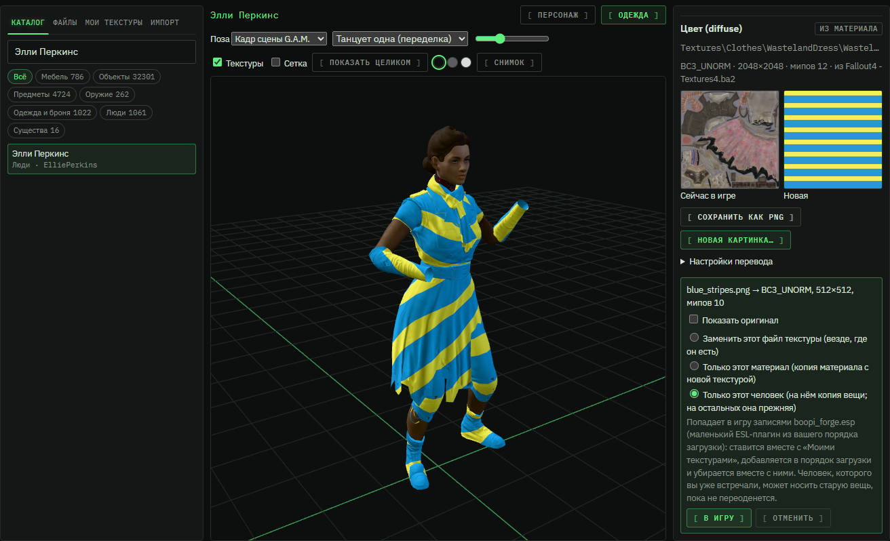
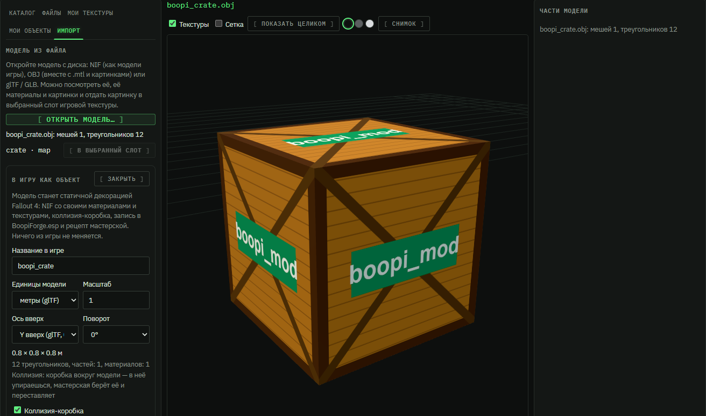

#  F.O.R.G.E. — 3D-объекты и текстуры

🇷🇺 Русский · [🇬🇧 English](en/FORGE.md)

[← Все руководства](README.md) · [← Главная страница проекта](../README.md)

> [!NOTE]
> F.O.R.G.E. — младший брат [G.A.M.](ANIMATION_IMPORT.md): G.A.M. двигает тела, F.O.R.G.E. их одевает и красит. Любой
> 3D-объект вашей игры — мебель, предметы, оружие, одежда и броня, люди и существа — с его текстурами: посмотреть,
> перекрасить и поставить в игру одной кнопкой. Файлы игры читаются **только с вашего компьютера** — программа их не
> содержит и никуда не отправляет.

> ### ⏱ За 1 минуту
>
> - **F.O.R.G.E.** в меню слева, сразу после G.A.M. Слева — что есть в вашей игре, в центре — 3D-вид, справа — части модели и её текстуры.
> - Выберите вещь → часть модели → **слот текстуры** (цвет, рельеф, блеск, свечение) → **«Сохранить как PNG»**, чтобы
>   рисовать поверх оригинала.
> - **«Новая картинка…»** — PNG, JPG или DDS. Программа сама переведёт её в нужный формат DDS с мипмапами и сразу покажет на модели.
> - **«В игру»** — правка попадает в мод **«Мои текстуры»** (виден и на странице «Моды»). Убрали правку — в игре снова
>   ровно та текстура, что была.
> - **«Только эта вещь»** и **«Только этот человек»** — перекрасить одну броню или одежду только на одном персонаже: остальные
>   носят её как раньше ([раздел 4](#4-в-игру-мои-текстуры)).
> - Одежда и тела надеты на **скелет игры** (тот же, что в G.A.M.): поза «как сделано», «стоя» или кадр сцены G.A.M.;
>   волосы и броня с палитрой показаны **в своих настоящих цветах**.
> - Свои текстуры можно сохранить **пакетом `.ogmod`** и поделиться, как любым модом.
> - Уже есть текстурный мод — папка или `.zip` с `Textures\…`? **Перетащите его на страницу**: F.O.R.G.E. покажет, что
>   подходит к игре, и поставит всё одной кнопкой (вкладка **«Импорт»**, [раздел 8](#8-текстурный-мод-папка-или-zip)).
> - Своя модель OBJ или glTF может стать **новым объектом игры**: «Импорт» → **«В игру как объект»** — он строится в
>   мастерской и ставится из консоли ([раздел 7](#7-своя-модель-в-игру-мои-объекты)).

## Содержание

1. [Что можно открыть](#1-что-можно-открыть)
2. [3D-вид и слоты текстур](#2-3d-вид-и-слоты-текстур)
3. [Перекрасить: новая картинка](#3-перекрасить-новая-картинка)
4. [В игру: «Мои текстуры»](#4-в-игру-мои-текстуры)
5. [Пакет текстур: поделиться](#5-пакет-текстур-поделиться)
6. [Открыть свою модель (OBJ, glTF, NIF)](#6-открыть-свою-модель-obj-gltf-nif)
7. [Своя модель в игру: «Мои объекты»](#7-своя-модель-в-игру-мои-объекты)
8. [Текстурный мод: папка или .zip](#8-текстурный-мод-папка-или-zip)
9. [Если что-то не так](#9-если-что-то-не-так)
10. [Что дальше](#10-что-дальше)

---

## 1. Что можно открыть

Слева четыре вкладки:

| Вкладка | Что там |
|---|---|
| **Каталог** | Всё, у чего в вашей игре есть модель, **с названиями из игры**: мебель, объекты, предметы, оружие, одежда и броня, люди (их лица), существа. Поиск — по названию, editor id, form id (как в консоли: `0001EED7`), плагину или пути модели; регистр, «ё», пробелы и дефисы не важны («10мм» найдёт «10 мм»). Порядок — по названию, по плагину или **недавно открытые**; фильтр по плагину. В строке под названием — плагин и файл модели: так отличаются вещи с одинаковым названием. |
| **Файлы** | Каждая модель `.nif` из архивов игры и отдельных файлов — для того, чего нет в каталоге. Поиск — словами пути. |
| **Мои текстуры** | Ваши правки, которые сейчас в игре: с миниатюрами, поиском и группами (по моду, по объекту, по дню). |
| **Импорт** | Модель с диска (OBJ, glTF / GLB, NIF) и текстурный мод — папка или `.zip`. |

Каталог собирается из **плагинов вашей игры** (официальных, DLC и модов в порядке загрузки) — первый раз это около
минуты, потом мгновенно. По умолчанию видны только вещи **с названием** и без **технических записей** (маркеры, пустые
«заглушки», остатки VR-мастерской) — галочки под категориями открывают и их; сколько скрыто, написано над списком.
**Оружие** собирается, как в игре, из деталей — каждая на своей точке крепления. Справа над частями модели — **«Сборка»**:
**«Вариант игры»** (именованные сборки оружия из игры: «Простой пистолет», «Штурмовой карабин», «Снайперский карабин»…) и
деталь в каждом слоте этой сборки — ствольная коробка, ствол, рукоять / приклад, магазин, прицел, дуло. Список деталей — из
вашего порядка загрузки: моды оружия (записи OMOD), сделанные для этого оружия (его ключевые слова и точки крепления), с
пометкой **«верстак»**, если её делают на верстаке (рецепт COBJ); детали модов тоже. Другая ствольная коробка приносит свои
слоты — список меняется вместе со сборкой. Каждую деталь можно перекрасить, как любую модель. У оружия и одежды, где игра
знает **модель от первого лица** (руки и рукава, нож в руке), есть кнопка **«От первого лица»**.
Одежда открывается в вариантах **«Женская» / «Мужская» / «На земле»** (кнопки над 3D-видом), человек —
с его лицом из игры и телом (**«Персонаж»**) или в его обычной одежде (**«Одежда»**: вещи его стандартного комплекта из игры;
случайные вещи из списков не показываются). Если мод заменяет текстуру или модель, F.O.R.G.E. покажет ту, что видит игра: отдельный файл
важнее архива, архив плагина ниже по порядку загрузки важнее архива выше.

**Клавиатура.** В каталоге, «Файлах» и «Моих текстурах»: стрелки, PgUp / PgDn, Home / End — выбор строки (и прямо из поля
поиска), **Enter** — открыть (в «Моих текстурах» — отметить запись или свернуть группу), **Esc** — очистить поиск; начните
печатать, стоя в списке, — буквы уйдут в поиск.

**«Пересканировать»** (под фильтрами каталога и во «Файлах») перечитывает плагины порядка загрузки и файлы игры — после
установки, удаления или обновления модов. Неизменённые плагины берутся из кэша, а прежний список работает, пока идёт скан
(полоса прогресса над ним). Если порядок загрузки изменился после последнего скана, над списком появится подсказка —
сколько плагинов добавлено, убрано и изменено — с той же кнопкой; сам по себе скан при этом не начинается.

## 2. 3D-вид и слоты текстур

- **Вращение** — левая кнопка мыши, **сдвиг** — правая, **масштаб** — колесо; **«Показать целиком»** — вернуть вид.
- **«Текстуры»** — показывать модель с текстурами или серой; **«Сетка»** — каркас.
- **Фон** — три кружка: тёмный, нейтральный серый (цвета видны честнее всего) и светлый (для тёмных вещей); выбор запоминается.
- **«Снимок»** — сохранить вид как PNG в `Документы\BoopiMod\Screenshots` (кнопка «Показать» откроет папку).
- **Щелчок по модели** выбирает её часть; справа список частей (с числом треугольников). Сразу выбрана **самая крупная
  часть**, а не первая в файле.
- **Глаз** у части прячет её и показывает снова; глаз с **Alt** — оставить только эту часть. Служебные части — «мясо»
  отрубленных конечностей, кровь, эффекты, временные и теневые вставки — **скрыты сразу** и помечены «служебная».
- **OBJ** и **GLB** над видом — сохранить то, что видно (без скрытых частей, в текущей позе), для Blender:
  OBJ с MTL и текстурами PNG или один GLB с текстурами внутри, в `Документы\BoopiMod\Models`.
- У выбранной части — **слоты текстур**: цвет (diffuse), рельеф (normal), блеск (specular), свечение (glow) и
  остальные (отражение, палитра…), с путём к файлу. Метка **«из материала»** значит, что текстуру называет файл
  материала (`.bgsm` / `.bgem`); **«из модели»** — сама модель (так, например, у лиц).
- Под слотом: формат (`BC7_UNORM`, `BC5_UNORM`…), размер, число мипмапов и **откуда** игра берёт файл (архив или отдельный файл).
- Если файла материала нет в игре, F.O.R.G.E. так и скажет — с путём, — а часть будет серой.
- Пока текстуры приходят, в углу вида видно **«Текстуры: N из M»**.
- **Палитра.** Волосы, бороды и часть брони игра красит так: текстура цвета у них серая, а настоящий цвет берётся из
  текстуры-палитры (строка палитры — цвет волос персонажа или индекс цвета брони). F.O.R.G.E. показывает их **в тех же
  цветах, что игра**: у персонажа — его цвет волос, у брони — её строка палитры.
- **Поза.** Одежда, броня и тела надеты на **скелет игры** — тот же, что G.A.M. читает из вашей игры. Над 3D-видом —
  **«Поза»**: **«Как сделано (T)»** (вещь как её сделали), **«Стоя, руки опущены»** или **«Кадр сцены G.A.M.»** — выберите сцену
  из библиотеки G.A.M. и момент ползунком (сцены с тегом «близость» здесь не предлагаются). Если скелет прочитать нельзя
  (нет gamtool), вещь показана как сделана.

Редактировать можно цвет, рельеф, блеск и свечение; остальные слоты видны для справки. **Блеск** в Fallout 4 — две карты в
одной: красный канал — сила блеска, зелёный — гладкость; серая картинка даёт обе одинаковыми.

## 3. Перекрасить: новая картинка

1. Выберите слот → **«Сохранить как PNG»**. Файл ляжет в `Документы\BoopiMod\Textures`, кнопка **«Показать»** откроет папку.
   Рисуйте поверх — так развёртка (UV) совпадёт с моделью. **«Шаблон UV»** сохранит туда же прозрачный PNG с сеткой развёртки
   этой текстуры в её размере (всех частей, которые её используют) — удобно рисовать слоем поверх.
2. **«Новая картинка…»** — PNG, JPG, BMP, TGA, WebP или DDS. F.O.R.G.E. переведёт её **texconv** (он идёт с программой):
   - в **тот же формат DDS**, что у оригинала (BC1, BC3, BC5, BC7…), с **полным набором мипмапов**;
   - **в размере оригинала**. Размер никогда не меняется молча: если картинка другого размера (например, 8192 на текстуру
     2048), черновик сделан в размере оригинала, а под ним — выбор **«Как у оригинала / Как у картинки / Свой размер»**.
     Стороны должны делиться на 4 (так требует сжатый DDS) — иначе они округлятся вверх, с предупреждением;
   - **16-битные** серые картинки (карты высот из Substance, Blender, Photoshop) читаются с их оттенками, а не белым квадратом;
     края вырезов (волосы, листва) уменьшаются без тёмного ореола;
   - **рельеф остаётся рельефом**: векторы выравниваются, недостающий синий канал восстанавливается, формат BC5
     сохраняется. Картинка из OpenGL-редактора (Blender, Substance в режиме OpenGL) — галочка **«перевернуть зелёный
     канал»**; есть только чёрно-белая карта высот — **«Это карта высот»**, и рельеф сделается из неё;
   - если у картинки нет прозрачности, а у оригинала есть (волосы, ткань с вырезами), **прозрачность берётся от оригинала**.
3. Новая текстура **сразу видна на модели**. **«Показать оригинал»** — сравнить. Если новая картинка не перевелась, прежний
   черновик остаётся как был. Предупреждения подскажут, если пропорции
   не как у оригинала (развёртка растянет картинку) или картинка в слоте рельефа не похожа на карту рельефа.
4. **Рисуете в своём редакторе?** После «Сохранить как PNG» под кнопками появляется этот файл с галочкой **«Следить за
   файлом»**: сохраните его в редакторе — и через пару секунд он сам станет новой картинкой слота, с теми же настройками
   (размер, зелёный канал…), а модель обновится. Без галочки — кнопка **«Перечитать изменённый PNG»**. Работает и в
   приложении, и в браузере; следить можно за несколькими слотами сразу.

### Перекраска и карты из основной текстуры

В панели слота **«Цвет (diffuse)»** — **«Перекраска и карты из основной текстуры»**. Первая вкладка, **«Перекрасить»**, —
та же вещь в другом цвете без графического редактора: **оттенок** (поворот по кругу цветов), **насыщенность** (×0 — серое,
×2 — ярче), **темнее ↔ светлее**. Серые и белые места (швы, пуговицы) остаются как были, прозрачность тоже. Остальные
вкладки — недостающие карты: F.O.R.G.E. сделает их (своим
кодом, без чужих генераторов). Источник — основная текстура, как её рисует игра сейчас, или новая картинка, которую вы
только что дали слоту.

| Карта | Куда | Настройки |
|---|---|---|
| **Рельеф** | слот рельефа (normal) | Карта нормалей в стиле игры (DirectX). Высота — из яркости (или одного канала); **сила**, **размытие** (шум и блоки JPEG долой), **мелкие детали** поверх размытого, **резкость**, **перевернуть высоту** (светлое — впадины), зелёный канал DirectX / OpenGL. |
| **Отражения** | слот блеска (specular) | Карта Fallout 4: красный — сила блика, зелёный — гладкость. **Материал**: ткань, кожа, металл, кожа тела, пластик, дерево — или свои значения: сила и контраст блика, гладкость и её контраст, **металл ↔ шершавое**, перевернуть. |
| **Перекрасить** | сама основная текстура | Оттенок −180…180°, насыщенность ×0…×2, темнее ↔ светлее. Всегда из текстуры игры (не из прежней перекраски). |
| **Впадины** | сама основная текстура | Затемняет впадины (похоже на ambient occlusion): глубина и ширина. |
| **Свечение** | слот свечения (glow), если он есть | Маска из ярких пикселей: порог, мягкость края, цветом текстуры или белым. |

Ползунки сразу показывают карту **на модели** (галочка «Показывать на модели сразу»). **«Сделать черновик»** переводит её в
формат той текстуры, которую она заменит (BC5, BC7, BC1…), в её размере, — и дальше это обычный черновик: откройте слот
карты и нажмите «В игру» (весь файл, этот материал, эта вещь или этот человек) или «Применить все черновики» сверху. Так
сгенерированные карты ставятся через «Мои текстуры» и убираются оттуда же.

## 4. В игру: «Мои текстуры»

Перед **«В игру»** выберите, что менять (по умолчанию — самое осторожное, **«Только этот материал»**):

| Вариант | Что произойдёт |
|---|---|
| **Заменить этот файл текстуры** | Новый файл встаёт на место текстуры игры — её покажет **всё**, что её использует. |
| **Только этот материал** | F.O.R.G.E. делает копию материала (из вашей же игры), где этот слот указывает на вашу новую текстуру. Меняется только то, что использует этот материал. |
| **Только эта вещь** (открыта одежда или броня) | Новая текстура — только на **этой вещи**, на всех, кто её носит. Другие вещи с тем же материалом не меняются. |
| **Только этот человек** (открыт персонаж, вид «Одежда») | Только **этот персонаж** носит вещь с новой текстурой; на всех остальных та же вещь прежняя. |
| **Только кожа этого человека** (вид «Персонаж», тело) | Новая кожа — только у этого персонажа: на теле и на открытой коже в его обычной одежде. |
| **Только этот человек** (лицо) | Текстура лица у каждого персонажа своя (запечена игрой для него), поэтому меняется только у него. |

Каждая правка — **одна запись** в моде **«Мои текстуры»**. Мод ставится через менеджер модов с журналом, как любой другой:

- **«Убрать»** у записи (вкладка «Мои текстуры») — игра снова показывает **ровно тот файл**, что был до правки (байт в байт),
  в том числе файл другого мода, если он там лежал;
- на странице **«Моды»** «Мои текстуры» можно удалить целиком — записи останутся в списке с пометкой «не в игре»,
  и «В игру» вернёт их;
- вторая правка той же текстуры заменяет первую, правки разных слотов одного материала собираются в одну запись;
- **«Применить все черновики»** вверху справа ставит все ждущие черновики разом (каждый — с вариантом, выбранным в его слоте);
- ставится **только то, что изменилось**: остальные файлы «Моих текстур» не трогаются.

Игре нужно разрешение читать отдельные файлы поверх архивов (`Fallout4Custom.ini`: `bInvalidateOlderFiles=1`). Если его нет,
F.O.R.G.E. покажет сверху предупреждение с кнопкой **«Включить»**.

### Одна вещь, один человек: как это устроено

Одежду и броню игра красит через **материалы** (`.bgsm`). Чтобы поменять текстуру только у одной вещи или одного персонажа,
F.O.R.G.E. пишет **записи игры** в свой маленький плагин **`BoopiForge.esp`** (ESL — не занимает место в порядке загрузки;
он общий с «Моими объектами», см. [«Один плагин на всё»](#один-плагин-на-всё-boopiforgeesp)):

- **подмена материала** (MSWP: «этот материал → копия с вашей текстурой») вешается на копии моделей вещи (ARMA);
- **«Только эта вещь»** — сама вещь (ARMO) надевает эти копии; подмена, которая у модели уже была (цветной вариант), сохраняется;
- **«Только этот человек»** — делается копия вещи и копия его обычного комплекта одежды (OTFT) с копией вместо оригинала,
  и персонаж (NPC_) носит этот комплект; **кожа** — копия его кожи (WNAM) с подменой, та же подмена — на вещах его комплекта.

Плагин собирается **из вашего порядка загрузки** при каждой установке «Моих текстур»: если мод уже меняет этого персонажа или
вещь, F.O.R.G.E. берёт его версию записи и ставится после него. `BoopiForge.esp` ставится через журнал после текстур,
одной строкой в конце `plugins.txt`, и уходит, когда в нём не остаётся ни таких правок, ни объектов (удаление «Моих текстур»
убирает из него их записи) — `plugins.txt` остаётся ровно таким, каким был.

Что важно знать:

- **Лицо.** Лицо персонажа в Fallout 4 «запечено» (FaceGen): у каждого свой файл лица и свои текстуры лица — их можно менять
  обычной заменой файла, это и есть «только этот человек». Записи набора текстур (TXST) игра для запечённых лиц не
  применяет без нового запекания в Creation Kit, а **волосы и глаза** внутри запечённой головы используют общие для всех
  материалы — поэтому для них «только этот человек» не предлагается.
- **Уже встреченные персонажи.** Что надето на персонажа, игра хранит в сохранении, поэтому тот, кого вы уже встречали, может
  ещё носить старую вещь, пока игра не наденет на него комплект заново; новые встречи (и новые копии персонажа) сразу носят новую.
- **Шаблоны.** Если персонаж берёт одежду из шаблона (обычно безымянные жители и враги), F.O.R.G.E. скажет об этом — меняйте
  персонажа-шаблон или используйте «Только эта вещь».
- **Пакеты `.ogmod`** такие правки не берут: это записи именно вашего порядка загрузки, они остаются на этом компьютере.

> [!TIP]
> Ставьте текстуры, пока игра закрыта: текстуру, которую игра уже загрузила, она не перечитывает — после установки
> запустите игру заново.

## 5. Пакет текстур: поделиться

Во вкладке **«Мои текстуры»** → **«Пакет текстур (.ogmod)»**: название, автор, версия, описание → **«Сохранить пакет»**.
Отметьте галочками нужные правки (без отметок в пакет пойдут все). Пакет сохраняется в `Документы\BoopiMod\Mods`.

- В пакете **только ваши текстуры** — ни одного файла игры. Правка «только этот материал» лежит в пакете как рецепт:
  копию материала сделает boopi_mod того, кто ставит пакет, **из его собственной игры**.
- Пакет ставится, как любой мод boopi_mod: перетащите `.ogmod` в программу (или установите с boopi.site) — он появится на
  странице «Моды» и удаляется оттуда же, со всеми файлами, через журнал.
- Публикуется так же, как мод студии ([Опубликовать на boopi.site](SCRIPT_STUDIO.md#97-опубликовать-на-boopisite)).
- В пакет можно положить любые ваши записи, и записи из импортированного текстурного мода тоже: какие текстуры ставить и
  чем делиться — решаете вы.

## 6. Открыть свою модель (OBJ, glTF, NIF)

Вкладка **«Импорт»** → **«Открыть модель…»** (или перетащите файлы модели на страницу — и в браузере, и в приложении; из
приложения OBJ подтянет свой `.mtl` и картинки из своей папки). Картинку можно так же перетащить прямо в открытый слот:

- **OBJ** — выберите сразу `.obj`, его `.mtl` и картинки; **glTF** — `.gltf` с `.bin` и картинками или один `.glb`;
- **NIF** — модель в формате Fallout 4 (20.2.0.7); её текстуры по путям игры берутся из вашей игры.

Если модель называет картинки, которых нет среди выбранных файлов, F.O.R.G.E. их перечислит — выберите их вместе с
моделью или перетащите на страницу всю папку модели.

Модель видна в 3D-виде, список её материалов и картинок — слева. Кнопка **«В выбранный слот»** отдаёт картинку модели в
выбранный слот игровой текстуры (сначала выберите вещь и слот в каталоге) — дальше как в [разделе 3](#3-перекрасить-новая-картинка).
А саму модель OBJ или glTF можно поставить в игру новым объектом — [раздел 7](#7-своя-модель-в-игру-мои-объекты).

## 7. Своя модель в игру: «Мои объекты»

Открытую модель OBJ или glTF / GLB можно поставить в игру как **новый статичный объект** — декорацию, которую строят в
мастерской поселения или ставят из консоли.

1. Вкладка **«Импорт»** → откройте модель → **«В игру как объект»**.
2. F.O.R.G.E. соберёт объект для игры и сразу покажет в 3D-виде то, что загрузит игра (снимите галочку **«Показывать то,
   что загрузит игра»**, чтобы сравнить с исходником):
   - **Единицы модели и масштаб.** glTF всегда в метрах; OBJ бывает в метрах, сантиметрах, дюймах — смотрите на размер под
     настройками (в метрах). Модель больше 40 м сразу пересобирается как сантиметровая.
   - **Ось вверх** — Y (glTF, большинство OBJ) или Z. Перед модели (+Z у glTF) смотрит туда же, куда «вперёд» у объектов
     игры; **«Поворот»** — шагами по 90°.
   - Объект встаёт на землю своим центром: это точка, за которую его держит мастерская.
3. **«Название в игре»**, **«Меню мастерской»** (Украшения, Настенные украшения, Мебель — подразделы как у игры) и галочка
   **«В меню мастерской»** (строится бесплатно; без неё объект ставится только из консоли).
4. **«Поставить в игру»**. Объект появится на вкладке **«Мои объекты»** вместе с командой консоли вида
   `player.placeatme FE00X800` — откройте консоль (`~`) и введите её, объект появится перед вами.

Что делается внутри:

| Часть | Что |
|---|---|
| Модель | NIF Fallout 4: BSFadeNode и BSTriShape на каждую часть (позиции, нормали, касательные, UV, цвета вершин); до 65 535 вершин на часть — большие сетки режутся сами |
| Материал | BGSM на каждый материал модели: двусторонний, вырез или прозрачность по альфе, свечение |
| Текстуры | цвет (BC1, с альфой — BC3), нормали (BC5; у карт OpenGL зелёный переворачивается, галочка «DirectX» — для карт в стиле игры), блеск (BC5, из шероховатости и металличности glTF), свечение; нет картинки — простая своя |
| Коллизия | коробка вокруг модели (Havok): в объект упираешься, мастерская выделяет и переставляет его. Точной формы нет — стол целиком коробка. Можно выключить: тогда объект проходим, и после установки мастерская его не выделит |
| Плагин | `BoopiForge.esp` с флагом ESL (не занимает слот порядка загрузки, общий с «Моими текстурами»): статичный объект (STAT) и рецепт мастерской (COBJ) на каждый объект; записи только свои, игра не меняется |

Файлы ставятся модом **«Мои объекты»** через журнал менеджера модов (он виден на странице «Моды»), записи — в общий
`BoopiForge.esp` (мод «F.O.R.G.E.: плагин»), который попадает в plugins.txt. **«Убрать»** на вкладке «Мои объекты» убирает
файлы и записи объекта; номера остальных не меняются, так что объекты, уже поставленные в сохранении, остаются на месте.
Убран последний объект — мод удаляется (и плагин, если в нём нет правок «Моих текстур»), и в игре и в plugins.txt ровно то,
что было до него.

> [!IMPORTANT]
> Ставьте и убирайте объекты при закрытой игре. Объект, поставленный в сохранении и потом убранный из «Моих объектов», из
> этого сохранения пропадёт. Скелета и анимаций у объекта нет: это статичная декорация — не мебель, на которую садятся,
> и не предмет в инвентарь.

### Один плагин на всё: BoopiForge.esp

Всё, что F.O.R.G.E. пишет в игру записями, лежит в **одном** плагине — **`BoopiForge.esp`** (ESL, не занимает слот порядка
загрузки): записи «Моих текстур» («Только эта вещь», «Только этот человек») и записи «Моих объектов» (STAT и рецепт
мастерской). На странице «Моды» он виден отдельным модом **«F.O.R.G.E.: плагин»**, файлы текстур и объектов — модами «Мои
текстуры» и «Мои объекты». Плагин собирается заново при любом изменении с любой стороны, в `plugins.txt` у него одна строка,
которая не двигается. Когда ни у «Моих текстур», ни у «Моих объектов» не остаётся записей, плагин уходит через журнал, и
`plugins.txt` снова ровно такой, каким был.

**Номера записей (form id) не двигаются.** F.O.R.G.E. помнит номер каждой записи (`forge\plugin_ids.json` в папке данных
boopi_mod): убрали объект или правку одежды — у остальных номера прежние, так что поставленное в сохранении остаётся на месте.
Номер убранной записи новой не отдаётся, пока есть свободные: старое сохранение просто теряет убранную вещь, а не получает
вместо неё другую.

**Если вы обновились с версии до 0.2.0.** Раньше плагинов было два: у «Моих текстур» — `boopi_forge.esp`, у «Моих объектов» —
`BoopiForge.esp`. При первом запуске новой версии (или при первом изменении в F.O.R.G.E.) оба переезжают в один
`BoopiForge.esp` сами — запускать игру в это время не нужно, при запущенной игре переезд ждёт следующего запуска программы.
Старый плагин уходит через журнал (вместе со своей строкой в `plugins.txt`), всё остальное остаётся как было. Программа
скажет об этом сообщением сверху и заметкой на вкладках «Мои текстуры» и «Мои объекты». Что это значит для сохранений:

- **Объекты** сохраняют свои номера, и файл называется так же: объекты, уже поставленные в ваших сохранениях, остаются на месте.
- **Одежда и люди** («Только эта вещь», «Только этот человек») теперь берутся из `BoopiForge.esp`. Сохранение помнит записи по
  имени файла, поэтому то, что оно держало из `boopi_forge.esp`, при загрузке пропадает: игра может один раз спросить про
  отсутствующий `boopi_forge.esp` — ответьте «Да», следующему сохранению он уже не нужен. Человек, который уже носил вашу копию
  одежды, получит новую, когда игра снова наденет на него комплект; сама игра и её файлы не меняются.
- Если игровой материал для какой-то правки сейчас недоступен (мод с ним выключен), «Мои текстуры» остаются на старом плагине
  до следующего раза — вкладка напишет об этом; объекты переезжают в любом случае.

## 8. Текстурный мод: папка или .zip

Если у вас уже есть текстуры, разложенные как в игре (`Data\Textures\Clothes\…`) — свой набор DDS или скачанный
текстурный мод, — не нужно ставить их по одной:

1. Вкладка **«Импорт»** → **«Папка…»** или **«.zip или файлы…»** — или просто **перетащите папку / `.zip` на страницу**.
2. F.O.R.G.E. сверит каждый файл с файлами игры и покажет список:
   - **подходит** — заменяет текстуру, которая есть в игре (с форматом и размером; «заменит вашу запись», если вы её уже меняли);
   - **нет в игре** — новый файл мода, его использует только сам мод (такие ставьте целым модом на странице «Моды»);
   - **пропущен** — не текстура: модели, материалы, плагины, readme;
   - **ошибка** / **повтор** — DDS не читается, или та же текстура уже есть в моде (DDS важнее PNG).
   Путь без папки `Textures` (например, `MyMod\Clothes\x_d.dds`) сопоставляется по самой длинной части пути, которую знает игра.
3. Снимите галочки с лишнего → **«В игру: N»**. Каждая текстура станет отдельной записью «Моих текстур» — их можно убрать по
   одной, и в игре снова будет родная текстура, байт в байт. Убрать весь мод разом: «Мои текстуры», группы **«по моду»** →
   галочка у группы мода → **«Убрать выбранные»**.

DDS из мода ставится как есть; PNG, JPG или TGA переводятся в формат оригинальной текстуры с мипмапами, как в
[разделе 3](#3-перекрасить-новая-картинка). Ставьте текстуры при закрытой игре.

## 9. Если что-то не так

| Что | Что делать |
|---|---|
| «Игра не найдена» | Укажите папку Fallout 4 в «Настройки → Игра». |
| Каталог пустой или долго читается | Первый раз плагины читаются около минуты; полоса прогресса над списком. |
| «Нет texconv» | texconv ставится вместе с программой; переустановите boopi_mod. |
| Текстура не видна в игре | Кнопка «Включить» в предупреждении сверху (чтение отдельных файлов); перезапустите игру. |
| Текстурный мод: «ни один файл не подходит» | Пути в моде должны повторять игровые: `Textures\Clothes\…\x_d.dds`. Архивы 7z и rar распакуйте и выберите папку. |
| Модель не открывается | F.O.R.G.E. читает NIF Fallout 4 (20.2.0.7); модели других игр открывайте через OBJ / glTF. |
| Вещи в каталоге нет | Снимите «Только с названием» или включите «Технические записи»; «Скрыто фильтрами: N» — сколько спрятано. |
| Нет вещей только что поставленного мода | «Пересканировать» под фильтрами каталога. |
| У оружия нет «Сборки» | У этого оружия нет слотов модов (нож, многие уникальные вещи) — показана его модель. |
| Сгенерированный рельеф «вдавлен», а не выпуклый | Галочка «Светлое — впадины» (или зелёный канал OpenGL, если развёртка зеркальная). |
| «Перечитать изменённый PNG» не берёт файл | Редактор ещё сохраняет его — F.O.R.G.E. возьмёт файл, когда он перестанет меняться; или нажмите кнопку ещё раз. |
| Часть модели не видна | Её глаз в списке частей выключен (служебные части скрыты сразу) — включите. |
| «Картинка … оригинал …: черновик сделан в размере оригинала» | Выберите «Как у картинки» или свой размер — или оставьте как есть. |
| «Этой вещи нет в обычной одежде этого человека» | «Только этот человек» работает для вещей его стандартного комплекта (вид «Одежда»); для остального — «Только эта вещь». |
| «…берёт одежду или внешность из шаблона» | Измените персонажа-шаблон или выберите «Только эта вещь». |
| Персонаж в игре всё ещё в старой вещи | Он уже носил её в вашем сохранении; новая появится, когда игра наденет на него комплект заново. |
| Одежда не встаёт в позу | Поза нужна скелету игры (его читает gamtool, как в G.A.M.); без него вещь показана как сделана. |
| Объект огромный или крошечный | Поменяйте «Единицы модели» (OBJ часто в сантиметрах) или масштаб; размер в метрах виден под настройками. |
| Объект тёмный или с «рваным» рельефом | Карта нормалей в стиле DirectX (зелёный вниз) — поставьте галочку «DirectX»; грани, видимые только с одной стороны, сделайте двусторонними в редакторе модели. |
| Объекта нет в мастерской | `BoopiForge.esp` должен быть включён (страница «Моды» → порядок загрузки); из консоли объект ставит `player.placeatme` с id из «Моих объектов». |
| Игра пишет, что нет `boopi_forge.esp` | Это плагин «Моих текстур» до 0.2.0, его записи переехали в `BoopiForge.esp` ([«Один плагин на всё»](#один-плагин-на-всё-boopiforgeesp)). Ответьте «Да» и сохранитесь — больше не спросит. |
| «BoopiForge.esp заполнен» | В одном ESL-плагине помещается 2048 записей на «Мои текстуры» и «Мои объекты» вместе: уберите часть объектов или правок одежды. |
| Вернуть всё как было | «Мои текстуры» → «Убрать» у записи, или удалить «Мои текстуры» на странице «Моды»; объекты — «Мои объекты» → «Убрать» или удалить «Мои объекты» там же. |

## 10. Что дальше

F.O.R.G.E. меняет **текстуры** моделей игры и ставит в игру **свои статичные объекты** ([раздел 7](#7-своя-модель-в-игру-мои-объекты)).
Дальше — коллизия точно по форме модели, мебель, на которую садятся, и предметы в инвентарь: для них нужны скелет, веса
и другие записи плагина. Замена текстур у одной вещи или одного персонажа через
записи игры уже есть — варианты «Только эта вещь» и «Только этот человек» ([раздел 4](#4-в-игру-мои-текстуры)).

---

[← Все руководства](README.md) · [Импорт анимаций и редактор G.A.M.](ANIMATION_IMPORT.md)
