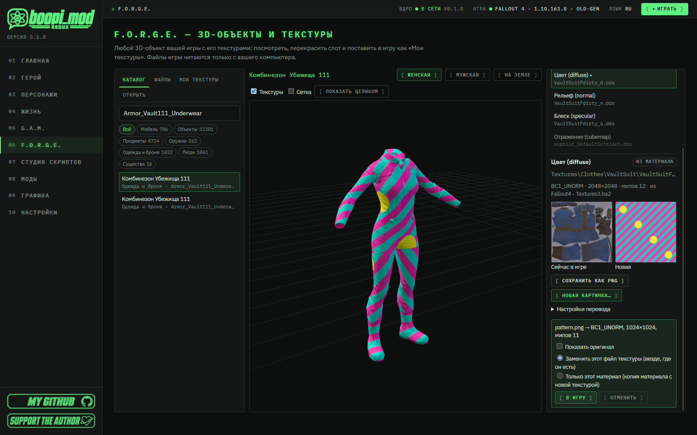
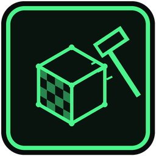
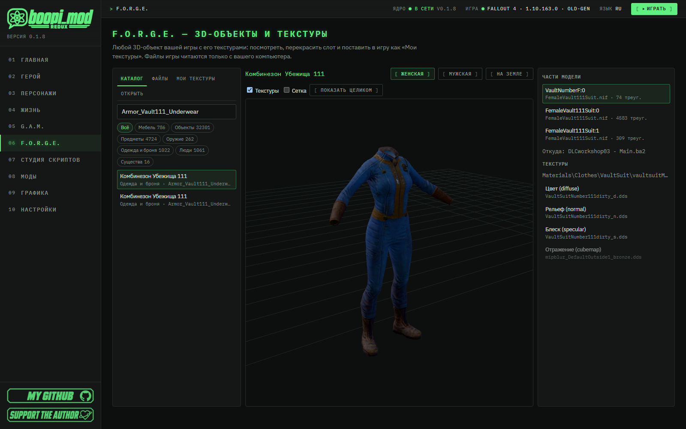
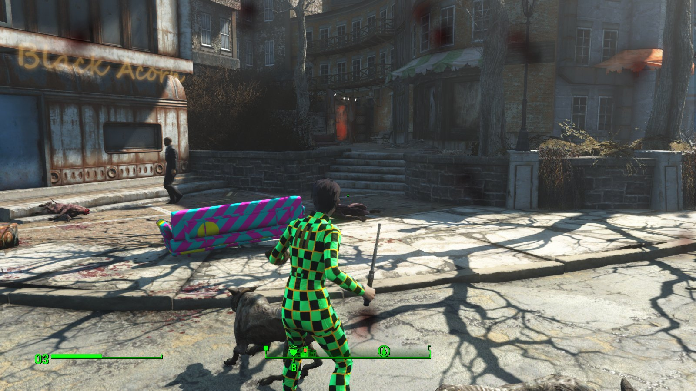
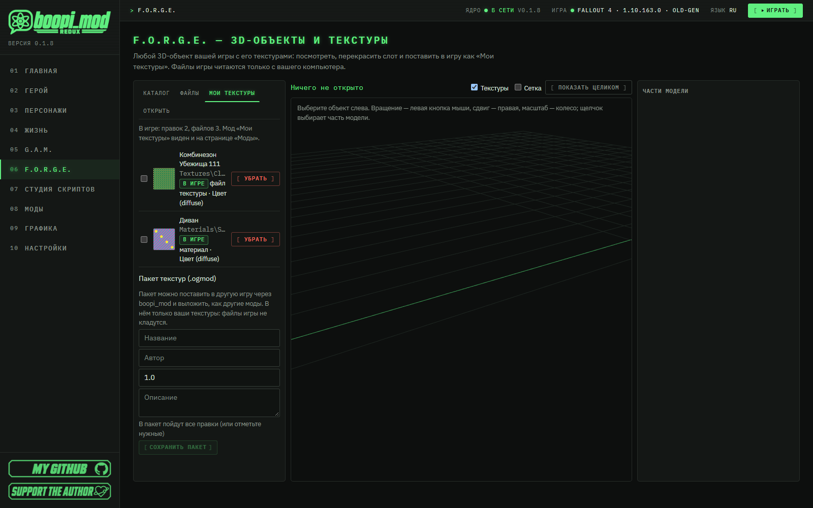
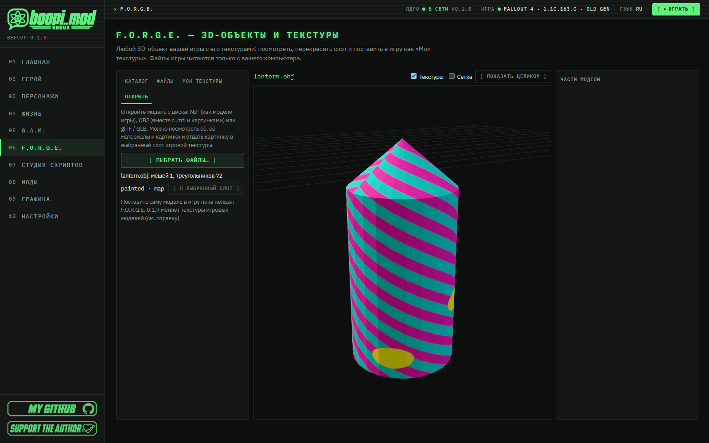
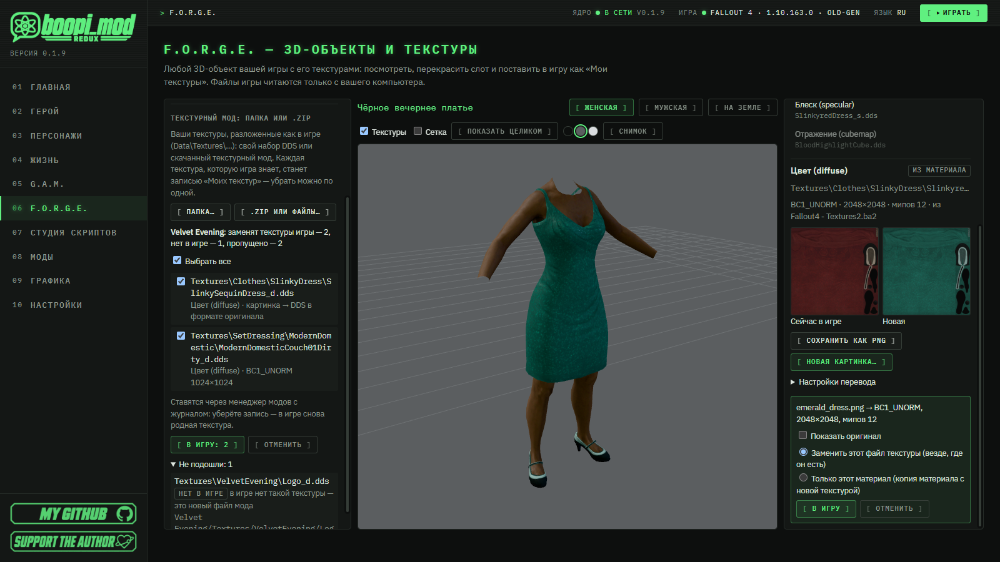

#  F.O.R.G.E. — 3D-объекты и текстуры

🇷🇺 Русский · [🇬🇧 English](en/FORGE.md)

[← Все руководства](README.md) · [← Главная страница проекта](../README.md)

> [!NOTE]
> F.O.R.G.E. — младший брат [G.A.M.](ANIMATION_IMPORT.md): G.A.M. двигает тела, F.O.R.G.E. их одевает и красит. Любой
> 3D-объект вашей игры — мебель, предметы, оружие, одежда и броня, люди и существа — с его текстурами: посмотреть,
> перекрасить и поставить в игру одной кнопкой. Файлы игры читаются **только с вашего компьютера** — программа их не
> содержит и никуда не отправляет.

> ### ⏱ За 1 минуту
>
> - **F.O.R.G.E.** в меню слева, сразу после G.A.M. Слева — что есть в вашей игре, в центре — 3D-вид, справа — части модели и её текстуры.
> - Выберите вещь → часть модели → **слот текстуры** (цвет, рельеф, блеск, свечение) → **«Сохранить как PNG»**, чтобы
>   рисовать поверх оригинала.
> - **«Новая картинка…»** — PNG, JPG или DDS. Программа сама переведёт её в нужный формат DDS с мипмапами и сразу покажет на модели.
> - **«В игру»** — правка попадает в мод **«Мои текстуры»** (виден и на странице «Моды»). Убрали правку — в игре снова
>   ровно та текстура, что была.
> - Свои текстуры можно сохранить **пакетом `.ogmod`** и поделиться, как любым модом.
> - Уже есть текстурный мод — папка или `.zip` с `Textures\…`? **Перетащите его на страницу**: F.O.R.G.E. покажет, что
>   подходит к игре, и поставит всё одной кнопкой (вкладка **«Импорт»**, [раздел 7](#7-текстурный-мод-папка-или-zip)).

## Содержание

1. [Что можно открыть](#1-что-можно-открыть)
2. [3D-вид и слоты текстур](#2-3d-вид-и-слоты-текстур)
3. [Перекрасить: новая картинка](#3-перекрасить-новая-картинка)
4. [В игру: «Мои текстуры»](#4-в-игру-мои-текстуры)
5. [Пакет текстур: поделиться](#5-пакет-текстур-поделиться)
6. [Открыть свою модель (OBJ, glTF, NIF)](#6-открыть-свою-модель-obj-gltf-nif)
7. [Текстурный мод: папка или .zip](#7-текстурный-мод-папка-или-zip)
8. [Если что-то не так](#8-если-что-то-не-так)
9. [Что дальше](#9-что-дальше)

---

## 1. Что можно открыть

Слева четыре вкладки:

| Вкладка | Что там |
|---|---|
| **Каталог** | Всё, у чего в вашей игре есть модель, **с названиями из игры**: мебель, объекты, предметы, оружие, одежда и броня, люди (их лица), существа. Поиск — по названию, editor id, form id (как в консоли: `0001EED7`) или пути модели. |
| **Файлы** | Каждая модель `.nif` из архивов игры и отдельных файлов — для того, чего нет в каталоге. Поиск — словами пути. |
| **Мои текстуры** | Ваши правки, которые сейчас в игре. |
| **Импорт** | Модель с диска (OBJ, glTF / GLB, NIF) и текстурный мод — папка или `.zip`. |

Каталог собирается из **плагинов вашей игры** (официальных, DLC и модов в порядке загрузки) — первый раз это около
минуты, потом мгновенно. Одежда открывается в вариантах **«Женская» / «Мужская» / «На земле»** (кнопки над 3D-видом), человек —
с его лицом из игры и телом. Если мод заменяет текстуру или модель, F.O.R.G.E. покажет ту, что видит игра: отдельный файл
важнее архива, архив плагина ниже по порядку загрузки важнее архива выше.

## 2. 3D-вид и слоты текстур

- **Вращение** — левая кнопка мыши, **сдвиг** — правая, **масштаб** — колесо; **«Показать целиком»** — вернуть вид.
- **«Текстуры»** — показывать модель с текстурами или серой; **«Сетка»** — каркас.
- **Фон** — три кружка: тёмный, нейтральный серый (цвета видны честнее всего) и светлый (для тёмных вещей); выбор запоминается.
- **«Снимок»** — сохранить вид как PNG в `Документы\BoopiMod\Screenshots` (кнопка «Показать» откроет папку).
- **Щелчок по модели** выбирает её часть; справа список частей (с числом треугольников).
- У выбранной части — **слоты текстур**: цвет (diffuse), рельеф (normal), блеск (specular), свечение (glow) и
  остальные (отражение, палитра…), с путём к файлу. Метка **«из материала»** значит, что текстуру называет файл
  материала (`.bgsm` / `.bgem`); **«из модели»** — сама модель (так, например, у лиц).
- Под слотом: формат (`BC7_UNORM`, `BC5_UNORM`…), размер, число мипмапов и **откуда** игра берёт файл (архив или отдельный файл).

Редактировать можно цвет, рельеф, блеск и свечение; остальные слоты видны для справки.

## 3. Перекрасить: новая картинка

1. Выберите слот → **«Сохранить как PNG»**. Файл ляжет в `Документы\BoopiMod\Textures`, кнопка **«Показать»** откроет папку.
   Рисуйте поверх — так развёртка (UV) совпадёт с моделью.
2. **«Новая картинка…»** — PNG, JPG, BMP, TGA, WebP или DDS. F.O.R.G.E. переведёт её **texconv** (он идёт с программой):
   - в **тот же формат DDS**, что у оригинала (BC1, BC3, BC5, BC7…), с **полным набором мипмапов**;
   - на **степени двойки** по размеру (или **«Размер как у оригинала»** в «Настройках перевода»);
   - **рельеф остаётся рельефом**: векторы выравниваются, недостающий синий канал восстанавливается, формат BC5
     сохраняется. Картинка из OpenGL-редактора (Blender, Substance в режиме OpenGL) — галочка **«перевернуть зелёный
     канал»**; есть только чёрно-белая карта высот — **«Это карта высот»**, и рельеф сделается из неё;
   - если у картинки нет прозрачности, а у оригинала есть (волосы, ткань с вырезами), **прозрачность берётся от оригинала**.
3. Новая текстура **сразу видна на модели**. **«Показать оригинал»** — сравнить. Предупреждения подскажут, если пропорции
   не как у оригинала (развёртка растянет картинку) или картинка в слоте рельефа не похожа на карту рельефа.

## 4. В игру: «Мои текстуры»

Перед **«В игру»** выберите, что менять:

| Вариант | Что произойдёт |
|---|---|
| **Заменить этот файл текстуры** | Новый файл встаёт на место текстуры игры — её покажет **всё**, что её использует. |
| **Только этот материал** | F.O.R.G.E. делает копию материала (из вашей же игры), где этот слот указывает на вашу новую текстуру. Меняется только то, что использует этот материал. |

Каждая правка — **одна запись** в моде **«Мои текстуры»**. Мод ставится через менеджер модов с журналом, как любой другой:

- **«Убрать»** у записи (вкладка «Мои текстуры») — игра снова показывает **ровно тот файл**, что был до правки (байт в байт),
  в том числе файл другого мода, если он там лежал;
- на странице **«Моды»** «Мои текстуры» можно удалить целиком — записи останутся в списке с пометкой «не в игре»,
  и «В игру» вернёт их;
- вторая правка той же текстуры заменяет первую, правки разных слотов одного материала собираются в одну запись.

Игре нужно разрешение читать отдельные файлы поверх архивов (`Fallout4Custom.ini`: `bInvalidateOlderFiles=1`). Если его нет,
F.O.R.G.E. покажет сверху предупреждение с кнопкой **«Включить»**.

> [!TIP]
> Ставьте текстуры, пока игра закрыта: текстуру, которую игра уже загрузила, она не перечитывает — после установки
> запустите игру заново.

## 5. Пакет текстур: поделиться

Во вкладке **«Мои текстуры»** → **«Пакет текстур (.ogmod)»**: название, автор, версия, описание → **«Сохранить пакет»**.
Отметьте галочками нужные правки (без отметок в пакет пойдут все). Пакет сохраняется в `Документы\BoopiMod\Mods`.

- В пакете **только ваши текстуры** — ни одного файла игры. Правка «только этот материал» лежит в пакете как рецепт:
  копию материала сделает boopi_mod того, кто ставит пакет, **из его собственной игры**.
- Пакет ставится, как любой мод boopi_mod: перетащите `.ogmod` в программу (или установите с boopi.site) — он появится на
  странице «Моды» и удаляется оттуда же, со всеми файлами, через журнал.
- Публикуется так же, как мод студии ([Опубликовать на boopi.site](SCRIPT_STUDIO.md#97-опубликовать-на-boopisite)).
  Делитесь только своей работой: картинка, перерисованная с текстуры игры, остаётся её производной.

## 6. Открыть свою модель (OBJ, glTF, NIF)

Вкладка **«Импорт»** → **«Открыть модель…»** (или перетащите файлы модели на страницу):

- **OBJ** — выберите сразу `.obj`, его `.mtl` и картинки; **glTF** — `.gltf` с `.bin` и картинками или один `.glb`;
- **NIF** — модель в формате Fallout 4 (20.2.0.7); её текстуры по путям игры берутся из вашей игры.

Если модель называет картинки, которых нет среди выбранных файлов, F.O.R.G.E. их перечислит — выберите их вместе с
моделью или перетащите на страницу всю папку модели.

Модель видна в 3D-виде, список её материалов и картинок — слева. Кнопка **«В выбранный слот»** отдаёт картинку модели в
выбранный слот игровой текстуры (сначала выберите вещь и слот в каталоге) — дальше как в [разделе 3](#3-перекрасить-новая-картинка).

## 7. Текстурный мод: папка или .zip

Если у вас уже есть текстуры, разложенные как в игре (`Data\Textures\Clothes\…`) — свой набор DDS или скачанный
текстурный мод, — не нужно ставить их по одной:

1. Вкладка **«Импорт»** → **«Папка…»** или **«.zip или файлы…»** — или просто **перетащите папку / `.zip` на страницу**.
2. F.O.R.G.E. сверит каждый файл с файлами игры и покажет список:
   - **подходит** — заменяет текстуру, которая есть в игре (с форматом и размером; «заменит вашу запись», если вы её уже меняли);
   - **нет в игре** — новый файл мода, его использует только сам мод (такие ставьте целым модом на странице «Моды»);
   - **пропущен** — не текстура: модели, материалы, плагины, readme;
   - **ошибка** / **повтор** — DDS не читается, или та же текстура уже есть в моде (DDS важнее PNG).
   Путь без папки `Textures` (например, `MyMod\Clothes\x_d.dds`) сопоставляется по самой длинной части пути, которую знает игра.
3. Снимите галочки с лишнего → **«В игру: N»**. Каждая текстура станет отдельной записью «Моих текстур» — их можно убрать по
   одной, и в игре снова будет родная текстура, байт в байт. Убрать весь мод разом: «Мои текстуры» → **«Выбрать «имя мода»»** →
   **«Убрать выбранные»**.

DDS из мода ставится как есть; PNG, JPG или TGA переводятся в формат оригинальной текстуры с мипмапами, как в
[разделе 3](#3-перекрасить-новая-картинка). Ставьте текстуры при закрытой игре.

## 8. Если что-то не так

| Что | Что делать |
|---|---|
| «Игра не найдена» | Укажите папку Fallout 4 в «Настройки → Игра». |
| Каталог пустой или долго читается | Первый раз плагины читаются около минуты; полоса прогресса над списком. |
| «Нет texconv» | texconv ставится вместе с программой; переустановите boopi_mod. |
| Текстура не видна в игре | Кнопка «Включить» в предупреждении сверху (чтение отдельных файлов); перезапустите игру. |
| Текстурный мод: «ни один файл не подходит» | Пути в моде должны повторять игровые: `Textures\Clothes\…\x_d.dds`. Архивы 7z и rar распакуйте и выберите папку. |
| Модель не открывается | F.O.R.G.E. читает NIF Fallout 4 (20.2.0.7); модели других игр открывайте через OBJ / glTF. |
| Вернуть всё как было | «Мои текстуры» → «Убрать» у записи, или удалить «Мои текстуры» на странице «Моды». |

## 9. Что дальше

В 0.1.9 F.O.R.G.E. меняет **текстуры** моделей игры. Свою модель можно открыть и рассмотреть, взять её картинки, но
**поставить новую модель в игру** пока нельзя: для этого программе нужно писать файлы NIF (геометрия, скелет и веса,
коллизия) и записи плагина — это следующий шаг F.O.R.G.E. Замена текстур у отдельного персонажа или брони через записи
игры (TXST / подмены материалов) тоже впереди; сейчас то же самое делает вариант «Только этот материал».

---

[← Все руководства](README.md) · [Импорт анимаций и редактор G.A.M.](ANIMATION_IMPORT.md)
