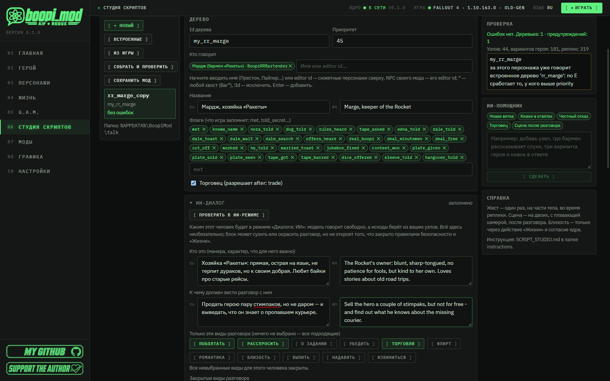
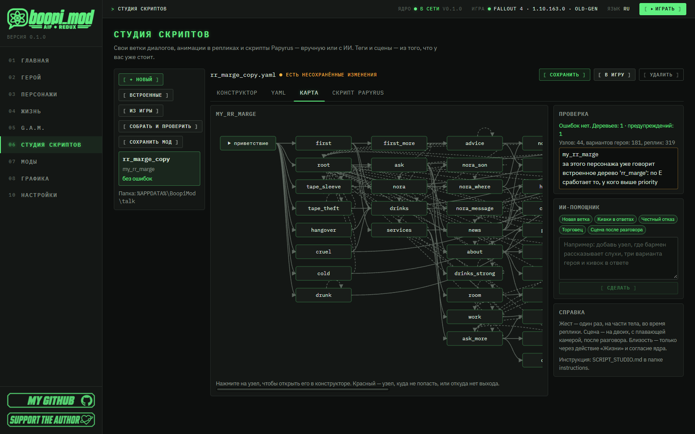
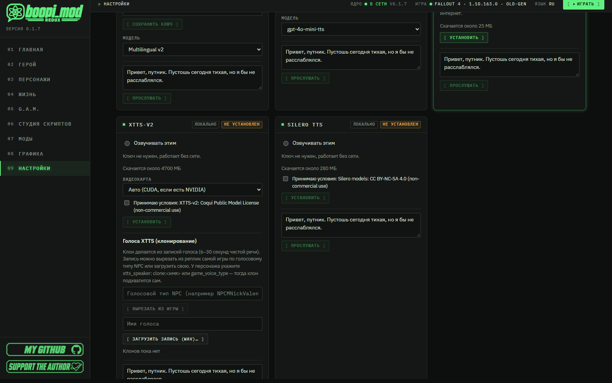
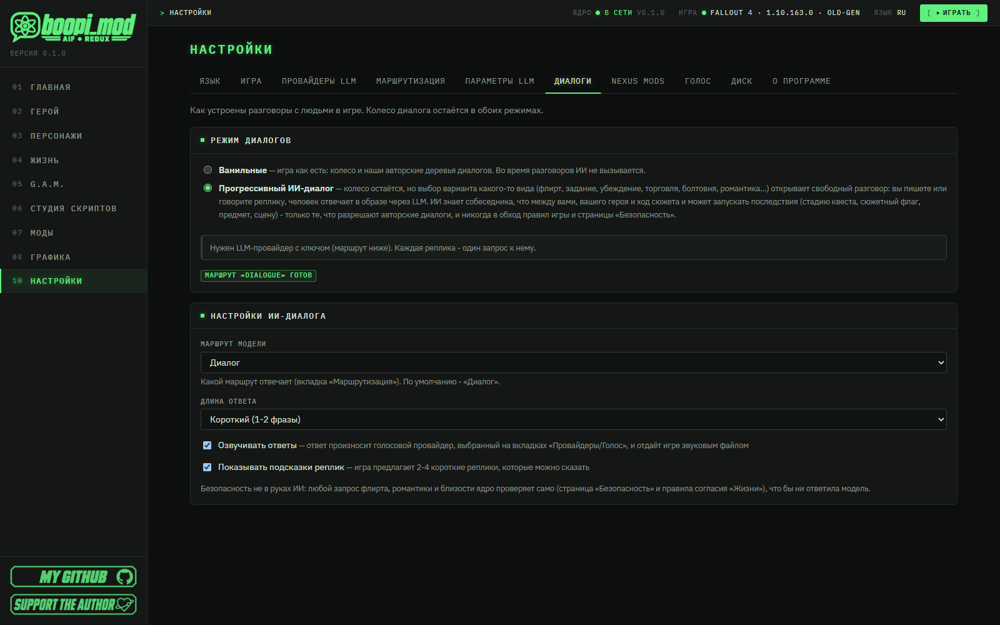
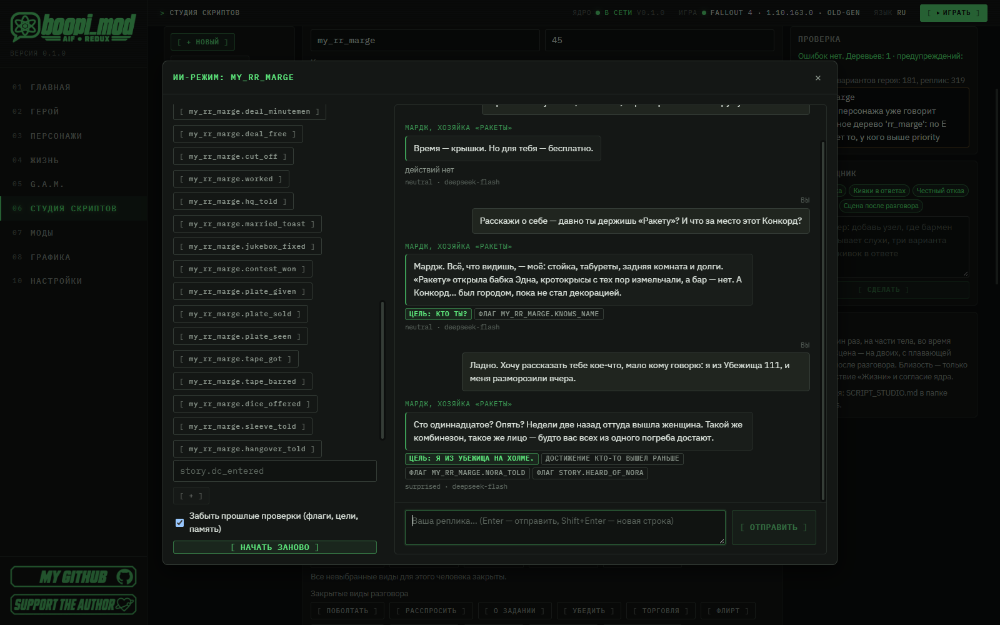
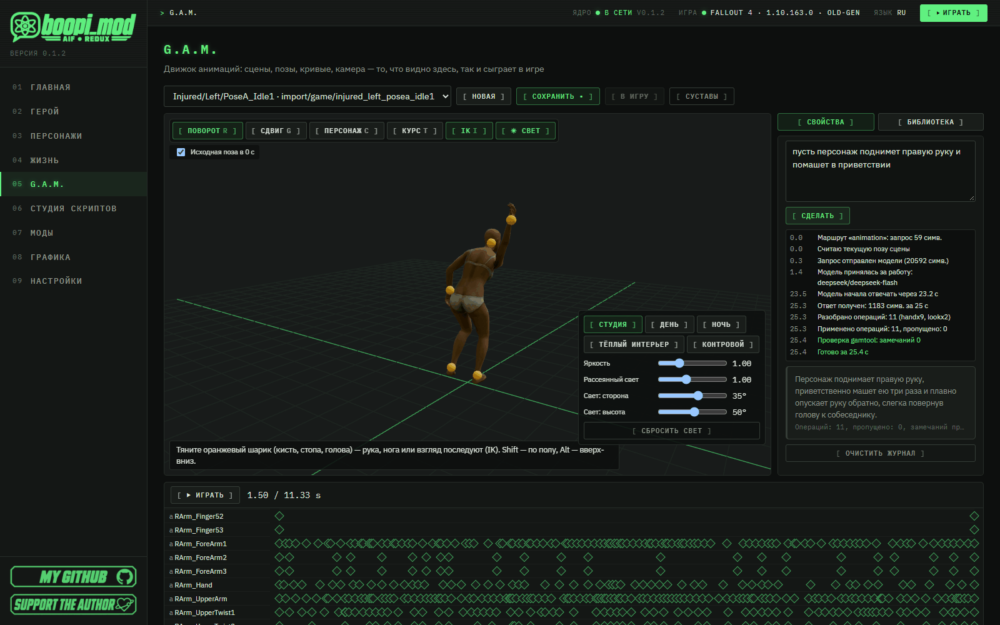

<p align="center"></p>

#  Студия скриптов: свои диалоги, сцены, озвучка и мод

🇷🇺 Русский · [🇬🇧 English](en/SCRIPT_STUDIO.md)

[Все инструкции](README.md) · [Главная страница проекта](../README.md)

**boopi_mod — это прежде всего менеджер модов, в котором вы СОЗДАЁТЕ**: свои анимации, сценарии, сцены и диалоги — вручную или с помощью ИИ. *Моддинг никогда не был так прост.*

**«Студия скриптов»** (пункт меню сразу после G.A.M.) — та часть, где делаются диалоги и всё, что вокруг них: свои деревья разговоров, ответвления от колеса диалога самой игры, озвучка, жесты и сцены прямо в репликах, ИИ-диалог для своего человека и готовый мод в один файл `.ogmod`, который другой игрок ставит в boopi_mod перетаскиванием. Программировать не нужно.

> [!NOTE]
> **⏱ За 1 минуту**
>
> - **Что это.** Раздел boopi_mod, где вы без кода делаете диалоги для персонажей игры или своего мода: в формах или в YAML.
> - **Самый быстрый путь.** «Студия скриптов» → **«+ Новый»** → выбрать персонажа → собрать разговор в конструкторе → **«В игру»** → в игре нажать **E** на персонаже.
> - **Проверка без игры.** **«▶ Сыграть диалог»** — дерево как колесо диалога: условия и последствия на тестовом состоянии (флаги, предметы, стадии квестов, SPECIAL, карма, время суток), что изменил ход, переход в любой узел. **Ctrl+Z / Ctrl+Y** — отмена и повтор правок, **«Версии»** — прежние версии файла после сохранения ([3.3](#33-версии-файла)).
> - **Своя история за минуту.** **«+ История»**: кто, где и когда, какие сцены G.A.M. сыграть и какая награда — студия сама делает дерево разговора и два триггера, уже связанных. Или **«Взять пример»** — готовая «Ночная посылка» со своими сценами ([12.8](#128--история-и-готовый-пример)).
> - **Ответвления от игры.** Свой вариант прямо на колесе ванильного диалога («Из игры» → сцена → «Ответвление») и своя ветка за ним.
> - **Голос и анимации.** Свои записи или синтез голоса («Озвучить ИИ»), жесты и сцены G.A.M. в репликах.
> - **ИИ помогает.** ИИ-помощник пишет ветки и скрипты Papyrus по описанию, а в «ИИ-диалоге» ваш человек говорит свободно; результат проверяется в тестовом чате **«Проверить в ИИ-режиме»**.
> - **Что вы получаете.** Один файл `.ogmod` в `Документы\BoopiMod\Mods`: диалоги, озвучка и сцены едут вместе, другой игрок перетаскивает его в окно boopi_mod и нажимает «В игру». Мод можно выложить на boopi.site прямо из программы ([9.7](#97-опубликовать-на-boopisite)).

<p align="center"></p>
<p align="center"><em>Конструктор дерева: флаги, секция «ИИ-диалог», проверка и ИИ-помощник справа.</em></p>

## Содержание

1. [Как это устроено](#1-как-это-устроено)
   - [1.1 Персонажи, предметы и квесты DLC и модов](#11-персонажи-предметы-и-квесты-dlc-и-модов)
2. [Первый разговор за 5 минут](#2-первый-разговор-за-5-минут)
3. [Вкладки студии](#3-вкладки-студии)
   - [3.1 Играть: проверить разговор без игры](#31-играть-проверить-разговор-без-игры)
   - [3.2 Отмена и повтор](#32-отмена-и-повтор)
   - [3.3 Версии файла](#33-версии-файла)
   - [3.4 Копировать, вставить, дублировать](#34-копировать-вставить-дублировать)
   - [3.5 Найти и заменить](#35-найти-и-заменить)
   - [3.6 Переименовать и удалить: ссылки идут следом](#36-переименовать-и-удалить-ссылки-идут-следом)
4. [Встроенные деревья как образец](#4-встроенные-деревья-как-образец)
5. [Реплики из игры и ответвления](#5-реплики-из-игры-и-ответвления)
   - [5.1 Взять сцену за основу](#51-взять-сцену-за-основу)
   - [5.2 Ответвление: свой вариант на колесе игры](#52-ответвление-свой-вариант-на-колесе-игры)
   - [5.3 Сказать репликой игры: голос и субтитр из Fallout 4](#53-сказать-репликой-игры-голос-и-субтитр-из-fallout-4)
6. [Озвучка реплик](#6-озвучка-реплик)
7. [«Собрать и проверить»](#7-собрать-и-проверить)
8. [ИИ-диалог: человек, который говорит сам](#8-ии-диалог-человек-который-говорит-сам)
9. [Свой мод: сохранить и поделиться](#9-свой-мод-сохранить-и-поделиться)
   - [9.7 Опубликовать на boopi.site](#97-опубликовать-на-boopisite)
10. [ИИ-помощник](#10-ии-помощник)
11. [Скрипты Papyrus для своего мода](#11-скрипты-papyrus-для-своего-мода)
12. [Триггеры: своя история](#12-триггеры-своя-история)
   - [12.5 Пример: «Ночная смена в „Землянке“»](#125-пример-ночная-смена-в-землянке)
   - [12.8 «+ История» и готовый пример](#128--история-и-готовый-пример)
13. [Частые вопросы](#13-частые-вопросы)
14. [Что читать дальше](#14-что-читать-дальше)

Теги и сцены подтягиваются из того, что у вас уже стоит в игре и в библиотеке G.A.M.

---

## 1. Как это устроено

> [!IMPORTANT]
> **Деревья работают и для персонажей boopi_mod, и для персонажей игры и DLC.** Дерево на персонажа игры (Вадим и Хоторн в «Землянке», Дэйзи в Добрососедстве, Аллен Ли в Фар-Харборе — проверено в игре) встраивается в его собственный повседневный разговор: по E открывается ваше дерево, а когда его приветствие больше не подходит (например, после флага «уже поговорили»), — снова родной диалог персонажа, со всеми его квестами и торговлей. Если персонаж в игре сам заговаривает с героем, когда тот подходит, так же придёт и приветствие дерева. Два ограничения: пока персонажа держит квест игры (разговор стадии квеста, сюжетная сцена — например, Кэсси Далтон в начале Фар-Харбора или Кент Коннолли с «Серебряным плащом»), первым идёт этот разговор; поселенцы и безымянные жители получают дерево через квест boopi_mod. Проверка студии напоминает об этом. Чтобы добавить вариант прямо в колесо родного диалога, используйте **ответвления** ([раздел 5](#5-реплики-из-игры-и-ответвления)).

В студии вы делаете:
- свои **деревья диалогов** для персонажей игры или своего мода — в формах или в YAML;
- **ответвления от диалогов самой игры**: свой вариант на колесе ванильного разговора и своя ветка за ним;
- **озвучку** реплик: свои записи или синтез голоса — весь диалог одной кнопкой — и липсинк, который делается сам;
- **анимации прямо в репликах**: кивок, жест, сцену на двоих после разговора;
- **скрипты Papyrus** для своего мода в Creation Kit: готовые заготовки или по описанию от ИИ;
- **ИИ-диалог** для своего человека: кто он, к чему вести разговор, а исходы берутся из ваших узлов — с проверкой в тестовом чате;
- **триггеры своей истории**: когда что-то происходит в мире (зона, час, таймер, стадия квеста, «убит», «использовал», реплика закончилась) — сообщение, разговор, сцена G.A.M., стадия квеста, флаги, предметы ([раздел 12](#12-триггеры-своя-история));
- **свой мод**: всё сделанное одним файлом `.ogmod`, который другой игрок перетащит в boopi_mod; диалоги, озвучка и сцены G.A.M. поедут вместе.

Путь от файла до игры:

```
 ваши файлы .yaml (%APPDATA%\BoopiMod\talk)        студия: конструктор / YAML / карта / проверка / ИИ
 + записи озвучки (talk\audio)                    «Из игры»: реплики персонажей игры, ответвления
 + установленные моды других игроков (.ogmod)
          │
          ▼  «В игру»
 BoopiCorp.esp пересобирается: встроенные деревья + ваши + из модов (с ошибками — пропускаются),
 озвучка ложится в Data\Sound\Voice\BoopiCorp.esp\<голос персонажа>\
          │
          ▼
 в игре: E на персонаже → ваш разговор; на колесе игры — ваше ответвление; реплики говорят вашими записями
```

- Ваши файлы лежат в `%APPDATA%\BoopiMod\talk\*.yaml` в том же формате, что встроенные деревья игры (`data/talk`).
- Ваши деревья собираются в плагин **после** встроенных. У каждого дерева свой диапазон записей, и он закреплён за деревом (`%APPDATA%\BoopiMod\plugin\tree_slots.json`): установка и удаление модов и файлов не сдвигают записи деревьев, которые помнят сохранения. Удалённое дерево свой диапазон бережёт — вернули его, и у него те же id. Диапазонов 767, встроенные деревья занимают около 120; если места не осталось, «В игру» остановится с понятной ошибкой.
- `who`, предметы `give` / `take` / `has` и квесты `quest` ищутся в boopi_mod, в Fallout4.esm, в DLC и во **включённых** плагинах (plugins.txt). Имя, которого нет нигде, — ошибка проверки: такое дерево в игру не попадёт, и проверка скажет почему.
- Дерево с ошибками остаётся черновиком: файл сохраняется, но в игру это дерево не попадает, пока ошибки не исправлены.
- Хеш ваших файлов, записей, установленных модов и мастеров из порядка загрузки входит в версию плагина (`2.6.3-u1a2b3c4d`). Изменили что-то — менеджер видит обновление, и «В игру» пересобирает плагин.

> [!NOTE]
> Эта инструкция — про работу в программе.

### 1.1 Персонажи, предметы и квесты DLC и модов

Нашлось имя в DLC или в моде — при «В игру» этот файл становится **мастером** BoopiCorp.esp. DLC просто должны оставаться установленными. Мод держите установленным и включённым: без него игра не запустится до следующего «В игру» (проверка предупредит об этом у дерева, «Собрать и проверить» покажет список мастеров). Плагин сюжета `OldGenStory.esp` мастером быть не может: его персонажей дерево называть не может. Триггеры ([раздел 12](#12-триггеры-своя-история)) пока называют места, предметы и людей только из Fallout4.esm и boopi_mod.

---

## 2. Первый разговор за 5 минут

**Шаг 1. Создайте файл.** Нажмите **«+ Новый»** и заполните:
- имя файла (`my_barman`);
- id дерева;
- **кто говорит** — начните вводить имя персонажа (`Престон`, `Пайпер`, `Мэксон`) или его editor id и выберите из списка. Сюжетные персонажи (компаньоны, фракции, DLC) стоят сверху, остальные NPC игры и включённых модов находятся по имени или editor id. NPC вашего мода — его editor id, можно со звёздочкой: `MyModBarman*` (мод должен быть включён; если такого NPC нет, проверка сразу скажет об этом);
- название.

Получится маленькое рабочее дерево: приветствие, вопрос «Кто ты?» с кивком и «Мне пора».

**Шаг 2. Соберите разговор в конструкторе.** Его разделы:
- **Дерево** — кто говорит (поиск по имени или editor id; на чипе видно имя), название, флаги (что игра запомнит: `met`, `told_secret`…), торговец ли он.
- **Приветствия** — что персонаж скажет по E. Срабатывает первое, чьи условия выполнены, поэтому последнее должно быть без условий.
- **Узлы** — каждое колесо выбора, до 4 вариантов героя (↑ вопрос, ← слева, → справа, ↓ снизу). Сверху видно, как колесо выглядит в игре.
- **Вариант героя** — подпись на колесе (до 40 символов), действие «Жизни» (`compliment`, `flirt`, `hug`… — исход решает ядро), куда дальше, условия и последствия.
- **Ответы персонажа** — группы ответа. Если у варианта есть действие, у группы бывает исход: `ok` — получилось, `no` — отказ, `later` — недавно уже было… Варианты текста пишутся по одному в строку, игра выберет случайный.

<p align="center"></p>
<p align="center"><em>Раздел «Дерево» конструктора: кто говорит, название и флаги; справа — «Проверка» и «ИИ-помощник».</em></p>

**Шаг 3. Добавьте анимацию реплики.** У каждого ответа есть поле «Анимация». Сцену просят **одним из трёх способов** — в `anim:` реплики стоит ровно один из них ([12.3](#123-действия-что-произойдёт)):
- *сцена из библиотеки G.A.M.* — своя сцена, выбранная по имени (сделанная в редакторе G.A.M. или импортированная). В списке видно, сколько у сцены ролей и стоит ли она уже в игре; сцену, которая пока только в библиотеке, «В игру» поставит в игру сама. «Открыть в G.A.M.» — к ней в редактор. Для жеста персонажа нужна сцена на одну роль, для «Кто: оба» — на две;
- *по тегам* — жест из установленных сцен. Под полем видно, сколько сцен подходит. Если «в игре нет подходящих сцен», поставьте пак с такими тегами;
- *контекст «Жизни»* — сцену выбирает ядро. Интимные контексты помечены «только с согласием». Нужного места в списке нет — сделайте **свой контекст**: G.A.M. → Библиотека → «Контексты» → «+ Свой контекст» (сцена или слой, запросы по тегам, сколько актёров, часть тела; [ANIMATION_IMPORT.md](ANIMATION_IMPORT.md)). Он появится в этом списке, а в мод поедет вместе с файлами, которые его называют ([9.1](#91-сохранить-мод));
- **Кто**: персонаж, герой или оба (тогда это сцена с камерой);
- **Часть тела**: голова — кивок, верх — жест, руки, одна рука…;
- **Когда**: во время реплики (жест) или после разговора (сцена).

**Шаг 4. Смотрите «Проверку» и играйте.** Проверка справа работает сама через секунду после правки, клик по ошибке открывает нужное место. Кнопка **«▶ Сыграть диалог»** — сыграть разговор прямо в студии, без игры ([раздел 3.1](#31-играть-проверить-разговор-без-игры)).

**Шаг 5. Сохраните и отправьте в игру.** **Ctrl+S** или «Сохранить». Затем **«В игру»**: закройте игру, плагин пересоберётся. Сцены G.A.M., которые играют ваши реплики и триггеры, «В игру» сама ставит в игру (как кнопка «В игру» на странице G.A.M.) и называет их. Запустите игру и нажмите E на персонаже.

> [!TIP]
> Не хотите начинать с нуля — откройте «Встроенные» и нажмите «Взять за основу» ([раздел 4](#4-встроенные-деревья-как-образец)): готовое дерево станет вашей копией с новым id.

---

## 3. Вкладки студии

| Вкладка | Что там |
|---|---|
| **Конструктор** | Всё в формах: деревья файла, приветствия (или ответвление от игры), узлы, варианты, ответы, озвучка, анимации, условия и последствия |
| **Триггеры** | Своя история: «когда» (событие мира), «если» (флаги, часы, повтор) и «что» (сообщение, разговор, сцена G.A.M., стадия квеста, флаги, предметы) — [раздел 12](#12-триггеры-своя-история) |
| **YAML** | Тот же файл текстом — для тех, кто знает формат или вставляет готовое. Конструктор и YAML всегда показывают одно и то же |
| **Карта** | Разговор схемой: приветствие → узлы → конец. Красным — узел, куда не попасть или откуда нет выхода. Клик открывает узел в конструкторе |
| **Скрипт Papyrus** | Заготовки скриптов для своего мода в Creation Kit и ИИ, который пишет скрипт по описанию |

<p align="center"></p>
<p align="center"><em>Вкладка «Карта»: приветствие, узлы и переходы между ними. Красный цвет подсветит узел-тупик.</em></p>

**Условия и последствия** видны у каждого приветствия, варианта героя и группы ответа (не прячутся): строка — это условие из списка с понятным названием («флаг стоит», «стадия отношений», «симпатия», «у героя есть предмет»…) и поле под него:
- **флаги** — фишки, флаг файла выбирается из списка «+ флаг из файла…» (свои — `met`, чужие — `дерево.флаг`), можно вписать и `story.x`;
- **сравнения** (симпатия, доверие, крышки, уровень, S.P.E.C.I.A.L.…) — знак (≥ ≤ > < = ≠) и число; **стадия** — знак и стадия из списка;
- **предмет** и **квест** — поиск по имени, как во вкладке «Триггеры», плюс количество или стадия; **пол героя**, **время суток**, **характер** — выбор; «да / нет» — выбор;
- последствия: **поставить / снять флаг**, **симпатия +5 / −10**, **дать / забрать предмет**, **стадия квеста**, **после разговора** (торговля, свидание…), **память персонажа**.

Кнопка **«YAML»** у блока показывает те же условия строками «ключ: значение» (например, для `any` — «хотя бы одно из»); выбор запоминается. Если значение там не читается, под полем сказано, что не так и где («в списке ожидалась запятая или ] · символ 14»).

**Тексты реплик.** В многострочном поле каждая строка — вариант реплики (игра выбирает случайный): **Enter** начинает новый вариант, пробелы печатаются как обычно. Лишние пробелы по краям и пустые строки убираются, когда вы выходите из поля и при сохранении.

**Приветствия и группы ответа.** Срабатывает первое подходящее по порядку, поэтому «+ приветствие» и «+ группа ответа» ставят новое **перед** последним без условий — дайте ему условие. Если что-то стоит после записи без условий и никогда не прозвучит, проверка скажет «приветствие #3 никогда не прозвучит…».

**Комментарии** (`# заметка`) в файле остаются на своих местах и после правок в конструкторе: каждый возвращается над тем ключом или пунктом списка (или в конец той строки), где стоял. Комментарий удалённого узла уходит вместе с ним.

### 3.1 Играть: проверить разговор без игры

Кнопка **«▶ Сыграть диалог»** (над вкладками; в карточке узла — **«▶ Сыграть отсюда»**) открывает **проигрыватель**: дерево играется как колесо диалога игры, без игры и без пересборки плагина. Играется то, что сейчас в редакторе, — сохранённое или нет.

- **Слева — разговор.** Приветствие (первое, чьи условия выполнены), потом колесо на 4 места, как в игре: ↑ вопрос, ← слева, → справа, ↓ снизу. Вариант, который сейчас не показался бы, остаётся на экране приглушённым — с причиной («charisma должно быть >=6 (сейчас 5)», «в слоте раньше показывается…», «исчерпанный вопрос»). Кнопка **«всё равно»** говорит такой вариант принудительно — посмотреть, куда он ведёт.
- **Реплики.** Под каждой — какой вариант текста выпал («вариант 2 из 2», остальные раскрываются) и озвучка: записанный WAV играется кнопкой **«▶ запись»**, для реплики без записи есть **«🔊 озвучить»** — голосовым движком из Настроек, по нажатию. Галочка «Играть записи» сама проигрывает записи новых реплик персонажа. Реплики «мимоходом» (`hello`), которые в этом состоянии прозвучали бы до разговора, показаны отдельной строкой. У дерева-ответвления вместо приветствия — вход: «ответвление от колеса игры, слот …» с подписью вашего варианта; не выполнено условие входа — это сказано.
- **Справа — тестовое состояние**, которое вы правите: пара (стадия, `affinity`, `trust`, `attraction`, `fear`, характер), герой (пол, уровень, крышки, карма, слава и дурная слава, опьянение, убеждение, в розыске, напарник, на свидании…), S.P.E.C.I.A.L., время суток, **флаги** (у дерева — одной кнопкой, чужие — `story.x` или `дерево.флаг`), **предметы**, **стадии квестов**, кубики для `chance`. Колесо пересчитывается сразу, как только вы тронули значение. Состояние запоминается для этого дерева; «Сбросить состояние» возвращает значения по умолчанию.
- **Что изменил ход.** Под репликами — ярлыки: `⚑ my_barman.met` (флаг), `caps 100 → 70`, `NukaCola ×0 → ×2`, `MQ102: 0 → 20`, `affinity 0 → 5`, смена стадии, заметка в память. Внизу справа — всё, что изменил разговор целиком.
- **Кнопки.** **«Сначала»** — с приветствия, с вашего исходного состояния; **«Назад»** — на один ход (состояние возвращается тоже); **«Открыть узел»** — любой узел с текущим состоянием; **RU/EN** — язык реплик; **🎲** — другие кубики (другой вариант реплики, другой бросок `chance`).

**Как считается.** Тем же, что и в игре: условия `when` читают тестовое состояние, последствия `do` меняют его в порядке плагина (флаги, крышки, предметы, стадия квеста, числа, `after`/`anim`); ответ персонажа — первая группа, чьё условие выполнено **после** последствий варианта героя и чей `result` подходит итогу действия; числа пары идут через правила ядра — прирост с убывающей отдачей и границами, **стадия идёт за числами** (флажок можно снять; романтические стадии требуют открытого романа, а не только чисел). Предмета или квеста, которых вы не задали, нет: счёт 0.

**Чего проигрыватель не делает** — это показано ярлыками, а не исполняется: **действие «Жизни»** (`act`: в игре его исход решает ядро, здесь вы выбираете итог в списке над колесом — ответит группа с этим `result`), **преступление**, **`after`** (торговля, свидание…), сама **анимация** (видно, сколько сцен подходит по тегам или контексту; играет её G.A.M. в игре). Защиты (`gam.censor`) и правила «Жизни» проигрыватель не трогает.

### 3.2 Отмена и повтор

Каждая правка файла — шаг истории: в конструкторе, в YAML, ответ ИИ-помощника. **Ctrl+Z** или **«↶ Отменить»** — шаг назад; **Ctrl+Y** (или Ctrl+Shift+Z) и **«↷ Повторить»** — вперёд.

- Набор текста в поле — **один шаг**, а не по букве. Добавить вариант, переименовать узел, поменять ответы местами — по шагу на действие. Хранятся последние **200** шагов.
- Работает во всех вкладках файла (карта показывает результат). В полях правой панели (запрос ИИ) и в окнах — обычная отмена браузера.
- Вернулись к сохранённому — снова «Изменения сохранены», предупреждение о несохранённом снимается.
- История живёт, пока файл открыт: другой файл, новый или восстановленный черновик начинают её заново. Несохранённые правки не теряются молча: при смене и удалении файла студия спрашивает, при закрытии окна — предупреждает, при переходе на другую страницу программы остаётся черновик (предложат восстановить).

### 3.3 Версии файла

Отмена живёт, пока файл открыт. Кнопка **«Версии»** (в панели над вкладками, рядом с «В игру») помнит дольше: перед сохранением программа откладывает прежнюю версию файла — **последние 30**. Несколько сохранений подряд в пределах пары минут — одна версия, так что вечер с Ctrl+S не вытесняет утренний файл.

- В окне «Версии файла …» список от новой к старой: время, число строк, деревья и число триггеров в той версии.
- **«Показать»** — что отличается от текущего текста (с несохранёнными правками): «−» было в этой версии, «+» есть сейчас, вокруг — пара строк без изменений для ориентира; галочка «весь текст» показывает версию целиком. «Вернуть» есть и здесь.
- **«Вернуть»** → подтверждение. Файл станет таким, каким был, а версия, которую он заменяет, сама попадёт в список: вернуть можно и обратно. Несохранённые правки в окне при этом пропадут (окно предупредит).
- Прежние версии появляются после повторного сохранения: у только что созданного файла их ещё нет.
- Удаление файла тоже откладывает его последнюю версию. Создайте файл с тем же именем — в «Версиях» будут версии удалённого.
- Версии лежат в `%APPDATA%\BoopiMod\talk\.history\<имя файла>\`. У сцен в редакторе G.A.M. есть такая же кнопка «История».

### 3.4 Копировать, вставить, дублировать

У узла (рядом с id), у варианта героя, группы ответа и приветствия есть **⧉ Дублировать** (копия встаёт рядом) и **⎘ Копировать**. Скопированное вставляется кнопкой «Вставить …» в том же файле или **в другом**: буфер переживает смену файла и перезапуск программы. Узел вставляется под свободным id (`start_2`), вариант — в узел, группа ответа — в вариант.

Клавиши: щёлкните по карточке (не в поле ввода) — **Ctrl+C** копирует её, **Ctrl+D** дублирует, **Ctrl+V** вставляет то, что в буфере, сюда. В поле ввода эти клавиши работают как обычно, с текстом.

### 3.5 Найти и заменить

**Ctrl+F** (или кнопка **«Найти»**) открывает поиск по файлу: тексты реплик, подписей и сообщений, id (деревья, узлы, триггеры, `go`, `who`, предметы) и флаги — галочками можно оставить нужное, «Aa» — с учётом регистра. В списке у каждой находки место (`my_tree.start[0].reply[1] · ru`), клик открывает его. **«Заменить в текстах: N»** меняет найденное только в текстах; id и флаги переименовывайте в их полях — ссылки поправятся сами ([3.6](#36-переименовать-и-удалить-ссылки-идут-следом)). Во вкладке YAML Ctrl+F — обычный поиск по тексту.

### 3.6 Переименовать и удалить: ссылки идут следом

- **Переименовать дерево** (поле «Id дерева»): в этом же файле следом меняются `talk.tree` триггеров и все флаги `дерево.флаг`; всплывает «Переименовано … · ссылок в файле обновлено: N». Если старое имя есть в **других файлах** или установленных модах, следом придёт список — их поправьте сами (проверка там покажет ошибки).
- **Переименовать триггер** — так же: `done`, `start` других триггеров и флаги `триггер.флаг`.
- **Переименовать флаг** — щёлкните по фишке флага у дерева или триггера и впишите новое имя: меняются его условия и последствия в своём дереве / триггере и `владелец.флаг` во всём файле. Узел переименовывается в поле «Id узла» — все `go` следом.
- **Удалить** дерево, узел, триггер или флаг: в подтверждении сказано, кто на него ссылается («На него ссылаются: triggers.bar.do[0]…», «В других файлах: …») — после удаления эти ссылки станут ошибками. Флаг, на который никто не ссылается, удаляется без вопроса.

---

## 4. Встроенные деревья как образец

«Встроенные» — все деревья, что идут с boopi_mod (Стелла, клуб, «Ред Рокет», сюжет…):
- их можно открыть и посмотреть, как сделано;
- **«Взять за основу»** — копия с новым id станет вашей.

> [!WARNING]
> Если ваше дерево говорит за того же персонажа, что и встроенное, проверка предупредит: в игре по E сработает первое подходящее приветствие, а встроенные деревья в плагине идут первыми (поле `priority` сборка не читает: все деревья — один квест). Чтобы отвечало ваше, дайте ему своего персонажа или используйте ответвление (раздел 5).

---

## 5. Реплики из игры и ответвления

Кнопка **«Из игры»** рядом со «Встроенными». Найдите персонажа по имени, и откроется всё, что он говорит в Fallout 4 и DLC:
- по квестам: **сцены** (сколько в них колёс диалога и реплик) и отдельные **реплики** с пометкой «приветствие», «мимоходом», «бой»… и условиями игры (`GetStageDone(MQ102) == 1` — после такой-то стадии квеста);
- сцену можно открыть и прочитать по порядку: что он говорит, колёса с вариантами героя (подпись в колесе в скобках) и его ответы. Блёклым — реплики других участников сцены.

### 5.1 Взять сцену за основу

**«Взять за основу»** у сцены с колесом создаёт новый файл: колёса сцены по порядку, варианты героя и ответы как в игре. Варианты, которые игра показывает только при условиях квеста, взяты такими, как они видны по умолчанию; ответы для героини и героя сохранены через `when: { player: female }`. Это новый разговор за того же персонажа — ванильный не меняется. Если у персонажа уже есть встроенное дерево (Престон, Пайпер…), проверка предупредит, что по E сработает первое подходящее приветствие (встроенные деревья идут первыми).

### 5.2 Ответвление: свой вариант на колесе игры

Так вы встраиваете свою ветку прямо в разговор игры — например, у Артуро на первом колесе вместо «Может быть» появляется «Какие слухи?», за ним ваша ветка, а из неё — обратно на его колесо.

1. «Из игры» → персонаж → откройте сцену.
2. У нужного колеса, у нужного слота (↑ ↓ ← →) — **«Ответвление»**. Задайте подпись вашего варианта (до 40 символов) и имя файла → «Создать». Файл откроется в конструкторе.
3. В конструкторе вместо приветствий — карточка **«Ответвление от игры»**: сцена, колесо и слот; подпись; что говорит герой (необязательно) и озвучка этой фразы; **условие, когда вариант виден**; первый узел ветки.
4. Ветка — обычные узлы. В «Куда дальше» есть **«↩ назад в игру»** — обратно на это колесо игры, и «■ конец разговора».
5. «Сохранить» → «В игру».

Что нужно знать:
- В колесе ровно 4 слота: ваш вариант **занимает слот**, ванильный вариант там не виден, пока ваш доступен. Без условия — всегда.
- Если ванильный вариант двигает квест (запускает сцену, ставит стадию), «Собрать и проверить» предупредит: задайте условие (например, `flag: met` своего дерева или стадию квеста), иначе квест может встать.
- Пустой верхний слот у торговцев игра заполняет своими сюжетными вариантами («Поиски Шона») — туда ответвление не встаёт, кнопки там нет.
- Ответвления пока делаются от сцен основной игры (не DLC).
- Другие моды, меняющие тот же квест (например, неофициальный патч), видны в «Собрать и проверить».

> [!IMPORTANT]
> Ванильный вариант слота, который двигает квест, лучше не прятать безусловно. Всегда задавайте условие видимости своего варианта — тогда игра не потеряет нужный ей выбор.

---

### 5.3 Сказать репликой игры: голос и субтитр из Fallout 4

Если нужная вам реплика уже есть в игре (и озвучена), её слова в свой файл не переписывают: у группы ответа, приветствия или реплики «мимоходом» вместо текста стоит **id реплики игры (INFO)**. Мод тогда не хранит ни текста, ни записи: игра сама играет свой голос с липсинком и показывает свой субтитр на языке игрока — из вашей копии Fallout 4.

1. «Из игры» → персонаж → откройте сцену или реплику; id INFO написан серым справа от реплики (например `Fallout4.esm|198308`) — его можно вписать как есть.
2. В конструкторе у группы ответа (или приветствия) нажмите **«♪ из игры»** и впишите id через запятую — несколько id образуют случайный пул. Реплика из DLC пишется как `DLCCoast.esm|00A3B4`. В YAML это одна строка: `- { vanilla: 0x198308, go: deeper }` (условия `when`, `result`, `go`, `do` работают как обычно). Кнопка **«✎ свой текст»** возвращает обычный текст.
3. **«Играть»** показывает текст реплики, прочитанный из вашей игры, с пометкой «голос игры» (если игры нет — заглушка «(реплика из игры)»).

Что нужно знать:
- Рядом с `vanilla` нет `ru`, `en` и озвучки: у такой реплики нет своего текста и своей записи.
- Реплику играет тот персонаж, которому игра её записала. «Проверка» предупредит, если тип голоса говорящего другой: субтитр покажется, голос — нет. Берите реплики того же персонажа (или того же типа голоса).
- Проверка также ищет INFO в вашей игре: нет такой реплики (или DLC не установлен) — ошибка, дерево не соберётся. Мод с репликой DLC при установке требует этот DLC.
- Так делаются реплики персонажа. Слова героя и подписи на колесе — всегда свои.

---

## 6. Озвучка реплик

У приветствий, ответов персонажа, фраз героя (раскрывающийся блок «Полная реплика героя» у варианта) и у входа в ответвление есть поле **«Озвучка»**: по записи на каждый вариант текста, для русского и английского отдельно.

### 6.1 Озвучить весь диалог одной кнопкой

**«🎙 Озвучить всё»** на панели файла озвучивает все реплики файла голосом каждого говорящего:

1. Нажмите **«Озвучить всё»**. В окне — **кто каким голосом говорит**: каждый человек деревьев файла и **герой**, у каждого голос
   для русского и для английского, кнопка **«▶»** — прослушать. Голоса — того провайдера, что выбран в «Настройки → Провайдеры
   LLM» (по умолчанию Edge TTS — ключ не нужен; ElevenLabs, OpenAI, Higgs TTS 3, XTTS-v2, Silero). Если ничего не выбрано,
   человек говорит голосом персонажа boopi_mod, который его играет (или голосом по умолчанию), герой — голосом своего пола.
   Выбор запоминается для всех ваших файлов.

   С **клонирующим** провайдером (XTTS-v2, Higgs TTS 3) пункт «— авто —» значит **образец из игры**: NPC игры (Пайпер, Ник,
   поселенец…) и герой говорят своим голосом. Под именем говорящего — его голосовой тип и откуда он взят («из игры», «из
   карточки», «герой»), под каждым голосом — что звучит, например «образец из игры (NPCFPiper) · секунд: 18.8 · с текстом
   реплик». Образец вырезается из реплик игры при первой озвучке и хранится на вашем компьютере (до того — «вырежется при
   первой озвучке»). **«Вырезать заново»** берёт образец ещё раз, **«Своя запись…»** — ваш WAV (6–30 секунд) вместо него;
   в списке можно выбрать и другой клон или готовый голос. Образцы не попадают в мод; клонируйте только те голоса, на которые у
   вас есть право ([VOICE.md](VOICE.md), раздел 3).
2. Выберите, что озвучить: **весь файл**, **дерево** или **узел**, выбранные в конструкторе. Окно считает реплики: «К озвучке: N ·
   уже есть запись: M». Реплики с записью пропускаются; галочка **«Озвучить заново и те, у которых уже есть запись»** —
   переозвучить и их. Каждая запись помнит свой текст: реплику, которую поправили после озвучки, окно озвучит заново («Текст
   изменился после озвучки: N»), а готовую запись того же текста (озвучка, прерванная закрытием программы, реплика, которую
   переставили или вернули) возьмёт без новой озвучки и без новой оплаты («Готовые записи … возьмутся без новой озвучки: N»).
   Ниже — **оценка**: число символов, у платного провайдера — примерная цена (OpenAI — в долларах, ElevenLabs — в кредитах
   тарифа; у облачного Higgs — только символы); перед платной озвучкой окно спросит ещё раз.
3. Нажмите **«Озвучить N»**. Полоса показывает, как идёт озвучка; окно можно свернуть — озвучка продолжится, а записи попадут в файл,
   когда вы снова откроете окно. Реплика, которая не получилась, видна в списке с причиной, остальные идут дальше. Запись встаёт
   на ту реплику, которая говорит её текст: если за время озвучки реплики переставили, она найдёт свою; реплику удалили или
   переписали — запись не встанет никуда (окно скажет, сколько таких), а файл останется и возьмётся, если текст вернётся.
4. Записи встают в поля «Озвучка» реплик точно так же, как выбранные вручную. **Сохраните** файл, потом **«В игру»**.

Каждая реплика получает WAV в `%APPDATA%\BoopiMod\talk\audio` (у той же реплики — то же имя: новая озвучка заменяет файл).
Кто что говорит: приветствия, реплики «мимоходом» и ответы — человек дерева; варианты героя (полная реплика, иначе подпись
на колесе без `[метки]`) и вход в ответвление — герой. Реплики самой игры («♪ из игры») звучат голосом игры. Чтобы переозвучить
**одну реплику**, нажмите «Озвучить ИИ» у этого варианта (шаг 1 ниже) — она скажется тем же голосом говорящего из студии.

### 6.2 Одна реплика вручную

**Шаг 1. Добавьте запись.** «Озвучка» → у нужного варианта **«Загрузить…»** → выберите файл:
- **WAV** — PCM 16 бит (другой формат — ошибка), моно, 44100 или 48000 Гц (так пишут все программы записи и озвучки). 22050 Гц тоже подходит; другая частота, стерео и запись длиннее 60 секунд дают предупреждение;
- **XWM** — уже сжатый звук игры;
- **FUZ** — готовый файл реплики игры (звук и липсинк в одном);
- или кнопка **«Озвучить ИИ»**: текст этого варианта озвучивает выбранный в «Настройки → Провайдеры LLM» сервис (Edge, ElevenLabs, OpenAI, XTTS…) голосом говорящего из студии (6.1; в списке «Кто говорит» можно взять голос персонажа), а WAV сразу кладётся в записи. Настройка голоса — [VOICE.md](VOICE.md).

<p align="center"></p>
<p align="center"><em>Движки озвучки в настройках (здесь XTTS-v2 и Silero TTS): тот, у кого стоит «Озвучивать этим», озвучивает реплики по кнопке «Озвучить ИИ».</em></p>

**Шаг 2. Липсинк — делать ничего не нужно.** Для WAV boopi_mod делает липсинк сам при сборке мода: слушает запись и раскладывает буквы реплики по времени, когда звучит речь (со временем слов от встроенного распознавания речи, если оно установлено); в игре `BoopiUI.dll` двигает губы говорящего вместе с голосом ([VOICE.md](VOICE.md), «Липсинк»). Свой `.lip` — по желанию: загрузите его кнопкой **«+ .lip»** рядом с записью, и игра возьмёт его. У FUZ липсинк уже внутри; XWM двигает губы только со своим `.lip`.

**Шаг 3. Прослушайте.** WAV можно прослушать прямо в студии.

**Шаг 4. Сохраните и отправьте в игру.** «Сохранить» → «В игру».

При сборке WAV сжимается программой `Tools\Audio\xwmaencode.exe` из **Creation Kit** (он должен стоять в папке игры; без него загружайте XWM или FUZ), склеивается с вашим `.lip` (если он есть) в `.fuz` и кладётся в папку голоса того, кто говорит: персонаж — его тип голоса из игры (у Артуро `NPCMArturo`), герой — `PlayerVoiceFemale01` / `PlayerVoiceMale01` (для фразы с `{p:…|…}` — своя запись в свою папку). Проверено в игре: реплика звучит вашей записью, субтитр держится столько, сколько она длится. Рядом кладётся липсинк реплики (`Data\F4SE\Plugins\BoopiUI\Lips\BoopiCorp.esp\<реплика>_1.json`) — губы двигаются вместе с записью.

Записи лежат в `%APPDATA%\BoopiMod\talk\audio`.

> [!NOTE]
> Имена файлов записей — латиницей (студия переименует сама).

> [!TIP]
> Не хватает Creation Kit? Загрузите готовый **XWM** или **FUZ** — для них кодировщик не нужен.

---

## 7. «Собрать и проверить»

Кнопка в списке файлов. Плагин собирается так же, как для «В игру», но **в игру ничего не ставится** — это проверка для того, кто готовит мод. Сборка занимает 1–3 минуты. В отчёте (клик по строке открывает место):
- ошибки и предупреждения всех файлов, деревья, которые не вошли в плагин, и почему;
- плагин читается обратно, сколько в нём записей и какой он по размеру;
- **мастера**: от каких DLC и модов будет зависеть BoopiCorp.esp (их персонажей, предметы или квесты называют ваши деревья);
- **озвучка**: файл есть, формат играет, есть кодировщик для WAV, у XWM есть `.lip`;
- **ответвления**: ванильные реплики слота двигают квест (нужно условие); какие моды из вашего порядка загрузки меняют тот же квест или тему и что из этого следует;
- **сцены G.A.M.** реплик и триггеров: по id — есть ли сцена в игре или пока только в библиотеке («В игру» поставит её сама); по тегам — отвечает ли запросу хоть одна сцена в игре, есть ли такие в вашей библиотеке (их «В игру» тоже поставит) или не сыграет ничего;
- **триггеры**, которые не вошли в плагин, и почему (нет такого места, квеста, предмета или персонажа в `Fallout4.esm` / `BoopiCorp.esp`, [12.7](#127-если-триггер-не-срабатывает)) — то же теперь ловит и проверка на ходу.

Ответвления **встроенного сюжета**, которые трогают другие плагины, сведены в одну строку: в ваших файлах с ними ничего делать не нужно. В живой проверке заметка «персонаж игры или DLC» — одна на файл, свёрнута под «ℹ заметки» (это обычный случай, не ошибка).

> [!TIP]
> Прогоните «Собрать и проверить» перед тем, как сохранять мод для других: так вы увидите то же, что увидит игра у получателя.

---

## 8. ИИ-диалог: человек, который говорит сам

Если у игрока включён режим «Диалоги: ИИ» (Настройки → Диалоги → «Прогрессивный ИИ-диалог»; [AI_DIALOGUE.md](AI_DIALOGUE.md)), ваш человек говорит свободно, а **исходы берутся из ваших узлов**. Что открывает ваш выбор в дереве (флаги, предметы, крышки, стадия квеста, «после разговора», жест или сцена), то ИИ может выдать, когда разговор до этого действительно дошёл — с теми же условиями `when`, флагами и глобалами, что и в обычном диалоге. Это работает одинаково для встроенных деревьев, ваших и деревьев установленных модов. Деревья с ошибками (черновики) в игру не попадают, значит и ИИ их не видит.

<p align="center"></p>
<p align="center"><em>Настройки → Диалоги: режим «Прогрессивный ИИ-диалог», маршрут модели и длина ответа.</em></p>

Без блока `ai` всё работает по узлам: цели, темы и приветствие берутся из дерева. Блок **только сужает или окрашивает** разговор — правила безопасности и «Жизни» над ним, он не может открыть то, что они закрыли.

### 8.1 Секция «ИИ-диалог»

В конструкторе, под флагами дерева; раскрывается по клику (см. снимок конструктора в начале инструкции).

1. **Кто это** — манера, характер, что для него важно (до ~900 знаков; по-русски и по-английски; модель читает это каждый ход).
2. **К чему должен вести разговор с ним** — цель человека («продать герою пару стимпаков, но не даром»).
3. **Только эти виды разговора** — поболтать, расспросить, о задании, убедить, торговля, флирт, романтика, близость, выпить, надавить, извиниться. Ничего не выбрано — открыты все подходящие.
4. **Закрытые виды разговора** — то, что человек никогда не поддержит (побеждает над предыдущим пунктом).
5. **Подсказки по ходу сюжета** — короткие тексты с условием `when` («вы ещё не знакомы», «сделка была, вы друзья»); показываются модели, пока условие выполнено.

Закрытый вид не предлагается игроку и не стартует.

Дерево на персонаже самой игры (`who: Codsworth`) окрашивает и его свободные реплики в **колесе игры** (клавиша T, [AI_DIALOGUE.md §5](AI_DIALOGUE.md#5-в-диалогах-самой-игры)): «Кто это» и подсказки модель читает и там, а исходов там нет — сюжет идёт вариантами игры.

> [!NOTE]
> Проверка предупредит, если текст написан только на одном языке: пишите и по-русски, и по-английски.

### 8.2 Проверка: «Проверить в ИИ-режиме»

Кнопка в секции «ИИ-диалог» открывает тестовый чат с человеком из дерева — таким, как оно сейчас в редакторе (даже не сохранённым и с ошибками):
- слева выберите **вид разговора**, **пол героя**, **SPECIAL**, **стадию** отношений, уровень и крышки, поставьте нужные **флаги** и нажмите **«Начать»**;
- в левой колонке под кнопкой — **открытые сейчас цели** (выборы дерева, которые ИИ может «взять», с флагами, которые они ставят);
- говорите: под каждым ответом видно, что сработало (**цель, флаг, предмет, квест, анимация, достижение**), а если ядро отказало — в чём и почему.

<p align="center"></p>
<p align="center"><em>Тестовый чат: ответ в образе, под ним — сработавшие цели и флаги.</em></p>

Тест идёт в отдельном сохранении `studio-test`, настоящие сохранения не трогает; нужен ключ модели для диалогов. «Начать заново» забывает флаги и память прошлых проверок.

> [!IMPORTANT]
> Жёсткие правила ИИ не обходит, о чём бы его ни просили и что бы ни написал автор в блоке `ai`: только взрослые в романтике, близость только через действие «Жизни» и согласие ядра, никакого откровенного текста, никогда «forced», пленники или животные.

---

## 9. Свой мод: сохранить и поделиться

### 9.1 Сохранить мод

**«Сохранить мод»** (в списке файлов):
1. Название, автор, версия (`1.0`), описание.
2. Отметьте **файлы диалогов** (файлы с ошибками не берутся — исправьте их).
3. **Сцены G.A.M.**, которые ваши файлы играют по id (реплики и триггеры), отмечены сами — «играют ваши файлы — войдёт в мод». Другие свои анимации мода отметьте при желании (поиск по имени или тегам). Сцены, собранные из **чужих анимаций** (импортированный пак, анимации Skyrim, походки OAR, клипы из плагина), помечены **«чужое»**: делиться ими можно только с разрешения их автора. Галочка **«Только мои сцены»** (она появляется, когда в библиотеке есть такие сцены) оставляет их вне мода. Без неё сцена войдёт в мод, но программа напомнит о правах.
4. «Сохранить». Мод появится в `Документы\BoopiMod\Mods\<название латиницей>-<версия>.ogmod`, кнопки «Показать в папке» и «Опубликовать на boopi.site» ([9.7](#97-опубликовать-на-boopisite)). Ниже — предупреждения: запись озвучки, которую вы не загрузили; сцена, которой нет в вашей библиотеке; сцена «собрана из чужих анимаций … нужно разрешение автора» (или «в мод не вошла»); какие ваши контексты и группы рас вошли в мод.

В мод входят: ваши деревья и ответвления, триггеры, блоки `ai`, записи озвучки, которые они называют (с `.lip`, если вы его добавили), и выбранные сцены G.A.M. Едут вместе с модом и **ваши собственные контексты G.A.M.** (из `gam\contexts`), которые называют реплики и триггеры мода (`anim.context`, `scene.context`), и **ваши группы рас** (из `gam\race_groups.json`), которые упомянуты в ролях упакованных сцен как `@группа`. Встроенные контексты и группы программы не упаковываются: они есть у всех. Если сцена играет клипы из чужого пака или деревья называют персонажей, предметы и квесты DLC и других модов, мод запоминает, какие плагины нужны, и показывает это при установке.

Мод записывает и всё остальное, что ему нужно для работы (§ 9.5): **версию boopi_mod** (не ниже той, в которой он сделан), **плагины** его сцен и деревьев (DLC и моды, чьих персонажей, предметы и квесты называют деревья) и **другие моды Студии**, чьи флаги читают ваши деревья (`when: { flag: чужое_дерево.флаг }`). Последние Студия находит сама; если нужный мод поставлен с boopi.site, в файл попадает его адрес на сайте — тот, у кого его нет, поставит всё одной кнопкой. Мод, поставленный из файла, Студия назовёт в предупреждении: тому, кто будет ставить ваш мод, придётся найти его самому.

<p align="center"></p>
<p align="center"><em>Редактор G.A.M. — менеджера анимаций: свои сцены делаются здесь, а затем отмечаются в «Сохранить мод».</em></p>

### 9.2 Установить чужой мод

Перетащите `.ogmod` в окно boopi_mod — на «Студию скриптов» или на страницу «Моды». Мод проверяется (целостность, деревья, совпадение id с вашими и с другими модами) и появляется в студии в разделе **«Установленные моды»**: его можно посмотреть и удалить (✕). Затем **«В игру»** — и мод работает: он собирается вместе с вашими деревьями, на языке вашей игры, в своих номерах записей (с другими модами не пересекается).

Перед установкой мод сверяется с вашим компьютером: нужная версия boopi_mod, плагины его сцен, другие моды (§ 9.5). Если чего-то не хватает, программа не молчит, а показывает окно «Мод пока нельзя установить» со списком и кнопкой, которая это исправляет.

Когда мод встал, программа сверяет его деревья с теми, что уже есть (встроенными, вашими и других модов), и **предупреждает**, но установку не отменяет — решать вам. Два случая: деревья мода говорят **за тех же персонажей**, что и уже стоящие (по E сработает первое подходящее приветствие: встроенные деревья идут первыми, остальные по id), или **ответвляются от того же места** колеса игры (игра покажет один из двух вариантов). В предупреждении названы пары «дерево мода / дерево, которое уже было». В списке «Установленные моды» у мода видно, сколько в нём деревьев, контекстов G.A.M. и групп рас.

Контексты и группы рас мода ставятся в папку самого мода (`studio_mods\<id>\gam\…`) и читаются оттуда рядом со встроенными: удалили мод (✕) — они ушли вместе с ним. Мод **не может переопределить** контекст или группу, которые уже есть в программе, у вас или у другого мода, — установка откажет с названием совпавшего id. Защиты (`gam.censor`) работают для таких контекстов и групп так же, как для ваших собственных.

### 9.3 Сцены мода сразу попадают в игру

При установке сцены G.A.M. из мода ложатся в вашу библиотеку и, если игра найдена, в `Data\GAM\Scenes` — как кнопка «В игру» на странице G.A.M. Анимации по тегам в репликах мода находят только то, что уже стоит в игре, поэтому без этого шага они бы молчали. Сцена с тем же id, которую сделали вы сами, никогда не перезаписывается (установка откажет с понятной причиной); при обновлении самого мода его сцены заменяются. Удаление мода (✕) убирает и его сцены из игры.

### 9.4 Мод из каталога boopi.site

На странице «Моды» → «Моды сообщества · boopi.site» кнопка **«Установить»** работает и для модов Студии: файл `.ogmod` скачивается, сверяется с SHA-256, который называет сайт, и ставится так же, как при перетаскивании — деревья, озвучка и сцены вместе (в «Установленных модах» такой мод помечен «с boopi.site»; карточка в каталоге пишет «Установлен (Студия скриптов)»). Когда автор выпустит новую версию, у карточки появится **«Обновить»**. Удаляется мод там же, в «Установленных модах» (✕).

### 9.5 Что нужно моду: версия, плагины, другие моды

- **Версия boopi_mod.** Мод, сделанный для более новой версии программы, не ставится: «Нужен boopi_mod ≥ X, а у вас Y» — обновите программу. Файлы прежнего формата ставятся как раньше; если они сделаны в более новой версии, программа лишь предупредит.
- **Плагины.** Если сцены мода играют анимации из чужого пака, нужны плагины этого пака. Их нет в порядке загрузки — окно покажет список (нет в `Data` / файл есть, но плагин выключен) и предложит **«Всё равно установить»**: диалоги заработают, сцены с этими анимациями — нет. В «Установленных модах» такой мод отмечен предупреждением, пока пак не поставлен.
- **Другие моды.** Если мод построен на другом (в файле: id и/или адрес на boopi.site и диапазон версий, например `>=1.2,<2`), он не поставится, пока тот не установлен нужной версии. Окно покажет, что не хватает («не установлен» / «у вас 1.0, версия не подходит»). Кнопка **«Установить зависимости»** скачает недостающие с boopi.site (самую новую версию, подходящую под диапазон; цепочки зависимостей — не глубже пяти уровней) и затем сам мод. Моды без адреса на сайте придётся найти самому.
- **Удаление.** Если на моде построены другие, при удалении (✕) программа назовёт их и спросит ещё раз: без него они перестанут работать.

> [!TIP]
> Автору: `.ogmod` сохраняется с версией boopi_mod, в которой вы его сделали, как минимальной. Другой минимум (например, `0.1.0`) можно задать в запросе сохранения (`min_app`, docs/API.md «Script studio»).

### 9.6 Новая версия мода

Установка мода с тем же id заменяет старый **целиком**: деревья, записи озвучки и сцены, которых в новой версии нет, исчезают — и из библиотеки, и из игры (сцену, которую вы успели изменить сами, программа не трогает). Если установка оборвалась, прежняя версия остаётся как была. Программа сообщает, что произошло: «обновлён 1.0 → 1.1» или «заменён более ранней версией». После установки — **«В игру»**. Если новая версия мода перестала подходить модам, построенным на нём, об этом будет предупреждение.

> [!NOTE]
> Почему мод — это исходники, а не готовый esp: деревья работают на квестах и скриптах boopi_mod, так что мод всё равно для boopi_mod, а собранный у получателя он подстраивается под его игру и его другие моды.

### 9.7 Опубликовать на boopi.site

Сохранённый мод можно отправить на [boopi.site](https://boopi.site) прямо из программы: после проверки модератором он появится в каталоге («Моды» → «Моды сообщества · boopi.site»), и другие игроки ставят его одной кнопкой ([9.4](#94-мод-из-каталога-boopisite)).

1. Один раз войдите: **«Настройки → Аккаунт boopi.site» → «Войти через boopi.site»**. Вход подтверждается на сайте, пароль вводится только там. Без входа окно публикации предложит войти.
2. «Сохранить мод» ([9.1](#91-сохранить-мод)) → в конце **«Опубликовать на boopi.site»**.
3. В окне «Публикация на boopi.site» заполните:
   - **«Куда публикуем»**: «Новый мод» или мод, уже выложенный вами (тогда добавится новая версия; список виден, когда у вас есть моды на сайте);
   - **карточку** нового мода: название, категорию, «Кратко» (до 300 символов), описание (Markdown или BBCode), теги через запятую, ссылки, требования (другие моды, DLC), благодарности, отметку 18+;
   - **картинки**: иконку (квадратная, от 256×256), постер (широкий, от 1280 px, 16:9 или 2:1) и скриншоты (до 20);
   - **версию** и «Что нового в этой версии».

   Для нового мода обязательны название, категория, краткое описание, описание, иконка и постер; для любого — версия и «Что нового». Чего не хватает, подскажет «Заполните: …» под формой.
4. **«Отправить на модерацию»**. Программа создаёт карточку, грузит картинки и файл мода (по частям) и отправляет всё на модерацию. Статус и ответ модератора будут на сайте; после одобрения мод появится в каталоге.

Публикуя, вы соглашаетесь с правилами сайта: только ваша работа или с разрешения авторов, без материалов с детьми в интимном контексте. Сцены, собранные из чужих анимаций ([9.1](#91-сохранить-мод)), без разрешения их авторов не публикуйте.

---

## 10. ИИ-помощник

Нужен ключ любого провайдера ИИ в настройках. Модель выбирается в «Настройки → Маршрутизация → Студия скриптов».

**Деревья.** Опишите, что нужно, например: «добавь узел, где бармен рассказывает слухи, три варианта героя и кивок в ответе». Готовые подсказки:
- «Новая ветка», «Кивки в ответах», «Честный отказ», «Торговец», «Сцена после разговора».

Как обрабатывается ответ:
- ИИ получает весь файл, формат, ваши теги и контексты и пишет файл заново;
- ответ проходит ту же проверку; если есть ошибки, ИИ сам получает их и исправляет (один повтор);
- результат ждёт кнопки **«Применить»**: посмотрите текст и примите или отклоните.

**Скрипты Papyrus.** Например: «охранник отдаёт честь, когда герой подходит ближе 300 единиц». Скрипт проверяется по **настоящим сигнатурам из исходников вашей игры** (`Data\Scripts\Source`). Неверное число аргументов ловится, и ИИ исправляет его сам.

> [!WARNING]
> Ответ ИИ заменяет файл целиком, а несохранённые правки в нём пропадают — перед «Применить» сохраните то, что хотите оставить.

> [!IMPORTANT]
> Жёсткие правила ИИ не обходит, о чём бы его ни просили: только взрослые в романтике, близость только через действие «Жизни» и согласие ядра, никакого откровенного текста, никогда «forced», пленники или животные.

---

## 11. Скрипты Papyrus для своего мода

Вкладка «Скрипт Papyrus» — заготовки, которые сразу компилируются (проверено Caprica):

| Заготовка | Куда | Что делает |
|---|---|---|
| Жест во время реплики | фрагмент реплики (TopicInfo) в CK | `GAM.Gesture` на говорящем: кивок, жест рукой |
| Сцена на двоих после реплики | TopicInfo, `OnEnd` | `GAM.RunScene` героя и собеседника: камера плавает, этапы по очереди |
| Контекст «Жизни» после реплики | TopicInfo | `OGAIAnim.Context`: сцену выбирает ядро, интимную — только с согласием |
| Сцена по активации | мебель / активатор | герой играет сцену на этой ссылке (сесть, станцевать) |
| Функции для квеста | скрипт квеста | `Gesture` и `SceneWithPlayer` — зовите из своих фрагментов |

- **«Проверить»** — быстрая проверка: блоки закрыты, функции G.A.M. и OGAIAnim существуют, число аргументов совпадает с исходниками игры, интимное не просится по тегам.
- **«Копировать»** — в буфер, дальше компилируйте в Creation Kit или Caprica. Исходник `GAM.psc` ставится вместе с G.A.M. в `Data\Scripts\Source\User`.

> [!NOTE]
> «Проверить» — быстрая проверка, не компилятор: последнее слово за Creation Kit или Caprica.

---

## 12. Триггеры: своя история

Деревья отвечают, когда герой сам подошёл и нажал E. **Триггеры** заставляют мир действовать первым: герой вошёл в бар ночью — бармен машет и заговаривает; квест дошёл до стадии — приходит сообщение; прошло три часа — напоминание; реплика вашего диалога закончилась — играет сцена G.A.M. Так из диалогов, сцен и событий собирается **своя история**.

Триггеры исполняет тот же движок, что ведёт миссии встроенного сюжета (раздел `world:` его карточек): зоны, часы, таймеры, стадии квестов, «использовал», «убит». Встроенный сюжет от ваших триггеров не меняется.

### 12.1 Как устроен триггер

Триггер — это три вопроса: **когда**, **если** и **что произойдёт**.

- **Когда** — одно событие мира (таблица ниже). Можно без события: тогда триггер срабатывает, как только выполнены условия.
- **Если** — условия:
  - флаги: «все стоят», «хотя бы один», «ни одного» (в YAML `if: { flags: […], any: […], not: […] }`);
  - окно игровых часов («с 19 до 3» — через полночь; `if: { hours: { from: 19, to: 3 } }`);
  - один раз или **повторять** с паузой в игровых часах (`repeat: true`, `cooldown: 3`);
  - флаг, после которого триггер выключается навсегда («Выключить навсегда», `until: флаг`).

  Условия проверяются, пока триггер ждёт своего события. Перестали выполняться — он ждёт заново, с начала (таймер тоже начинается заново).
- **Что произойдёт** — действия **по очереди**: следующее ждёт, пока закончится предыдущее. Сцена доиграет — потом сообщение; разговор откроется — потом флаг.

Триггеры живут **в том же файле студии**, что и деревья, — на вкладке **«Триггеры»** (в YAML это раздел `triggers:`). Можно сделать файл только с триггерами. Проверка справа ловит ошибки триггеров так же, как ошибки деревьев, клик по ошибке открывает нужный триггер и действие.

**Флаги** связывают триггеры с диалогами:
- `story.<id>` — флаг встроенного сюжета (читать можно; поставить тоже, но проверка предупредит: это меняет тот сюжет);
- `<дерево>.<флаг>` — флаг вашего дерева. Его ставит реплика (`do: { set: … }`) и читает триггер, и наоборот: триггер ставит — дерево читает в `when`;
- `<триггер>.<флаг>` — свой флаг триггера. Его объявляют во «Своих флагах» и внутри триггера пишут без имени.

> [!TIP]
> Хотите, чтобы дерево реагировало на то, что сделал триггер? Объявите флаг **в дереве** (`flags: [invited]`) и ставьте его из триггера (`vadim_night.invited`). Дерево флаги триггеров не читает.

**Переходы.** Под деревом в конструкторе видно, какие триггеры файла открывают этот разговор или ждут его флагов, — клик открывает триггер. У действия «Начать разговор» сначала выбирается **дерево разговора**: персонаж подставится из его «Кто говорит», а «Открыть дерево →» ведёт обратно в конструктор. Если ни один триггер разговор не открывает, конструктор так и скажет: тогда он начнётся только по E.

### 12.2 События («Когда»)

| Событие | В YAML | Когда срабатывает |
|---|---|---|
| Сразу | без `when` | как только выполнены условия (без условий — после загрузки игры) |
| Запуск другим триггером | `when: start` | другой триггер выполнил действие «Запустить триггер» |
| Зона | `near: { at: ССЫЛКА, radius: 512 }` | герой ближе радиуса к ссылке мира или к маркеру локации (64 единицы ≈ 1 м) |
| Локация | `location: { id: DiamondCityLocation }` | герой в локации (как у ванильных квестов) |
| Помещение | `cell: { id: DmndDugoutInn01 }` | герой во внутренней ячейке |
| Игровой час | `hour: { from: 22, to: 23 }` | игровое время в окне часов |
| Таймер | `timer: { hours: 3 }` | прошло столько игровых часов, как триггер начал ждать |
| Стадия квеста | `quest: { id: MQ102, stage: 10 }` | стадия квеста выполнена |
| Убит | `kill: { npc: EDID }` или `kill: { at: ССЫЛКА }` | уникальный персонаж мёртв, или убит ещё один персонаж этой базы, или мертва эта ссылка |
| Использовал | `use: { at: ССЫЛКА }` | герой нажал E на двери, терминале, рубильнике (вещь работает как обычно) |
| Получил предмет | `got: { item: EDID, count: 1 }` | у героя в инвентаре столько штук предмета (нашёл, купил, получил) |
| Флаг | `flag: { name: my_tree.asked }` | флаг стоит: например, его поставила реплика вашего диалога |
| Другой закончил | `done: { id: другой_триггер }` | все действия того триггера закончились (его сцена доиграла) |

Места, помещения, квесты и предметы выбираются **поиском** по имени или editor id — из `Fallout4.esm` и `BoopiCorp.esp` (первый поиск читает игру несколько секунд). Персонажи — тем же поиском, что «Кто говорит» в деревьях. Editor id своего мода можно вписать как есть.

> [!NOTE]
> Сейчас триггер находит места, квесты, предметы и персонажей только в `Fallout4.esm` и `BoopiCorp.esp` — в отличие от деревьев ([1.1](#11-персонажи-предметы-и-квесты-dlc-и-модов)). Поиск персонажей общий с деревьями и может показать героя DLC или мода, но триггер его не найдёт. Проверка на ходу ищет каждое такое имя там же, где сборка: опечатку или чужое место она покажет ошибкой сразу («интерьерной ячейки 'NoSuchCell' нет ни в Fallout4.esm, ни в boopi_mod — опечатка?»), и «В игру» не нажмётся, пока она есть.

### 12.3 Действия («Что произойдёт»)

| Действие | В YAML | Что делает в игре |
|---|---|---|
| Сообщение | `message: { text: { ru, en }, from: hero \| pip \| core, box: false }` | уведомление (мысль героя, «Пип-Бой: …», «Ядро: …»); `box: true` или длинный текст — окно |
| Начать разговор | `talk: { npc: EDID, radius: 1000, tree: моё_дерево }` (вместо `npc` можно `at: ССЫЛКА`) | когда персонаж рядом, жив и никто не в бою, разговор открывается сам, как по E. **Укажите `tree`**: без него студия предупредит («talk.tree: выберите дерево…») — иначе непонятно, чья история заговорит. Здоровается **именно выбранное дерево**: пока разговор открывается, в игре действуют только его приветствия (подходит то, чей `when` выполнен), остальные деревья молчат; студия проверяет, что оно говорит за этого персонажа (его `who`) — иначе откроется обычное приветствие персонажа. Без `tree` открывается первое подходящее приветствие |
| Сцена G.A.M. | `scene: { tags: "hug,pair", actors: [hero, EDID] }`, `scene: { id: my/wave, actors: [hero] }` или `scene: { context: drink_together, npc: EDID }` | **ровно одно** из `id` / `tags` / `context` (одна форма «сыграть сцену» везде — в репликах, триггерах и строках мира миссий, см. ниже). По тегам или по id — сцену играет G.A.M. (затемнение `fade`, не дольше `seconds`); по контексту — сцену подбирает ядро |
| Стадия квеста | `stage: { quest: EDID, stage: 20 }` | ставит стадию квеста (ваш или ванильный — осторожно с основным сюжетом игры) |
| Флаги | `flag: { set: [..], clear: [..] }` | ставит и снимает флаги |
| Дать / забрать предмет | `give: { item: EDID, count: 1 }`, `take: { … }` | в рюкзак героя или из него |
| Запустить триггер | `start: другой_триггер` | разрешает сработать триггеру с `when: start` |
| Показать / Скрыть | `enable: ССЫЛКА`, `disable: { at: ССЫЛКА }` | ссылка мира появляется или исчезает (её можно вернуть) |
| Замок | `lock: { at: ССЫЛКА, level: 50 }` (`level: open` — отпереть) | запирает дверь или контейнер с этой сложностью или отпирает |
| Переместить | `move: { who: hero \| ССЫЛКА, to: ССЫЛКА, fx: teleport }` | переносит героя или ссылку мира к месту (`fx: teleport` — вспышка Института) |
| Фракция | `faction: { who: hero \| ССЫЛКА, add: FactionEdid, rank: 0 }` (или `remove:`) | добавляет во фракцию или убирает: так меняются враждебность и отношение |

Персонажа по editor id игра ищет **рядом с героем** (уникального — где бы он ни был). Нет никого — разговор ждёт; сцена пропускается, и идут следующие действия.

**Одна форма «сыграть сцену».** Реплика (`anim:`), триггер (`scene:`) и строка мира миссии (`scene:`, docs/story/MISSION_WORLD.md) просят сцену одинаково: ровно одно из `id` (сцена библиотеки или игры), `tags` (запрос «hug,pair») или `context` (контекст, сцену выбирает ядро) — и проверка в студии говорит об ошибке теми же словами. Запрос по тегам, написанный в `id` или `context` (`id: "hug,pair"`, как раньше писали в строках мира), читается как `tags`. У реплики вокруг этого: `who: npc | player | both`, `part`, `when`; у триггера и строки мира: `actors` (для `id` / `tags`) или `npc` + `who: both | npc` + `part` (для `context`), `fade`, `seconds`.

Сцену «по id» выбирают из списка **по имени** — свои сцены G.A.M. и те, что стоят в игре; в списке видно, сколько у сцены ролей (столько же нужно актёров) и есть ли она уже в игре. Актёры — «hero» и персонажи, найденные по имени, по порядку ролей сцены (всего до трёх). Сцену из библиотеки, которой ещё нет в игре, «В игру» поставит сама.

### 12.4 Безопасность

Все проверки — в `gam.censor`, как у реплик:
- по тегам и по id триггер **никогда** не берёт интимную сцену (в студии это ошибка, в игре G.A.M. такую не выберет);
- интимная сцена возможна только через **контекст**: её подбирает ядро, и только с согласием персонажа. Нет согласия — нет сцены;
- уровень каждой сцены (флирт, романтика, близость) проверяется для героя и всех названных персонажей. Ребёнок не попадёт в романтическую сцену ни в каком режиме. В остальном дети в историях участвуют как обычно: разговоры, задания, напарники.

### 12.5 Пример: «Ночная смена в „Землянке“»

> Пример использует персонажа игры (Вадим): дерево встраивается в его повседневный разговор в «Землянке» ([раздел 1](#1-как-это-устроено)). Вадим в игре сам заговаривает с героем у стойки — приветствие дерева тоже может прийти, как только вы подойдёте, без нажатия E.

Маленькая история на 15 минут. Вечером бармен Вадим из «Землянки» в Даймонд-сити сам заговаривает с героем: в баре кончилась водка. Если герой согласится, через три часа Пип-Бой напомнит о поставке. Принесёт водку — Вадим выпьет с ним и подарит бутылку самогона.

1. **«+ Новый»** → файл `dugout_night`, дерево `vadim_night`, «Кто говорит»: **Вадим Бобров** (`VadimBobrov`).
2. **Дерево.** Во флагах: `invited`, `agreed`, `delivered`. Приветствия по порядку:
   - при `flag: invited` и `not: agreed` — предложение с вариантами «Принесу три бутылки» (`set: agreed`) и «Не сегодня»;
   - при `agreed` без `delivered` — «Ну что, принёс?», вариант «Вот водка» с условием `has: { item: Vodka, count: ">=3" }` и последствиями «забрать 3 водки», «+100 крышек», `set: delivered`;
   - последнее — без условий.
3. **Вкладка «Триггеры» → «+ Триггер»** `dugout_evening`:
   - **Когда:** «Герой вошёл в помещение» → `DmndDugoutInn01` (в русской версии игры бар называется «Скамья запасных» — по этому имени его и найдёт поиск);
   - **Если:** «Ни один из флагов» `vadim_night.invited`, «Только в игровые часы» с 19 до 3;
   - **Что произойдёт:** «Сообщение» «Вадим машет вам из-за стойки.» → «Флаги» поставить `vadim_night.invited` → «Начать разговор» с `VadimBobrov`.

   Порядок важен: флаг ставится **до** разговора, чтобы приветствие с предложением уже видело его.
4. Триггер `vodka_reminder`: **Когда** «Прошло время» 3 часа; **Если** `vadim_night.agreed` и не `vadim_night.delivered`; **Что** — «Сообщение» от Пип-Боя. Принесёт водку раньше — условие перестанет выполняться, напоминания не будет.
5. Триггер `drinks`: **Когда** «Поставлен флаг» `vadim_night.delivered`; **Что** — «Сцена G.A.M.» по контексту «Выпить вместе» (`drink_together`) с `VadimBobrov`, «Дать предмет» `MoonshineBobrov`, «Сообщение».
6. **Ctrl+S**, справа «Ошибок нет» → **«В игру»** → запустите игру и вечером зайдите в «Землянку».

Тот же файл в YAML:

```yaml
# Моя история: ночная смена в «Землянке»
trees:
  vadim_night:
    who: [VadimBobrov]
    title: { ru: "Вадим: ночная смена", en: "Vadim: the night shift" }
    flags: [invited, agreed, delivered]
    greet:
      - when: { flag: invited, not: agreed }
        go: offer
        ru: ["Эй, друг! Ночью у нас аншлаг, а водка кончилась."]
        en: ["Hey, friend! Full house tonight and we're out of vodka."]
      - when: { flag: agreed, not: delivered }
        go: wait
        ru: ["Ну что, принёс?"]
        en: ["Well, got it?"]
      - { go: bye, ru: ["Заходи ещё."], en: ["Come again."] }
    nodes:
      offer:
        - slot: positive
          label: { ru: "Принесу три бутылки.", en: "I'll bring three bottles." }
          do: { set: agreed }
          reply: [{ ru: ["Спасибо! Жду до утра."], en: ["Thanks! I'll wait till morning."], go: end }]
        - slot: negative
          label: { ru: "Не сегодня.", en: "Not tonight." }
          reply: [{ ru: ["Жаль."], en: ["Pity."], go: end }]
      wait:
        - slot: positive
          label: { ru: "Вот водка.", en: "Here's the vodka." }
          when: { has: { item: Vodka, count: ">=3" } }
          do: { take: { item: Vodka, count: 3 }, caps: 100, set: delivered }
          reply: [{ ru: ["Спасаешь! Выпьем?"], en: ["You're a lifesaver! A drink?"], go: end }]
        - slot: neutral
          label: { ru: "Ещё ищу.", en: "Still looking." }
          reply: [{ ru: ["Поторопись."], en: ["Hurry up."], go: end }]
      bye:
        - slot: neutral
          label: { ru: "Пока.", en: "Bye." }
          reply: [{ ru: ["Пока."], en: ["Bye."], go: end }]
triggers:
  dugout_evening:
    title: { ru: "Вечер в «Землянке»", en: "An evening at the Dugout" }
    when: { cell: DmndDugoutInn01 }
    if: { not: [vadim_night.invited], hours: { from: 19, to: 3 } }
    do:
      - message: { text: { ru: "Вадим машет вам из-за стойки.", en: "Vadim waves at you from behind the bar." } }
      - flag: { set: [vadim_night.invited] }
      - talk: { npc: VadimBobrov, tree: vadim_night }
  vodka_reminder:
    when: { timer: { hours: 3 } }
    if: { flags: [vadim_night.agreed], not: [vadim_night.delivered] }
    do:
      - message: { text: { ru: "Вадим ждёт водку в «Землянке».", en: "Vadim is waiting for the vodka at the Dugout." }, from: pip }
  drinks:
    when: { flag: vadim_night.delivered }
    do:
      - scene: { context: drink_together, npc: VadimBobrov }
      - give: { item: MoonshineBobrov, count: 1 }
      - message: { text: { ru: "Бутылка «Лучшего самогона Бобровых» — за счёт заведения.", en: "A bottle of Bobrov's Best - on the house." } }
```

> [!TIP]
> Сцена «Выпить вместе» играет, если в игре стоит пак сцен с тегами `drink,pair` или `toast,pair` ([ANIMATION_IMPORT.md](ANIMATION_IMPORT.md)). Иначе её нет, а следующие действия всё равно выполняются.

### 12.6 Мод и обмен

«Сохранить мод» берёт файлы целиком, поэтому триггеры едут в `.ogmod` вместе с деревьями своего файла. В манифесте мода есть список триггеров. При установке они проверяются так же, как в студии: id не должен совпадать с вашими и с другими модами, флаги должны находиться, сцены проходят `gam.censor`. Удалили мод (✕) — его триггеры уходят из игры со следующим «В игру».

### 12.7 Если триггер не срабатывает

- **Проверка на ходу** и **«Собрать и проверить»** покажут, если нет такой ссылки, персонажа, предмета, квеста или помещения в `Fallout4.esm` / `BoopiCorp.esp` (сборка пишет причину по-русски: «не вошло в плагин: …»).
- **Условия.** Пока условия «Если» не выполнены, событие не ждут. Окно часов «с 19 до 3» идёт через полночь.
- **Один раз.** Сработавший без «Повторять» триггер больше не срабатывает в этом сохранении. Чтобы проверить снова, начните новую игру или сделайте сохранение до него.
- **Разговор не открылся.** Персонаж должен быть рядом (радиус), жив и не в бою, а у героя не должно быть меню и другого разговора. Приветствие вашего дерева должно подходить по условиям.
- **Лог.** С `bEnableLogging=1` в `Fallout4Custom.ini` в `Papyrus.0.log` видны строки `OGSWorld: T/<id> fires`, `… its event came`, `… listens again`.

### 12.8 «+ История» и готовый пример

> «Ночная посылка» использует персонажа игры (Дэйзи): дерево встраивается в её повседневный разговор в Добрососедстве ([раздел 1](#1-как-это-устроено)); когда его приветствие больше не подходит, Дэйзи снова говорит и торгует как обычно.

Чтобы не собирать связи руками, нажмите **«+ История»** (в списке файлов или на первом экране студии):

1. **Название** истории — имя файла получится само (его можно поправить).
2. **Кто** — персонаж игры или вашего мода (поиск по имени или editor id): он и заговорит с героем.
3. **Где начинается** — локация или помещение (поиск по имени; галочка «Только ночью» — с 20:00 до 4:00). Без места история начнётся сразу после загрузки игры.
4. **Сцена в разговоре** — своя сцена G.A.M.: на одну роль — жест персонажа во время ответа, на две — сцена после разговора. Без неё — дружелюбный жест по тегам.
5. **Награда** — предмет и сколько, и **сцена после награды** (герой и персонаж, необязательно).
6. **«Создать историю»** — файл откроется на вкладке «Триггеры».

Получается обычный файл: дерево разговора (флаги `called`, `agreed`, `done`) и два триггера — `<история>_start` (герой пришёл на место → уведомление, флаг `called`, персонаж заговаривает) и `<история>_reward` (вариант «Возьмусь» ставит `done` → награда, сцена, сообщение Пип-Боя). Дальше всё правится как обычно: реплики — в конструкторе, условия и действия — на вкладке «Триггеры».

**Готовый пример.** В том же окне — **«Взять пример»**: «Ночная посылка». Дэйзи из Добрососедства ночью сама окликает героя, её ответ играет жест из библиотеки G.A.M. по id, согласие ставит флаг, триггер выдаёт 150 крышек и играет сцену на двоих. В вашу библиотеку G.A.M. ложатся обе сцены примера (папка `example/night_parcel`), в студию — файл `night_parcel` с комментариями о том, как всё связано. «В игру» — и пример работает. Исходники примера лежат в папке программы: `core\data\studio\examples\night_parcel`.

---

## 13. Частые вопросы

**«В игру» недоступна.**
В файле есть ошибки — список справа.

**Персонаж молчит.**
Проверьте «Кто говорит» (у NPC из игры на чипе видно имя; чип без имени — editor id, набранный вручную) и что последнее приветствие без условий. Если у персонажа уже есть встроенное дерево или это персонаж игры, см. примечание в разделе 1.

**Проверка пишет «в игре нет персонажа (предмета, квеста) …».**
Такого editor id нет ни в boopi_mod, ни в Fallout4.esm, ни в DLC, ни во включённых плагинах. Это опечатка, или мод с этим персонажем выключен (включите его на странице «Моды»). Пока ошибка есть, дерево в игру не попадёт.

**«В игру» пишет «слишком много деревьев диалога».**
Все 767 диапазонов записей заняты деревьями, которые сейчас есть. Удалите ненужные моды студии или файлы деревьев. Диапазоны давно удалённых деревьев отдаются новым сами.

**Хочу проверить ветку, не запуская игру.**
«▶ Сыграть диалог» над вкладками ([раздел 3.1](#31-играть-проверить-разговор-без-игры)): колесо, условия и последствия на тестовом состоянии; не показавшийся вариант виден приглушённым — с причиной.

**Случайно удалил или испортил — как вернуть?**
**Ctrl+Z** ([раздел 3.2](#32-отмена-и-повтор)): отменяются все правки файла, пока он открыт, в том числе ответ ИИ-помощника. Уже сохранили — кнопка **«Версии»** ([раздел 3.3](#33-версии-файла)): последние 30 версий файла, что изменилось, «Вернуть» в один клик; удалённый файл возвращается так же, если создать файл с тем же именем.

**Ответвления не видно на колесе.**
Выполнено ли его условие; не тот ли это пустой верхний слот торговца; не перекрывает ли тему другой мод (см. «Собрать и проверить»). После правок — «В игру» и перезапуск игры.

**Реплика без звука.**
Запись загружена и выбрана у этого варианта и этого языка (язык — язык вашей игры); для WAV в папке игры есть Creation Kit (`Tools\Audio\xwmaencode.exe`). «Собрать и проверить» покажет, чего не хватает.

**Губы не двигаются.**
Запись — WAV (XWM нужен `.lip`); после озвучки — «Сохранить» и «В игру»; в `BoopiUI.ini` стоит `bLipSync=1`. Пока реплика звучит, в `BoopiUI.log` есть строка `face: ... speaks`.

**Жест не виден в диалоге.**
Камера диалога держит крупный план. Кивок (голова) виден всегда, жест руками — лучше «после разговора» или как сцена.

**Сцена сделана в G.A.M., а в игре не играет.**
Выберите её в реплике или в триггере как «Сцена из библиотеки G.A.M.» / «Сцена по id» — тогда «В игру» студии поставит её в игру сама. Проверьте, что ролей у сцены столько же, сколько актёров (жест — одна роль, «оба» — две): иначе список и проверка предупредят. «Собрать и проверить» покажет сцены, которых ещё нет в игре.

**Персонаж не находится по имени.**
Ищите по имени из вашей версии игры или по editor id. Буквы «е» и «э», «е» и «ё» поиск не различает («Дейзи» найдёт «Дэйзи»).

**«В игре нет подходящих сцен».**
Тегам не соответствует ни одна установленная сцена. Поставьте «G.A.M.: жесты» (кивки, «отдать честь», «указать», «руки вверх») или пак с нужными тегами ([ANIMATION_IMPORT.md](ANIMATION_IMPORT.md)).

**Мод не ставится: «id уже занят».**
У вас (или в другом установленном моде) есть дерево с тем же id. Переименуйте своё или удалите другой мод. Так же установка откажет, если id контекста G.A.M. или группы рас мода уже занят программой, вами или другим модом, и если у вас есть своя сцена с тем же id: мод ничего чужого не перезаписывает, а отказ называет, что именно совпало.

**Где мои файлы?**
`%APPDATA%\BoopiMod\talk` (записи — `talk\audio`), путь виден внизу списка файлов. Их можно править и в любом редакторе: студия перечитает файл при открытии. Сохранённые моды — `Документы\BoopiMod\Mods`.

---

## 14. Что читать дальше

- [ANIMATION_IMPORT.md](ANIMATION_IMPORT.md) — где взять анимации (импорт из Skyrim и модов Fallout 4) и как сделать свои в редакторе G.A.M.
- [ANIMATION_GUIDE.md](ANIMATION_GUIDE.md) — справка по анимациям в диалогах и скриптах: жест и сцена, камера, теги, контексты.
- [AI_DIALOGUE.md](AI_DIALOGUE.md) — режим «Диалоги: ИИ» глазами игрока.
- [VOICE.md](VOICE.md) — озвучка (TTS), клонирование голоса и распознавание речи (STT).

[Все инструкции](README.md) · [Главная страница проекта](../README.md)
