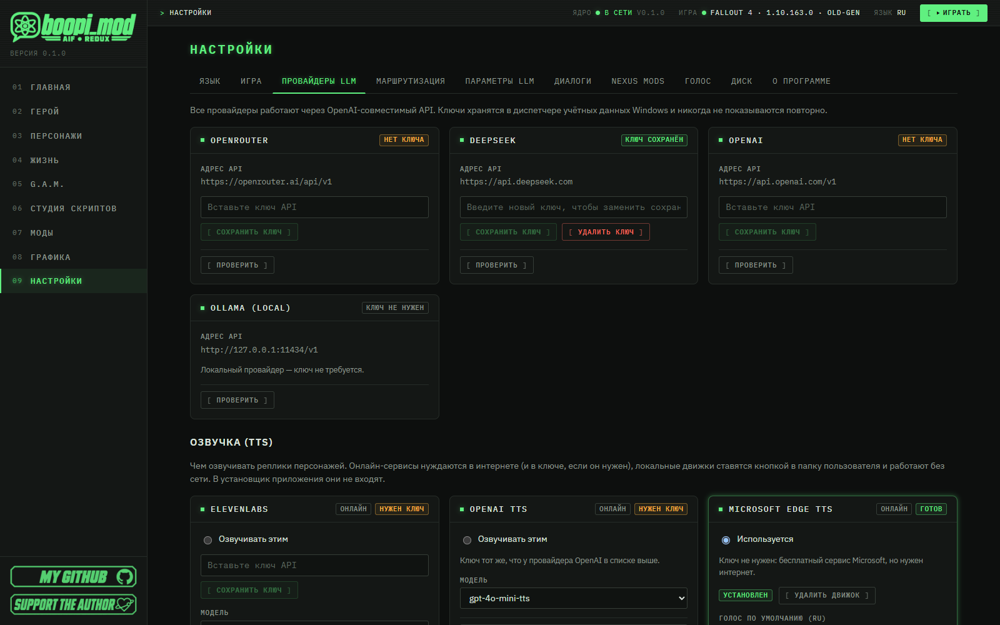
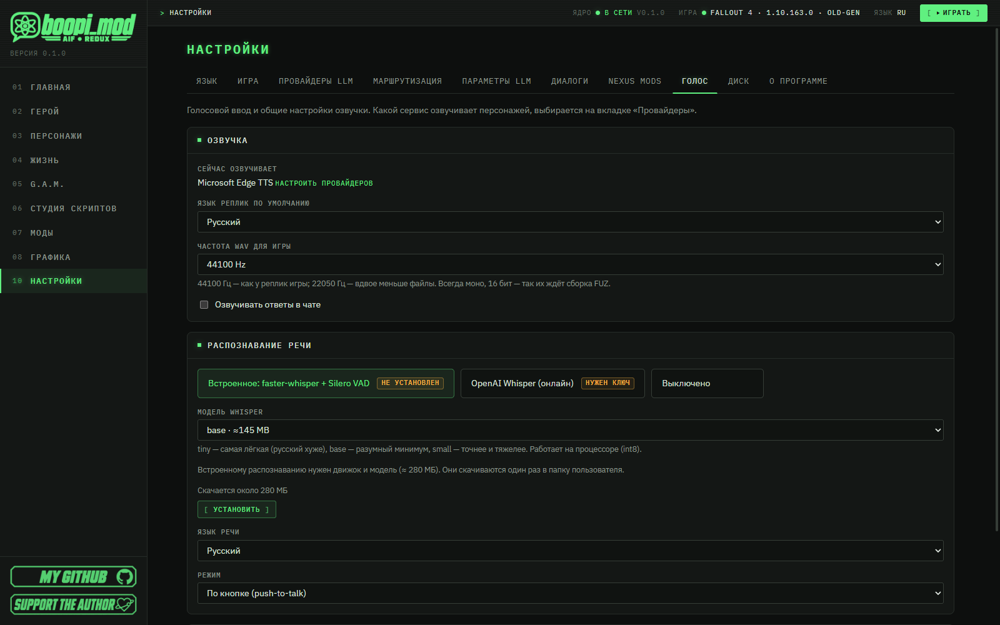

#  Голос: озвучка (TTS) и распознавание речи (STT)

🇷🇺 Русский · [🇬🇧 English](en/VOICE.md)

[← Все руководства](README.md) · [← Главная страница проекта](../README.md)

> [!NOTE]
> boopi_mod — прежде всего **менеджер модов**: *«Моддинг никогда не был так прост»*. Голос — приятное дополнение к тому, что вы
> в нём создаёте: диалоги в приложении и в игре могут **звучать**, а вы можете **говорить** в микрофон. Всё необязательно и
> включается по желанию.

> ### ⏱ За 1 минуту
>
> - **Озвучка (TTS)** — кто произносит реплики: онлайн (Edge TTS, ElevenLabs, OpenAI) или локально (XTTS-v2, Silero).
> - Проще всего начать с **Microsoft Edge TTS**: бесплатно, без ключа, русские голоса Дмитрий и Светлана.
> - Выбор провайдера: «Настройки → Провайдеры LLM» → блок «Озвучка (TTS)» → **«Озвучивать этим»**.
> - **Распознавание речи (STT)** — «Настройки → Голос»: встроенное (faster-whisper) или OpenAI Whisper; в игре — удерживайте **V**.
> - Локальные движки не входят в приложение: ставятся кнопкой **«Установить»** и работают без сети. XTTS-v2 умеет
>   **клонировать голос**.
> - XTTS-v2 и Silero — **некоммерческие** лицензии, поэтому ставятся только после вашего явного согласия.

## Содержание

1. [Где нужен голос](#1-где-нужен-голос)
2. [Озвучка (TTS)](#2-озвучка-tts)
3. [Клонирование голоса (XTTS-v2)](#3-клонирование-голоса-xtts-v2)
4. [Распознавание речи (STT)](#4-распознавание-речи-stt)
5. [Если что-то не работает](#5-если-что-то-не-работает)
6. [Другие руководства](#6-другие-руководства)

---

## 1. Где нужен голос

Голос в boopi_mod нужен в трёх местах:

- **чат с персонажем** в приложении — ответы можно озвучивать;
- **ИИ-диалог в игре** ([AI_DIALOGUE.md](AI_DIALOGUE.md)) — ответ человека звучит, а вы можете говорить сами, удерживая **V**;
- **Студия скриптов** — «Озвучить ИИ» записывает реплики для своих диалогов ([SCRIPT_STUDIO.md](SCRIPT_STUDIO.md), раздел
  «Озвучка реплик»).

Ничего тяжёлого в приложение не входит: онлайн-сервисы подключаются ключом, локальные движки ставятся кнопкой в папку
`%APPDATA%\BoopiMod\speech\` и работают без сети.

---

## 2. Озвучка (TTS)

«Настройки → Провайдеры LLM» → блок **«Озвучка (TTS)»**. Провайдер, у которого стоит **«Озвучивать этим»**, и озвучивает.

### 2.1 Выбрать провайдера

| Провайдер | Где работает | Что нужно | Заметки |
|---|---|---|---|
| **Microsoft Edge TTS** | онлайн | ничего (ключ не нужен), интернет | Бесплатно, русские голоса Дмитрий и Светлана; скорость регулируется в процентах. Хорошее начало |
| **ElevenLabs** | онлайн | ключ API | Голоса и модели берутся из вашего аккаунта (Multilingual v2, Turbo, Flash, v3); потоковая выдача |
| **OpenAI TTS** | онлайн | тот же ключ, что у провайдера OpenAI | Модели gpt-4o-mini-tts, tts-1, tts-1-hd |
| **XTTS-v2** | локально | «Установить» (около 4,7 ГБ), принять лицензию | Лучшее качество и **клонирование голоса**; желательна видеокарта NVIDIA (CUDA) |
| **Silero TTS** | локально | «Установить» (около 280 МБ), принять лицензию | Русские голоса, лёгкий |

### 2.2 Подключить

1. Для онлайн-сервиса вставьте ключ (**«Сохранить ключ»**; он хранится в Диспетчере учётных данных Windows) и нажмите
   **«Проверить»**. У Edge TTS ключ не нужен.

   

   *«Настройки → Провайдеры LLM»: ключи провайдеров сверху, ниже блок «Озвучка (TTS)». У Microsoft Edge TTS стоит «Используется» —
   ключ не нужен.*

2. Для локального движка нажмите **«Установить»**. Приложение само создаёт окружение и скачивает модель; идёт прогресс. У XTTS
   выберите видеокарту («Авто», «Только процессор», «Принудительно CUDA») и поставьте галочку лицензии.

   

   *Локальные движки XTTS-v2 и Silero TTS: «Установить», выбор видеокарты и галочка лицензии у XTTS, блок «Голоса XTTS
   (клонирование)».*

3. Выберите голос по умолчанию для русского и английского и нажмите **«Прослушать»**.
4. Отметьте **«Озвучивать этим»** — и этот провайдер озвучивает всех.

> [!IMPORTANT]
> **Лицензии движков.** XTTS-v2 распространяется по Coqui Public Model License, Silero — по CC BY-NC-SA 4.0: обе
> **некоммерческие**. Поэтому они не входят в архив и ставятся только после вашего явного согласия; Edge TTS и Whisper
> таких ограничений не накладывают.

### 2.3 Голос конкретного персонажа

«Персонажи» → персонаж → **«Профиль»**: карточка голоса показывает поля выбранного провайдера (голос ElevenLabs, голос OpenAI,
голос Edge, диктор Silero, диктор XTTS). Выберите и нажмите **«Прослушать»** — выбор сохраняется в вашем слое
правок. Если у персонажа ничего не выбрано, берётся голос по умолчанию для языка из настроек провайдера.

### 2.4 Озвучка в чате и в игре

- **Чат в приложении:** галочка **«Озвучивать ответы»** над полем ввода (или «Настройки → Голос» → «Озвучивать ответы в чате»);
  отдельный ответ можно озвучить кнопкой **«Прослушать»** рядом с именем персонажа.
- **ИИ-диалог в игре:** «Настройки → Диалоги» → **«Озвучивать ответы»**. Ядро получает ответ, синтезирует WAV и отдаёт игре, а
  та проигрывает его (не позиционно, без липсинка).
- **Частота WAV для игры** — 44100 Гц (как у реплик игры) или 22050 Гц (вдвое легче). Всегда моно, 16 бит — так их ждёт
  сборка озвучки студии.

---

## 3. Клонирование голоса (XTTS-v2)

Клон делается из чистой записи речи длиной **6–30 секунд**. Источников два:

1. **Вырезать из игры.** В блоке XTTS введите **голосовой тип NPC** (например `NPCMNickValentine`) и нажмите **«Вырезать из
   игры»**: приложение найдёт реплики этого типа в архивах озвучки игры, вырежет и декодирует несколько штук и сохранит их
   под этим именем. Нужен установленный XTTS и найденная игра.
2. **Своя запись.** Введите имя голоса и нажмите **«Загрузить запись (WAV)…»**.

Готовые клоны видны в списке ниже. Чтобы персонаж говорил клоном, в карточке голоса укажите диктора XTTS `clone:<имя>`; если у
персонажа задан `game_voice_type`, клон подхватится сам.

> [!WARNING]
> Клонируйте только те голоса, на которые у вас есть право. Реплики игры используются как образец для личного использования
> на вашем компьютере; они не копируются в раздачу.

---

## 4. Распознавание речи (STT)

«Настройки → Голос» → блок **«Распознавание речи»**.

*«Настройки → Голос»: частота WAV, озвучка в чате и блок «Распознавание речи» — встроенное, OpenAI Whisper или выключено.*

### 4.1 Варианты

| Вариант | Заметки |
|---|---|
| **Встроенное: faster-whisper + Silero VAD** | Работает на процессоре (int8), без сети. Нужен движок и модель — кнопка **«Установить»** (около 280 МБ), качается один раз |
| **OpenAI Whisper (онлайн)** | Нужен ключ OpenAI; запись уходит в сервис |
| **Выключено** | Голосовой ввод не работает |

### 4.2 Параметры

- **Модель Whisper:** `tiny` (≈75 МБ, самая лёгкая, русский хуже), `base` (≈145 МБ, разумный минимум), `small` (≈480 МБ, точнее
  и тяжелее).
- **Язык речи:** русский или английский.
- **Режим:** «По кнопке (push-to-talk)» — микрофон слушает, пока удерживается клавиша; «Слушать всегда (Silero VAD)» —
  фразы выделяются сами. В игре работает режим по кнопке.
- **«Проверить микрофон» → «Записать 5 секунд»:** приложение запишет несколько секунд и покажет, что распознано. Микрофон
  открывается только на это время.

### 4.3 Голосовой ввод в игре

Удерживайте **V** (клавишу можно сменить в `Data\F4SE\Plugins\BoopiUI.ini`, `iPushToTalk` — код клавиши Windows), говорите и
отпустите. Текст появится в строке ввода; **Enter** отправляет (`bAutoSend=1` отправляет сразу). Запись держится до 30 секунд
(`iMaxSeconds`).

> [!TIP]
> Сначала нажмите «Записать 5 секунд» в блоке «Проверить микрофон»: это быстро покажет, видит ли приложение ваш микрофон.

---

## 5. Если что-то не работает

| Что видите | Что делать |
|---|---|
| «Движок не установлен» | Нажмите «Установить» у провайдера (или у распознавания) |
| «Не скачан голос или модель» | Скачайте модель Silero или Whisper в блоке провайдера |
| «Нужно принять условия лицензии» | Поставьте галочку условий XTTS или Silero и повторите установку |
| «Не задан ключ API провайдера» | Вставьте ключ провайдера и нажмите «Сохранить ключ» |
| «Распознавание речи выключено» | «Настройки → Голос»: выберите встроенное распознавание или OpenAI Whisper |
| В игре нет звука | «Настройки → Диалоги» → «Озвучивать ответы»; в `BoopiUI.ini` `bPlayReply=1`; проверьте «Прослушать» у провайдера |
| V ничего не записывает | «Настройки → Голос»: установлено ли распознавание, «Проверить микрофон»; «Микрофон не найден» — выберите устройство записи по умолчанию в Windows |
| Мало места на диске | «Настройки → Диск»: движки и модели речи можно удалить и поставить заново |

Установки идут через менеджер заданий приложения: прогресс виден в блоке провайдера, при сбое там же — понятная причина.
Данные речи лежат в `%APPDATA%\BoopiMod\speech\` (окружения движков, модели, голоса-клоны).

> [!TIP]
> **Жду обратной связи:** пишите о проблемах и идеях — будем решать. Заведите обращение на
> [github.com/boopi-coder/boopi_mod/issues/new](https://github.com/boopi-coder/boopi_mod/issues/new) и приложите свежие логи
> из `%APPDATA%\BoopiMod\logs\`.

---

## 6. Другие руководства

| Руководство | О чём |
|---|---|
| [SCRIPT_STUDIO.md](SCRIPT_STUDIO.md) | Студия скриптов: свои диалоги, озвучка реплик, свой мод |
| [ANIMATION_IMPORT.md](ANIMATION_IMPORT.md) | Импорт анимаций и свои сцены в редакторе G.A.M. |
| [ANIMATION_GUIDE.md](ANIMATION_GUIDE.md) | Анимации в модах: жест и сцена, камера, вызов из диалогов и скриптов |
| [AI_DIALOGUE.md](AI_DIALOGUE.md) | ИИ-диалог в игре |
| [VOICE.md](VOICE.md) | Озвучка (TTS) и распознавание речи (STT) (вы здесь) |

[← Все руководства](README.md) · [← Главная страница проекта](../README.md)
