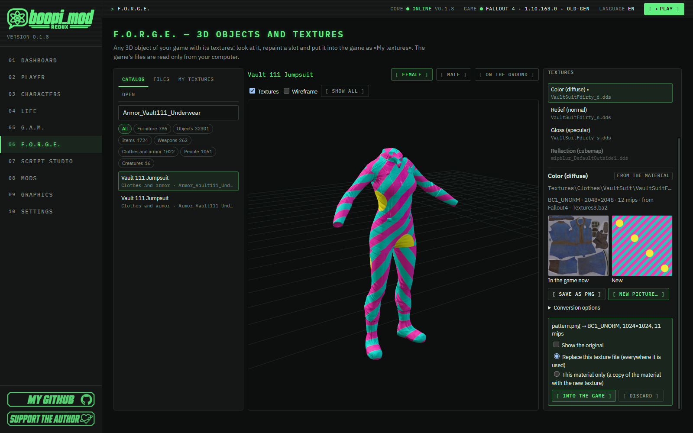
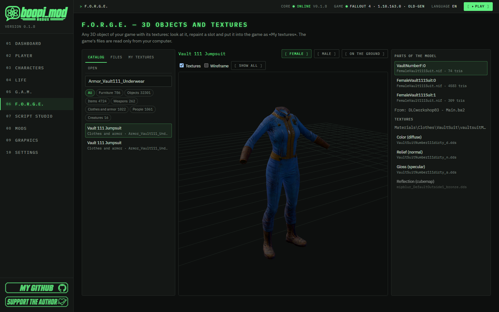
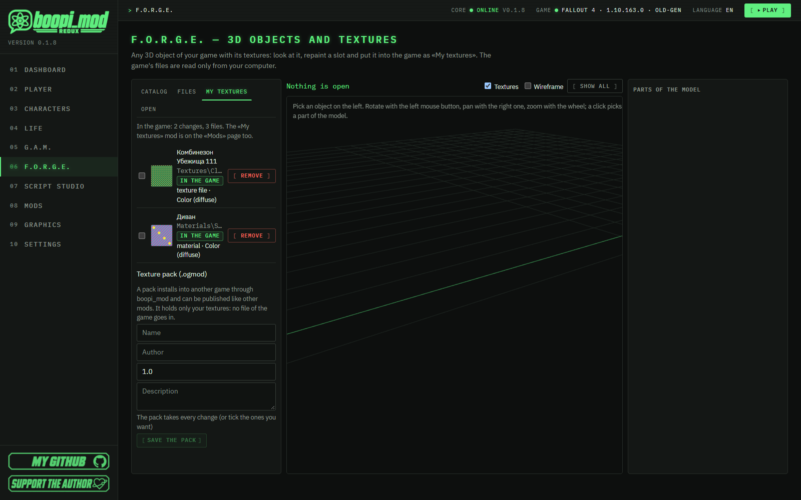
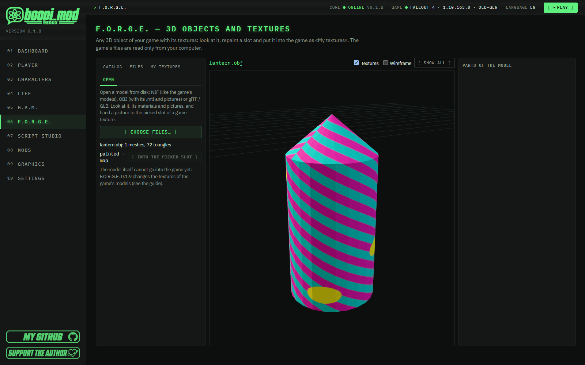
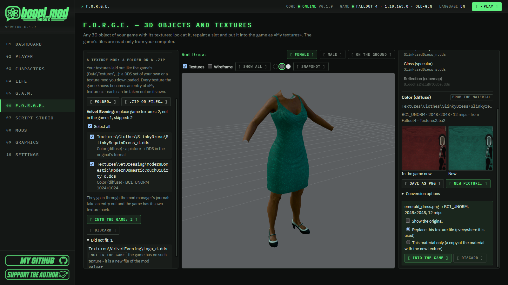

#  F.O.R.G.E. — 3D objects and textures

[🇷🇺 Русский](../FORGE.md) · 🇬🇧 English

[← All guides](README.md) · [← Project home page](../../README.en.md)

> [!NOTE]
> F.O.R.G.E. is the younger sibling of [G.A.M.](ANIMATION_IMPORT.md): G.A.M. moves the bodies, F.O.R.G.E. dresses and paints
> them. Any 3D object of your game — furniture, items, weapons, clothes and armor, people and creatures — with its textures:
> look at it, repaint it and put it into the game with one button. The game's files are read **only from your computer** —
> the app does not contain them and never sends them anywhere.

> ### ⏱ In 1 minute
>
> - **F.O.R.G.E.** is in the menu on the left, right after G.A.M. On the left — what your game has, in the middle — the 3D view,
>   on the right — the parts of the model and their textures.
> - Pick a thing → a part of the model → a **texture slot** (color, relief, gloss, glow) → **«Save as PNG»** to paint over the
>   original.
> - **«New picture…»** — PNG, JPG or DDS. The app converts it into the right DDS format with mipmaps and shows it on the model
>   at once.
> - **«Into the game»** — the change goes into the **«My textures»** mod (it is on the «Mods» page too). Remove the change and
>   the game has exactly the texture it had.
> - **«Only this outfit»** and **«Only this person»** — repaint one piece of armor or clothing, or repaint it on one character
>   only: everyone else keeps wearing it as before ([section 4](#4-into-the-game-my-textures)).
> - Clothes and bodies are on the **game skeleton** (the one G.A.M. uses): posed as made, standing, or in a G.A.M. scene frame;
>   hair and palette-coloured armor show **in their real colours**.
> - Your textures can be saved as a **`.ogmod` pack** and shared like any mod.
> - Have a texture mod already — a folder or a `.zip` with `Textures\…`? **Drop it onto the page**: F.O.R.G.E. shows what
>   fits your game and puts it all in with one button (the **«Import»** tab, [section 8](#8-a-texture-mod-a-folder-or-a-zip)).
> - Your own OBJ or glTF model can become **a new object of the game**: «Import» → **«To the game as an object»** — it is
>   built in the workshop and placed from the console ([section 7](#7-your-own-model-in-the-game-my-objects)).

## Contents

1. [What you can open](#1-what-you-can-open)
2. [The 3D view and texture slots](#2-the-3d-view-and-texture-slots)
3. [Repaint: a new picture](#3-repaint-a-new-picture)
4. [Into the game: «My textures»](#4-into-the-game-my-textures)
5. [A texture pack: share it](#5-a-texture-pack-share-it)
6. [Open your own model (OBJ, glTF, NIF)](#6-open-your-own-model-obj-gltf-nif)
7. [Your own model in the game: «My objects»](#7-your-own-model-in-the-game-my-objects)
8. [A texture mod: a folder or a .zip](#8-a-texture-mod-a-folder-or-a-zip)
9. [If something is wrong](#9-if-something-is-wrong)
10. [What comes next](#10-what-comes-next)

---

## 1. What you can open

Four tabs on the left:

| Tab | What is there |
|---|---|
| **Catalog** | Everything your game has a model for, **with the game's own names**: furniture, objects, items, weapons, clothes and armor, people (their faces), creatures. Search by name, editor id, form id (as the console shows it: `0001EED7`), plugin or model path; case, spaces and dashes do not matter («10mm» finds «10 mm»). Order by name, by plugin or **recently opened**; filter by plugin. The line under a name shows the plugin and the model file: that is how things of the same name tell apart. |
| **Files** | Every `.nif` model of the game's archives and loose files — for what the catalog does not list. Search by words of the path. |
| **My textures** | Your changes that are in the game now: with thumbnails, a search and groups (by mod, by object, by day). |
| **Import** | A model from disk (OBJ, glTF / GLB, NIF) and a texture mod — a folder or a `.zip`. |

The catalog is built from **your game's plugins** (official, DLC and mods in load order) — about a minute the first time,
instant afterwards. By default it shows only things **with a name** and no **technical records** (markers, empty dummies, the
VR workshop's leftovers) — the boxes under the categories show those too; how many are hidden is written above the list.
**Weapons** are assembled as the game does, from parts — each on its attach point. On the right, above the model's parts, is
**«Build»**: **«Game variant»** (the weapon's named builds in the game: «Simple Pistol», «Assault Rifle», «Sniper Rifle»…) and the
part in each slot of that build — receiver, barrel, grip / stock, magazine, sights, muzzle. The parts come from your load order:
the weapon mods (OMOD records) made for this weapon (its keywords and attach points), marked **«workbench»** when a workbench
recipe (COBJ) makes it; mods' parts too. Another receiver brings its own slots — the list changes with the build. Each part can
be retextured like any model. Weapons and clothes the game has a **first-person model** for (arms and sleeves, a knife in hand)
get a **«First person»** button.
Clothes open as **«Female» / «Male» / «On the ground»** (buttons above the 3D view), a person with their
face from the game and a body (**«Character»**) or in their usual clothes (**«Outfit»**: the pieces of their default outfit in the
game; random pieces from leveled lists are not shown). When a mod replaces a texture or a model, F.O.R.G.E. shows the one the game sees: a loose file
wins over an archive, the archive of a plugin lower in the load order wins over one higher up.

**Keyboard.** In the catalog, «Files» and «My textures»: arrows, PgUp / PgDn, Home / End move the row (from the search box too),
**Enter** opens it (in «My textures»: ticks an entry or folds a group), **Esc** clears the search; start typing in the list and
the letters go to the search.

**«Rescan»** (under the catalog's filters and in «Files») reads the load order's plugins and the game's files again — after
installing, removing or updating mods. Unchanged plugins come from the cache, and the previous list keeps working while it
scans (the progress bar above it). When the load order changed since the last scan, a hint above the list says how many
plugins were added, removed and changed — with the same button; no scan starts by itself.

## 2. The 3D view and texture slots

- **Rotate** with the left mouse button, **pan** with the right one, **zoom** with the wheel; **«Show all»** brings the view back.
- **«Textures»** — the model with its textures or plain grey; **«Wireframe»** — the mesh.
- **Background** — three dots: dark, neutral grey (colours read truest) and light (for dark things); the choice is remembered.
- **«Snapshot»** — save the view as a PNG in `Documents\BoopiMod\Screenshots` («Show» opens the folder).
- **A click on the model** picks a part of it; the parts are listed on the right (with their triangle counts). The **biggest
  part** is picked first, not the first one in the file.
- The **eye** of a part hides it and shows it again; the eye with **Alt** — this part alone. Service parts — the meat caps of
  severed limbs, gore, effects, temporary and shadow helpers — are **hidden at once** and marked «service».
- **OBJ** and **GLB** above the view save what is shown (hidden parts left out, in the current pose) for Blender: OBJ with its
  MTL and PNG textures, or one GLB with the textures inside, into `Documents\BoopiMod\Models`.
- The picked part's **texture slots**: color (diffuse), relief (normal), gloss (specular), glow and the rest (reflection,
  palette…), with the file's path. **«from the material»** means a material file (`.bgsm` / `.bgem`) names the texture;
  **«from the model»** — the model itself does (faces, for instance).
- Under the slot: the format (`BC7_UNORM`, `BC5_UNORM`…), the size, the mipmap count and **where** the game takes the file from
  (an archive or a loose file).
- When the game has no such material file, F.O.R.G.E. says so, with its path, and the part is grey.
- While the textures come in, the corner of the view shows **«Textures: N of M»**.

- **Palette.** Hair, beards and some armor are coloured by the game like this: their color texture is grey, and the real
  colour comes from a palette texture (the palette row is the character's hair colour or the armor's colour index).
  F.O.R.G.E. shows them **in the colours the game does**: a character's own hair colour, an armor's own palette row.
- **Pose.** Clothes, armor and bodies are on the **game skeleton** — the one G.A.M. reads from your game. Above the 3D view —
  **«Pose»**: **«As made (T)»** (the thing as it was made), **«Standing, arms down»** or **«A G.A.M. scene frame»** — pick a scene
  of the G.A.M. library and a moment with the slider (scenes tagged intimate are not offered here). When the skeleton cannot be
  read (no gamtool), the thing is shown as made.

Color, relief, gloss and glow can be edited; the other slots are shown for reference. **Gloss** in Fallout 4 is two maps in
one: red is the strength of the shine, green the glossiness; a grey picture makes both the same.

## 3. Repaint: a new picture

1. Pick a slot → **«Save as PNG»**. The file goes to `Documents\BoopiMod\Textures`, **«Show»** opens the folder. Paint over it —
   that way the UV layout matches the model. **«UV template»** saves there a transparent PNG of this texture's UV wireframe at
   its size (of every part that uses it) — handy as a layer to paint over.
2. **«New picture…»** — PNG, JPG, BMP, TGA, WebP or DDS. F.O.R.G.E. converts it with **texconv** (it comes with the app):
   - into **the same DDS format** the original has (BC1, BC3, BC5, BC7…), with a **full mipmap chain**;
   - **at the original's size**. The size never changes silently: a picture of another size (say 8192 for a 2048 texture) makes
     a draft at the original's size, with **«The original's / The picture's / Custom size»** under it. The sides must divide by 4
     (compressed DDS needs it) — otherwise they are rounded up, with a warning;
   - **16-bit** grey pictures (height maps from Substance, Blender, Photoshop) keep their greys instead of turning into a white
     square; the edges of cut-outs (hair, leaves) are resized without a dark halo;
   - **a normal map stays a normal map**: its vectors are evened out, a missing blue channel is rebuilt, BC5 stays BC5. A picture
     from an OpenGL tool (Blender, Substance in OpenGL mode) — tick **«flip the green channel»**; only a black-and-white height map —
     **«It is a height map»**, and the relief is made from it;
   - when the picture has no transparency and the original has (hair, cloth with cut-outs), **the original's transparency is kept**.
3. The new texture **shows on the model at once**. **«Show the original»** compares. A new picture that cannot be converted
   leaves the draft before it as it was. Warnings tell when the proportions differ
   from the original's (the UV layout will stretch the picture) or a picture in the relief slot does not look like a normal map.
4. **Painting in your own editor?** After «Save as PNG» the file shows under the buttons with **«Watch the file»** ticked: save it
   in your editor and a couple of seconds later it becomes the slot's new picture by itself, with the same options (size, green
   channel…), and the model updates. Without the tick — the **«Re-read the changed PNG»** button. Works in the app and in the
   browser; several slots can be watched at once.

### Maps from the main texture

The **«Color (diffuse)»** slot's panel has **«Maps from the main texture»**: F.O.R.G.E. makes the missing maps from it (our own
code, no third-party generators). The source is the main texture as the game draws it now, or the new picture you just gave
the slot.

| Map | Goes to | Options |
|---|---|---|
| **Relief** | the relief (normal) slot | A normal map in the game's style (DirectX). The height comes from brightness (or one channel); **strength**, **blur** (noise and JPEG blocks out), **fine detail** on top of the blur, **sharpen**, **invert the height** (bright is low), green channel DirectX / OpenGL. |
| **Reflections** | the specular slot | Fallout 4's map: red is the highlight's strength, green the smoothness. **Material**: cloth, leather, metal, skin, plastic, wood — or your own values: highlight and its contrast, smoothness and its contrast, **metal ↔ rough**, invert. |
| **Cavities** | the main texture itself | Darkens the crevices (much like ambient occlusion): depth and width. |
| **Glow** | the glow slot, when there is one | A mask of the bright pixels: threshold, edge softness, in the texture's colour or white. |

The sliders show the map **on the model** at once («Show on the model at once»). **«Make the draft»** converts it into the format
of the texture it replaces (BC5, BC7, BC1…), at its size — and from there it is an ordinary draft: open the map's slot and press
«Into the game» (the whole file, this material, this item or this person) or «Apply all drafts» at the top. That way generated
maps go in through «My textures» and come out the same way.

## 4. Into the game: «My textures»

Before **«Into the game»** choose what changes (the careful one is the default: **«This material only»**):

| Option | What happens |
|---|---|
| **Replace this texture file** | The new file takes the game texture's place — **everything** that uses it shows it. |
| **This material only** | F.O.R.G.E. makes a copy of the material (from your own game) whose slot points at your new texture. Only what uses that material changes. |
| **Only this outfit** (clothes or armor opened) | The new texture is on **this thing** only, on everyone who wears it. Other things with the same material stay. |
| **Only this person** (a character opened, «Outfit» view) | Only **this character** wears the thing with the new texture; on everyone else the same thing stays as it was. |
| **Only this person's skin** («Character» view, the body) | New skin for this character only: on the body and on the bare skin their usual clothes show. |
| **Only this person** (the face) | Every character's face texture is their own (baked by the game for them), so it changes for them alone. |

Every change is **one entry** of the **«My textures»** mod. The mod is installed through the mod manager's journal like any other:

- **«Remove»** on an entry («My textures» tab) — the game shows **exactly the file** it had before the change (byte for byte),
  another mod's file too if one was there;
- **«Apply all drafts»** at the top right puts every waiting draft in at once (each with the option chosen in its slot);
- **only what changed** is installed: the other files of «My textures» are not touched;
- on the **«Mods»** page «My textures» can be removed as a whole — the entries stay in the list marked «not in the game», and
  «Into the game» brings them back;
- a second change of the same texture replaces the first, changes of different slots of one material gather into one entry.

The game must be allowed to read loose files over its archives (`Fallout4Custom.ini`: `bInvalidateOlderFiles=1`). When it is not,
F.O.R.G.E. shows a warning at the top with a **«Turn on»** button.

### One thing, one person: how it works

The game colours clothes and armor through **materials** (`.bgsm`). To change a texture on one thing or one character only,
F.O.R.G.E. writes **game records** into its own small plugin **`BoopiForge.esp`** (ESL — it takes no slot in the load order;
it is shared with «My objects», see [«One plugin for everything»](#one-plugin-for-everything-boopiforgeesp)):

- a **material swap** (MSWP: «this material → a copy with your texture») is put on copies of the thing's models (ARMA);
- **«Only this outfit»** — the thing itself (ARMO) wears those copies; a swap a model already had (a colour variant) is kept;
- **«Only this person»** — a copy of the thing and a copy of the character's default outfit (OTFT) with the copy in its place
  are made, and the character (NPC_) wears that outfit; **skin** — a copy of their skin (WNAM) with the swap, the same swap on the
  pieces of their outfit.

The plugin is built **from your load order** at every install of «My textures»: when a mod already changes this character or
thing, F.O.R.G.E. takes that mod's version of the record and loads after it. `BoopiForge.esp` goes in through the journal after
the textures, as one line at the end of `plugins.txt`, and leaves once it holds neither such changes nor objects (removing «My
textures» takes their records out of it) — `plugins.txt` is left exactly as it was.

Good to know:

- **The face.** A Fallout 4 character's face is «baked» (FaceGen): everyone has their own face file and face textures — replacing
  those files is already «only this person». The game does not apply texture set records (TXST) to baked faces without baking
  them again in the Creation Kit, and **hair and eyes** inside the baked head use materials shared by everyone — so «only this
  person» is not offered for them.
- **Characters you have met.** The game keeps what a character wears in your save, so one you have already met may still wear
  the old piece until the game puts their outfit on them again; new meetings (and new copies of the character) wear the new one
  at once.
- **Templates.** When a character takes their outfit from a template (usually unnamed settlers and enemies), F.O.R.G.E. says so —
  change the template character or use «Only this outfit».
- **`.ogmod` packs** do not take such changes: they are records of your very load order and stay on this computer.

> [!TIP]
> Install textures while the game is closed: the game does not read again a texture it has already loaded — after an
> install, start the game anew.

## 5. A texture pack: share it

**«My textures»** tab → **«Texture pack (.ogmod)»**: name, author, version, description → **«Save the pack»**. Tick the changes you
want (with none ticked every change goes in). The pack is saved to `Documents\BoopiMod\Mods`.

- The pack holds **only your textures** — not a single file of the game. A «this material only» change travels as a recipe: the
  boopi_mod of whoever installs the pack makes the material copy **from their own game**.
- A pack installs like any boopi_mod mod: drop the `.ogmod` on the app (or install it from boopi.site) — it shows on the «Mods»
  page and is removed from there, every file through the journal.
- It is published the same way as a studio mod ([Publish to boopi.site](SCRIPT_STUDIO.md#97-publish-to-boopisite)).
- Any of your entries can go into a pack, those of an imported texture mod too: which textures you install and what you share
  is your choice.

## 6. Open your own model (OBJ, glTF, NIF)

**«Import»** tab → **«Open a model…»** (or drop the model's files onto the page — in the browser and in the app alike; in the
app an OBJ brings its `.mtl` and pictures from its folder). A picture dropped the same way goes straight into the open slot:

- **OBJ** — pick the `.obj`, its `.mtl` and pictures together; **glTF** — the `.gltf` with its `.bin` and pictures, or a single `.glb`;
- **NIF** — a Fallout 4 model (20.2.0.7); its textures named by game paths come from your game.

If the model names pictures that are not among the chosen files, F.O.R.G.E. lists them — pick them together with the
model or drop the model's whole folder onto the page.

The model shows in the 3D view, its materials and pictures are listed on the left. **«Into the picked slot»** hands a picture of
the model to the picked slot of a game texture (pick a thing and a slot in the catalog first) — then go on as in
[section 3](#3-repaint-a-new-picture). And the OBJ or glTF model itself can go into the game as a new object —
[section 7](#7-your-own-model-in-the-game-my-objects).

## 7. Your own model in the game: «My objects»

An opened OBJ or glTF / GLB model can go into the game as **a new static object** — a decoration built in a settlement's
workshop or placed from the console.

1. The **«Import»** tab → open the model → **«To the game as an object»**.
2. F.O.R.G.E. builds the object for the game and shows in the 3D view what the game will load (untick **«Show what the game
   will load»** to compare with the original):
   - **The model's units and scale.** glTF is always in metres; an OBJ may be in metres, centimetres or inches — watch the
     size under the settings (in metres). A model bigger than 40 m is built again in centimetres at once.
   - **Up axis** — Y (glTF, most OBJ) or Z. The model's front (glTF's +Z) faces where the game's objects face; **«Turn»** — in
     steps of 90°.
   - The object stands on the ground at its centre: the point the workshop holds it by.
3. **«Name in the game»**, **«Workshop menu»** (Decorations, Wall decorations, Furniture — the game's own sub-menus) and the
   **«In the workshop menu»** box (free to build; without it the object is placed from the console only).
4. **«Put into the game»**. The object shows up on the **«My objects»** tab with a console command like
   `player.placeatme FE00X800` — open the console (`~`) and type it, and the object appears in front of you.

What happens inside:

| Part | What |
|---|---|
| Model | A Fallout 4 NIF: a BSFadeNode and a BSTriShape per part (positions, normals, tangents, UVs, vertex colours); up to 65,535 vertices per part — big meshes are cut by themselves |
| Material | A BGSM per material of the model: two-sided, alpha cut-out or blending, glow |
| Textures | colour (BC1, with alpha BC3), normals (BC5; green is turned for OpenGL maps, the «DirectX» box is for maps in the game's style), gloss (BC5, from glTF's roughness and metalness), glow; no picture — a plain one of our own |
| Collision | a box around the model (Havok): you bump into the object, the workshop picks it up and moves it. No exact shape — a table is one box. It can be turned off: then you walk through the object, and the workshop cannot pick it up after it is placed |
| Plugin | `BoopiForge.esp`, ESL-flagged (it takes no load-order slot, shared with «My textures»): a static object (STAT) and a workshop recipe (COBJ) per object; only records of its own, nothing of the game changes |

The files go in as the mod **«My objects»** through the mod manager's journal (it is on the «Mods» page), the records into
the shared `BoopiForge.esp` (the mod «F.O.R.G.E.: plugin»), which goes into plugins.txt. **«Remove»** on the «My objects» tab
takes the object's files and records out; the others keep their numbers, so objects already placed in a save stay where they
are. With the last object out the mod is uninstalled (and the plugin, when «My textures» has no change in it), and the game
and plugins.txt hold exactly what they held before it.

> [!IMPORTANT]
> Add and remove objects with the game closed. An object placed in a save and later removed from «My objects» disappears
> from that save. The object has no skeleton or animations: it is a static decoration — not furniture to sit on and not an
> item for the inventory.

### One plugin for everything: BoopiForge.esp

Everything F.O.R.G.E. writes into the game as records lives in **one** plugin, **`BoopiForge.esp`** (ESL, it takes no load-order
slot): the records of «My textures» («Only this outfit», «Only this person») and of «My objects» (a STAT and a workshop
recipe). On the «Mods» page it is a mod of its own, **«F.O.R.G.E.: plugin»**; the files of textures and objects are the mods
«My textures» and «My objects». The plugin is built again with any change on either side and has one line in `plugins.txt`
that stays where it is. Once neither «My textures» nor «My objects» has a record left, the plugin leaves through the journal
and `plugins.txt` is exactly what it was.

**Record numbers (form ids) stay put.** F.O.R.G.E. remembers the number of every record (`forge\plugin_ids.json` in the
boopi_mod data folder): remove an object or an outfit change and the others keep their numbers, so what you placed in a save
stays where it is. A removed record's number is not given to a new one while free ones remain: an old save simply loses the
removed thing instead of getting another in its place.

**If you updated from a version before 0.2.0.** There used to be two plugins: `boopi_forge.esp` for «My textures» and
`BoopiForge.esp` for «My objects». At the first start of the new version (or the first change in F.O.R.G.E.) both move into
the one `BoopiForge.esp` by themselves — the game does not need to run for it, and while the game runs the move waits for the
next start of the program. The old plugin leaves through the journal (with its line in `plugins.txt`), everything else stays
as it was. The program says so in a message at the top and in a note on the «My textures» and «My objects» tabs. What it
means for your saves:

- **Objects** keep their numbers and the file has the same name: objects already placed in your saves stay where they are.
- **Outfits and people** («Only this outfit», «Only this person») now come from `BoopiForge.esp`. A save remembers records by
  their file's name, so what it held of `boopi_forge.esp` is dropped when it loads: the game may ask once about the missing
  `boopi_forge.esp` — answer «Yes», the next save no longer needs it. A person who already wore your outfit copy gets the new
  one when the game puts their outfit on them again; the game and its files do not change.
- If the game's material for some change is not there right now (the mod with it is off), «My textures» stays on the old
  plugin until next time — the tab says so; the objects move in any case.

## 8. A texture mod: a folder or a .zip

If you already have textures laid out like the game's (`Data\Textures\Clothes\…`) — a DDS set of your own or a texture
mod you downloaded — there is no need to put them in one by one:

1. The **«Import»** tab → **«Folder…»** or **«.zip or files…»** — or just **drop the folder / `.zip` onto the page**.
2. F.O.R.G.E. matches every file to the game's files and shows the list:
   - **fits** — it replaces a texture your game has (with its format and size; «replaces your entry» when you changed it already);
   - **not in the game** — a new file of the mod that only the mod itself uses (install such mods whole on the «Mods» page);
   - **skipped** — not a texture: models, materials, plugins, readmes;
   - **error** / **duplicate** — a DDS that cannot be read, or the mod has the same texture already (a DDS wins over a PNG).
   A path without a `Textures` folder (say `MyMod\Clothes\x_d.dds`) is matched by its longest tail the game knows.
3. Untick what you do not want → **«Into the game: N»**. Every texture becomes an entry of «My textures» of its own — take
   them out one by one and the game has its own texture back, byte for byte. To take the whole mod out at once: «My textures»,
   groups **«by mod»** → the box of the mod's group → **«Remove the chosen»**.

A DDS of the mod goes in as it is; a PNG, JPG or TGA is converted to the original texture's format with mipmaps, as in
[section 3](#3-repaint-a-new-picture). Put textures in while the game is closed.

## 9. If something is wrong

| What | What to do |
|---|---|
| «The game is not found» | Set the Fallout 4 folder in «Settings → Game». |
| The catalog is empty or slow | The plugins take about a minute the first time; the progress bar is above the list. |
| «texconv is missing» | texconv comes with the app; reinstall boopi_mod. |
| The texture does not show in the game | «Turn on» in the warning at the top (loose files); restart the game. |
| A texture mod: «no file replaces a texture» | The paths in the mod must follow the game's: `Textures\Clothes\…\x_d.dds`. Unpack a 7z or rar and pick the folder. |
| A model does not open | F.O.R.G.E. reads Fallout 4 NIF (20.2.0.7); open models of other games as OBJ / glTF. |
| A mod just installed has no things in the catalog | «Rescan» under the catalog's filters. |
| A weapon has no «Build» | It has no mod slots (a knife, many unique items) — its model is shown. |
| A generated relief is pressed in, not raised | Tick «Bright is low» (or the OpenGL green channel when the UVs are mirrored). |
| «Re-read the changed PNG» does not take the file | The editor is still saving it — F.O.R.G.E. takes it once it stops changing; or press the button again. |
| A thing is missing from the catalog | Untick «Named only» or tick «Technical records»; «Hidden by the filters: N» says how many are hidden. |
| A part of the model is not shown | Its eye in the parts list is off (service parts are hidden at first) — turn it on. |
| «The picture is … the original …: the draft was made at the original's size» | Choose «The picture's» or a custom size — or keep it as it is. |
| «This thing is not part of this person's default outfit» | «Only this person» works for the pieces of their default outfit («Outfit» view); for anything else use «Only this outfit». |
| «…takes their outfit or looks from a template» | Change the template character or choose «Only this outfit». |
| A character in the game still wears the old piece | They already wore it in your save; the new one shows when the game puts their outfit on them again. |
| Clothes do not take a pose | A pose needs the game skeleton (gamtool reads it, as in G.A.M.); without it the thing is shown as made. |
| The object is huge or tiny | Change «The model's units» (an OBJ is often in centimetres) or the scale; the size in metres is under the settings. |
| The object is dark or its relief looks torn | A DirectX-style normal map (green down): tick «DirectX»; faces seen from one side only: make them two-sided in the model's editor. |
| The object is not in the workshop | `BoopiForge.esp` must be on (the «Mods» page → load order); from the console `player.placeatme` with the id from «My objects» places it. |
| The game says `boopi_forge.esp` is missing | It is the plugin «My textures» had before 0.2.0; its records moved into `BoopiForge.esp` ([«One plugin for everything»](#one-plugin-for-everything-boopiforgeesp)). Answer «Yes» and save — it will not ask again. |
| «BoopiForge.esp is full» | One ESL plugin holds 2048 records for «My textures» and «My objects» together: remove some objects or outfit changes. |
| Put everything back | «My textures» → «Remove» on the entry, or remove «My textures» on the «Mods» page; objects: «My objects» → «Remove», or remove «My objects» there too. |

## 10. What comes next

F.O.R.G.E. changes the **textures** of the game's models and puts **your own static objects** into the game
([section 7](#7-your-own-model-in-the-game-my-objects)). Next come a collision that follows the model's exact shape, furniture
to sit on and items for the inventory: they need a skeleton, weights and other plugin records. Retexturing one thing or one character through
the game's records is here already — the «Only this outfit» and «Only this person» options ([section 4](#4-into-the-game-my-textures)).

---

[← All guides](README.md) · [Animation import and the G.A.M. editor](ANIMATION_IMPORT.md)
