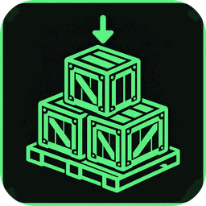

#  boopi_mod guides

[🇷🇺 Русский](../README.md) · 🇬🇧 English · [← Back to the main page](../../README.en.md)

> **Modding has never been this easy.** boopi_mod is first of all a mod manager in which you **create**: your own animations,
> scenarios, scenes and dialogues — by hand or with AI help. These guides take you from the first minute to your own mod
> that you can share as a single file.

> [!WARNING]
> **This is the first beta (0.1.1):** expect rough edges and bugs — please report them so I can fix them quickly. Feedback on
> problems and ideas is very welcome. [Open an issue](https://github.com/boopi-coder/boopi_mod/issues/new/choose)

## Where to start

| I want to… | Read |
|---|---|
| install and launch | [Install and first run](../../README.en.md#install-and-first-run) |
| make my own dialogue, scene, mod | [Script Studio](SCRIPT_STUDIO.md) |
| import animations or draw my own | [Animation import and the G.A.M. editor](ANIMATION_IMPORT.md) |
| call animations from dialogues and scripts | [Animations in mods](ANIMATION_GUIDE.md) |
| free conversation with people in the game | [AI dialogue](AI_DIALOGUE.md) |
| voice and voice input | [Voice](VOICE.md) |

## All guides

<table>
  <tr>
    <td width="72" align="center"></td>
    <td><b><a href="SCRIPT_STUDIO.md">Script Studio</a></b> · <a href="../SCRIPT_STUDIO.md">RU</a> 
    Your own dialogues, lines from the game and branches off its wheels, voice with lip sync, "Build and check", your own mod
    (<code>.ogmod</code>) and installing someone else's, animations in lines, Papyrus, the AI assistant and "Check in AI mode".</td>
  </tr>
  <tr>
    <td align="center"></td>
    <td><b><a href="ANIMATION_IMPORT.md">Animation import and the G.A.M. editor</a></b> · <a href="../ANIMATION_IMPORT.md">RU</a> 
    Fallout 4 mods, Skyrim animations, OAR gaits, "drop it — it plays", your own scenes in the 3D editor: the
    Rotate / Move / Character / Heading tools, IK handles, lighting, the AI animator.</td>
  </tr>
  <tr>
    <td align="center"></td>
    <td><b><a href="ANIMATION_GUIDE.md">Animations in G.A.M. mods</a></b> · <a href="../ANIMATION_GUIDE.md">RU</a> 
    A gesture and a scene, the camera, calling from scripts, dialogues and "Life", scene files, a mod for the manager,
    checking in the game, safety.</td>
  </tr>
  <tr>
    <td align="center"></td>
    <td><b><a href="AI_DIALOGUE.md">AI dialogue</a></b> · <a href="../AI_DIALOGUE.md">RU</a> 
    The "Progressive AI dialogue" mode: how to switch it on, "Say your own…", keyboard input (Russian included), voice on
    <b>V</b>, widgets on <b>F10</b>, what the AI can and cannot do.</td>
  </tr>
  <tr>
    <td align="center"></td>
    <td><b><a href="VOICE.md">Voice</a></b> · <a href="../VOICE.md">RU</a> 
    Text-to-speech (Edge, ElevenLabs, OpenAI, Piper, XTTS-v2, Silero), voice cloning, speech recognition and push-to-talk.</td>
  </tr>
</table>

## Paths used in the guides

| What | Where |
|---|---|
| Data and settings | `%APPDATA%\BoopiMod\` |
| Your dialogues | `%APPDATA%\BoopiMod\talk` |
| G.A.M. scenes | `%APPDATA%\BoopiMod\gam\scenes` |
| Saved mods | `Documents\BoopiMod\Mods` |
| Logs | `%APPDATA%\BoopiMod\logs` |
| The program | usually `C:\Games\boopi_mod` |
