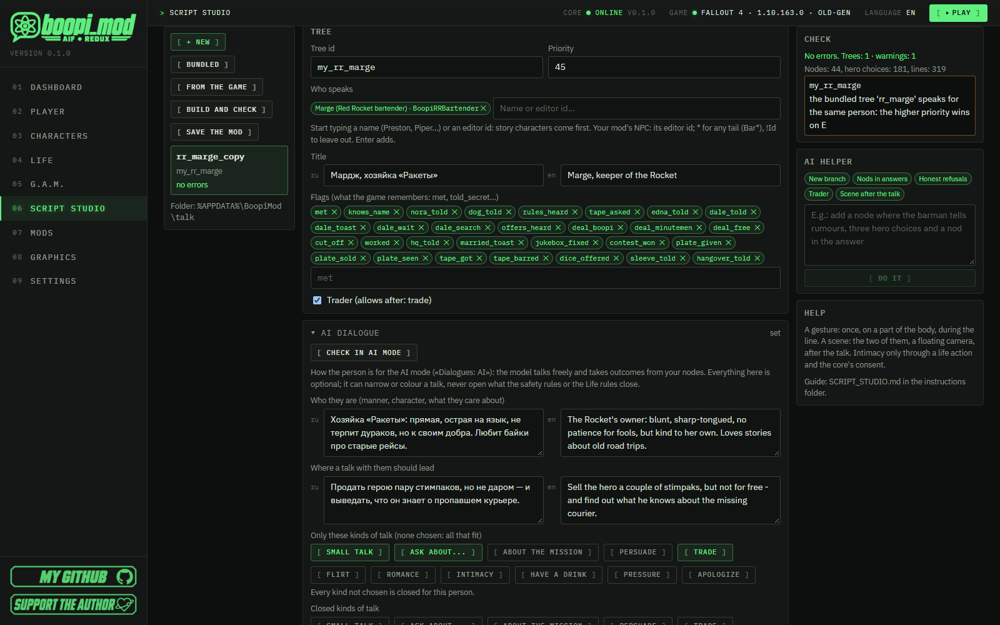
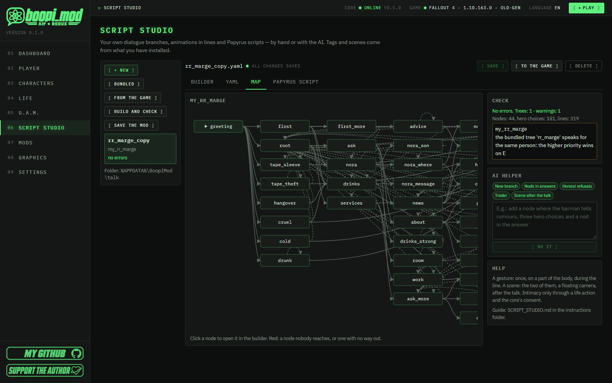
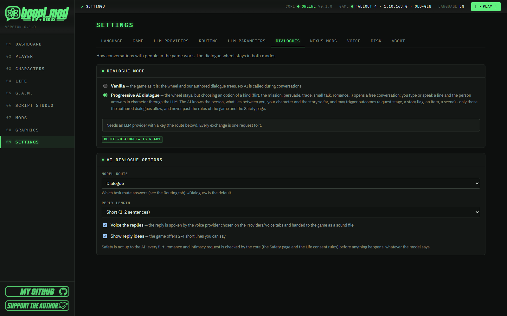
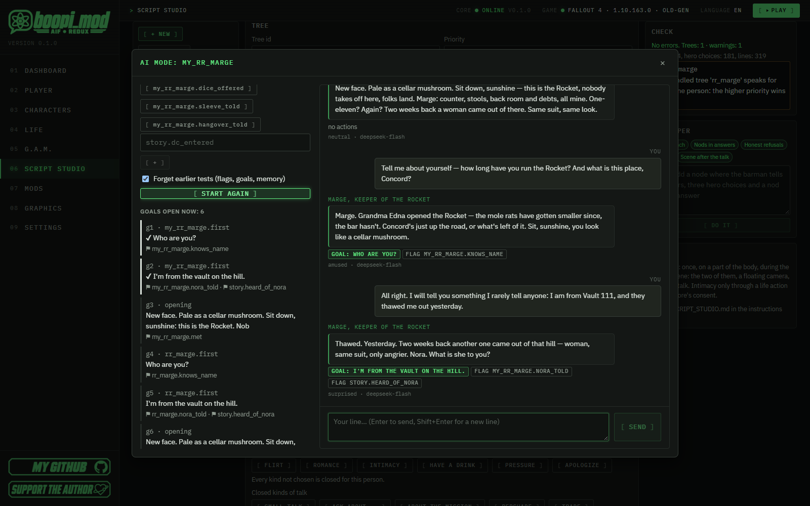
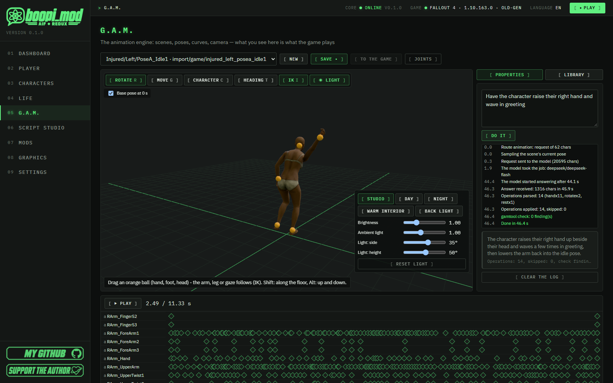

<p align="center"></p>

#  Script studio: your own dialogues, scenes, voice-over and mod

[🇷🇺 Русский](../SCRIPT_STUDIO.md) · 🇬🇧 English

[All guides](README.md) · [Project home page](../../README.en.md)

**boopi_mod is first of all a mod manager in which you CREATE**: your own animations, scenarios, scenes and dialogues — by hand or with AI help. *Modding has never been this easy.*

**«Script studio»** (the menu item right after G.A.M.) is the part where dialogues and everything around them are made: your own conversation trees, branches off the dialogue wheel of the game itself, voice-over, gestures and scenes right inside the lines, AI dialogue for your own person, and a finished mod in one `.ogmod` file that another player installs into boopi_mod by dragging it in. No programming needed.

> [!NOTE]
> **⏱ In 1 minute**
>
> - **What it is.** The boopi_mod section where you make dialogues for the game's characters or for your own mod without code: in forms or in YAML.
> - **The fastest path.** «Script studio» → **«New»** → pick a character → build the conversation in the builder → **«To the game»** → in the game press **E** on the character.
> - **Checking without the game.** **«▶ Try the dialogue»** — the tree as a dialogue wheel: conditions and consequences on a test state (flags, items, quest stages, SPECIAL, karma, time of day), what a turn changed, a jump into any node. **Ctrl+Z / Ctrl+Y** — undo and redo of edits, **«Versions»** — the file's earlier versions after a save ([3.3](#33-file-versions)).
> - **A story of your own in a minute.** **«+ Story»**: who, where and when, which G.A.M. scenes to play and the reward — the studio makes the dialogue tree and two triggers, already connected. Or **«Take the example»** — the ready «Night parcel» with its own scenes ([12.8](#128--story-and-the-ready-example)).
> - **Branches off the game.** Your own choice right on the wheel of a vanilla dialogue («From the game» → a scene → «Branch») and your own branch behind it.
> - **Voice and animations.** Your own recordings or synthesized voice («Voice with AI»), G.A.M. gestures and scenes in the lines.
> - **AI helps.** The AI helper writes branches and Papyrus scripts from a description, and in «AI dialogue» your person talks freely; you check the result in the test chat **«Check in AI mode»**.
> - **What you get.** One `.ogmod` file in `Documents\BoopiMod\Mods`: dialogues, voice and scenes travel together; another player drops it into the boopi_mod window and presses «To the game». You can publish the mod to boopi.site right from the program ([9.7](#97-publish-to-boopisite)).

<p align="center"></p>
<p align="center"><em>The tree builder: flags, the «AI dialogue» section, the check and the AI helper on the right.</em></p>

## Contents

1. [How it works](#1-how-it-works)
   - [1.1 Characters, items and quests of the DLCs and mods](#11-characters-items-and-quests-of-the-dlcs-and-mods)
2. [Your first conversation in 5 minutes](#2-your-first-conversation-in-5-minutes)
3. [The studio tabs](#3-the-studio-tabs)
   - [3.1 Play: try a conversation without the game](#31-play-try-a-conversation-without-the-game)
   - [3.2 Undo and redo](#32-undo-and-redo)
   - [3.3 File versions](#33-file-versions)
   - [3.4 Copy, paste, duplicate](#34-copy-paste-duplicate)
   - [3.5 Find and replace](#35-find-and-replace)
   - [3.6 Rename and delete: the references follow](#36-rename-and-delete-the-references-follow)
4. [Bundled trees as a model](#4-bundled-trees-as-a-model)
5. [Lines from the game and branches](#5-lines-from-the-game-and-branches)
   - [5.1 Start from a scene](#51-start-from-a-scene)
   - [5.2 A branch: your own choice on the game's wheel](#52-a-branch-your-own-choice-on-the-games-wheel)
   - [5.3 Say a line of the game: its voice and subtitle from Fallout 4](#53-say-a-line-of-the-game-its-voice-and-subtitle-from-fallout-4)
6. [Voice-over for lines](#6-voice-over-for-lines)
7. [«Build and check»](#7-build-and-check)
8. [AI dialogue: a person who talks on their own](#8-ai-dialogue-a-person-who-talks-on-their-own)
9. [Your own mod: save and share](#9-your-own-mod-save-and-share)
   - [9.7 Publish to boopi.site](#97-publish-to-boopisite)
10. [The AI helper](#10-the-ai-helper)
11. [Papyrus scripts for your own mod](#11-papyrus-scripts-for-your-own-mod)
12. [Triggers: your own story](#12-triggers-your-own-story)
   - [12.5 Example: «The night shift at the Dugout»](#125-example-the-night-shift-at-the-dugout)
   - [12.8 «+ Story» and the ready example](#128--story-and-the-ready-example)
13. [FAQ](#13-faq)
14. [What to read next](#14-what-to-read-next)

Tags and scenes are taken from what you already have installed in the game and in the G.A.M. library.

---

## 1. How it works

> [!IMPORTANT]
> **Trees work for boopi_mod's own characters and for the game's and the DLCs' characters alike.** A tree for a game character (Vadim and Hawthorne at the Dugout, Daisy in Goodneighbor, Allen Lee in Far Harbor — checked in the game) goes into their own everyday talk: E opens your tree, and once its greeting no longer fits (say, after a «talked already» flag) their usual dialogue is back, with all its quests and trading. If the character greets the hero first in the game as they walk up, the tree's greeting comes the same way. Two limits: while a quest of the game holds the character (a quest stage's talk, a story scene — Cassie Dalton at the start of Far Harbor, Kent Connolly with the Silver Shroud), that talk comes first; settlers and unnamed townsfolk get the tree through boopi_mod's own quest. The Studio check reminds you of this. To add a choice right into the wheel of their usual dialogue, use **branches** ([section 5](#5-lines-from-the-game-and-branches)).

In the studio you make:
- your own **dialogue trees** for the game's characters or for your own mod — in forms or in YAML;
- **branches off the game's own dialogues**: your own choice on the wheel of a vanilla conversation and your own branch behind it;
- **voice-over** for lines: your own recordings or a synthesized voice — one click for the whole dialogue — and lip sync that makes itself;
- **animations right inside the lines**: a nod, a gesture, a scene of the two after the talk;
- **Papyrus scripts** for your own mod in the Creation Kit: ready templates or written from a description by the AI;
- **AI dialogue** for your own person: who they are, where the talk should lead, while the outcomes come from your nodes — checked in a test chat;
- **triggers of your own story**: when something happens in the world (a zone, an hour, a timer, a quest stage, "killed", "used", a line ended) — a message, a talk, a G.A.M. scene, a quest stage, flags, items ([section 12](#12-triggers-your-own-story));
- **your own mod**: everything you made in one `.ogmod` file that another player drops into boopi_mod; dialogues, voice and G.A.M. scenes travel together.

The path from a file to the game:

```
 your .yaml files (%APPDATA%\BoopiMod\talk)        studio: builder / YAML / map / check / AI
 + voice recordings (talk\audio)                   «From the game»: lines of the game's characters, branches
 + mods of other players you installed (.ogmod)
          │
          ▼  «To the game»
 BoopiCorp.esp is rebuilt: bundled trees + yours + from mods (trees with errors are skipped),
 voice goes to Data\Sound\Voice\BoopiCorp.esp\<the character's voice type>\
          │
          ▼
 in the game: E on a character → your conversation; on the game's wheel → your branch; lines are spoken with your recordings
```

- Your files live in `%APPDATA%\BoopiMod\talk\*.yaml`, in the same format as the game's bundled trees (`data/talk`).
- Your trees are built into the plugin **after** the bundled ones. Every tree has a range of records of its own, pinned to it (`%APPDATA%\BoopiMod\plugin\tree_slots.json`): installing and removing mods and files never shifts the records of the trees that saves remember. A removed tree keeps its range — bring it back and it has the same ids. There are 767 ranges, the bundled trees take about 120; when none is left, «To the game» stops with a clear error.
- `who`, the items of `give` / `take` / `has` and the quests of `quest` are looked up in boopi_mod, Fallout4.esm, the DLCs and the **enabled** plugins (plugins.txt). A name found nowhere is a check error: such a tree does not go into the game, and the check says why.
- A tree with errors stays a draft: the file is saved, but the tree does not go into the game until the errors are fixed.
- The hash of your files, recordings, installed mods and the masters from the load order is part of the plugin version (`2.6.3-u1a2b3c4d`). Change something — the manager sees an update, and «To the game» rebuilds the plugin.

> [!NOTE]
> This guide is about working in the program.

### 1.1 Characters, items and quests of the DLCs and mods

When a name is found in a DLC or a mod, that file becomes a **master** of BoopiCorp.esp on «To the game». The DLCs just have to stay installed. Keep the mod installed and enabled: without it the game does not start until the next «To the game» (the check warns about it on the tree, «Build and check» lists the masters). The story plugin `OldGenStory.esp` cannot be a master: a tree cannot name its characters. Triggers ([section 12](#12-triggers-your-own-story)) still name places, items and people of Fallout4.esm and boopi_mod only.

---

## 2. Your first conversation in 5 minutes

**Step 1. Create a file.** Press **«New»** and fill in:
- the file name (`my_barman`);
- the tree id;
- **who speaks** — start typing the character's name (`Preston`, `Piper`, `Maxson`) or their editor id and pick from the list. Story characters (companions, factions, DLC) come first, the other NPCs of the game and of the enabled mods are found by name or editor id. For an NPC of your own mod, use its editor id, with a star if you like: `MyModBarman*` (the mod must be enabled; if there is no such NPC, the check says so right away);
- the title.

You get a small working tree: a greeting, the question «Who are you?» with a nod, and «I have to go».

**Step 2. Build the conversation in the builder.** Its sections:
- **Tree** — who speaks (search by name or editor id; the chip shows the name), the title, the flags (what the game will remember: `met`, `told_secret`…), whether they are a trader.
- **Greetings** — what the character says on E. The first one whose conditions hold fires, so the last one must have no conditions.
- **Nodes** — every choice wheel, up to 4 hero choices (↑ question, ← left, → right, ↓ bottom). At the top you can see how the wheel looks in the game.
- **A hero choice** — the label on the wheel (up to 40 characters), a «Life» action (`compliment`, `flirt`, `hug`… — the core decides the outcome), where to go next, conditions and consequences.
- **The character's answers** — answer groups. If a choice has an action, a group can have an outcome: `ok` — it worked, `no` — a refusal, `later` — it was done recently… Text variants are written one per line, the game picks a random one.

<p align="center"></p>
<p align="center"><em>The «Tree» section of the builder: who speaks, title and flags; on the right — the «Check» and the «AI helper».</em></p>

**Step 3. Add an animation to a line.** Every answer has an «Animation» field. A scene is asked for in **one of three ways** — a line's `anim:` holds exactly one of them ([12.3](#123-actions-what-happens)):
- *a scene of the G.A.M. library* — your own scene picked by its name (made in the G.A.M. editor or imported). The list shows how many roles a scene has and whether the game has it already; a scene that is only in the library goes into the game with «To the game». «Open in G.A.M.» takes you to it in the editor. A gesture of the character needs a scene of one role, «Who: both» one of two;
- *by tags* — a gesture from the installed scenes. Under the field you see how many scenes fit. If it says «no scene in the game fits», install a pack with such tags;
- *a Life context* — the core picks the scene. Intimate contexts are marked «consent only». No context fits the place — make **your own**: G.A.M. → Library → «Contexts» → «+ Own context» (a scene or a layer, tag queries, how many actors, the part of the body; [ANIMATION_IMPORT.md](ANIMATION_IMPORT.md)). It shows up in this list, and travels in a mod together with the files that name it ([9.1](#91-save-a-mod));
- **Who**: the character, the hero or both (then it is a scene with a camera);
- **Part of the body**: head — a nod, upper body — a gesture, arms, one arm…;
- **When**: during the line (a gesture) or after the talk (a scene).

**Step 4. Watch the «Check» and play.** The check on the right runs by itself a second after an edit; a click on an error opens the right place. The **«▶ Try the dialogue»** button plays the conversation right in the studio, no game needed ([section 3.1](#31-play-try-a-conversation-without-the-game)).

**Step 5. Save and send to the game.** **Ctrl+S** or «Save». Then **«To the game»**: close the game, the plugin is rebuilt. The G.A.M. scenes your lines and triggers play go into the game with it (as the «To the game» button of the G.A.M. page does), and the studio names them. Start the game and press E on the character.

> [!TIP]
> Don't want to start from scratch? Open «Bundled» and press «Start from this» ([section 4](#4-bundled-trees-as-a-model)): a ready tree becomes your copy with a new id.

---

## 3. The studio tabs

| Tab | What is there |
|---|---|
| **Builder** | Everything in forms: the file's trees, greetings (or a branch off the game), nodes, choices, answers, voice-over, animations, conditions and consequences |
| **Triggers** | Your own story: «when» (an event of the world), «if» (flags, hours, repeat) and «do» (a message, a talk, a G.A.M. scene, a quest stage, flags, items) — [section 12](#12-triggers-your-own-story) |
| **YAML** | The same file as text — for those who know the format or paste something ready-made. The builder and YAML always show the same thing |
| **Map** | The conversation as a diagram: greeting → nodes → end. Red marks a node nobody reaches or one with no way out. A click opens the node in the builder |
| **Papyrus script** | Script templates for your own mod in the Creation Kit, and an AI that writes a script from a description |

<p align="center"></p>
<p align="center"><em>The «Map» tab: the greeting, the nodes and the transitions between them. Red highlights a dead-end node.</em></p>

**Conditions and consequences** are shown at every greeting, hero's choice and answer group (not folded away): a row is a condition from a list with a plain name («flag is set», «relationship stage», «affinity», «the hero has an item»…) and a field for it:
- **flags** — chips, a flag of the file is picked from «+ a flag of the file…» (own ones `met`, others' `tree.flag`), `story.x` can be typed;
- **comparisons** (affinity, trust, caps, level, S.P.E.C.I.A.L.…) — a sign (≥ ≤ > < = ≠) and a number; a **stage** — a sign and a stage from the list;
- an **item** and a **quest** — a search by name, as in the «Triggers» tab, plus a count or a stage; the **hero's sex**, the **time of day**, the **character** — a choice; yes / no — a choice;
- consequences: **set / clear a flag**, **affinity +5 / −10**, **give / take an item**, **quest stage**, **after the talk** (trade, a date…), **the person's memory**.

The **«YAML»** button of a block shows the same conditions as «key: value» lines (for `any` — «any one of» — say); the choice is remembered. If a value there does not read, the field says what is wrong and where («a comma or ] expected in the list · character 14»).

**Line texts.** In a multi-line field every line is a variant of the line (the game picks one at random): **Enter** starts a new variant, spaces type as usual. Spaces at the edges and empty lines are tidied away when you leave the field and on saving.

**Greetings and answer groups.** The first that fits is the one, so «+ greeting» and «+ answer group» put the new one **before** the last one without a condition — give it a condition. If something stands after an entry without a condition and can never come, the check says «greeting #3 never comes…».

**Comments** (`# a note`) in the file stay at their places after edits in the builder too: each comes back above the key or the list item (or at the end of the line) it stood at. A comment of a deleted node goes with it.

### 3.1 Play: try a conversation without the game

The **«▶ Try the dialogue»** button (above the tabs; on a node's card — **«▶ Try from here»**) opens the **player**: the tree is played like the game's dialogue wheel, with no game and no plugin rebuild. It plays what is in the editor right now — saved or not.

- **On the left — the conversation.** The greeting (the first whose conditions hold), then the wheel with 4 places, as in the game: ↑ question, ← left, → right, ↓ down. A choice that would not show now stays on screen, dimmed, with the reason («charisma must be >=6 (now 5)», «the slot shows … first», «an exhausted question»). The **«play anyway»** button says such a choice by force — to see where it leads.
- **Lines.** Under each one — which text variant came up («variant 2 of 2», the others unfold) and the voice: a recorded WAV plays with **«▶ recording»**, a line without a recording has **«🔊 speak»** — with the speech engine from Settings, on a click. The «Play recordings» check box plays the recordings of the person's new lines by itself. The lines said «in passing» (`hello`) that would sound before the talk in this state are shown on a line of their own. A branch tree has an entry instead of a greeting: «branch from the game's wheel, slot …» with the caption of your choice; if the entry's condition does not hold, it says so.
- **On the right — the test state** you edit: the pair (stage, `affinity`, `trust`, `attraction`, `fear`, persona), the hero (sex, level, caps, karma, fame and infamy, intoxication, persuasion, wanted, companion, on a date…), S.P.E.C.I.A.L., the time of day, **flags** (the tree's own with one button, others as `story.x` or `tree.flag`), **items**, **quest stages**, the dice for `chance`. The wheel is read again as soon as you touch a value. The state is remembered for this tree; «Reset state» brings back the defaults.
- **What a turn changed.** Under the lines — labels: `⚑ my_barman.met` (a flag), `caps 100 → 70`, `NukaCola ×0 → ×2`, `MQ102: 0 → 20`, `affinity 0 → 5`, a change of stage, a note in memory. Bottom right — everything the conversation changed as a whole.
- **Buttons.** **«Restart»** — from the greeting, from your starting state; **«Back»** — one turn back (the state returns too); **«Open node»** — any node with the current state; **RU/EN** — the language of the lines; **🎲** — other dice (another variant of a line, another `chance` roll).

**How it is counted.** As in the game: the `when` conditions read the test state, the `do` consequences change it in the plugin's order (flags, caps, items, quest stage, numbers, `after`/`anim`); the person's answer is the first group whose condition holds **after** the hero choice's consequences and whose `result` fits the outcome of the action; the pair's numbers go through the core's rules — gains shrink near the top and are clamped, **the stage follows the numbers** (the check box can be cleared; romantic stages need an open romance, not numbers alone). An item or a quest you did not set is not there: count 0.

**What the player does not do** — it is shown as labels, not executed: a **life action** (`act`: in the game the core decides its outcome, here you pick the outcome in the list above the wheel — the group with that `result` answers), a **crime**, **`after`** (trade, a date…), the **animation** itself (you see how many scenes fit by tags or context; in the game G.A.M. plays it). The protections (`gam.censor`) and the Life rules are not touched by the player.

### 3.2 Undo and redo

Every change to the file is a history step: in the builder, in YAML, the AI helper's answer. **Ctrl+Z** or **«↶ Undo»** — a step back; **Ctrl+Y** (or Ctrl+Shift+Z) and **«↷ Redo»** — forward.

- Typing into a field is **one step**, not a step per letter. Adding a variant, renaming a node, swapping answers — one step each. The last **200** steps are kept.
- Works in every tab of the file (the map shows the result). In the right panel's fields (the AI prompt) and in dialogs the browser's own undo applies.
- Back at the saved state — «All changes saved» again, the unsaved warning goes away.
- The history lives while the file is open: another file, a new one or a restored draft start it over. Unsaved changes are not lost silently: the studio asks before switching to another file or deleting one, warns when the window is closed, and when you leave for another page of the program a draft stays (you are offered to restore it).

### 3.3 File versions

Undo lives while the file is open. The **«Versions»** button (in the bar above the tabs, next to «To the game») remembers longer: before a save the program keeps the file's previous version — **the last 30**. Saves within a couple of minutes are one version, so an evening of Ctrl+S does not push the morning's file out.

- The «Versions of …» window lists them from the newest: the time, the number of lines, the trees and the number of triggers in that version.
- **«Show»** — what differs from the current text (unsaved changes included): «−» was in this version, «+» is there now, with a couple of unchanged lines around; the «the whole text» box shows the version entire. «Restore» is there too.
- **«Restore»** → a confirmation. The file becomes what it was, and the version it replaces goes into the list itself, so you can bring it back too. Unsaved changes in the window are lost (the window warns you).
- Earlier versions appear after the file is saved again: a file just created has none yet.
- Deleting a file also keeps its last version. Create a file with the same name and «Versions» lists the deleted one's versions.
- The versions are in `%APPDATA%\BoopiMod\talk\.history\<file name>\`. Scenes in the G.A.M. editor have the same kind of button, «History».

### 3.4 Copy, paste, duplicate

A node (next to its id), a hero's choice, an answer group and a greeting have **⧉ Duplicate** (the copy goes right after it) and **⎘ Copy**. What is copied is pasted with «Paste …» in the same file or **in another one**: the clipboard outlives a file switch and a restart of the program. A node is pasted under a free id (`start_2`), a choice into a node, an answer group into a choice.

Keys: click a card (not a text field) — **Ctrl+C** copies it, **Ctrl+D** duplicates it, **Ctrl+V** pastes what is on the clipboard here. In a text field these keys work as usual, on the text.

### 3.5 Find and replace

**Ctrl+F** (or the **«Find»** button) searches the file: the texts of lines, labels and messages, the ids (trees, nodes, triggers, `go`, `who`, items) and the flags — the boxes keep what you need, «Aa» matches case. Every hit shows its place (`my_tree.start[0].reply[1] · ru`), a click opens it. **«Replace in texts: N»** replaces in the texts only; rename ids and flags in their fields — the references follow by themselves ([3.6](#36-rename-and-delete-the-references-follow)). In the YAML tab Ctrl+F is the browser's own search of the text.

### 3.6 Rename and delete: the references follow

- **Rename a tree** (the «Tree id» field): the same file's `talk.tree` of the triggers and every `tree.flag` follow; «Renamed … · references updated in the file: N» pops up. If the old name is used in **other files** or installed mods, a list follows — fix those yourself (the check there shows the errors).
- **Rename a trigger** — the same: `done`, `start` of the other triggers and the `trigger.flag` flags.
- **Rename a flag** — click the flag's chip at a tree or a trigger and type the new name: its conditions and consequences in its own tree / trigger and `owner.flag` in the whole file change. A node is renamed in the «Node id» field — every `go` follows.
- **Delete** a tree, a node, a trigger or a flag: the confirmation says who refers to it («Referred to by: triggers.bar.do[0]…», «In other files: …») — after the delete those references become errors. A flag nobody refers to goes without a question.

---

## 4. Bundled trees as a model

«Bundled» are all the trees that ship with boopi_mod (Stella, the club, Red Rocket, the story…):
- you can open them and see how they are made;
- **«Start from this»** — a copy with a new id becomes yours.

> [!WARNING]
> If your tree speaks for the same character as a bundled one, the check warns you: in the game, on E, the first greeting that fits fires, and the bundled trees come first in the plugin (the build does not read the `priority` field: all trees are one quest). To have yours answer, give it your own character or use a branch (section 5).

---

## 5. Lines from the game and branches

The **«From the game»** button is next to «Bundled». Find a character by name and you see everything they say in Fallout 4 and the DLCs:
- by quest: **scenes** (how many dialogue wheels and lines they have) and separate **lines** marked «greeting», «in passing», «combat»… with the game's conditions (`GetStageDone(MQ102) == 1` — after such-and-such quest stage);
- a scene can be opened and read in order: what they say, the wheels with the hero's choices (the wheel label is in brackets) and their answers. The faded lines belong to the other participants of the scene.

### 5.1 Start from a scene

**«Start from this»** on a scene with a wheel creates a new file: the scene's wheels in order, the hero's choices and the answers as in the game. Choices that the game shows only under quest conditions are taken as they are visible by default; the answers for the heroine and the hero are kept through `when: { player: female }`. This is a new conversation for the same character — the vanilla one is not changed. If the character already has a bundled tree (Preston, Piper…), the check warns you that on E the first fitting greeting fires (the bundled trees come first).

### 5.2 A branch: your own choice on the game's wheel

This is how you build your own branch right into the game's conversation — for example, on Arturo's first wheel «Какие слухи?» («What rumours?») appears in place of «Maybe», your branch is behind it, and from it you go back to his wheel.

1. «From the game» → the character → open a scene.
2. At the wheel you need, at the slot you need (↑ ↓ ← →), press **«Branch»**. Set the label of your choice (up to 40 characters) and the file name → «Create». The file opens in the builder.
3. In the builder, in place of greetings, there is the **«Branch from the game»** card: the scene, the wheel and the slot; the label; what the hero says (optional) and the voice-over of that phrase; the **condition under which the choice is shown**; the first node of the branch.
4. The branch is made of ordinary nodes. In «Next» there is **«↩ back to the game»** — back to this wheel of the game, and «■ end of the talk».
5. «Save» → «To the game».

What you need to know:
- The wheel has exactly 4 slots: your choice **takes a slot**, and the vanilla choice there is not visible while yours is available. Without a condition — always.
- If the vanilla choice moves a quest (starts a scene, sets a stage), «Build and check» warns you: set a condition (for example, `flag: met` of your own tree or a quest stage), otherwise the quest may get stuck.
- The empty top slot of traders is filled by the game with its own story choices («The search for Shaun») — a branch does not fit there, and there is no button.
- Branches can so far be made off scenes of the base game (not DLC).
- Other mods that change the same quest (for example, the unofficial patch) are shown in «Build and check».

> [!IMPORTANT]
> Don't hide a vanilla choice that moves a quest unconditionally. Always set a visibility condition for your choice — then the game doesn't lose the choice it needs.

---

### 5.3 Say a line of the game: its voice and subtitle from Fallout 4

If the line you need is already in the game (and voiced), you don't copy its words into your file: a reply group, a greeting or a «passing» line carries the **id of the game's line (INFO)** instead of text. The mod then keeps neither the text nor a recording: the game itself plays its voice with lip sync and shows its own subtitle in the player's language — from your copy of Fallout 4.

1. «From the game» → the character → open the scene or the line; the INFO id is written in grey to the right of the line (for example `Fallout4.esm|198308`) — you can enter it as it is.
2. In the builder, on a reply group (or a greeting), press **«♪ from the game»** and type the id; several ids, comma separated, make a random pool. A DLC's line is written `DLCCoast.esm|00A3B4`. In YAML it is one line: `- { vanilla: 0x198308, go: deeper }` (`when`, `result`, `go` and `do` work as usual). **«✎ own text»** brings back an ordinary text.
3. **«Play»** shows the line's text read from your game, marked «game's voice» (without the game: the placeholder «(a line from the game)»).

What you need to know:
- `ru`, `en` and a recording do not go next to `vanilla`: such a line has no text or recording of its own.
- The character the game recorded the line for is the one who plays it. The check warns when the speaker's voice type is another one: the subtitle shows, the voice doesn't. Take lines of the same character (or of the same voice type).
- The check also looks the INFO up in your game: no such line (or the DLC is not installed) is an error, and the tree is not built. A mod with a DLC's line asks for that DLC when it is installed.
- This is for the character's lines. The hero's words and the wheel captions are always your own.

---

## 6. Voice-over for lines

Greetings, the character's answers, the hero's phrases (the folding «The hero's full line» block of a choice) and the entrance of a branch have a **«Voice»** field: one recording per text variant, for Russian and English separately.

### 6.1 Voice the whole dialogue in one click

**«🎙 Voice all»** in the file's toolbar says every line of the file with each speaker's voice:

1. Press **«Voice all»**. The window shows **who speaks with which voice**: every person of the file's trees and **the hero**,
   a Russian and an English voice each, with **«▶»** to listen. The voices are those of the provider selected in «Settings →
   LLM providers» (Edge TTS by default — no key needed; ElevenLabs, OpenAI, Higgs TTS 3, XTTS-v2, Silero). Nothing picked: the
   person speaks with the voice of the boopi_mod character who plays them (or the provider's default), the hero with a voice of
   the hero's sex. The choice is remembered for all your files.

   With a **cloning** provider (XTTS-v2, Higgs TTS 3) «— auto —» means **a sample from the game**: a game NPC (Piper, Nick, a
   settler…) and the hero speak with their own voice. Under the speaker's name are their voice type and where it comes from
   («from the game», «from the card», «hero»), under each voice what is used, for example «sample from the game (NPCFPiper) ·
   seconds: 18.8 · with the lines' text». The sample is cut from the game's lines on the first voicing and kept on your computer
   (until then: «cut on the first voicing»). **«Cut again»** takes the sample once more, **«Own recording…»** uses your WAV
   (6–30 seconds) instead; the list can also pick another clone or a preset voice. Samples never go into the mod; clone only the
   voices you have the right to ([VOICE.md](VOICE.md), section 3).
2. Choose what to voice: **the whole file**, **the tree** or **the node** selected in the builder. The window counts the lines:
   «To voice: N · already recorded: M». Lines that have a recording are skipped; tick **«Say again the lines that have a
   recording»** to redo them. Every recording remembers its text: a line fixed after it was voiced is voiced again («Text
   changed after voicing: N»), and a recording already made for the same text (a voicing cut short by closing the program, a
   line moved or put back) is taken without voicing — or paying — again («Recordings already made … are taken: N»). Below is
   the **estimate**: the characters and, for a paid provider, the price (OpenAI in dollars, ElevenLabs in the plan's credits;
   the cloud Higgs — characters only); before a paid voicing the window asks again.
3. Press **«Voice N»**. A progress bar shows the lines as they are said; the window can be hidden — the voicing goes on, and the
   recordings go into the file when you open the window again. A line that fails is listed with the reason, the rest go on. A
   recording goes to the line that says its text: lines moved meanwhile find theirs; a line deleted or rewritten gets nothing
   (the window says how many), and the file stays to be taken if the text comes back.
4. The recordings are put into the lines' «Voice» fields exactly like files picked by hand. **Save** the file, then **«To the
   game»**.

Every line gets a WAV in `%APPDATA%\BoopiMod\talk\audio` (the same name for the same line: saying it again replaces the
file). Who says what: greetings, hellos and the person's replies — the tree's person; the hero's choices (their full line,
else the caption on the wheel without its `[tag]`) and the entrance of a branch — the hero. Lines of the game itself
(«♪ from the game») keep the game's voice. To redo **one line**, press «Voice with AI» at that variant (step 1 below) — it
speaks with the same studio voice of the speaker.

### 6.2 One line by hand

**Step 1. Add a recording.** «Voice» → at the variant you need press **«Upload…»** → choose a file:
- **WAV** — PCM 16 bit (any other format is an error), mono, 44100 or 48000 Hz (this is what all recording and voicing programs write). 22050 Hz fits too; another rate, stereo and a recording longer than 60 seconds give a warning;
- **XWM** — the game's already compressed sound;
- **FUZ** — a ready line file of the game (sound and lip sync in one);
- or the **«Voice with AI»** button: the text of this variant is voiced by the service selected in «Settings → LLM providers» (Edge, ElevenLabs, OpenAI, XTTS…) with the speaker's studio voice (6.1; the «Who speaks» list can pick a character's voice instead), and the WAV is put into the recordings at once. Voice setup — [VOICE.md](VOICE.md).

<p align="center"></p>
<p align="center"><em>The voice engines in the settings (here XTTS-v2 and Silero TTS): the one marked «Voice with this» speaks your lines when you press «Voice with AI».</em></p>

**Step 2. Lip sync — nothing to do.** For a WAV, boopi_mod makes the lip sync itself when the mod is built: it listens to the recording and spreads the line's letters over the spoken time (with the word times of the built-in speech recognition when it is installed); in the game `BoopiUI.dll` moves the speaker's lips with the voice ([VOICE.md](VOICE.md), «Lip sync»). A `.lip` of your own is optional: upload it with **«+ .lip»** next to the recording and the game uses it instead. A FUZ already has lip sync inside; an XWM moves the lips only with a `.lip`.

**Step 3. Listen.** A WAV can be played right in the studio.

**Step 4. Save and send to the game.** «Save» → «To the game».

On build, the WAV is compressed by `Tools\Audio\xwmaencode.exe` from the **Creation Kit** (it must be installed in the game folder; without it upload XWM or FUZ), glued with your `.lip` (if there is one) into a `.fuz` and put into the voice folder of whoever speaks: for a character — their voice type from the game (Arturo's is `NPCMArturo`), for the hero — `PlayerVoiceFemale01` / `PlayerVoiceMale01` (for a phrase with `{p:…|…}` — its own recording in its own folder). Checked in the game: the line sounds with your recording, and the subtitle stays as long as it lasts. Next to it goes the line's lip track (`Data\F4SE\Plugins\BoopiUI\Lips\BoopiCorp.esp\<line>_1.json`) — the lips move with the recording.

The recordings are in `%APPDATA%\BoopiMod\talk\audio`.

> [!NOTE]
> Recording file names must be in Latin letters (the studio renames them by itself).

> [!TIP]
> No Creation Kit? Upload a ready **XWM** or **FUZ** — they need no encoder.

---

## 7. «Build and check»

A button in the file list. The plugin is built the same way as for «To the game», but **nothing is installed into the game** — it is a check for whoever prepares a mod. The build takes 1–3 minutes. In the report (a click on a row opens the place):
- the errors and warnings of all files, the trees that did not make it into the plugin, and why;
- the plugin is read back: how many records it has and how big it is;
- **masters**: which DLCs and mods BoopiCorp.esp will depend on (your trees name their characters, items or quests);
- **voice-over**: the file is there, the format plays, an encoder for WAV is available, an XWM has its `.lip`;
- **branches**: the slot's vanilla lines move a quest (a condition is needed); which mods of your load order change the same quest or topic and what follows from it;
- **G.A.M. scenes** of the lines and triggers: by id — whether the game has the scene or only the library does so far («To the game» puts it there); by tags — whether any scene in the game answers the query, whether your library has such scenes («To the game» puts those there too), or nothing will play;
- **triggers** that did not make it into the plugin, and why (no such place, quest, item or person in `Fallout4.esm` / `BoopiCorp.esp`, [12.7](#127-when-a-trigger-does-not-fire)) — the live check catches the same now.

The **built-in story's** branches that other plugins touch are one line: nothing to do in your files. In the live check the note «a character of the game or a DLC» is one per file, folded under «ℹ notes» (the usual case, not a mistake).

> [!TIP]
> Run «Build and check» before you save a mod for others: you will see the same thing the game will see at the recipient's.

---

## 8. AI dialogue: a person who talks on their own

If the player has the «Dialogues: AI» mode on (Settings → Dialogues → «Progressive AI dialogue»; [AI_DIALOGUE.md](AI_DIALOGUE.md)), your person talks freely, while **the outcomes come from your nodes**. Whatever your choice in the tree opens (flags, items, caps, a quest stage, «after the talk», a gesture or a scene), the AI may issue when the conversation has really got there — with the same `when` conditions, flags and globals as in an ordinary dialogue. It works the same way for bundled trees, your own and the trees of installed mods. Trees with errors (drafts) do not go into the game, so the AI does not see them either.

<p align="center"></p>
<p align="center"><em>Settings → Dialogues: the «Progressive AI dialogue» mode, the model route and the reply length.</em></p>

Without an `ai` block everything works by nodes: goals, topics and the greeting come from the tree. The block **only narrows or colours** the conversation — the safety and «Life» rules are above it, it cannot open what they have closed.

### 8.1 The «AI dialogue» section

In the builder, under the tree's flags; it unfolds on a click (see the builder screenshot at the start of this guide).

1. **Who they are** — manner, character, what matters to them (up to ~900 characters; in Russian and in English; the model reads this every turn).
2. **Where a talk with them should lead** — the person's goal («sell the hero a couple of stimpaks, but not for free»).
3. **Only these kinds of talk** — small talk, asking around, about the mission, persuade, trade, flirt, romance, intimacy, have a drink, pressure, apologize. Nothing chosen — all that fit are open.
4. **Closed kinds of talk** — what the person will never support (wins over the previous item).
5. **Story hints** — short texts with a `when` condition («you have not met yet», «the deal was done, you are friends»); shown to the model while the condition holds.

A closed kind is not offered to the player and does not start.

A tree on a character of the game itself (`who: Codsworth`) also colours their free lines in the **game's own wheel** (the T key, [AI_DIALOGUE.md §5](AI_DIALOGUE.md#5-in-the-games-own-dialogues)): the model reads «Who it is» and the hints there too, but there are no outcomes there — the story goes on through the game's replies.

> [!NOTE]
> The check warns you if a text is written in only one language: write both in Russian and in English.

### 8.2 The check: «Check in AI mode»

The button in the «AI dialogue» section opens a test chat with the person from the tree — as it is in the editor right now (even unsaved and with errors):
- on the left choose the **kind of talk**, the **hero's sex**, **SPECIAL**, the relationship **stage**, level and caps, set the **flags** you need and press **«Start»**;
- in the left column under the button — the **goals open now** (choices of the tree that the AI may «take», with the flags they set);
- talk: under each answer you see what fired (**goal, flag, item, quest, animation, achievement**), and if the core refused — in what and why.

<p align="center"></p>
<p align="center"><em>The test chat: an in-character reply, and under it the goals and flags that fired.</em></p>

The test runs in a separate save, `studio-test`, and does not touch your real saves; a model key for dialogues is needed. «Start again» forgets the flags and the memory of earlier checks.

> [!IMPORTANT]
> The AI never goes around the hard rules, whatever it is asked and whatever the author writes in the `ai` block: only adults in romance, intimacy only through a «Life» action and the core's consent, no explicit text, never «forced», captives or animals.

---

## 9. Your own mod: save and share

### 9.1 Save a mod

**«Save the mod»** (in the file list):
1. Name, author, version (`1.0`), description.
2. Mark the **dialogue files** (files with errors are not taken — fix them).
3. The **G.A.M. scenes** your files play by id (lines and triggers) are ticked by themselves — «your files play it - goes into the mod». Tick other animations of your mod if you like (search by name or tags). Scenes made of **somebody else's animations** (an imported pack, Skyrim animations, OAR gaits, a plugin's clips) are marked **«not yours»**: they may be shared only with their author's permission. The **«Only my own scenes»** check box (it appears when the library has such scenes) leaves them out of the mod. Without it the scene goes into the mod, but the program reminds you about the rights.
4. «Save». The mod appears in `Documents\BoopiMod\Mods\<name in latin letters>-<version>.ogmod`, with the «Show in folder» and «Publish to boopi.site» buttons ([9.7](#97-publish-to-boopisite)). Below are the warnings: a voice recording you did not upload; a scene that is not in your library; a scene «made of somebody else's animations … you need the author's permission» (or «left out of the mod»); which of your contexts and race groups went into the mod.

A mod contains: your trees and branches, triggers, `ai` blocks, the voice recordings they name (with a `.lip` where you added one), and the selected G.A.M. scenes. **Your own G.A.M. contexts** (from `gam\contexts`) that the mod's lines and triggers name (`anim.context`, `scene.context`) travel with it too, and **your race groups** (from `gam\race_groups.json`) that the roles of the packed scenes mention as `@group`. The program's own contexts and groups are not packed: everybody has them. If a scene plays clips from somebody else's pack, or the trees name characters, items and quests of the DLCs and other mods, the mod remembers which plugins are needed and shows it on install.

The mod also records everything else it needs to work (§ 9.5): the **boopi_mod version** (at least the one it was made in), the **plugins** of its scenes and trees (the DLCs and mods whose characters, items and quests the trees name) and the **other studio mods** whose flags your trees read (`when: { flag: other_tree.flag }`). The studio finds the latter itself; if the mod you build on was installed from boopi.site, its address on the site goes into the file — whoever lacks it installs everything with one button. A mod installed from a file is named in a warning: whoever installs your mod will have to find it themselves.

<p align="center"></p>
<p align="center"><em>The editor of G.A.M. — the animation engine: you make your own scenes here, then mark them in «Save the mod».</em></p>

### 9.2 Install somebody else's mod

Drag an `.ogmod` into the boopi_mod window — onto «Script studio» or onto the «Mods» page. The mod is checked (integrity, trees, id clashes with yours and with other mods) and appears in the studio in the **«Installed mods»** section: you can look at it and remove it (✕). Then **«To the game»** — and the mod works: it is built together with your trees, in the language of your game, with its own record numbers (it does not overlap with other mods).

Before installing, the mod is checked against your computer: the boopi_mod version it needs, the plugins of its scenes, other mods (§ 9.5). If something is missing the program does not stay quiet: it shows a «The mod cannot be installed yet» window with the list and a button that fixes it.

Once the mod is in, the program compares its trees with the ones already there (the bundled ones, yours and other mods') and **warns** without cancelling the install — it is your call. Two cases: the mod's trees speak **for the same people** as trees already there (on E the first greeting that fits fires: the bundled trees come first, the others by id), or they **branch from the same place** of the game's wheel (the game shows one of the two). The warning names the pairs «the mod's tree / the tree that was there». In the «Installed mods» list you can see how many trees, G.A.M. contexts and race groups a mod holds.

A mod's contexts and race groups are installed into the mod's own folder (`studio_mods\<id>\gam\…`) and read from there next to the built-in ones: remove the mod (✕) and they go with it. A mod **cannot override** a context or group that the program, you or another mod already has — the install refuses and names the id that clashed. The safety checks (`gam.censor`) work for such contexts and groups just as for your own.

### 9.3 A mod's scenes go into the game at once

On install, the G.A.M. scenes from the mod go into your library and, if the game is found, into `Data\GAM\Scenes` — like the «To the game» button on the G.A.M. page. Animations by tags in the mod's lines find only what is already installed in the game, so without this step they would stay silent. A scene with the same id that you made yourself is never overwritten (the install refuses with a clear reason); when the mod itself is updated, its scenes are replaced. Removing a mod (✕) removes its scenes from the game too.

### 9.4 A mod from the boopi.site catalog

On the «Mods» page → «Community mods · boopi.site» the **«Install»** button works for studio mods too: the `.ogmod` file is downloaded, checked against the SHA-256 the site gives, and installed exactly as if you had dragged it in — trees, voice and scenes together (in «Installed mods» such a mod is marked «from boopi.site»; the catalog card says «Installed (Script studio)»). When the author releases a new version the card offers **«Update»**. The mod is removed in the same «Installed mods» list (✕).

### 9.5 What a mod needs: version, plugins, other mods

- **boopi_mod version.** A mod made for a newer version of the program does not install: «Needs boopi_mod ≥ X, you have Y» — update the program. Files of the previous format install as before; if they were made in a newer version the program only warns.
- **Plugins.** If a mod's scenes play animations from somebody else's pack, that pack's plugins are needed. When they are not in the load order the window lists them (not in `Data` / the file is there but the plugin is off) and offers **«Install anyway»**: the dialogues will work, the scenes with those animations will not. In «Installed mods» such a mod carries a warning until the pack is installed.
- **Other mods.** If a mod builds on another (in the file: an id and/or a boopi.site address and a version range such as `>=1.2,<2`) it does not install until that one is installed in the right version. The window shows what is missing («not installed» / «you have 1.0, the version does not fit»). The **«Install dependencies»** button downloads the missing ones from boopi.site (the newest version the range allows; dependency chains no deeper than five levels) and then the mod itself. Mods without an address on the site you have to find yourself.
- **Removing.** If other mods build on a mod, removing it (✕) names them and asks once more: without it they stop working.

> [!TIP]
> For authors: an `.ogmod` is saved with the boopi_mod version you made it in as the minimum. Another minimum (say `0.1.0`) can be given in the save request (`min_app`, docs/API.md «Script studio»).

### 9.6 A new version of a mod

Installing a mod with the same id replaces the old one **as a whole**: trees, voice recordings and scenes that the new version no longer has are gone — from the library and from the game (a scene you changed yourself in the meantime is left alone). If the install breaks off, the previous version stays as it was. The program says what happened: «updated 1.0 → 1.1» or «replaced by an earlier version». Then **«To the game»**. If the new version no longer suits the mods built on it you get a warning.

> [!NOTE]
> Why a mod is the sources and not a finished esp: the trees work on boopi_mod's quests and scripts, so the mod is for boopi_mod anyway, and built at the recipient's it adapts to their game and their other mods.

### 9.7 Publish to boopi.site

A saved mod can be sent to [boopi.site](https://boopi.site) right from the program: once a moderator has checked it, it appears in the catalog («Mods» → «Community mods · boopi.site»), and other players install it with one button ([9.4](#94-a-mod-from-the-boopisite-catalog)).

1. Sign in once: **«Settings → boopi.site account» → «Sign in with boopi.site»**. The sign-in is confirmed on the site; the password is typed only there. Without it the publish window offers to sign in.
2. «Save the mod» ([9.1](#91-save-a-mod)) → at the end **«Publish to boopi.site»**.
3. In the «Publish to boopi.site» window fill in:
   - **«Publish as»**: «A new mod», or a mod you have already published (then a new version is added; the list shows when you have mods on the site);
   - the new mod's **card**: title, category, «Summary» (up to 300 characters), description (Markdown or BBCode), tags separated by commas, links, requirements (other mods, DLC), credits, the 18+ mark;
   - the **images**: an icon (square, 256×256 or more), a poster (wide, 1280 px or more, 16:9 or 2:1) and screenshots (up to 20);
   - the **version** and «What is new in this version».

   A new mod needs a title, a category, a summary, a description, an icon and a poster; any publish needs a version and «What is new». What is missing is told by «Fill in: …» under the form.
4. **«Send to moderation»**. The program creates the card, uploads the images and the mod file (in parts) and sends everything to moderation. The status and the moderator's answer are on the site; once approved the mod appears in the catalog.

By publishing you accept the site rules: only your own work or with the authors' permission, no minors in any intimate context. Do not publish scenes made of somebody else's animations ([9.1](#91-save-a-mod)) without their authors' permission.

---

## 10. The AI helper

You need an API key of any AI provider in the settings. The model is chosen in «Settings → Routing → Script studio».

**Trees.** Describe what you need, for example: «add a node where the barman tells rumours, three hero choices and a nod in the answer». Ready hints:
- «New branch», «Nods in answers», «Honest refusals», «Trader», «Scene after the talk».

How the answer is processed:
- the AI receives the whole file, the format, your tags and contexts, and writes the file anew;
- the answer goes through the same check; if there are errors, the AI receives them itself and fixes them (one retry);
- the result waits for the **«Apply»** button: look at the text and accept or discard it.

**Papyrus scripts.** For example: «a guard salutes when the hero comes closer than 300 units». The script is checked against **the real signatures from your game's sources** (`Data\Scripts\Source`). A wrong number of arguments is caught, and the AI fixes it by itself.

> [!WARNING]
> The AI's answer replaces the whole file, and unsaved changes in it are lost — save what you want to keep before pressing «Apply».

> [!IMPORTANT]
> The AI never goes around the hard rules, whatever it is asked: only adults in romance, intimacy only through a «Life» action and the core's consent, no explicit text, never «forced», captives or animals.

---

## 11. Papyrus scripts for your own mod

The «Papyrus script» tab has templates that compile at once (checked with Caprica):

| Template | Where | What it does |
|---|---|---|
| A gesture during a line | a line fragment (TopicInfo) in the CK | `GAM.Gesture` on the speaker: a nod, a hand gesture |
| A scene of the two after a line | TopicInfo, `OnEnd` | `GAM.RunScene` of the hero and the interlocutor: the camera floats, stages in turn |
| A «Life» context after a line | TopicInfo | `OGAIAnim.Context`: the core picks the scene, an intimate one only with consent |
| A scene on activation | furniture / activator | the hero plays a scene on this reference (sit, dance) |
| Quest functions | a quest script | `Gesture` and `SceneWithPlayer` — call them from your own fragments |

- **«Check»** — a quick check: blocks are closed, the G.A.M. and OGAIAnim functions exist, the number of arguments matches the game's sources, an intimate scene is not requested by tags.
- **«Copy»** — to the clipboard, then compile in the Creation Kit or Caprica. The `GAM.psc` source is installed with G.A.M. into `Data\Scripts\Source\User`.

> [!NOTE]
> «Check» is a quick check, not a compiler: the Creation Kit or Caprica has the last word.

---

## 12. Triggers: your own story

Trees answer when the hero walks up and presses E. **Triggers** make the world act first: the hero enters the bar at night and the barman waves and starts talking; a quest reaches a stage and a message comes; three hours pass and a reminder shows; a line of your dialogue ends and a G.A.M. scene plays. This is how dialogues, scenes and events become **your own story**.

Triggers run on the same engine that drives the missions of the built-in story (the `world:` section of its cards): zones, hours, timers, quest stages, "used", "killed". Your triggers leave the built-in story unchanged.

### 12.1 What a trigger is

A trigger answers three questions: **when**, **if** and **what happens**.

- **When** is one event of the world (table below). It can be left out: then the trigger runs as soon as its conditions hold.
- **If** is the conditions:
  - flags: "all are set", "at least one", "none" (in YAML `if: { flags: […], any: […], not: […] }`);
  - a window of game hours ("from 19 to 3" wraps midnight; `if: { hours: { from: 19, to: 3 } }`);
  - once, or **repeat** after a cooldown in game hours (`repeat: true`, `cooldown: 3`);
  - a flag that switches the trigger off for good ("Switch off for good", `until: flag`).

  The conditions are checked while the trigger waits for its event. If they stop holding, it waits again from the start (a timer starts over too).
- **What happens** is actions **one after another**: the next one waits until the previous is over. The scene ends, then the message shows; the talk opens, then the flag is set.

Triggers live **in the same studio file** as the trees, on the **«Triggers»** tab (in YAML, the `triggers:` section). A file can hold triggers alone. The check on the right finds trigger mistakes like tree mistakes; a click on a finding opens the right trigger and action.

**Flags** tie triggers and dialogues together:
- `story.<id>` is a flag of the built-in story (you can read it; setting it works too, but the check warns: it changes that story);
- `<tree>.<flag>` is a flag of your tree. A line sets it (`do: { set: … }`) and a trigger reads it, or the other way round: a trigger sets it and the tree reads it in `when`;
- `<trigger>.<flag>` is a trigger's own flag. Declare it in "Own flags"; inside the trigger, write it without the name.

> [!TIP]
> Want a tree to react to what a trigger did? Declare the flag **in the tree** (`flags: [invited]`) and set it from the trigger (`vadim_night.invited`). Trees do not read triggers' flags.

**Jumps.** Under a tree the builder shows which triggers of the file open this talk or wait for its flags — a click opens the trigger. In «Start a conversation» you pick the **dialogue tree** first: the person comes from its «Who speaks», and «Open the tree →» takes you back to the builder. When no trigger opens the talk, the builder says so: then it starts on E only.

### 12.2 Events («When»)

| Event | In YAML | Fires when |
|---|---|---|
| At once | no `when` | as soon as the conditions hold (none: after the game loads) |
| Started by another trigger | `when: start` | another trigger ran «Start a trigger» |
| Zone | `near: { at: REF, radius: 512 }` | the hero is within the radius of a reference of the world or of a location's marker (64 units ≈ 1 m) |
| Location | `location: { id: DiamondCityLocation }` | the hero is in the location (as the game's quests check it) |
| Interior | `cell: { id: DmndDugoutInn01 }` | the hero is in the interior cell |
| Game hour | `hour: { from: 22, to: 23 }` | the game time is inside the window |
| Timer | `timer: { hours: 3 }` | that many game hours have passed since the trigger began to wait |
| Quest stage | `quest: { id: MQ102, stage: 10 }` | the quest stage is done |
| Killed | `kill: { npc: EDID }` or `kill: { at: REF }` | the unique NPC is dead, or one more NPC of that base is killed, or that reference is dead |
| Used | `use: { at: REF }` | the hero pressed E on a door, terminal or switch (the thing works as usual) |
| Got an item | `got: { item: EDID, count: 1 }` | the hero carries this many of the item (found, bought, given) |
| Flag | `flag: { name: my_tree.asked }` | the flag is set: a line of your dialogue set it, say |
| Another one done | `done: { id: other_trigger }` | every action of that trigger is over (its scene ended) |

Places, interiors, quests and items are picked by **search** by name or editor id, from `Fallout4.esm` and `BoopiCorp.esp` (the first search reads the game for a few seconds). People are picked with the same search as "Who speaks" in trees. An editor id of your own mod can be typed as it is.

> [!NOTE]
> For now a trigger finds places, quests, items and people only in `Fallout4.esm` and `BoopiCorp.esp` — unlike trees ([1.1](#11-characters-items-and-quests-of-the-dlcs-and-mods)). The search for people is shared with trees and may show a DLC's or a mod's character, but a trigger will not find them. The live check looks each such name up where the build does: a typo or a place of another plugin is an error at once («no interior cell 'NoSuchCell' in Fallout4.esm or boopi_mod - a typo?»), and «To the game» stays off while it is there.

### 12.3 Actions («What happens»)

| Action | In YAML | What it does in the game |
|---|---|---|
| Message | `message: { text: { ru, en }, from: hero \| pip \| core, box: false }` | a notification (the hero's thought, "Pip-Boy: …", "Core: …"); `box: true` or a long text shows a window |
| Start a conversation | `talk: { npc: EDID, radius: 1000, tree: my_tree }` (`at: REF` instead of `npc` works too) | when the person is near, alive and nobody fights, the talk opens by itself, as on E. **Name the `tree`**: without it the studio warns ("talk.tree: choose the tree…") — otherwise it is unclear whose story speaks. **Exactly the chosen tree** greets: while the talk opens, only its greetings hold in the game (the one whose `when` is met), the other trees stay silent; the studio checks that it speaks for this person (its `who`) — otherwise the person's usual greeting opens. With no `tree` the first fitting greeting opens |
| G.A.M. scene | `scene: { tags: "hug,pair", actors: [hero, EDID] }`, `scene: { id: my/wave, actors: [hero] }` or `scene: { context: drink_together, npc: EDID }` | **exactly one** of `id` / `tags` / `context` (one shape of «play a scene» everywhere — in lines, triggers and a mission's world rows, see below). By tags or id, G.A.M. plays it (`fade` to black, at most `seconds`); by context, the core picks the scene |
| Quest stage | `stage: { quest: EDID, stage: 20 }` | sets a quest stage (yours or the game's; be careful with the game's main quest) |
| Flags | `flag: { set: [..], clear: [..] }` | sets and clears flags |
| Give / take an item | `give: { item: EDID, count: 1 }`, `take: { … }` | into or out of the hero's pack |
| Start a trigger | `start: other_trigger` | lets a trigger with `when: start` run |
| Show / Hide | `enable: REF`, `disable: { at: REF }` | a reference of the world appears or disappears (it can be brought back) |
| Lock | `lock: { at: REF, level: 50 }` (`level: open` unlocks) | locks a door or a container at this level, or unlocks it |
| Move | `move: { who: hero \| REF, to: REF, fx: teleport }` | moves the hero or a reference of the world to a place (`fx: teleport` — the Institute's flash) |
| Faction | `faction: { who: hero \| REF, add: FactionEdid, rank: 0 }` (or `remove:`) | adds to a faction or takes out of it: this changes hostility and attitude |

The game looks for a person named by editor id **near the hero** (a unique one wherever they are). If nobody is found, a talk waits, and a scene is skipped and the next actions run.

**One shape of «play a scene».** A line (`anim:`), a trigger (`scene:`) and a row of a mission's world (`scene:`, docs/story/MISSION_WORLD.md) ask for a scene the same way: exactly one of `id` (a scene of the library or the game), `tags` (a query like "hug,pair") or `context` (a context: the core picks the scene) — and the studio's check words a mistake the same way. A tag query written in `id` or `context` (`id: "hug,pair"`, as world rows used to be written) is read as `tags`. Around it a line has `who: npc | player | both`, `part`, `when`; a trigger or a world row has `actors` (for `id` / `tags`) or `npc` + `who: both | npc` + `part` (for `context`), `fade`, `seconds`.

A scene «by id» is picked from a list **by its name** — your own G.A.M. scenes and the ones the game has; the list shows how many roles a scene has (as many actors are needed) and whether the game has it already. The actors are «hero» and people found by name, in the order of the scene's roles (three at most). A library scene the game does not have yet goes there with «To the game».

### 12.4 Safety

Every check lives in `gam.censor`, the same as for lines:
- by tags or id, a trigger **never** takes an intimate scene (the studio reports an error, and in the game G.A.M. never picks one);
- an intimate scene is possible only through a **context**: the core picks it, and only with the person's consent. No consent, no scene;
- the level of every scene (flirt, romance, intimacy) is checked for the hero and every person named. A child never gets into a romantic scene, in any mode. Otherwise children take part in stories as usual: talks, missions, companions.

### 12.5 Example: «The night shift at the Dugout»

> The example uses a game character (Vadim): the tree goes into his everyday talk at the Dugout ([section 1](#1-how-it-works)). In the game Vadim greets the hero at the bar by himself — the tree's greeting can come as soon as you walk up, without pressing E.

A small story that takes about 15 minutes. In the evening Vadim, the barman of the Dugout Inn in Diamond City, starts talking to the hero by himself: the bar is out of vodka. If the hero agrees, three hours later the Pip-Boy reminds them of the delivery. When the hero brings the vodka, Vadim has a drink with them and gives a bottle of moonshine.

1. **«+ New»** → file `dugout_night`, tree `vadim_night`, "Who speaks": **Vadim Bobrov** (`VadimBobrov`).
2. **The tree.** Flags: `invited`, `agreed`, `delivered`. Greetings in order:
   - with `flag: invited` and `not: agreed`: the offer, with the choices "I'll bring three bottles" (`set: agreed`) and "Not tonight";
   - with `agreed` and no `delivered`: "Well, got it?", with the choice "Here's the vodka". It has the condition `has: { item: Vodka, count: ">=3" }` and the consequences "take 3 vodka", "+100 caps", `set: delivered`;
   - the last greeting has no condition.
3. **«Triggers» tab → «+ Trigger»** `dugout_evening`:
   - **When:** "The hero enters an interior" → `DmndDugoutInn01` (the Dugout Inn; in the Russian game it is called «Скамья запасных» — the search finds it by that name);
   - **If:** "None of these flags" `vadim_night.invited`, "Only within game hours" from 19 to 3;
   - **What happens:** "Message" "Vadim waves at you from behind the bar." → "Flags", set `vadim_night.invited` → "Start a conversation" with `VadimBobrov`.

   The order matters: the flag is set **before** the talk, so the offer's greeting already sees it.
4. Trigger `vodka_reminder`: **When** "Time passes", 3 hours; **If** `vadim_night.agreed` and not `vadim_night.delivered`; **What** "Message" from the Pip-Boy. If the hero brings the vodka earlier, the condition stops holding and there is no reminder.
5. Trigger `drinks`: **When** "A flag is set" `vadim_night.delivered`; **What** "G.A.M. scene" by the context "A drink together" (`drink_together`) with `VadimBobrov`, "Give an item" `MoonshineBobrov`, "Message".
6. **Ctrl+S**; when the check says "No errors", press **«To the game»**. Start the game and visit the Dugout in the evening.

The same file as YAML:

```yaml
# Моя история: ночная смена в «Землянке»
trees:
  vadim_night:
    who: [VadimBobrov]
    title: { ru: "Вадим: ночная смена", en: "Vadim: the night shift" }
    flags: [invited, agreed, delivered]
    greet:
      - when: { flag: invited, not: agreed }
        go: offer
        ru: ["Эй, друг! Ночью у нас аншлаг, а водка кончилась."]
        en: ["Hey, friend! Full house tonight and we're out of vodka."]
      - when: { flag: agreed, not: delivered }
        go: wait
        ru: ["Ну что, принёс?"]
        en: ["Well, got it?"]
      - { go: bye, ru: ["Заходи ещё."], en: ["Come again."] }
    nodes:
      offer:
        - slot: positive
          label: { ru: "Принесу три бутылки.", en: "I'll bring three bottles." }
          do: { set: agreed }
          reply: [{ ru: ["Спасибо! Жду до утра."], en: ["Thanks! I'll wait till morning."], go: end }]
        - slot: negative
          label: { ru: "Не сегодня.", en: "Not tonight." }
          reply: [{ ru: ["Жаль."], en: ["Pity."], go: end }]
      wait:
        - slot: positive
          label: { ru: "Вот водка.", en: "Here's the vodka." }
          when: { has: { item: Vodka, count: ">=3" } }
          do: { take: { item: Vodka, count: 3 }, caps: 100, set: delivered }
          reply: [{ ru: ["Спасаешь! Выпьем?"], en: ["You're a lifesaver! A drink?"], go: end }]
        - slot: neutral
          label: { ru: "Ещё ищу.", en: "Still looking." }
          reply: [{ ru: ["Поторопись."], en: ["Hurry up."], go: end }]
      bye:
        - slot: neutral
          label: { ru: "Пока.", en: "Bye." }
          reply: [{ ru: ["Пока."], en: ["Bye."], go: end }]
triggers:
  dugout_evening:
    title: { ru: "Вечер в «Землянке»", en: "An evening at the Dugout" }
    when: { cell: DmndDugoutInn01 }
    if: { not: [vadim_night.invited], hours: { from: 19, to: 3 } }
    do:
      - message: { text: { ru: "Вадим машет вам из-за стойки.", en: "Vadim waves at you from behind the bar." } }
      - flag: { set: [vadim_night.invited] }
      - talk: { npc: VadimBobrov, tree: vadim_night }
  vodka_reminder:
    when: { timer: { hours: 3 } }
    if: { flags: [vadim_night.agreed], not: [vadim_night.delivered] }
    do:
      - message: { text: { ru: "Вадим ждёт водку в «Землянке».", en: "Vadim is waiting for the vodka at the Dugout." }, from: pip }
  drinks:
    when: { flag: vadim_night.delivered }
    do:
      - scene: { context: drink_together, npc: VadimBobrov }
      - give: { item: MoonshineBobrov, count: 1 }
      - message: { text: { ru: "Бутылка «Лучшего самогона Бобровых» — за счёт заведения.", en: "A bottle of Bobrov's Best - on the house." } }
```

> [!TIP]
> The "A drink together" scene plays when a scene pack with the tags `drink,pair` or `toast,pair` is installed ([ANIMATION_IMPORT.md](ANIMATION_IMPORT.md)). Without one there is no scene, and the next actions still run.

### 12.6 Mods and sharing

"Save the mod" takes whole files, so the triggers go into the `.ogmod` together with the trees of their file. The mod's manifest lists the triggers. On install they are checked as in the studio: their ids must not clash with yours or another mod's, their flags must resolve, and their scenes go through `gam.censor`. When the mod is removed (✕), its triggers leave the game with the next «To the game».

### 12.7 When a trigger does not fire

- **The live check** and **"Build and check"** show it when there is no such reference, person, item, quest or interior in `Fallout4.esm` / `BoopiCorp.esp`.
- **Conditions.** While the «If» conditions do not hold, the event is not waited for. A window "from 19 to 3" wraps midnight.
- **Once.** A trigger without "Repeat" does not fire again in that save once it has fired. To test it again, start a new game or keep a save from before it.
- **No conversation.** The person must be near (the radius), alive and not fighting, and the hero must have no menu or other talk open. One of your tree's greetings must have its conditions met.
- **The log.** With `bEnableLogging=1` in `Fallout4Custom.ini`, `Papyrus.0.log` shows `OGSWorld: T/<id> fires`, `… its event came`, `… listens again`.

### 12.8 «+ Story» and the ready example

> «Night Parcel» uses a game character (Daisy): the tree goes into her everyday talk in Goodneighbor ([section 1](#1-how-it-works)); once its greeting no longer fits, Daisy talks and trades as usual again.

So as not to wire the connections by hand, press **«+ Story»** (in the file list or on the studio's first screen):

1. **The story's name** — the file name follows from it (you can change it).
2. **Who** — a character of the game or of your mod (search by name or editor id): this person speaks to the hero first.
3. **Where it starts** — a location or an interior (search by name; «Only at night» — 20:00 to 4:00). Without a place the story starts right after the game is loaded.
4. **A scene in the talk** — your own G.A.M. scene: for one role it is the person's gesture during the reply, for two a scene after the talk. Without one: a friendly gesture by tags.
5. **The reward** — an item and how many, and a **scene after the reward** (the hero and the person, optional).
6. **«Create the story»** — the file opens on the «Triggers» tab.

What you get is an ordinary file: a dialogue tree (flags `called`, `agreed`, `done`) and two triggers — `<story>_start` (the hero comes to the place → a notification, the flag `called`, the person starts the talk) and `<story>_reward` (the «I'm in» choice sets `done` → the reward, the scene, a Pip-Boy message). From here everything is edited as usual: the lines in the builder, the conditions and actions on the «Triggers» tab.

**The ready example.** The same window has **«Take the example»**: «The night parcel». Daisy of Goodneighbor calls the hero over at night, her reply plays a gesture of the G.A.M. library by id, agreeing sets a flag, a trigger gives 150 caps and plays a scene of the two. Both of the example's scenes go into your G.A.M. library (the `example/night_parcel` folder), and the studio gets the file `night_parcel` with comments on how it all connects. «To the game» — and the example works. Its sources are in the program's folder: `core\data\studio\examples\night_parcel`.

---

## 13. FAQ

**«To the game» is unavailable.**
The file has errors — see the list on the right.

**The character is silent.**
Check «Who speaks» (for a game NPC the chip shows a name; a chip without a name is an editor id typed by hand) and that the last greeting has no conditions. If the character already has a bundled tree or is a game character, see the note in section 1.

**The check says «no NPC (item, quest) … in the game».**
No such editor id in boopi_mod, Fallout4.esm, the DLCs or the enabled plugins. It is a typo, or the mod with that character is disabled (enable it on the Mods page). While the error is there, the tree does not go into the game.

**«To the game» says «too many dialogue trees».**
All 767 record ranges are taken by the trees there are now. Remove studio mods or tree files you do not use. The ranges of trees removed long ago are given to new ones by themselves.

**I want to check a branch without starting the game.**
«▶ Try the dialogue» above the tabs ([section 3.1](#31-play-try-a-conversation-without-the-game)): the wheel, conditions and consequences on a test state; a choice that does not show is visible, dimmed, with the reason.

**I deleted or broke something by accident — how do I get it back?**
**Ctrl+Z** ([section 3.2](#32-undo-and-redo)): every change to the file can be undone while it is open, the AI helper's answer included. Already saved — the **«Versions»** button ([section 3.3](#33-file-versions)): the last 30 versions of the file, what changed, «Restore» in one click; a deleted file comes back the same way if you create a file with the same name.

**The branch is not visible on the wheel.**
Is its condition met; is it not the empty top slot of a trader; is another mod not overriding the topic (see «Build and check»). After edits — «To the game» and restart the game.

**A line has no sound.**
The recording is uploaded and selected at this variant and this language (the language is the language of your game); for a WAV, the Creation Kit is in the game folder (`Tools\Audio\xwmaencode.exe`). «Build and check» shows what is missing.

**The lips don't move.**
The recording is a WAV (an XWM needs a `.lip`); after voicing — «Save» and «To the game»; `BoopiUI.ini` has `bLipSync=1`. While the line plays, `BoopiUI.log` says `face: ... speaks`.

**A gesture is not visible in the dialogue.**
The dialogue camera holds a close-up. A nod (the head) is always visible; a gesture with the arms is better «after the talk» or as a scene.

**A scene made in G.A.M. does not play in the game.**
Pick it in the line or the trigger as «A scene of the G.A.M. library» / «Scene by id» — then the studio's «To the game» puts it into the game by itself. Check that the scene has as many roles as there are actors (a gesture: one role, «both»: two): the list and the check warn otherwise. «Build and check» shows the scenes the game does not have yet.

**A character is not found by name.**
Search by the name your version of the game uses, or by the editor id. In Russian the search does not tell «е» from «э» or «ё» («Дейзи» finds «Дэйзи»).

**«No scene in the game fits».**
No installed scene matches the tags. Install «G.A.M.: gestures» (nods, «salute», «point», «hands up») or a pack with the tags you need ([ANIMATION_IMPORT.md](ANIMATION_IMPORT.md)).

**The mod won't install: «id already taken».**
You (or another installed mod) have a tree with the same id. Rename yours or remove the other mod. The install also refuses when the id of the mod's G.A.M. context or race group is already taken by the program, by you or by another mod, and when you have a scene of your own with the same id: a mod overwrites nothing that is not its own, and the refusal says what clashed.

**Where are my files?**
`%APPDATA%\BoopiMod\talk` (recordings — `talk\audio`), the path is shown at the bottom of the file list. You can edit them in any editor too: the studio rereads the file when opened. Saved mods — `Documents\BoopiMod\Mods`.

---

## 14. What to read next

- [ANIMATION_IMPORT.md](ANIMATION_IMPORT.md) — where to get animations (import from Skyrim and Fallout 4 mods) and how to make your own in the G.A.M. editor.
- [ANIMATION_GUIDE.md](ANIMATION_GUIDE.md) — a reference for animations in dialogues and scripts: gesture and scene, camera, tags, contexts.
- [AI_DIALOGUE.md](AI_DIALOGUE.md) — the «Dialogues: AI» mode through the player's eyes.
- [VOICE.md](VOICE.md) — voice-over (TTS), voice cloning and speech recognition (STT).

[All guides](README.md) · [Project home page](../../README.en.md)
