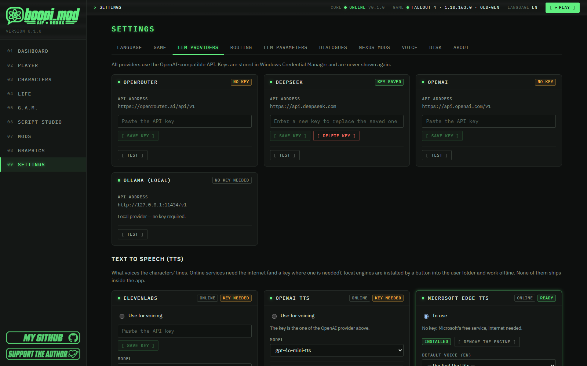
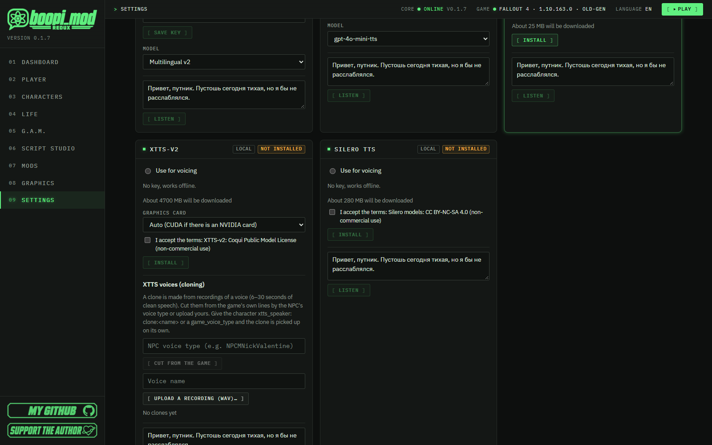
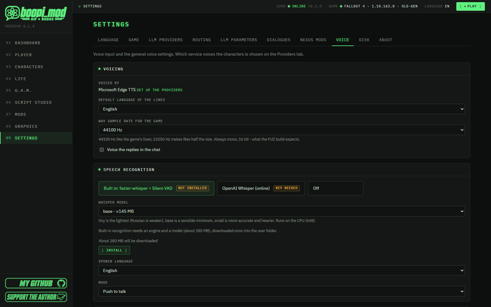

#  Voice: voicing (TTS) and speech recognition (STT)

[🇷🇺 Русский](../VOICE.md) · 🇬🇧 English

[← All guides](README.md) · [← Project home page](../../README.en.md)

> [!NOTE]
> boopi_mod is first of all a **mod manager**: *"Modding has never been this easy."* Voice is a nice addition to what you create in
> it: dialogues in the app and in the game can **sound**, and you can **speak** into a microphone. Everything is optional and
> turned on at your wish.

> ### ⏱ In 1 minute
>
> - **Voicing (TTS)** decides who speaks the lines: online (Edge TTS, ElevenLabs, OpenAI, Higgs TTS 3) or local (XTTS-v2,
>   Silero; Higgs TTS 3 on your own server too).
> - The easiest start is **Microsoft Edge TTS**: free, no key, Russian voices Dmitry and Svetlana.
> - Choose the provider: Settings → LLM providers → the "Text to speech (TTS)" block → **Use for voicing**.
> - **Speech recognition (STT)** — Settings → Voice: built in (faster-whisper) or OpenAI Whisper; in the game, hold **V**.
> - Local engines are not part of the app: they are installed by the **Install** button and work offline. XTTS-v2 and
>   Higgs TTS 3 can **clone a voice**; in the studio the sample of a game NPC's or the hero's voice is cut from the game's lines by
>   itself.
> - XTTS-v2 and Silero have **non-commercial** licences, so they are installed only after your explicit consent.
> - **Lip sync**: whatever is voiced — an AI reply in the game or a line of your studio mod — moves the speaker's lips with the
>   voice. It is boopi_mod's own: nothing to install, no `.lip` files to make.

## Contents

1. [Where voice is used](#1-where-voice-is-used)
2. [Voicing (TTS)](#2-voicing-tts)
3. [Voice cloning (XTTS-v2, Higgs TTS 3)](#3-voice-cloning-xtts-v2-higgs-tts-3)
4. [Speech recognition (STT)](#4-speech-recognition-stt)
5. [Troubleshooting](#5-troubleshooting)
6. [Other guides](#6-other-guides)

---

## 1. Where voice is used

Voice in boopi_mod is used in three places:

- **the chat with a character** in the app — the answers can be voiced;
- **the AI dialogue in the game** ([AI_DIALOGUE.md](AI_DIALOGUE.md)) — the person's answer sounds, and you can speak yourself by holding **V**;
- **the Script studio** — **Voice all** says every line of a dialogue with each speaker's voice, "Voice with AI" says one line
  ([SCRIPT_STUDIO.md](SCRIPT_STUDIO.md), the section about voicing lines).

Nothing heavy ships with the app: online services connect with a key, local engines are installed by a button into the folder
`%APPDATA%\BoopiMod\speech\` and work without a network.

---

## 2. Voicing (TTS)

Settings → LLM providers → the **"Text to speech (TTS)"** block. The provider that has **Use for voicing** set does the voicing.

### 2.1 Choose a provider

| Provider | Where it runs | What you need | Notes |
|---|---|---|---|
| **Microsoft Edge TTS** | online | nothing (no key), internet | Free, Russian voices Dmitry and Svetlana; speed is adjustable in percent. A good start |
| **ElevenLabs** | online | an API key | Voices and models come from your account (Multilingual v2, Turbo, Flash, v3); streaming output |
| **OpenAI TTS** | online | the same key as the OpenAI provider | Models gpt-4o-mini-tts, tts-1, tts-1-hd |
| **Higgs TTS 3** | online (Boson cloud) or your own server | a Boson AI key or your server's address | Preset voices and **voice cloning** from a sample with its text; about a hundred languages (2.6) |
| **XTTS-v2** | local | "Install" (about 4.7 GB), accept the licence | The best quality and **voice cloning**; an NVIDIA graphics card (CUDA) is desirable |
| **Silero TTS** | local | "Install" (about 280 MB), accept the licence | Russian voices, light |

### 2.2 Connect it

1. For an online service paste the key (**Save key**; it is stored in Windows Credential Manager) and press **Check**. Edge TTS
   needs no key.

   

   *Settings → LLM providers: provider keys at the top, the "Text to speech (TTS)" block below. Microsoft Edge TTS is marked "In
   use" — it needs no key. The screenshot is in Russian.*

2. For a local engine press **Install**. The app creates the environment and downloads the model itself; progress is shown. For XTTS
   pick the graphics card ("Auto (CUDA if there is an NVIDIA card)", "CPU only", "Force CUDA") and tick the licence box.

   

   *The local engines XTTS-v2 and Silero TTS: Install, the graphics card choice and the licence box for XTTS, the "XTTS
   voices (cloning)" block. The screenshot is in Russian.*

3. Pick the default voice for Russian and English and press **Listen**.
4. Tick **Use for voicing** — and this provider voices everyone.

> [!IMPORTANT]
> **Engine licences.** XTTS-v2 is distributed under the Coqui Public Model License, Silero under CC BY-NC-SA 4.0: both are
> **non-commercial**. That is why they are not in the archive and are installed only after your explicit consent; Edge TTS
> and Whisper have no such restrictions.

### 2.3 A particular character's voice

Characters → the character → **Profile**: the voice card shows the fields of the chosen provider (ElevenLabs voice, OpenAI voice,
Edge voice, Silero speaker, XTTS speaker). Choose and press **Listen** — the choice is saved in your layer of
edits. If nothing is chosen for the character, the default voice for the language from the provider settings is used.

### 2.4 Voicing in the chat and in the game

- **The chat in the app:** the **Voice the replies** box above the input field (or Settings → Voice → "Voice the replies in the chat");
  a single reply can be voiced with the **Listen** button next to the character's name.
- **The AI dialogue in the game:** Settings → Dialogues → **Voice the replies**. The core gets the answer, synthesises a WAV and
  hands it to the game, which plays it (not positional) — and the person's lips move with it (2.5).
- **WAV sample rate for the game** — 44100 Hz (like the game's lines) or 22050 Hz (half the size). Always mono, 16 bit — that is
  what the studio's voice build expects.

### 2.5 Lip sync

When a voiced line plays in the game, the lips of whoever says it move with the voice:

- **an AI reply** (the AI dialogue, also a free reply in the game's own wheel) — from the moment its sound starts;
- **a line of your studio mod** with a WAV recording (voiced by "Voice all", by "Voice with AI" or recorded by you) — when the
  line begins.

How it works — all of it boopi_mod's own, nothing to install or to make by hand:

1. boopi_mod listens to the recording: where the voice is loud or quiet, where it hisses (s, sh), which vowel it is (a, e, i, o, u
   by the voice's formants).
2. With the text of the line known, its letters (Russian or English) become mouth shapes — closed lips for m, b, p, the lower lip
   for f, v, round lips for o, u, a wide mouth for i, e, the tongue for t, d, l — spread over the time that is actually spoken. If the
   built-in speech recognition (faster-whisper) is installed, the studio also stores the time of every word next to the recording,
   and the words land exactly where they are said.
3. The sounds flow into each other as a living person's do: neighbouring shapes blend (the "t" of "two" is already round - the
   lips get ready for the "oo"), closed lips for m, b, p always meet, even on the briefest sound, and a sound said in an instant
   is only hinted - the mouth does not twitch. The jaw and the lips move at a natural speed, without jitter.
4. The face talks along: the line's emotion (an AI reply's - the one the AI chose; a studio line's - its "Face" field) comes with
   the line and leaves at its end; the loudest syllables lift the brows (an angry person knits them), the brows rise towards the
   end of a question, and the person blinks in the pauses between phrases. Where the face and the lips share the mouth (a smile
   and an "oo"), the lips win.
5. All of it is weights of the face's own morphs (jaw, lips, tongue, brows, lids, cheeks) thirty times a second; `BoopiUI.dll`
   plays them on the speaker's face in the game on top of the person's own expression and blinking.

The curves (how much the sounds blend, the speed of the lips, the emotions' faces, the blinks) live in
`data/speech/lipsync.yaml` - they can be tuned without programming.

> [!NOTE]
> A `.lip` file of your own (made in the Creation Kit or elsewhere) is still welcome but no longer needed: if one lies next to a
> recording, the game uses it instead. A ready **FUZ** carries its own lip sync. Only an **XWM** without a `.lip` keeps the lips still.

Switch it off: `Data\F4SE\Plugins\BoopiUI.ini` → `[Audio]` → `bLipSync=0`.

**A studio line's face.** A greeting, a reply and a hero's choice have a **"Face"** picker next to their voice: calm, warm,
happy, amused, flirty, shy, nervous, sad, angry, afraid, annoyed, suspicious, serious, surprised, disgusted. "From the text"
(the default) lets the face follow the line by itself: a question lifts the brows, so do the loud syllables. In the tree file
it is the line's `emotion:`. The face shows on lines with a WAV recording (our lip sync plays those).

### 2.6 Higgs TTS 3 (Boson AI)

**Higgs TTS 3** is Boson AI's voicing model: preset voices, **cloning from a sample** (a 5–30 second recording and, optionally,
its text — the voice comes out closer with it) and about a hundred languages. The **Higgs TTS 3** card has two options:

- **Boson cloud** — voicing goes through `api.boson.ai`. Paste your own Boson AI key and press **Save key**: it is kept only in
  Windows Credential Manager, never in a file. Preset voices: Oliver, Marcus, Jake, Chloe, Eleanor, Nora. It works under your
  own Boson terms (a new account first claims its trial credit).
- **Own server** — the open model `bosonai/higgs-tts-3-4b` on your computer or your network under **vLLM-Omni** or
  **SGLang-Omni** (an OpenAI-compatible `/v1/audio/speech`). Enter the address (for example `http://127.0.0.1:8095`) and press
  **Save address**; the model may stay empty (the server's own is used), a key only if the server asks for one. "How the voice
  sample is sent": `ref_audio` for vLLM-Omni (as Boson does), `references` for SGLang-Omni on the same computer (the sample goes
  into a temporary file the server reads itself).

The **Test** button really voices a short phrase, so you see at once that the key, address and model are fine. The default voice
for the language is in the list below; the clones `clone:<name>` are there too — the same samples XTTS uses (section 3).

> [!IMPORTANT]
> **The Higgs TTS 3 licence.** The open model is for research and non-commercial use only (Boson Higgs TTS 3 Research and
> Non-Commercial License). Clone only the voices you have the right to. The cloud API is under your own Boson terms. boopi_mod
> distributes none of it: the model and the key are yours.

---

## 3. Voice cloning (XTTS-v2, Higgs TTS 3)

Both "cloning" providers — **XTTS-v2** and **Higgs TTS 3** — speak with the voice of a sample `clone:<name>`: a clean recording
of speech **6–30 seconds** long. The samples are shared by both and live in `%APPDATA%\BoopiMod\speech\voices\<name>\`.
There are three sources:

1. **By itself, in the studio.** When the studio voices the lines of a game NPC (Piper, Nick, Cait, a settler…) or of the hero
   with a cloning provider, the sample is picked by itself: the speaker's voice type comes from the NPC record in your load order
   (for a boopi_mod character with a `game_voice_type` — from its card; for the hero — the player's voice of the hero's sex), a
   sample is cut from that type's lines and kept — it is not cut again. Details in [SCRIPT_STUDIO.md](SCRIPT_STUDIO.md),
   section 6.1.
2. **Cut from the game by hand.** In the "Voice samples" block enter an **NPC voice type** (for example `NPCMNickValentine`) and
   press **Cut from the game**.
3. **Your own recording.** Enter a voice name and press **Upload a recording (WAV)…**; for Higgs you can type what the recording
   says, word for word (**Save text**).

How a sample is cut: lines of that type of 2–17 seconds each are taken from the game's voice archives until about 15 seconds
(at most 30) are there. When the game's strings have the subtitles of these lines, only lines with a clean text (no stage
directions) are taken and the text of each is kept next to it — Higgs gets it together with the sample. The game's sound is
decoded by an installed XTTS-v2, or without it by the Creation Kit's `xWMAEncode.exe` (`Tools\Audio` in the game folder).
Whether a sample is "with text" or "no text" shows in the list.

To make a character always speak with a clone, put the XTTS speaker or the Higgs voice `clone:<name>` in the voice card; if the
character has a `game_voice_type`, the clone is picked up by itself.

> [!WARNING]
> Clone only the voices you have the right to. The game's lines are used as a sample for personal use on your computer; they are
> not copied into the distribution. The samples stay in `%APPDATA%\BoopiMod\speech\voices` and never go into the mod you build.

---

## 4. Speech recognition (STT)

Settings → Voice → the **"Speech recognition"** block.

*Settings → Voice: the WAV sample rate, voicing in the chat and the "Speech recognition" block — built in, OpenAI Whisper or off. The
screenshot is in Russian.*

### 4.1 Options

| Option | Notes |
|---|---|
| **Built in: faster-whisper + Silero VAD** | Runs on the CPU (int8), no network. Needs an engine and a model — the **Install** button (about 280 MB), downloaded once |
| **OpenAI Whisper (online)** | Needs an OpenAI key; the recording goes to the service |
| **Off** | Voice input does not work |

### 4.2 Parameters

- **Whisper model:** `tiny` (≈75 MB, the lightest, Russian is weaker), `base` (≈145 MB, a sensible minimum), `small` (≈480 MB, more
  accurate and heavier).
- **Spoken language:** Russian or English.
- **Mode:** "Push to talk" — the microphone listens while the key is held; "Always listen (Silero VAD)" — phrases are
  picked out by themselves. In the game the push-to-talk mode works.
- **Test the microphone → Record 5 seconds:** the app records a few seconds and shows what was recognised. The microphone is
  opened only for that time.

### 4.3 Voice input in the game

Hold **V** (the key can be changed in `Data\F4SE\Plugins\BoopiUI.ini`, `iPushToTalk` — a Windows key code), speak and release.
The text appears in the input line; **Enter** sends it (`bAutoSend=1` sends at once). The recording lasts up to 30 seconds
(`iMaxSeconds`).

> [!TIP]
> Press "Record 5 seconds" in the app first: it quickly shows whether the app sees your microphone.

---

## 5. Troubleshooting

| What you see | What to do |
|---|---|
| "The engine is not installed" | Press "Install" on the provider (or on recognition) |
| "The voice or model is not downloaded" | Download a Silero or a Whisper model in the provider block |
| "You need to accept the licence terms" | Tick the XTTS or Silero terms box and repeat the install |
| "The provider's API key is not set" | Paste the provider's key and press "Save key" |
| Higgs: "Nothing answers at this Higgs server address" / "no /v1/audio/speech" | Start your server (vLLM-Omni, SGLang-Omni) and check the address: just `http://host:port` |
| Higgs: "Boson refused the request for payment reasons" | Claim the trial credit or top up at boson.ai |
| "This voice has no sample" / "needs XTTS-v2 or xWMAEncode" | Cut a sample from the game or upload your own recording; cutting needs XTTS-v2 or the Creation Kit (`Tools\Audio\xwmaencode.exe`) |
| "Speech recognition is off" | Settings → Voice: choose built-in recognition or OpenAI Whisper |
| No sound in the game | Settings → Dialogues → "Voice the replies"; in `BoopiUI.ini` `bPlayReply=1`; check "Listen" on the provider |
| The voice plays but the lips stay still | `BoopiUI.ini` `bLipSync=1`; a studio line needs a WAV recording and "To the game" after it was voiced; `BoopiUI.log` says `face: ... speaks` when a track plays |
| V records nothing | Settings → Voice: is recognition installed, "Test the microphone"; "No microphone found" — choose the default recording device in Windows |
| Little disk space | Settings → Disk: speech engines and models can be deleted and installed again |

The messages above are paraphrased from the app's Russian interface.

Installs run through the app's job manager: progress is visible in the provider block, and on failure the reason is shown in the
same place. Speech data lives in `%APPDATA%\BoopiMod\speech\` (engine environments, models, cloned voices).

> [!TIP]
> **Feedback wanted — report problems and ideas, we'll fix them.** Open an issue at
> [github.com/boopi-coder/boopi_mod/issues/new](https://github.com/boopi-coder/boopi_mod/issues/new) and attach fresh logs from
> `%APPDATA%\BoopiMod\logs\`.

---

## 6. Other guides

| Guide | What it is about |
|---|---|
| [SCRIPT_STUDIO.md](SCRIPT_STUDIO.md) | Script studio: your own dialogues, voicing lines, your own mod |
| [ANIMATION_IMPORT.md](ANIMATION_IMPORT.md) | Importing animations and your own scenes in the G.A.M. editor |
| [ANIMATION_GUIDE.md](ANIMATION_GUIDE.md) | Animations in mods: gesture and scene, camera, calling from dialogues and scripts |
| [AI_DIALOGUE.md](AI_DIALOGUE.md) | AI dialogue in the game |
| [VOICE.md](VOICE.md) | Voicing (TTS) and speech recognition (STT) (you are here) |

[← All guides](README.md) · [← Project home page](../../README.en.md)
